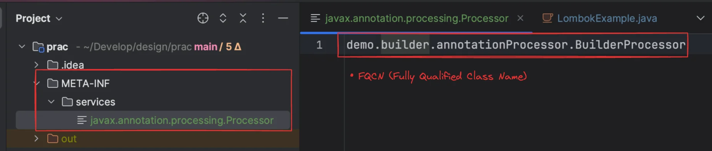
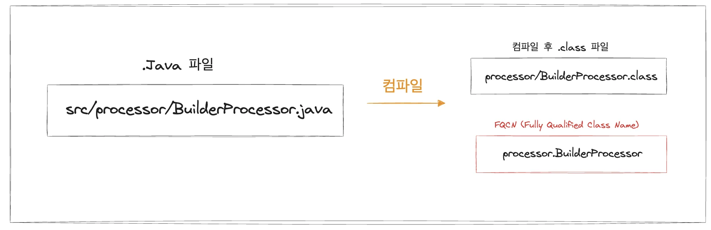

<details>
<summary>Lombok의 <code>&#64;Builder</code></summary>

<a id="1c4eda9b0fe1802ca464fe6c12edf7c5"></a>

```java
@Target({TYPE, METHOD, CONSTRUCTOR})
@Retention(SOURCE)
public @interface Builder {
	
	@Target(FIELD)
	@Retention(SOURCE)
	public @interface Default {}
	
	String builderMethodName() default "builder";
	
	String buildMethodName() default "build";
	
	String builderClassName() default "";
	
	boolean toBuilder() default false;
	
	AccessLevel access() default lombok.AccessLevel.PUBLIC;

	String setterPrefix() default "";
	
	
	@Target({FIELD, PARAMETER})
	@Retention(SOURCE)
	public @interface ObtainVia {
	
		String field() default "";
		
		
		String method() default "";
		
		boolean isStatic() default false;
	}
}
```

</details>

<details>
<summary><strong>🧐  </strong><strong><code>&#64;Target</code></strong><strong>, </strong><strong><code>&#64;Retention</code></strong><strong>의 의미</strong></summary>

---

<a id="1c4eda9b0fe180449361f2f53eeec71a"></a>

```java
@Target({TYPE, METHOD, CONSTRUCTOR})
@Retention(SOURCE)
public @interface Builder { 
}
```

<a id="1c4eda9b0fe180a08f1cffaa4acef55d"></a>

### <strong><code>&#64;Target</code></strong>

---

> ✏️ 
> 
> <a id="1c4eda9b0fe18031820be942a8f45c88"></a>
> 
> 해당 애노테이션의 <strong><u>사용 범위</u></strong>를 <strong>정의한다&#46;</strong>

| <strong>값</strong> | <strong>의미</strong> |
| --- | --- |
| <code>TYPE</code> | <strong><u>클래스, 인터페이스, 열거형</u></strong> 등에 사용 가능 |
| <code>METHOD</code> | <strong><u>메서드</u></strong>에 사용 가능 |
| <code>CONSTRUCTOR</code> | <strong><u>생성자</u></strong>에 사용 가능 |

<details>
<summary>ex) <code>&#64;Target({TYPE, METHOD, CONSTRUCTOR})</code></summary>

- &#91; 클래스, 메서드, 생성자 &#93;에 사용 가능

</details>

<a id="1c4eda9b0fe180d0abdfde1bd2f0acb1"></a>

자바 컴파일 타임 애노테이션 프로세싱(Annotation Processing)

<a id="1c4eda9b0fe1806dafced43539efe5db"></a>

### <strong><code>&#64;Retention</code></strong>

> ✏️ 
> 
> <a id="1c4eda9b0fe180efb99ffc77d5329d65"></a>
> 
> 해당 애노테이션이 <strong><u>언제까지 살아있</u></strong>는지를 지정한다&#46;

| <strong>값</strong> | <strong>의미</strong> |
| --- | --- |
| <code>SOURCE</code> | 컴파일러가 컴파일할 때까지만 존재하고, class 파일에는 포함되지 않음 (리플렉션으로 접근 불가) |
| <code>CLASS</code> | class 파일에 존재하지만 JVM에서 사용되지 않음 |
| <code>RUNTIME</code> | 런타임에도 남아있어서 <strong>리플렉션으로 접근 가능</strong>함 ✅ |

<details>
<summary>ex) </summary>

- <code>&#64;Retention(RetentionPolicy&#46;SOURCE)</code>
    - 컴파일러가 컴파일할 떄까지만 존재한다&#46; 

    - class 파일에는 포함되지 않음
        <a id="1c4eda9b0fe180a69d5be180b367d8bd"></a>

        → 리플랙션으로 접근 불가

    - 자바 컴파일 타임 애노테이션 프로세싱(<code>Annotation Processing</code>) 이라 한다&#46;

- <strong><code>&#64;Retention(RetentionPolicy&#46;RUNTIME)</code></strong>
    - 런타임 환경까지 살아있어, 리플랙션으로 접근 가능

</details>

</details>

<a id="1c4eda9b0fe180f7823bfb6fa54ae66c"></a>

## <code>&#64;Builder</code> 구현

---

<a id="1c4eda9b0fe180ddb65cc636126761ef"></a>

### 1&#46; 리플랙션을 사용한 구현 

<a id="1c4eda9b0fe1800599d5d0aa0e22389a"></a>

### 2&#46;  <strong>Annotation Processor(컴파일 타임) 구현</strong>

<details>
<summary>커스텀한 Processor 컴파일러에 등록하기</summary>

<details>
<summary>🧐 왜 META&#45;INF/services 하위에 Processer를 명시하는가?</summary>

<a id="1c4eda9b0fe180d0934ffbf13e1409d4"></a>

Java의 SPI ( Service Provide Interface) 규약 떄문이다&#46; 

<a id="1c4eda9b0fe1809e97f9e5a0d80acfa9"></a>

자바 컴파일러(javac)가 Annotation Processor를 자동 인식하려면, <br><code>META&#45;INF/services/javax&#46;annotation&#46;processing&#46;Processor</code>파일을 찾아서 

<a id="1c4eda9b0fe180e7b114dfda8b87d2ee"></a>

거기에 적힌 클래스를 Processor 구현체로 로드한다&#46;

<a id="1c4eda9b0fe1802e8045d030d60c3572"></a>

만약 해당 파일을 정의하지 않으면, javac(자바 컴파일러)는 커스텀한 Processor를 인식하지 못해 작동되지 못한다&#46;

- 추가 팁
    - 해당 등록 파일은 jar로 묶을 때도 함께 포함되어야 한다&#46;
        <a id="1c4eda9b0fe180e3aeb9db8b439a1ce2"></a>

        ```java
        jar cf builder-processor.jar -C out . -C META-INF/services javax.annotation.processing.Processor
        ```

</details>

<a id="1c4eda9b0fe18063996afa3b77e04968"></a>

```java
project-root/
├── src/ 
│   └──  ...
│
├── META-INF/
│   └── services/
│       └── javax.annotation.processing.Processor  ← ✅ 여기 이 파일
```



<details>
<summary>ex) Fully Qualified Class Name (FQCN) </summary>



</details>

</details>
