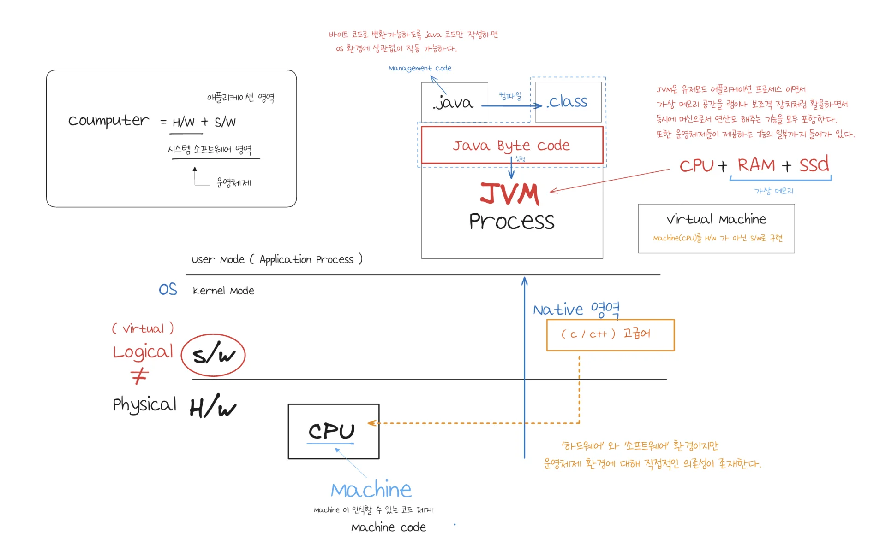
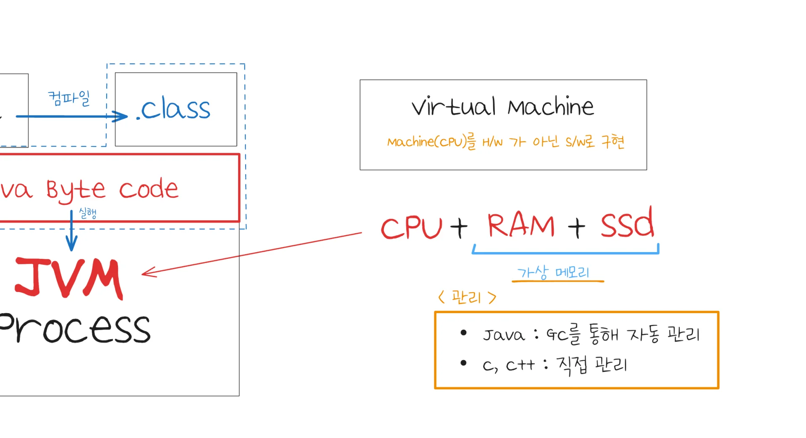
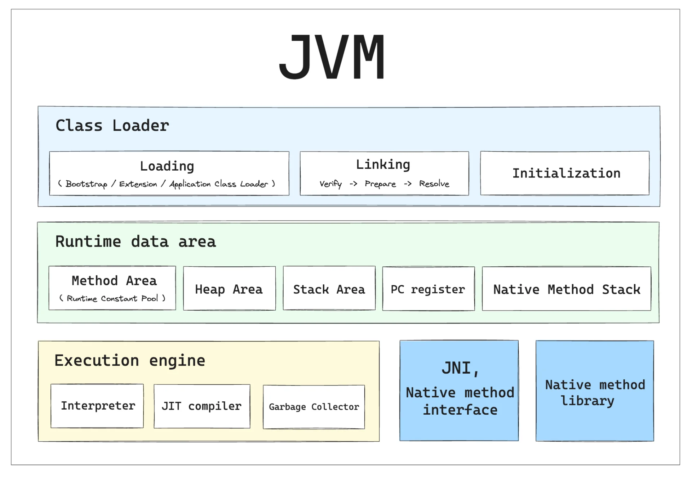
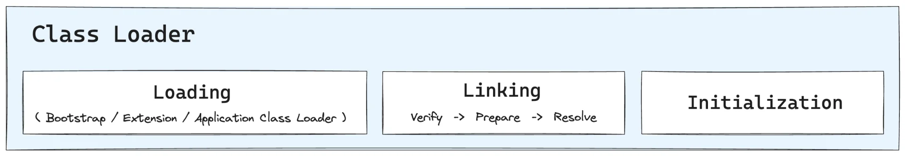
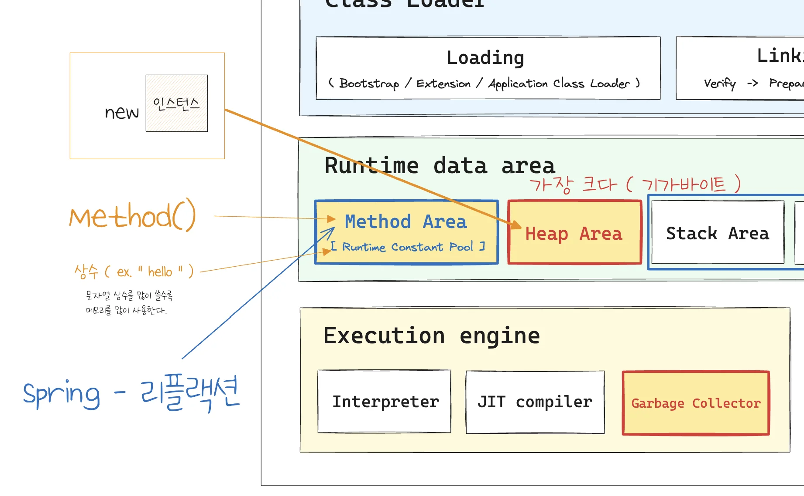
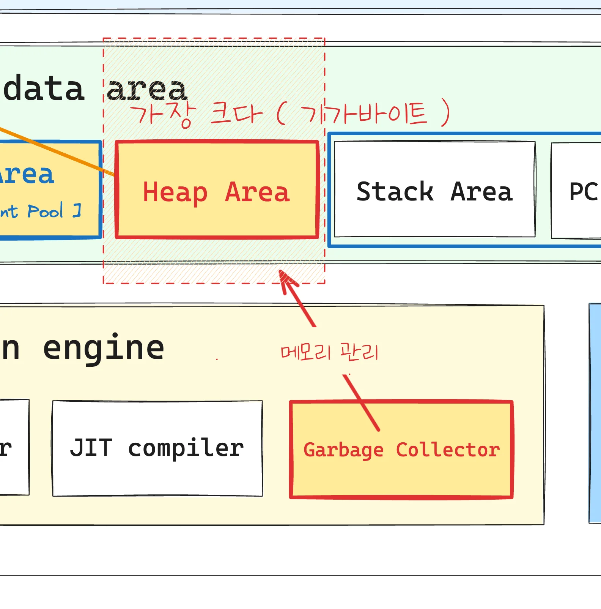
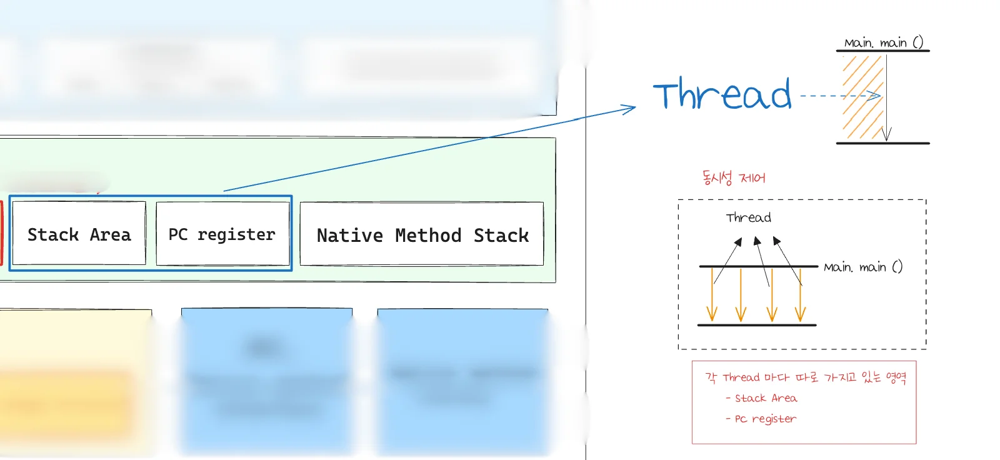
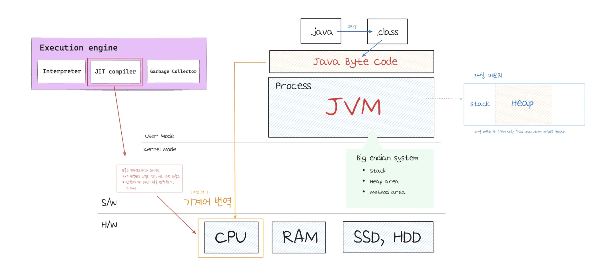

> 💬 
> 
> 
> 
> s&#46;w 운영 시, 장애 상활이 발생된다&#46; 
> 
> 
> 
> 이런 장애에 대한 대응이 필요한데, 그러다보면 JVM에 대한 깊은 이해가 필요하다 
> 
> ---
> 
> 
> 
> 미리 선행되어야 하는 개념
> 
> - 운영체제
> 
> - 가상 메모리 
>     - JVM&#58; Java Virtual Machine

## Java 와 C&#43;&#43; 메모리 관리 차이 

---

- OS 와 컴퓨터 구조론 에 대한 부분을 더해서 C, C&#43;&#43;로 구현하면 JVM 이 된다&#46; 

- 윈도우에서 개발하고 윈도우 환경에 특수화된 어떤 C 나 C&#43;&#43; 코드가 있다면 그걸 리눅스나 유닉스로 바로 옮기지 못한다&#46;

🧐 JVM은 가상 머신으로 h/w적인 부분과 OS에 대한 기능 일부를 포함한다&#46; 그렇다면 만약 프로그램을 잘못 만들어서 오류가 발생되었을 때, 운영체제가 다운될 수 있는가?

아니다&#46; 자바는 JVM 영역을 벗어나지 못한다&#46; 

- JNI ( Java Native Interface )를 사용한다면 가능하다&#46;

기본적으로 가상 머신 형태이기 때문에 애플리케이션 하나에서 문제가 발생된다 해도 OS가 다운되는 일은 발생되지 않는다&#46;

가상 머신에서 의도적으로 운영체제를 공격할 수 있지만, 이것도 상당 부분 무력화 된다&#46;

보안점 장점이 명확하다&#46;

### Java, C&#43;&#43; 메모리 관리 차이

> C&#43;&#43; 와 Java는 메모리 관리 체계가 매우 다르다&#46;

| 구분 | <strong><code>C&#43;&#43;</code></strong> | <strong><code>Java</code></strong> |
| --- | --- | --- |
| 설명 | &#45; 객체에 대한 모든 관리 책임은 개발자에게 있다&#46;     •  소유권    •  메모리 할당 및 해제  &#45; 객체의 생명 주기에 모두 개입하는 구조 | &#45; 개체 메모리 해제는 전적으로 JVM 몫이다&#46;    •  개발자에게는 소유권도 책임도 없다&#46;  &#45; <strong>문제 발생 시 구조를 알아야 대응이 가능하다&#46;</strong>   &#45; JVM을 사용하여 관리가 되기 때문에  <strong><u>성능 면에서 약간 떨어진다&#46;</u></strong>  |

## JVM 구성 요소

> ✏️ 
> 
> 
> 
> Point 
> 
> 1. 클래스 로더
> 
> 1. 운영 관점에서 힙 영역을 관리하는 GC 인스턴스 회수 원리
> 
> 1. STW ( Stop The World )

### 1&#46; 클래스 로더

> ✏️ 
> 
> 
> 
> <strong>클래스 로더 ( Class Loader )</strong>
> 
> ---
> 
> 
> 
> 
> 
> 이름을 알고 있는 특정 클래스에 대한 정의(Byte stream)를 가져오는 역할 수행
> 
> 

> 
<strong><code>부트스트랩 클래스 로더</code></strong>

> 
> - JVM에서 라이브러리로 취급(<strong><code>rt&#46;jar</code></strong>, <strong><code>tools&#46;jar</code></strong>)되는 것들을 로드
>     - 핫스팟에서는 C&#43;&#43;로 구현
> 
> 

> 
> 

> 
<strong><code>플랫폼 클래스 로더</code></strong> ( 기존 확장 클래스 로더 )

> 
> - 클래스 라이브러리 로드 
> 
> 

> 
> 

> 
<strong><code>애플리케이션 클래스 로더</code></strong>

> 
> - <code>sum&#46;misc&#46;Launcher&#36;AppClassLoader</code>를  의미
> 
> 

class loader &#45; java로도 개발 가능

리버스 엔지니어링 

### 1&#46; <code>&#46;class</code> file 구조

### 클래스 로더 별 담당 모듈 ( 일부 )

| Bootstrap | Platform | Application |  |
| --- | --- | --- | --- |
| • java&#46;base • java&#46;desktop • java&#46;logging • java&#46;naming • java&#46;net • java&#46;sctp | • java&#46;compiler&#42; • java&#46;corbar&#42; • java&#46;sql • java&#46;charset • java&#46;jsobject • java&#46;security&#46;auth • java&#46;xml&#46;dom | • jdk&#46;compiler • jdk&#46;hotspot&#46;agent • jdk&#46;jartool • jdk&#46;jcmd • jdk&#46;jshell • jdk&#46;pack |  |

### Java 클래스 로딩

### 2&#46;  Runtime data area

Methode Area

1. <strong><u>클래스, 메서드</u></strong>에 대한 메타 정보가 저장된다&#46; 
    - 해당 내용을 통해 Heap 영역에 인스턴스를 생성한다&#46; 

1. 상수 ( Constant )
    - Method Area 내부의 Rutime Constant Pool 에 저장된다&#46; 

    - 메타 정보로써 메모리를 차지하기 때문에, 많이 사용될 수록 메모리 공간을 많이 잡아먹는다&#46; 

Heap Area

- new 를 사용하여 생성한 객체가 담긴다&#46;  ( 인스턴스 )

- 메모리 관리를 Garbage Collector가 자동으로 해준다&#46; 
    

Stack Area

PC register

Thread

- Main&#46;main() 로 부터 시작하여 엔드포인트 끝까지 하나의 쓰레드가 처리한다&#46; 

- 각 쓰레드마다 Stack Area, PC register를 가진다&#46;

### 3&#46; Excution engine

- JIT compiler
    - 기계어 번역 &#45; 캐싱 

1&#46; 클래스 로더 &#45; 3 요소

JVM을 활용하는 머신의 강력한 중추적 역할을 한다&#46; 

- 굉장히 확장성이 뛰어나다&#46;

클래스 파일이 파일로 디스크 상에 저장되어 있다&#46; 

해당 내용을 네트워크에서 읽어오는 것이 가능하다&#46; 

런타임 환경에서 로딩하는 식으로 코드 개발 가능  &#45; 리플랙션에 대한 내용 같은데

이런 기능을 가능하게 하는 것이 클래스 로더이다&#46; 

