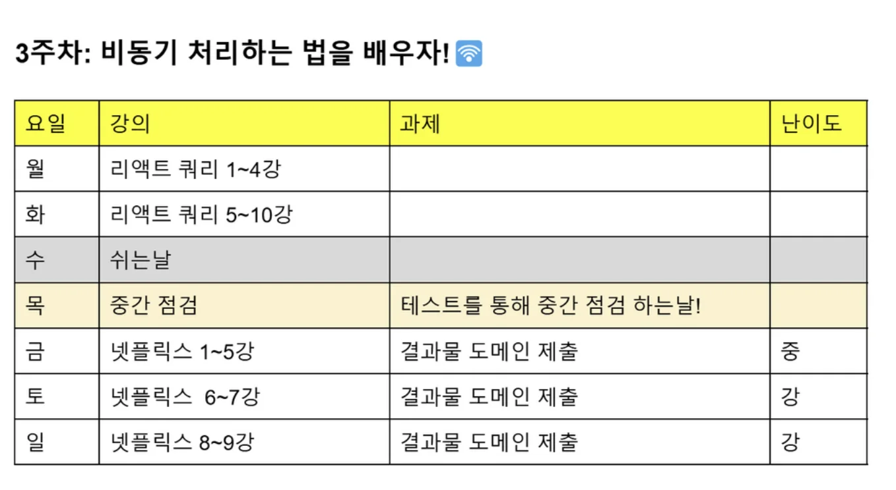
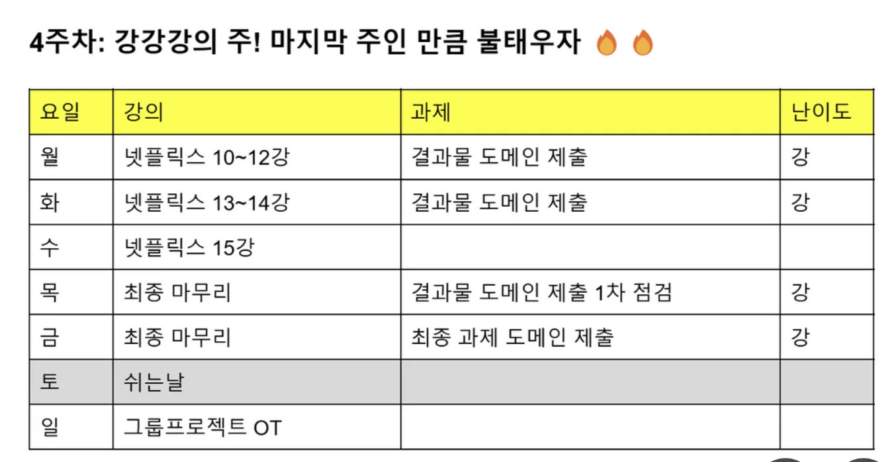

> /icons/circle-dot_green.svg 
> 
> 
> 
> 리액트 스터디 과제 4
> 
> - 기간&#58; 25&#46;4&#46;18(금) &#126; 25&#46;4&#46;25(금)
>     

>     
일정

> 
>     
> 
>     
> 
>     

### Github

### Notes

### Reference

‣

‣

‣

‣

‣

카드

‣

영화 노이즈 ‣

글자 이펙트

‣

3D

‣
