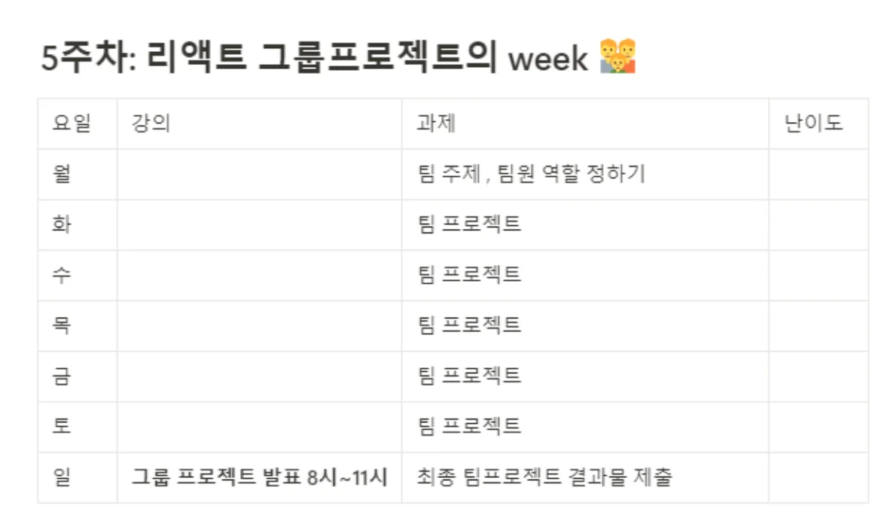

> /icons/circle-dot_green.svg 
> 
> 
> 
> 리액트 스터디 과제 5
> 
> - 기간&#58; 25&#46;4&#46;28(월) &#126; 25&#46;5&#46;3(토)
> 
> - 발표&#58; 25&#46;05&#46;04 &#45; 8시 &#126; 11시
> 
> 

> 
일정

> 
> 
> 
> 

### Github

### Notes

### Reference
