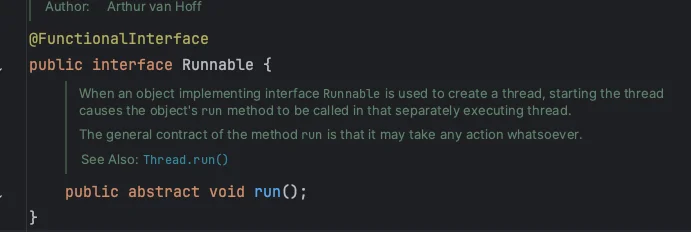
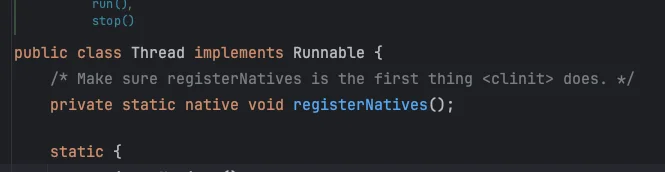

<a id="1ceeda9b0fe180eda830c2a08c60bcf6"></a>

## Thread, Runable

---

> 📖 
> 
> <a id="1ceeda9b0fe180c794fdcc2770138e76"></a>
> 
> 자바에서 쓰레드를 구현하고 실행하는 방법에 대해서 학습한다&#46;
> 
> 1. Thead  상속 ( <code>extends</code> )
> 
> 1. Runable 구현 ( <code>implements</code> )  → <code>new Thead( Runnable 구현체 )</code>

<details>
<summary>Thread</summary>

> ✏️ 
> 
> <a id="1ceeda9b0fe1806da3f8fa9f2a020661"></a>
> 
> Java에서 제공하는 Thread 클래스를 상속 받아 쓰레드를 구현한다&#46;

<a id="1ceeda9b0fe18053ad37c527d0e4a1f0"></a>

```java
public class TestTread extends Thread {

		@Override
		public void run() {
				// 쓰레드 수행 작업
		}
}

...

TestThread thread = new TestThread();  // 쓰레드 생성
thread.start() // 쓰레드 실행
```

- Thread 클래스를 상속하고 <code>run()</code> 오버라이딩하여 해당 쓰레드의 수행 작업을 정의할 수 있다&#46;

- 해당 쓰레드 인스턴스 생성 후, <code>start()</code>를  통해 쓰레드 실행이 가능하다&#46;

<details>
<summary>ex)</summary>

<a id="1ceeda9b0fe180ae9d36c5b7a28bf24c"></a>

```java
public class Main {
    public static void main(String[] args) {
        TestThread thread = new TestThread();
        thread.start();
    }
}

class TestThread extends Thread {
    @Override
    public void run() {
        for (int i = 0; i <100; i++) {
            System.out.print("*");
        }
    }
}
```

<a id="1ceeda9b0fe180beb8d8f1f4b97f6ce2"></a>

실행 결과

<a id="1ceeda9b0fe180e6b984fe49c0416412"></a>

```java
// thread.start();
***************************************... // * x 100
```

</details>

</details>

<details>
<summary>Runnable</summary>

> ✏️ 
> 
> <a id="1ceeda9b0fe1803b8f9ccc66696f06c9"></a>
> 
> Java에서 제공하는 Runable 인터페이스를 사용하여 쓰레드를 구현할 수 있다&#46;
> 
> <details>
> <summary>직접 정의한 Runnable 구현체를 사용하여 쓰레드 생성하고 실행한다&#46;</summary>
> 
> <a id="1ceeda9b0fe180eb8825f60b241fce15"></a>
> 
> ```java
> Runnable run = new TestRunnable();  // Runnable 구현체 생성
> Thread thread = new Thread(run);   // 직접 정의한 Runnable 구현체를 사용하여 쓰레드 생성
> thread.start();  // 쓰레드 실행
> ```
> 
> </details>

<a id="1ceeda9b0fe180ed9510ef0a0d5b210e"></a>

```java
public class TestRunnable implements Runnable {

		@Override
		public void run() {
					// 쓰레드 수행 작업
		}
}

...

Runnable run = new TestRunnable();
Thread thread = new Thread(run);   // 쓰레드 생성

thread.start();  // 쓰레드 실행
```

<details>
<summary>ex)</summary>

<a id="1ceeda9b0fe180d8b90bd126a54dc3b3"></a>

```java
public class Main {
    public static void main(String[] args) {

        Runnable run = new TestRunnable();
        Thread thread = new Thread(run);   // 직접 정의한 Runnable 구현체를 사용하여 쓰레드 생성

        thread.start();
    }
}

class TestRunnable implements Runnable {
    @Override
    public void run() {
        for (int i = 0; i <100; i++) {
            System.out.print("$");
        }
    }
}
```

</details>





- Thead 클래스는Runnable를 구현하는 구현체이다&#46; 

- 따라서 <code>Runnable</code>을 직접 구현하여 쓰레드를 구현하는 경우, <u>동일하게 </u><strong><u>run()</u></strong><strong> </strong>을<u> 오버라이딩</u> 하여 쓰레드의 수행 동작을 정의한다&#46;

> 🧐 
> 
> <a id="1ceeda9b0fe180d9ad31c685008c2a68"></a>
> 
> 왜 구체적인 Thread를 상속하지 않고 인터페이스인 Runnable을 직접 구현하는가?
> 
> ---
> 
> <a id="1ceeda9b0fe1805f909fd515219d93b1"></a>
> 
> 자바는 다중 상속을 지원하지 않는다&#46; 따라서 Thead를 상속 받아 처리하는 경우 확장성이 매우 떨어진다&#46; 
> 
> <a id="1ceeda9b0fe180d69976c164a4b5cf17"></a>
> 
> Runnable은 인터페이스이기 때문에, 다른 필요한 클래스를 상속 받을 수 있다&#46; 따라서 확장성에 매우 유리하다&#46;

</details>

<details>
<summary>람다식</summary>

> ✏️ 
> 
> <a id="1ceeda9b0fe1801fbdefdb42bdf67d7d"></a>
> 
> <strong><u>Runnable 인터페이스 &#43; 람다식</u></strong>  → 쓰레드 구현
> 
> - <code>run()</code> 메서드에 작성했던 쓰레드가 수행할 작업을 실행 블록 { } 안에 작성
> 
> - <code>setName()</code> 를 통해  쓰레드에 이름을 부여 가능
> 
> - <code>Thread&#46;currentThread()&#46;getName()</code> 은 현재 실행 중인 쓰레드의 이름을 반환함

<a id="1ceeda9b0fe1809fb783d0d4bb64710b"></a>

```java
public class Main {
    public static void main(String[] args) {
        Runnable task = () -> {
            int sum = 0;
            for (int i = 0; i < 50; i++) {
                sum += i;
                System.out.println(sum);
            }
            System.out.println(Thread.currentThread().getName() + " 최종 합 : " + sum);
        };

        Thread thread1 = new Thread(task);
        thread1.setName("thread1");
        Thread thread2 = new Thread(task);
        thread2.setName("thread2");

        thread1.start();
        thread2.start();
    }
}
```

</details>

<details>
<summary>실습</summary>

<details>
<summary>싱글 쓰레드</summary>

<a id="1ceeda9b0fe1803e8bd5cf98d5a4ac19"></a>

```java
public class Main {
    public static void main(String[] args) {
        Runnable task = () -> {
            for (int i = 0; i < 100; i++) {
                System.out.print("$");
            }
        };


        Thread thread1 = new Thread(task);
        thread1.setName("thread1");

        thread1.start();
    }
}
```

<a id="1ceeda9b0fe18027af2ce45f903d57e6"></a>

실행 결과

<a id="1ceeda9b0fe180b7a563cdbf9182a3e1"></a>

```java
$$$$$$$$$$$$$$$$$... // $ x 100
```

</details>

<details>
<summary>멀티 쓰레드</summary>

<a id="1ceeda9b0fe1803b9ff7c52aa44fa930"></a>

```java
public class Main {
    public static void main(String[] args) {
        Runnable task = () -> {
            for (int i = 0; i < 100; i++) {
                System.out.print("$");
            }
        };
        Runnable task2 = () -> {
            for (int i = 0; i < 100; i++) {
                System.out.print("*");
            }
        };


        Thread thread1 = new Thread(task);
        thread1.setName("thread1");
        Thread thread2 = new Thread(task2);
        thread2.setName("thread2");

        thread1.start();
        thread2.start();
    }
}
```

- 메인 쓰레드에서 멀티 쓰레드로 여러 개의 작업 실행 
    - &#36; 와 &#42; 이 순서가 일정하지 않게 출력됨&#92;

- 여러 번 실행해서 보면 순서가 정해져 있지 않아 출력의 형태가 계속해서 변화하는 것을 확인할 수 있음
    - 2개의 쓰레드는 서로 번갈아가면서 수행

    - 두 쓰레드의 실행 순서나 걸리는 시간은 OS의 스케줄러가 처리하기 때문에 알 수 없다&#46;

<a id="1ceeda9b0fe1807b8a50c11391c703e9"></a>

실행 결과

<a id="1ceeda9b0fe180f1a005c7a04f129c2c"></a>

```java
$$$$$$***$$$**$$$$***$$$$... // $, * x 100, 순서는 매번 다름
```

</details>

</details>
