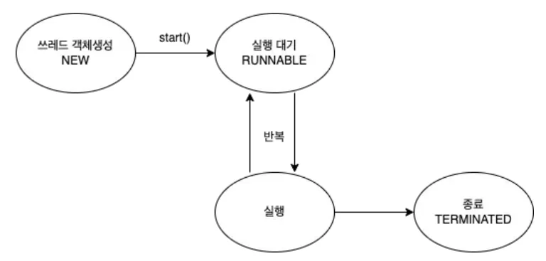
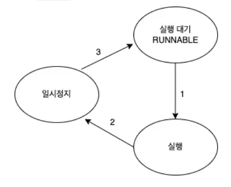
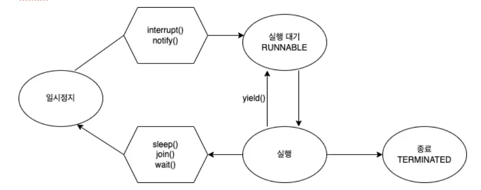

<a id="1ceeda9b0fe180909e00d443e57553ef"></a>

## 쓰레드 상태, 제어

---

> 📖 
> 
> <a id="1ceeda9b0fe1805597d3fbcf8e0a93f3"></a>
> 
> 동영상이나 음악을 들을 때 일시정지 후 다시 보거나 들을 수 있고, 중간에 종료할 수 있다&#46;
> 
> <a id="1ceeda9b0fe1809ab5eac96f10497d6b"></a>
> 
> 이와 같이 <code>쓰레드</code>도 <strong><u>상태가 존재</u></strong>하고 이를 <strong><u>제어할 수 있</u></strong>다&#46;

<details>
<summary>쓰레드 상태</summary>

| 상태 | Enum | 설명 |
| --- | --- | --- |
| 객체생성 | <code>NEW</code> | 쓰레드 객체 생성, 아직 start() 메서드 호출 전의 상태 |
| 실행대기 | <code>RUNNABLE</code> | 실행 상태로 언제든지 갈 수 있는 상태 |
| 일시정지 | <code>WAITING</code> | 다른 쓰레드가 통지(notify) 할 때까지 기다리는 상태 |
| 일시정지 | <code>TIMED&#95;WAITING</code> | 주어진 시간 동안 기다리는 상태 |
| 일시정지 | <code>BLOCKED</code> | 사용하고자 하는 객체의 Lock이 풀릴 때까지 기다리는 상태 |
| 종료 | <code>TERMINATED</code> | 쓰레드의 작업이 종료된 상태 |



-  쓰레드는 실행과 대기를 반복하며 <code>run()</code> 메서드를 수행한다&#46;

- <code>run()</code> 메서드가 종료되면 실행이 멈춘다&#46;



- 음악을 듣다 일시정지를 하는 것과 마찬가지로 쓰레드도 일시정지 상태를 만들 수 있다&#46;

- 일시정지 상태에서는 쓰레드를 실행할 수 없다&#46;

- 쓰레드가다시 실행 상태로 넘어가기 위해서는 <strong><u>실행 대기 상태로 넘어간 후 가능</u></strong>하다&#46;
    - 일시정지 → 실행 대기  → 실행

</details>

<a id="1ceeda9b0fe180bf8f8bd6609016b450"></a>

### 쓰레드 제어



<details>
<summary><strong><code>sleep()</code></strong><strong>, </strong><strong><code>interrupt()</code></strong></summary>

<details>
<summary><code>sleep()</code></summary>

> ✏️ 
> 
> <a id="1ceeda9b0fe180dcaedeccf8ac69180a"></a>
> 
> 현재 쓰레드 지정된 시간 동안 멈추게 한다&#46;
> 
> - <code>sleep()</code>은 쓰레드 자기 자신에 대해서만 멈출 수 있다&#46;

<details>
<summary>사용 방법</summary>

<a id="1ceeda9b0fe1801680baf50eb2df8a7d"></a>

```java
try {
    Thread.sleep(2000); // 2초
} catch (InterruptedException e) {
    e.printStackTrace();
}
```

- <code>Thread&#46;sleep(ms);</code> ms(밀리초) 단위로 설정

- 예외 처리 필요
    - sleep 상태에 있는 동안 <code>interrupt()</code>를 만나면 다시 실행되기 때문에 InterruptedException이 발생할 수 있다&#46;

- 특정 쓰레드를 지목해서 멈추게 하는 것은 불가능하다&#46;
    <a id="1ceeda9b0fe1808ebad7d1f215e19cbc"></a>

    ```java
    public class Main {
        public static void main(String[] args) {
            Runnable task = () -> {
                try {
                    Thread.sleep(2000);
                } catch (InterruptedException e) {
                    e.printStackTrace();
                }
                System.out.println("task : " + Thread.currentThread().getName());
            };

            Thread thread = new Thread(task, "Thread");
            thread.start();

            try {
                thread.sleep(1000);  // 쓰레드 지목 불가능
                System.out.println("sleep(1000) : " + Thread.currentThread().getName());
            } catch (InterruptedException e) {
                e.printStackTrace();
            }
        }
    }
    ```

</details>

</details>

<details>
<summary><code>interrupt()</code></summary>

> ✏️ 
> 
> <a id="1ceeda9b0fe180b7b389cf2019810bc4"></a>
> 
> 일시정지 상태인 쓰레드를 실행 대기 상태로 만든다&#46;

<details>
<summary><code>interrupt()</code></summary>

<details>
<summary>Thread 클래스</summary>

<a id="1ceeda9b0fe180349cc7da0c3894687d"></a>

```java
public class Thread implements Runnable {
    /* Make sure registerNatives is the first thing <clinit> does. */
    private static native void registerNatives();
    static {
        registerNatives();
    }

    private volatile String name;
    private int priority;

    /* Whether or not the thread is a daemon thread. */
    private boolean daemon = false;

    /* Interrupt state of the thread - read/written directly by JVM */
    private volatile boolean interrupted;
	
		...

		public void interrupt() {
        if (this != Thread.currentThread()) {
            checkAccess();

            // thread may be blocked in an I/O operation
            synchronized (blockerLock) {
                Interruptible b = blocker;
                if (b != null) {
                    interrupted = true;
                    interrupt0();  // inform VM of interrupt
                    b.interrupt(this);
                    return;
                }
            }
        }
        interrupted = true;
        // inform VM of interrupt
        interrupt0();
    }

		...

		public boolean isInterrupted() {
        return interrupted;
    }
}
```

</details>

- Thread 클래스 내부에 interrupted 되었는지 확인하는 boolean 변수가 존재한다&#46;

- 쓰레드가 <code>start()</code> 된 후 동작하다 <code>interrupt()</code>를 만나 실행하면 interrupted 상태가 true가 된다&#46;

- <code>isInterrupted()</code>를 사용하여 상태 값을 확인할 수 있다&#46;

</details>

<details>
<summary><code>sleep()</code> 실행 중 <code>interrupt()</code>가 실행되면 예외( <strong>InterruptedException</strong> )가 발생한다</summary>

<a id="1ceeda9b0fe180bfbe15f0a55ee95784"></a>

```java
public class Main {
    public static void main(String[] args) {
        Runnable task = () -> {
            try {
                Thread.sleep(1000);
                System.out.println(Thread.currentThread().getName());
            } catch (InterruptedException e) {
                e.printStackTrace();
            }
            System.out.println("task : " + Thread.currentThread().getName());
        };

        Thread thread = new Thread(task, "Thread");
        thread.start();

        thread.interrupt();

        System.out.println("thread.isInterrupted() = " + thread.isInterrupted());

    }
} 
```

</details>

<details>
<summary><strong><code>&#33;Thread&#46;currentThread()&#46;isInterrupted()</code></strong>로 <strong><u>interrupted 상태를 체크</u></strong>해서 처리하면 <strong><u>오류를 방지</u></strong>할 수 있다&#46;</summary>

<a id="1ceeda9b0fe18081bcebc607575c27fe"></a>

```java
public class Main {
    public static void main(String[] args) {
        Runnable task = () -> {
            while (!Thread.currentThread().isInterrupted()) {
                try {
                    Thread.sleep(1000);
                    System.out.println(Thread.currentThread().getName());
                } catch (InterruptedException e) {
                    break;
                }
            }
            System.out.println("task : " + Thread.currentThread().getName());
        };

        Thread thread = new Thread(task, "Thread");
        thread.start();

        thread.interrupt();

        System.out.println("thread.isInterrupted() = " + thread.isInterrupted());
        
    }
}
```

</details>

</details>

</details>

<details>
<summary><code>join()</code>, <code>yield()</code></summary>

<details>
<summary>join()</summary>

> ✏️ 
> 
> <a id="1ceeda9b0fe180ec8657c1162d82114f"></a>
> 
> 정해진 시간 동안 지정한 쓰레드가 작업하는 것을 기다린다&#46;
> 
> - 시간을 지정하지 않을 시, 지정한 쓰레드 작업이 끝날 때까지 기다린다&#46; 

- <code>join()</code> 사용 방법
    <a id="1ceeda9b0fe1806c8bfad85cfe07a5d2"></a>

    ```java
    Thread thread = new Thread(task, "thread");

    thread.start();

    try {
    		thread.join();
    } catch (InterruptedException e) {
    		e.printStackTrace();
    }
    ```

    - <code>Thread&#46;sleep(ms);</code> ms(밀리초) 단위로 설정된다&#46;

    - 예외 처리 필요
        - <code>interrupt()</code>를 만나면 기다리는 것을 멈추기 때문에 <code>InterruptedException</code>이 발생할 수 있다&#46;

    - 시간을 지정하지 않았기 때문에 thread가 작업을 끝낼 때까지 main 쓰레드는 기다린다&#46;

    ---

    <details>
    <summary>ex)</summary>

    <a id="1ceeda9b0fe18031aefee78f4e5fd115"></a>

    ```java
    public class Main {
        public static void main(String[] args) {
            Runnable task = () -> {
                try {
                    Thread.sleep(5000); // 5초
                } catch (InterruptedException e) {
                    e.printStackTrace();
                }
            };

            Thread thread = new Thread(task, "thread");

            thread.start();

            long start = System.currentTimeMillis();

            try {
                thread.join();

            } catch (InterruptedException e) {
                e.printStackTrace();
            }

            // thread 의 소요시간인 5000ms 동안 main 쓰레드가 기다렸기 때문에 5000이상이 출력됩니다.
            System.out.println("소요시간 = " + (System.currentTimeMillis() - start));
        }
    }
    ```

    </details>

</details>

<details>
<summary>yield()</summary>

> ✏️ 
> 
> <a id="1ceeda9b0fe180659a7cd886b1c0e4d3"></a>
> 
> 남은 시간을 다음 쓰레드에게 양보하고 쓰레드 자신은 실행 대기 상태가 된다&#46;

<details>
<summary>사용 방법</summary>

<a id="1ceeda9b0fe180858701c16a92805c36"></a>

```java
public class Main {
    public static void main(String[] args) {
        Runnable task = () -> {
            try {
                for (int i = 0; i < 10; i++) {
                    Thread.sleep(1000);
                    System.out.println(Thread.currentThread().getName());
                }
            } catch (InterruptedException e) {
                Thread.yield();
            }
        };

        Thread thread1 = new Thread(task, "thread1");
        Thread thread2 = new Thread(task, "thread2");

        thread1.start();
        thread2.start();

        try {
            Thread.sleep(5000);
        } catch (InterruptedException e) {
            e.printStackTrace();
        }

        thread1.interrupt();
    }
}
```

- thread1과 thread2가 같이 1초에 한 번씩 출력되다가 5초 뒤에 thread1에서 InterruptedException이 발생된다&#46;

- InterruptedException 되면 <code>Thread&#46;yield();</code> 이 실행되어 thread1은 실행 대기 상태로 변경된다&#46;

- 그리고 남은 시간(리소스)은 thread2 에게 양보된다&#46;

</details>

</details>

</details>

<details>
<summary><code>synchronized</code></summary>

> ✏️ 
> 
> <a id="1ceeda9b0fe1806694dcf44901a3ef05"></a>
> 
> 멀티 쓰레드의 경우 여러 쓰레드가 한 프로세스 자원을 공유해서 작업하기 때문에 서로 영향을 줄 수 있다&#46; 이로 인해 장애나 버그가 발생될 수 있다&#46;
> 
> - 이를 방지하기 위해 한 스레드가 진행 중인 작업을 다른 쓰레드가 침범하지 않도록 막는 것을 ‘<strong><u>쓰레드 동기화(Synchronization)</u></strong>’라 한다&#46;
> 
> - 동기화를 하려면 다른 쓰레드의 침범을 막아야 하는 코드들을 ‘임계 영역’으로 설정하면 된다&#46;
> 
> - 임계 영역에는 Lock을 가진 단 하나의 쓰레드만 사용 가능하다&#46;

<details>
<summary><code>synchronized</code>를 사용한 동기화</summary>

> ✅ 
> 
> <a id="1ceeda9b0fe18063acc2dcab26ec288e"></a>
> 
> 실행할 메서드 또는 실행할 코드 묶음 앞에 synchronized 를 붙여서 임계 영역을 지정하여 다른 쓰레드의 침법을 막을 수 있다&#46; ( Lock을 건다 )

<details>
<summary>임계 영역 지정&#58; <code>synchronized</code></summary>

- 메서드 전체
    <a id="1ceeda9b0fe180c6b454df54ae4a5ffa"></a>

    ```java
    public synchronized void asyncSum() {
    	  ...침범을 막아야하는 코드...
    }
    ```

- 특정 영역
    <a id="1ceeda9b0fe18097b348f3203a35a6e7"></a>

    ```java
    synchronized(해당 객체의 참조변수) {
    		...침범을 막아야하는 코드...
    }
    ```

</details>

</details>

<details>
<summary>ex)</summary>

<details>
<summary><code>synchronized</code> 적용 전</summary>

<a id="1ceeda9b0fe18016bccbce7032db77e0"></a>

```java
public class Main {
    public static void main(String[] args) {
        AppleStore appleStore = new AppleStore();

        Runnable task = () -> {
            while (appleStore.getStoredApple() > 0) {
                appleStore.eatApple();
                System.out.println("남은 사과의 수 = " + appleStore.getStoredApple());
            }

        };

        for (int i = 0; i < 3; i++) {
            new Thread(task).start();  // 동기화 문제 발생
        }
    }
}

class AppleStore {
    private int storedApple = 10;

    public int getStoredApple() {
        return storedApple;
    }

    public void eatApple() {
        if (storedApple > 0) {
            try {
                Thread.sleep(1000);
            } catch (InterruptedException e) {
                e.printStackTrace();
            }
            storedApple -= 1;
        }
    }
}
```

- 남은 사과의 수가 뒤죽박죽 출력될 뿐만 아니라 없는 사과를 먹는 경우도 발생함

</details>

<details>
<summary><code>synchronized</code> 적용</summary>

<a id="1ceeda9b0fe180bdac46d625594f0359"></a>

```java
public class Main {
    public static void main(String[] args) {
        AppleStore appleStore = new AppleStore();

        Runnable task = () -> {
            while (appleStore.getStoredApple() > 0) {
                appleStore.eatApple();
                System.out.println("남은 사과의 수 = " + appleStore.getStoredApple());
            }

        };

        for (int i = 0; i < 3; i++) {
            new Thread(task).start();
        }
    }
}

class AppleStore {
    private int storedApple = 10;

    public int getStoredApple() {
        return storedApple;
    }

    public void eatApple() {
        synchronized (this) {
            if(storedApple > 0) {
                try {
                    Thread.sleep(1000);
                } catch (InterruptedException e) {
                    e.printStackTrace();
                }
                storedApple -= 1;
            }
        }
    }
}
```

- 사과를 순서대로 잘 먹는 것을 확인할 수 있다&#46;

</details>

</details>

</details>

<details>
<summary><code>wait()</code>, <code>notify()</code></summary>

> ✏️ 
> 
> <a id="1ceeda9b0fe1801ab87ae726714ccaf8"></a>
> 
> Lock을 걸고 작업을 수행하다가, 작업이 더이상 진행될 상활이 아니라면 <code>wait()</code>를 호출하여 쓰레드가 Lock을 반납하고 기다리게 할 수 있다&#46;
> 
> <a id="1ceeda9b0fe1806fa793c5b4ac810d04"></a>
> 
> 그럼 다른 쓰레드가 락을 얻고 작업을 수행한다&#46;
> 
> <a id="1ceeda9b0fe180e195e0df37d9b12099"></a>
> 
> 추후 다시 작업을 진행할 수 있는 상황이 오면 <code>notify()</code>를 호출하여 작업이 중단됐던 쓰레드가 다시 Lock 얻고 작업을 진행할 수 있다&#46;
> 
> - 쓰레드 작업 일시 중단, 락 해제&#58; <code>wait()</code>
> 
> - 다시 작업 재개, 락 부여&#58; <code>notify()</code>

- <strong><code>wait()</code></strong>
    <a id="1ceeda9b0fe1807fbce6c3c0d03ff8b7"></a>

    실행 중이던 쓰레드는 해당 객체의 대기실(waiting pool)에서 통지를 기다린다&#46;

- <strong><code>notify()</code></strong>
    <a id="1ceeda9b0fe180a39fbedd44221be796"></a>

    해당 객체의 대기실(waiting pool)에 있는 모든 쓰레드 중에서 <strong><u>임의의 쓰레드만 통지를 받</u></strong>는다&#46;

---

<details>
<summary>ex)</summary>

<a id="1ceeda9b0fe1804d946ad3e1c1878f20"></a>

```java
public class Main {
    public static String[] itemList = {
            "MacBook", "IPhone", "AirPods", "iMac", "Mac mini"
    };
    public static AppleStore appleStore = new AppleStore();
    public static final int MAX_ITEM = 5;

    public static void main(String[] args) {

        // 가게 점원
        Runnable StoreClerk = () -> {
                while (true) {
                    int randomItem = (int) (Math.random() * MAX_ITEM);
                    appleStore.restock(itemList[randomItem]);
                    try {
                        Thread.sleep(50);
                    } catch (InterruptedException ignored) {
                    }
                }
        };

        // 고객
        Runnable Customer = () -> {
                while (true) {
                    try {
                        Thread.sleep(77);
                    } catch (InterruptedException ignored) {
                    }

                    int randomItem = (int) (Math.random() * MAX_ITEM);
                    appleStore.sale(itemList[randomItem]);
                    System.out.println(Thread.currentThread().getName() + " Purchase Item " + itemList[randomItem]);
                }
        };


        new Thread(StoreClerk, "StoreClerk").start();
        new Thread(Customer, "Customer1").start();
        new Thread(Customer, "Customer2").start();

    }
}

class AppleStore {
    private List<String> inventory = new ArrayList<>();

    public void restock(String item) {
        synchronized (this) {
            while (inventory.size() >= Main.MAX_ITEM) {
                System.out.println(Thread.currentThread().getName() + " Waiting!");
                try {
                    wait(); // 재고가 꽉 차있어서 재입고하지 않고 기다리는 중!
                    Thread.sleep(333);
                } catch (InterruptedException e) {
                    e.printStackTrace();
                }
            }
            // 재입고
            inventory.add(item);
            notify(); // 재입고 되었음을 고객에게 알려주기
            System.out.println("Inventory 현황: " + inventory.toString());
        }
    }

    public synchronized void sale(String itemName) {
        while (inventory.size() == 0) {
            System.out.println(Thread.currentThread().getName() + " Waiting!");
            try {
                wait(); // 재고가 없기 때문에 고객 대기중
                Thread.sleep(333);
            } catch (InterruptedException e) {
                e.printStackTrace();
            }
        }

        while (true) {
            // 고객이 주문한 제품이 있는지 확인
            for (int i = 0; i < inventory.size(); i++) {
                if (itemName.equals(inventory.get(i))) {
                    inventory.remove(itemName);
                    notify(); // 제품 하나 팔렸으니 재입고 하라고 알려주기
                    return; // 메서드 종료
                }
            }

            // 고객이 찾는 제품이 없을 경우
            try {
                System.out.println(Thread.currentThread().getName() + " Waiting!");
                wait();
                Thread.sleep(333);
            } catch (InterruptedException e) {
                e.printStackTrace();
            }
        }

    }
}
```

</details>

</details>

<details>
<summary><code>Lock</code>, <code>Condition</code></summary>

<details>
<summary>Lock</summary>

> ✏️ 
> 
> <a id="1ceeda9b0fe18055bb2efa850801a668"></a>
> 
> <code>synchronized</code> 블럭으로 동기화하면 자동적으로 Lock이 걸리고 풀리지만, <strong><u>같은 메서드 내에서만 Lock을 걸 수 있다</u></strong>는 제약이 있다&#46;
> 
> <a id="1ceeda9b0fe18025b6d2c3c0802e8ef3"></a>
> 
> 이러한 제약을 해결하기 위해 <strong><u>Lock 클래스</u></strong>를 사용한다&#46;

<details>
<summary>ReentrantLock </summary>

> ✅ 
> 
> - 재진입 가능한 Lock, 가장 일반적인 배타 Lock
> 
> - 특정 조건에서 Lock을 풀고, 나중에 다시 Lock을 얻어 임계 영역으로 진입이 가능하다&#46;

<details>
<summary>ex)</summary>

<a id="1ceeda9b0fe180f0a0f0ec62da69fa5b"></a>

```java
public class MyClass {
    private Object lock1 = new Object();
    private Object lock2 = new Object();
    
    public void methodA() {
        synchronized (lock1) {
            methodB();
        }
    }
    
    public void methodB() {
        synchronized (lock2) {
            // do something
            methodA();
        }
    }
}
```

- methodA는 lock1을 가지고, methodB는 lock2를 가진다&#46;

- methodB에서 <strong>methodA</strong>를 호출하고 있으므로, <strong>methodB</strong>에서 <strong>lock2</strong>를 가진 상태에서 methodA를 호출하면 <strong>lock1</strong>을 가지려고 할 것이다&#46;

- 그러나 이때, methodA에서 이미 lock1을 가지고 있으므로 lock2를 기다리는 상태가 되어 데드락이 발생할 가능성이 있다&#46;

- 하지만 ReentrantLock을 사용하면, 같은 스레드가 이미 락을 가지고 있더라도 락을 유지하며 계속 실행할 수 있기 때문에 데드락이 발생하지 않는다&#46;

- 즉, ReentrantLock을 사용하면 코드의 유연성을 높일 수 있다&#46;

</details>

</details>

<details>
<summary>ReentrantReadWriteLock</summary>

> ✅ 
> 
> - 읽기를 위한 Lock과 쓰기를 위한 Lock을 따로 제공한다&#46;
> 
> - 읽기에는 공유적이고, 쓰기에는 베타적인 Lock이다&#46;
> 
> - 읽기 Lock이 걸려있으면 다른 쓰레드들도 읽기 Lock을 중복으로 걸고 읽기를 수행할 수 있다&#46; (read&#45;only)
> 
> - 읽기 Lock이 걸려있는 상태에서 쓰기 Lock을 거는 것은 허용되지 않는다&#46; (데이터 변경 방지)

</details>

<details>
<summary>StampedLock</summary>

> ✅ 
> 
> - ReentrantReadWriteLock에 낙관적인 Lock의 기능 추가
>     <details>
>     <summary>낙관적인 Lock</summary>
> 
>     - 데이터를 변경하기 전에 락을 걸지 않는 것을 말한다&#46;
> 
>     -  데이터 변경을 할 때 충돌이 일어날 가능성이 적은 상황에서 사용한다&#46;
> 
>     - 낙관적인 락을 사용하면 읽기와 쓰기 작업 모두가 빠르게 처리된다&#46; <br>쓰기 작업이 발생했을 때 데이터가 이미 변경된 경우 다시 읽기 작업을 수행하여 새로운 값을 읽어들이고, 변경 작업을 다시 수행한다&#46; <br>이러한 방식으로 쓰기 작업이 빈번하지 않은 경우에는 낙관적인 락을 사용하여 더 빠른 처리가 가능하다&#46;
> 
>     </details>
> 
> - 낙관적인 읽기 Lock은 쓰기 Lock에 의해 바로 해제 가능하다&#46;
> 
> - 무조건 읽기 Lock을 걸지 않고, 쓰기와 읽기가 충돌할 때만 쓰기 후 읽기 Lock을 건다&#46;

</details>

</details>

<details>
<summary>Condition</summary>

> ✏️ 
> 
> <a id="1ceeda9b0fe18007ab26cc4cd73cc9c2"></a>
> 
> wait() &#38; notify()의 문제점인 waiting pool 내 쓰레드를 구분하지 못한다는 것을 해결한 것이 Condition이다&#46;<br><br><strong>&#91;추가 설명&#93;</strong>
> 
> - wait()과 notify()는 객체에 대한 모니터링 락(lock)을 이용하여 스레드를 대기시키고 깨웁니다&#46; 그러나 wait()과 notify()는 <strong><u>waiting pool 내에 대기 중인 스레드를 구분하지 못하므로</u></strong>, 특정 조건을 만족하는 스레드만 깨우기가 어렵습니다&#46;
> 
> - 이러한 문제를 해결하기 위해 JDK 5에서는 java&#46;util&#46;concurrent&#46;locks 패키지에서 Condition 인터페이스를 제공합니다&#46; Condition은 waiting pool 내의 스레드를 분리하여 특정 조건이 만족될 때만 깨우도록 할 수 있으며, ReentrantLock 클래스와 함께 사용됩니다&#46; 따라서 Condition을 사용하면 wait()과 notify()의 문제점을 보완할 수 있습니다&#46;

- <code>wait()</code> &#38; <code>notify()</code> 대신 Condition의 <code>await()</code> &#38; <code>signal()</code> 을 사용한다&#46;

- 아래 코드와 같이 Condition 을 만들어서 대기 줄(waiting pool)을 사용할 수 있다&#46;

<a id="1ceeda9b0fe1800c95bffb233d1fc4d9"></a>

```java
public class Main {
public static final int MAX_TASK = 5;

private ReentrantLock lock = new ReentrantLock();

// lock으로 condition 생성
private Condition condition1 = lock.newCondition();
private Condition condition2 = lock.newCondition();

private ArrayList<String> tasks = new ArrayList<>();

// 작업 메서드
public void addMethod(String task) {
			lock.lock(); // 임계영역 시작
	
			try {
				while(tasks.size() >= MAX_TASK) {
						String name = Thread.currentThread().getName();
						System.out.println(name+" is waiting.");
						try {
							condition1.await(); // wait(); condition1 쓰레드를 기다리게 합니다.
							Thread.sleep(500);
						} catch(InterruptedException e) {}	
				}
	
				tasks.add(task);
				condition2.signal(); // notify();  기다리고 있는 condition2를 깨워줍니다.
				System.out.println("Tasks:" + tasks.toString());
			} finally {
				lock.unlock(); // 임계영역 끝
			}
		}
	}
```

</details>

</details>
