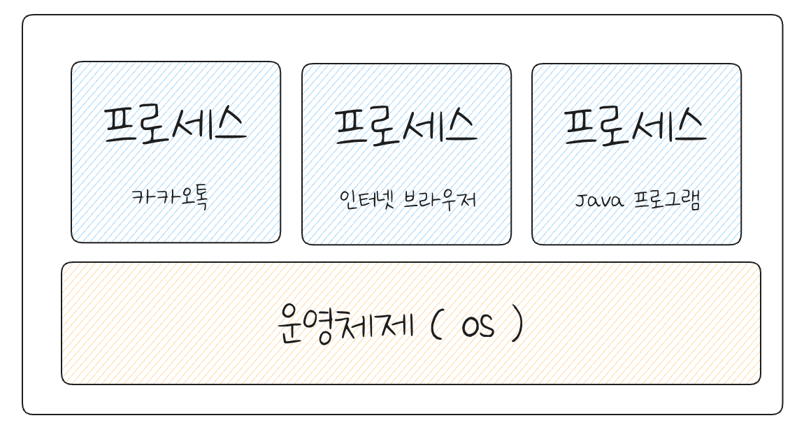
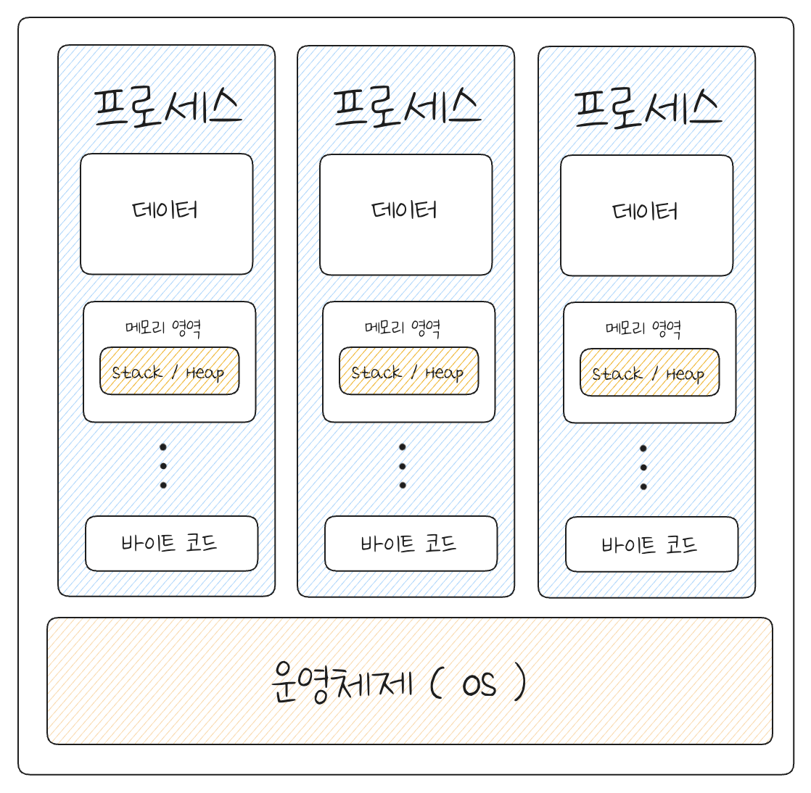
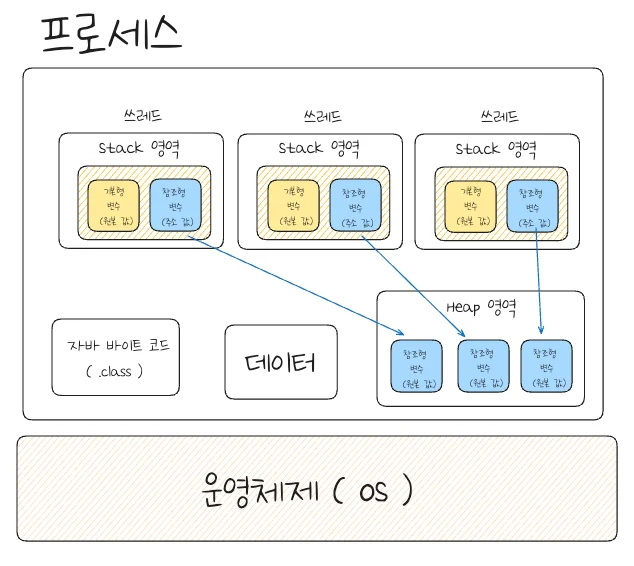
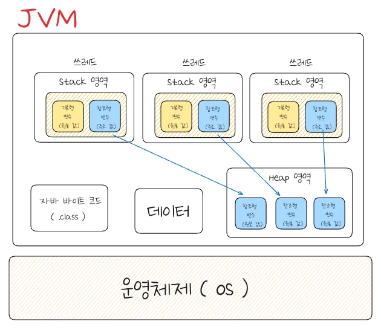

## 프로세스, 쓰레드

---

> 📖 
> 
> - <code>프로세스</code>&#58; 운영체제로 부터 자원을 할당 받는 작업 단위
> 
> - <code>쓰레드</code>&#58; 프로세스가 할당받은 자원을 이용하는 실행의 단위

프로세스

프로세스 작업 단위

> ✏️ 
> 
> 
> 
> 프로세스는 ‘실행 중인 프로그램’을 의미한다&#46;
> 
> - 자바 프로그램 실행 시, 해당 프로그램은 프로세스라는 이름으로 운영체제 위에서 실행된다&#46;
> 
> - 즉, OS 위에서 실행되는 모든 프로그램은 OS가 만들어준 프로세스에서 실행된다&#46; 
> 
> - ex)카카오톡, 인터넷 브라우저&#46;&#46; → 프로세스

프로세스 구조

> ✏️ 
> 
> 
> 
> OS에서 프로그램 실행을 위한 프로세스 할당 시, 프로세스 안에 프로그램의 Code와 Data 그리고 메모리 영역(Stack, Heap)을 함께 할당한다&#46;

- <code>Code</code>&#58; Java main 메소드와 같은 프로그램 실행 코드를 의미한다&#46; 

- <code>Data</code>&#58; 프로그램이 실행 중 저장할 수 있는 저장 공간을 의미한다&#46; 
    - 전역 변수, 정적 변수(static), 배열 등 초기화된 데이터를 저장하는 공간

- Memory ( 메모리 영역 )
    - Stack&#58; 지역변수, 매개변수, 리턴 변수를 저장하는 공간

    - Heap&#58; 프로그램이 동적으로 필요한 변수를 저장하는 공간 ( <code>new()</code>)

쓰레드

> ✏️ 
> 
> 
> 
> 쓰레드는 프로세스 내에서 일하는 일꾼(코드의 실행 흐름)과 같다&#46;

- 쓰레드 생성
    - 프로세스가 작업 중인 프로그램에서 실행 요청이 들어오면 쓰레드(일꾼)을 만들어 명령을 처리하도록 한다&#46;

- 쓰레드 자원
    

    - 프로세스 안에 여러 쓰레드(일꾼)들이 있고, 쓰레드들은 실행을 위한 프로세스 내 주소 공간 및 메모리 공간(Heap)을 공유한다&#46; 

    - 또한 쓰레드들은 각각 명령 처리를 위한 자신만의 메모리 공간(Stack)도 할당 받는다&#46;

- Java 쓰레드
    

    - 일반 쓰레드와 동일하며 JVM 프로세스 안에서 실행되는 쓰레드를 말한다&#46;  

    - Java 프로그램의 쓰레드는 JVM에 의해서 Java Main 쓰레드 부터 실행된다&#46; 

