<details>
<summary>Reference</summary>

- ‣ ( 이전 정리 내용 )

- ‣

</details>

<details>
<summary>template</summary>

> ✏️ 
> 
> <a id="1d7eda9b0fe1802aa43def758edd3224"></a>
> 
> <br>

<a id="1d7eda9b0fe180be9b3fc0cf2d4f5675"></a>

```css

```

<details>
<summary>ex)</summary>

<a id="1d7eda9b0fe180c68432c4d6de4066d4"></a>

```css

```

</details>

</details>

<a id="1d4eda9b0fe18028bf0ef4ebe62937a5"></a>

## Grid 

---

> ✏️ 
> 
> <a id="1d7eda9b0fe1807089bacea0f43ae2f6"></a>
> 
> 웹 레이아웃에서 가장 많이 사용되는 것이 <code>Flexible Box</code> 와 <code>Css Grid</code> 이다&#46; 
> 
> - <code>Flex</code>는 <strong><u>1차원</u></strong>으로 <strong><u>수평, 수직 영역 중 </u></strong><strong><u>하나</u></strong>의 방향으로 레이아웃을 나눈다&#46; 
> 
> -  <code>Grid</code>는 <strong><u>2차원</u></strong>으로<strong><u> 수평, 수직을 </u></strong><strong><u>동시</u></strong><strong><u>에 </u></strong>영역을 나눌 수 있다&#46; 
> 
> <a id="1d7eda9b0fe180dd8ce9c3905e88e599"></a>
> 
> <br>둘 모두 Container(컨테이너) 와 Item(아이템) 이라는 두가지 개념으로 구분되는데 <code>Container</code>는 <strong><u>Item을 감싸는 부모 요소</u></strong>이며, <u>컨테이너 안에서 각 아이템을 배치</u>할 수 있다&#46; 

<a id="1d7eda9b0fe180b8910af2e519d31667"></a>

### 1&#46; Grid Container &#45; 부모 요소에 정의

<details>
<summary><code>display&#58; grid</code></summary>

<a id="1d7eda9b0fe18096b006d4ad5e00f23f"></a>

```css
display: grid;
```

<a id="1d4eda9b0fe180e9ba4ee89d2fa97890"></a>

그리드를 사용하기 위한 컨테이너(부모 요소)에 작성

</details>

<a id="1d7eda9b0fe180e994d1ee14f2b95924"></a>

### 2&#46; 아이템들의 레이아웃(크기) 지정

> ✏️ 
> 
> <a id="1d7eda9b0fe180aeb087c7652b4e0763"></a>
> 
> <code>fr</code>( fraction )
> 
> ---
> 
> <a id="1d7eda9b0fe180e4a2fefb372be77ad4"></a>
> 
> <code>fr</code>은 <a href="https://dic.daum.net/word/view.do?wordid=ekw000066112&#38;q=fraction">fraction</a>이라는 뜻으로 숫자 비율대로 트랙의 크기를 나눈다&#46;
> 
> - ex) <code>1fr 1fr 1fr</code> 
>     - 균일하게 1&#58;1&#58;1 비율인 3개 column 생성

> ✏️ 
> 
> <a id="1d7eda9b0fe180479decc6c0c560aa9a"></a>
> 
> <code>auto</code> 
> 
> ---
> 
> <a id="1d7eda9b0fe1801b98b3c8fc7abea2d4"></a>
> 
> <code>auto</code>는 자동으로 남은 레이아웃을 채운다&#46; 
> 
> <a id="1d7eda9b0fe1808c9f01ccbb7a3e4583"></a>
> 
> <code>auto</code>를 여러개 지정한다면 남은 부분에서 해당 개수를 기준으로 부분적으로 나눈다&#46;
> 
> <details>
> <summary>ex) <code>auto 1fr auto</code></summary>
> 
> - <code>1fr auto</code> 시 화면은 <code>1fr</code> &#58; <code>1fr</code>으로 나눈다&#46; <br>즉, <code>50%</code>&#58;<code>50%</code>로 나뉜다&#46; 
> 
> - 여기서 <code>auto 1fr auto</code>는 <code>1fr</code>을 제외하고 남은 영역을 <code>auto</code> 영역으로 할당한다&#46; 그리고 해당 영역을 다시 auto의 개수만큼 나눠 처리한다&#46; 
> 
> - 즉, <code>auto 1fr auto</code> 에서 <strong><u>1fr을 제외</u></strong>한 남은 <strong><u>auto 영역은 50%</u></strong>이고 여기서 <strong>2개의 auto가 할당</strong>되기 때문에 <strong>각 auto는 25%의 크기를 갖</strong>는다&#46;
> 
> </details>

<details>
<summary><code>grid&#45;template&#45;column</code> ( 가로 )</summary>

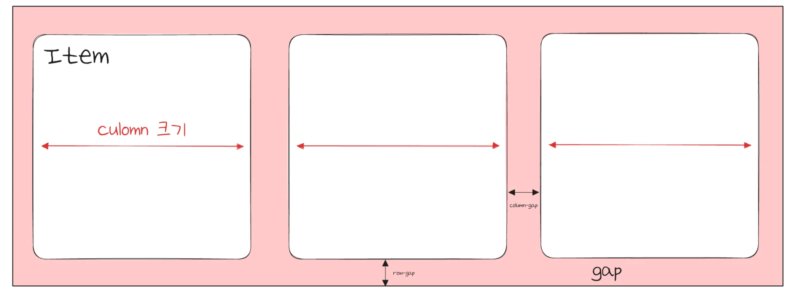

<a id="1d7eda9b0fe180f0a05fedf7738deb65"></a>

```css
/* 열 (column) */
grid-template-column: [ 아이템 가로 비율 ] 
```

<details>
<summary>ex)</summary>

<details>
<summary>1&#46;  <code>1fr 1fr 1fr</code></summary>

<a id="1d7eda9b0fe180e5b9c1efde7e7f57a7"></a>

```css
grid-template-columns: 1fr 1fr 1fr;
```

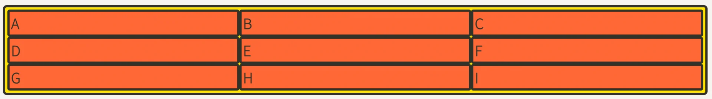

- 화면을 <strong><u>1&#58;1&#58;1</u></strong> 비율로 나눈다&#46;

</details>

<details>
<summary>2&#46; <code>100px 2fr 1fr</code></summary>

<a id="1d7eda9b0fe180e5a7bafbb701fa5f33"></a>

```css
grid-template-columns: 100px 2fr 1fr;
```

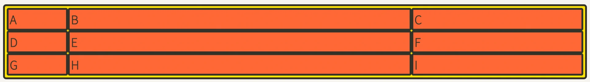

- 화면&#58; <strong><u>100px &#58; 나머지&#91; 2&#58; 1 &#93;</u></strong> 로 나눈다&#46;

</details>

<details>
<summary>3&#46; <code>70px auto</code></summary>

<a id="1d7eda9b0fe180a2af9dd2b633fa614f"></a>

```css
grid-template-columns: 70px auto;
```

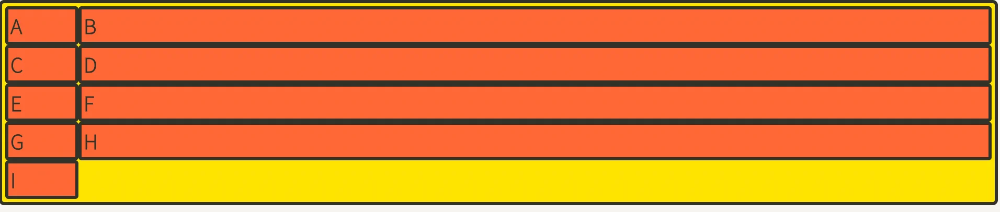

- 화면&#58; <strong><u>70px &#58; 나머지 (1)</u></strong>

- 자식 요소가 레이아웃을 넘어가는 경우 자동으로 하위로 배치한다&#46;

</details>

<details>
<summary>4&#46; <code>70px 1fr</code> ( 위와  동일 )</summary>

<a id="1d7eda9b0fe180b28fe0f5b27d5ed629"></a>

```css
grid-template-columns: 70px 1fr;
```


- 화면&#58; <strong><u>70px &#58; 나머지 (auto)</u></strong>

- 자식 요소가 레이아웃을 넘어가는 경우 자동으로 하위로 배치한다&#46;

</details>

</details>

</details>

<details>
<summary><code>grid&#45;template&#45;rows</code> ( 세로 ) </summary>

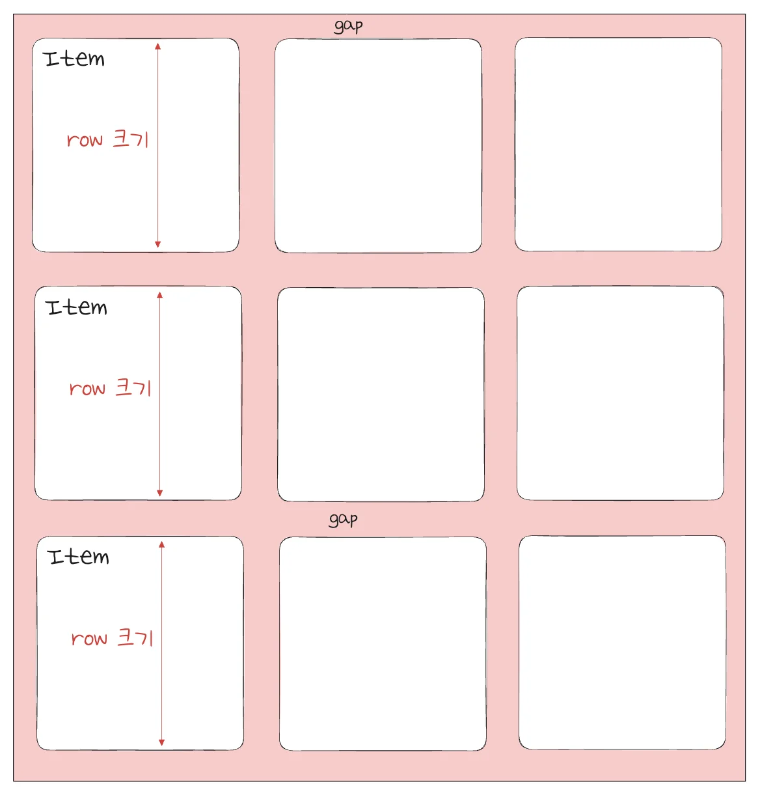

<a id="1d7eda9b0fe18006ba32c10b997a8684"></a>

```css
/* 행(row) */
grid-template-rows: [ 아이템 세로 비율 ] 
```

<details>
<summary>ex) </summary>


</details>

</details>

<a id="1d7eda9b0fe1803faa2bf3bec49f88ce"></a>

### 3&#46; 유틸 함수

<details>
<summary><strong><code>repeat()</code></strong></summary>

> ✏️ 
> 
> <a id="1d7eda9b0fe1802ba0cdd77227476562"></a>
> 
> <strong><code>repeat(반복횟수, 반복값)</code></strong>
> 
> ---
> 
> <a id="1d7eda9b0fe18092b471f11e12ebef81"></a>
> 
> 반복되는 값을 자동 처리

<a id="1d7eda9b0fe18020813bf2c34134c6ed"></a>

```css
/* grid-template-columns: 1fr 1fr 1fr 1fr 1fr */
grid-template-columns: repeat(5, 1fr);
```

- <code>repeat(3, 1fr 4fr 2fr)</code> 과 같은 패턴도 가능함 

</details>

<details>
<summary><strong><code>minmax()</code></strong></summary>

> ✏️ 
> 
> <a id="1d7eda9b0fe180879608fa70ca1cf079"></a>
> 
> <strong><code>minmax(최솟값, 최댓값)</code></strong>
> 
> ---
> 
> <a id="1d7eda9b0fe1805daac1e5aeb356b5ea"></a>
> 
> <strong>최솟값과 최댓값 지정</strong>

<a id="1d7eda9b0fe18004a22be8311dbe20d9"></a>

```css
/* 최소한 100px, 최대는 자동으로(auto) 늘어나게 */
minmax(100px, auto)
```

- 아무리 내용의 양이 적더라도 최소한 높이 100px은 확보

-  내용이 많아 100px이 넘어가면 알아서 늘어나도록 처리

<details>
<summary>ex)</summary>

<a id="1d7eda9b0fe18052a120c65f0f8f66cb"></a>

```css
.container {
	grid-template-columns: repeat(3, 1fr);
	grid-template-rows: repeat(3, minmax(100px, auto));
}
```

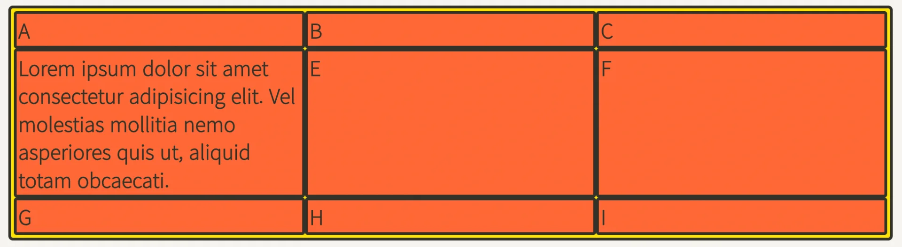

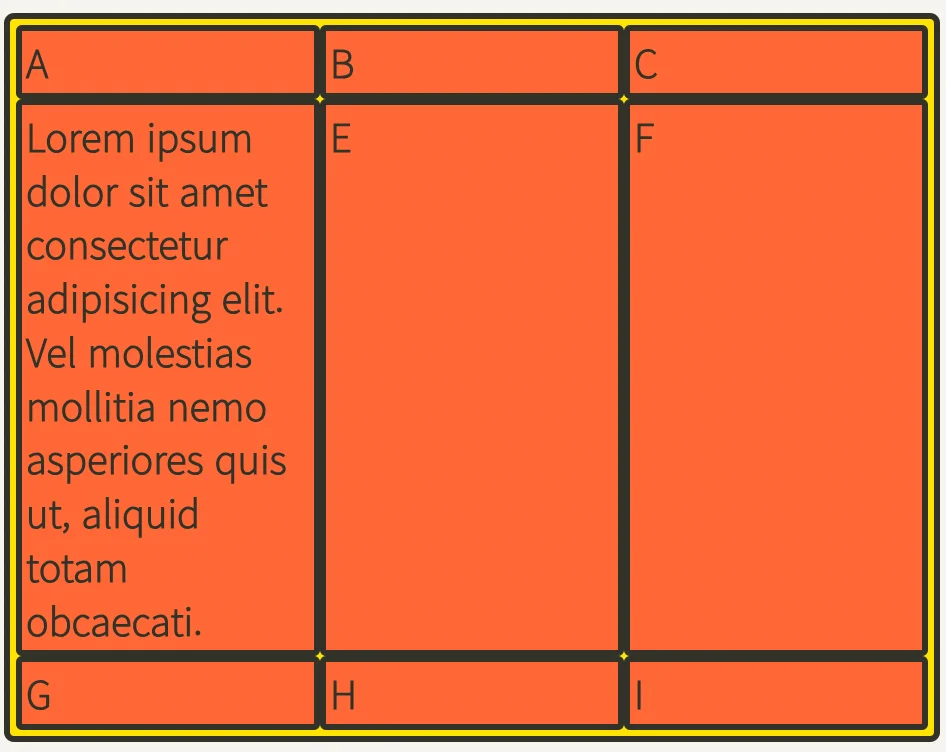

</details>

</details>

<details>
<summary><strong><code>auto&#45;fill</code></strong><strong>, </strong><strong><code>auto&#45;fit</code></strong></summary>

> ✏️ 
> 
> <a id="1d7eda9b0fe18010a478cc37701e6e36"></a>
> 
> <strong><code>auto&#45;fill</code></strong><strong>, </strong><strong><code>auto&#45;fit</code></strong>
> 
> ---
> 
> <a id="1d7eda9b0fe1801bbd1ffc40483b5a69"></a>
> 
>  column의 개수를 미리 정하지 않고 <strong>설정된 너비가 허용하는 한 </strong><strong><u>최대한</u></strong> 셀을 채운다&#46;<br>

<a id="1d7eda9b0fe180699fd5cb5accf16473"></a>

```css
grid-template-columns: 
				repeat(auto-fill, minmax(20%, auto));
```

- auto&#45;fill의 크기를 20%로 설정했으므로, 1개의 row에는 5개의 셀이 들어간다&#46;
    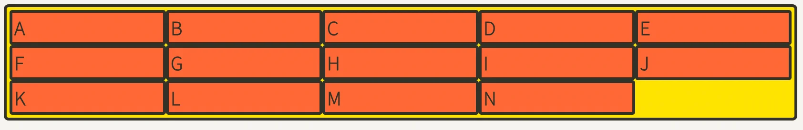

- 셀의 개수가 5개보다 모자라면 아래와 같이 공간이 남는다&#46;
    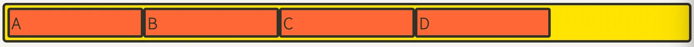

- auto&#45;fill 대신 <strong>auto&#45;fit</strong>을 사용하면, 남는 공간을 채운다&#46; 
    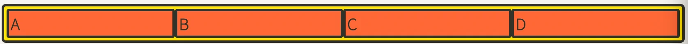

    - auto&#45;fill과 auto&#45;fit의 차이점

</details>

<a id="1d7eda9b0fe18080bd42ef0ce28e6c21"></a>

### 4&#46; 간격 

<details>
<summary><code>gap</code> ( column&#45;gap &#43; row&#45;gap )</summary>

> ✏️ 
> 
> <a id="1d7eda9b0fe1802993c4eb1cc3adf4ee"></a>
> 
> <strong><code>gap</code></strong>
> 
> ---
> 
> <a id="1d7eda9b0fe180c29cb8c52ce13cb0fd"></a>
> 
> 각 아이템(cell)과 아웃레이어 사이의 간격을 설정한다&#46; 
> 
> - <code>gap</code>  =  column&#45;gap &#43; row&#45;gap

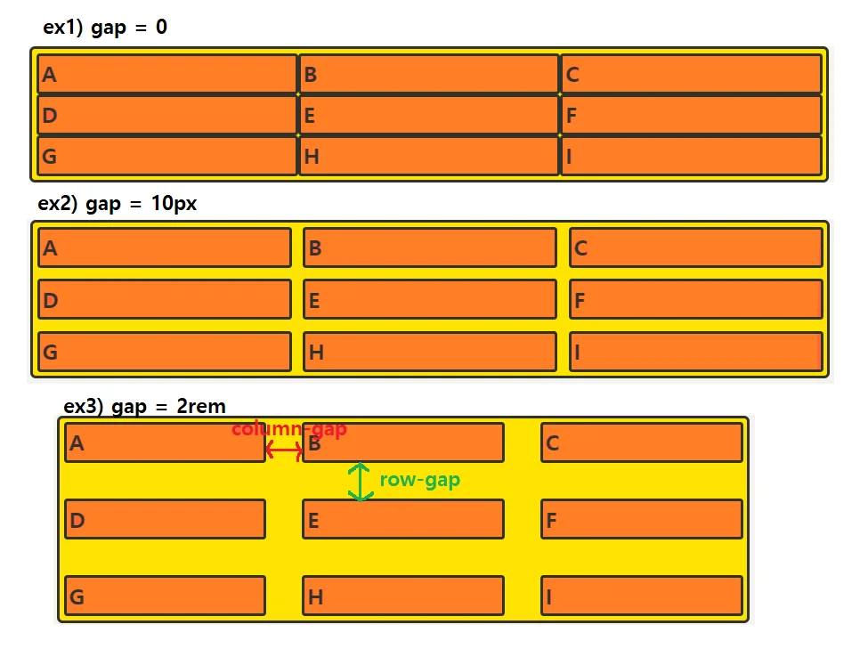

<a id="1d7eda9b0fe180d09057c70b4899a041"></a>

```css

```

<details>
<summary>ex)</summary>

<a id="1d7eda9b0fe180b492c9d42ff73ed3c8"></a>

```css

```

</details>

</details>

<details>
<summary><code>column&#45;gap</code></summary>

> ✏️ 
> 
> <a id="1d7eda9b0fe1807eb472dce6985c6184"></a>
> 
> <code>column&#45;gap</code>
> 
> ---
> 
> <a id="1d7eda9b0fe180398a9fc5f74f5fa287"></a>
> 
> <strong>각 </strong><strong><code>column(y축, 세로)</code></strong><strong> 아이템(cell) 사이 간격 설정</strong>


<a id="1d7eda9b0fe180e3910ad11a9d88b721"></a>

```css

```

<details>
<summary>ex)</summary>

<a id="1d7eda9b0fe1807aa042d82fca7a9e40"></a>

```css

```

</details>

</details>

<details>
<summary><code>row&#45;gap</code></summary>

> ✏️ 
> 
> <a id="1d7eda9b0fe180ca81c7c327fdaee530"></a>
> 
> <code>row&#45;gap</code>
> 
> ---
> 
> <a id="1d7eda9b0fe180cd820aefa0892416ca"></a>
> 
> <strong><code>row(x축, 가로)</code></strong><strong> 아이템(cell) 사이 간격 설정</strong>

<a id="1d7eda9b0fe1801fbed9d25c426008bb"></a>

```css

```

<details>
<summary>ex)</summary>

<a id="1d7eda9b0fe18078a177ca3b97ef046a"></a>

```css

```

</details>

</details>

<a id="1d4eda9b0fe18057aa50c07cf793d3f9"></a>

### 요소 z 축 위치 설정&#58; <strong><code>z&#45;index</code></strong>

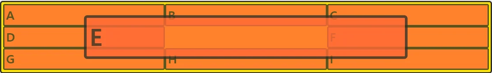

<a id="1d4eda9b0fe180fbaf41c427eaefaaaa"></a>

```bash
.item:nth-child(5) {
	z-index: 1;
	transform: scale(2);
}
```
