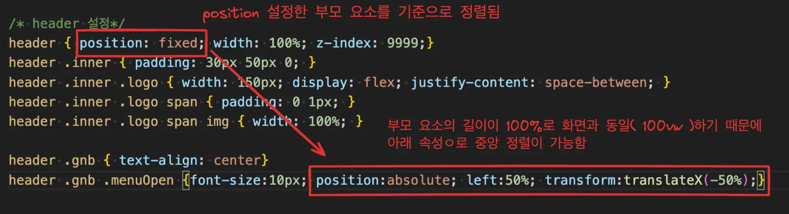

<a id="1d5eda9b0fe1807bbedbc8c08107bb91"></a>

### 요소 중앙 정렬

---



<a id="1d5eda9b0fe180eeabb1f8f45358fd2e"></a>

```html
<body>
  <div class="wrap">
    <header>
      <div class="inner">
        <a href="#" class="logo">
          <span></span>
          <span></span>
          <span></span>
          <span></span>
          <span></span>
          <span></span>
        </a>
        <nav class="gnb">
          <p class="menuOpen">MENU</p>
          <ul class="menuBox">
            <li><a href="#">HOME</a></li>
            <li><a href="#">ABOUT</a></li>
            <li><a href="#">WORK</a></li>
            <li><a href="#">PORTFOLIO UX</a></li>
          </ul>
        </nav>
      </div>
    </header>
  </div>
</body>
```

<a id="1d5eda9b0fe18039865ef611bbfca615"></a>

<strong>CSS</strong>

<a id="1d5eda9b0fe18015923fe70d9d66ddbd"></a>

```css
header { position: fixed; width: 100%; z-index: 9999;}
header .inner { padding: 30px 50px 0; }
header .inner .logo { width: 150px; display: flex; justify-content: space-between; }
header .inner .logo span { padding: 0 1px; }
header .inner .logo span img { width: 100%; }

header .gnb { text-align: center}
header .gnb .menuOpen {font-size:10px; position:absolute; left:50%; transform:translateX(-50%);}
```
