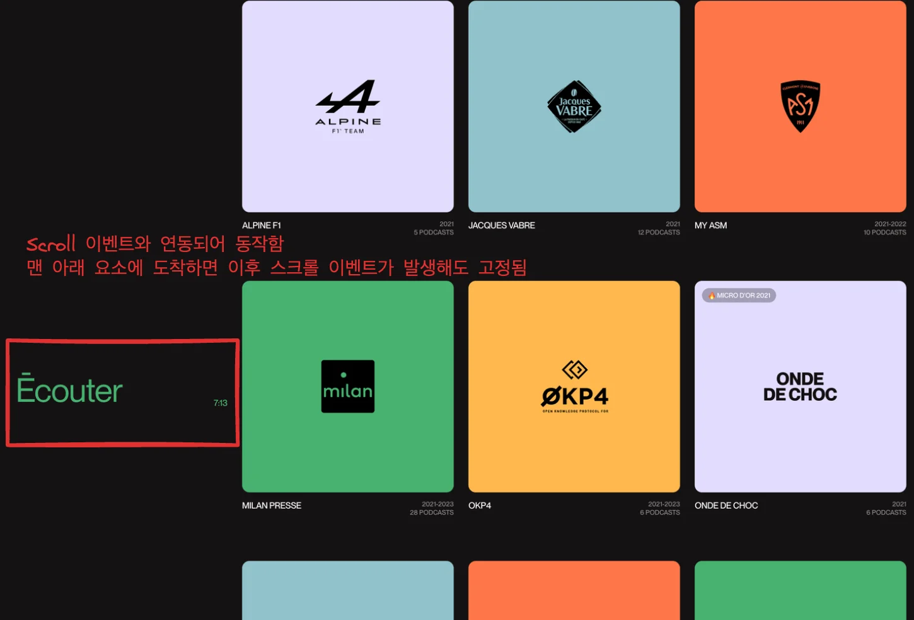
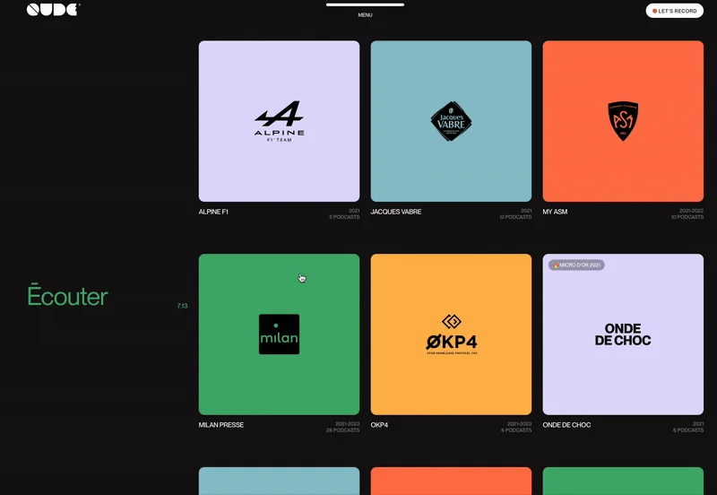
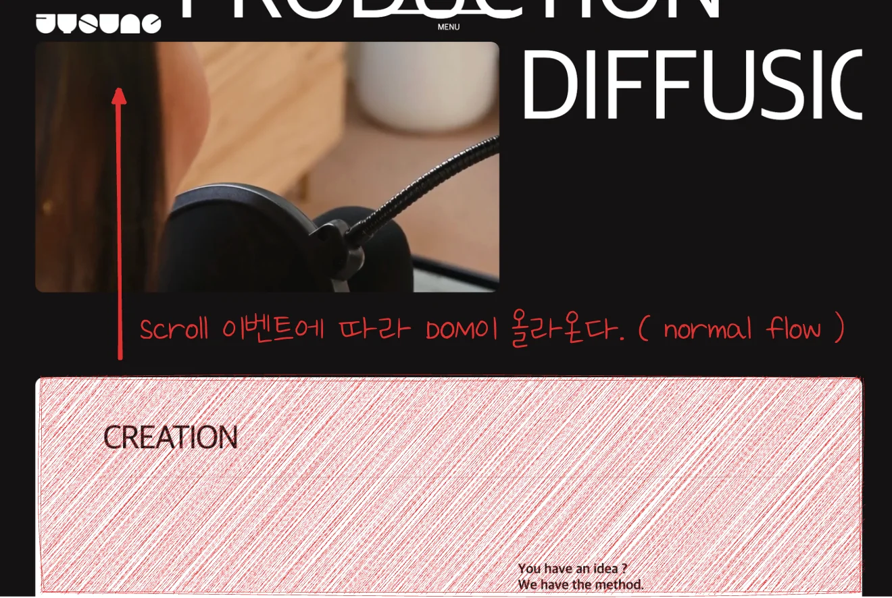
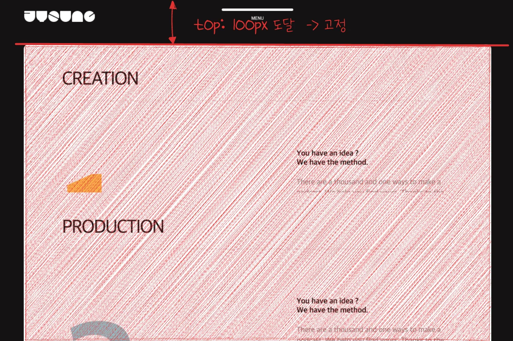
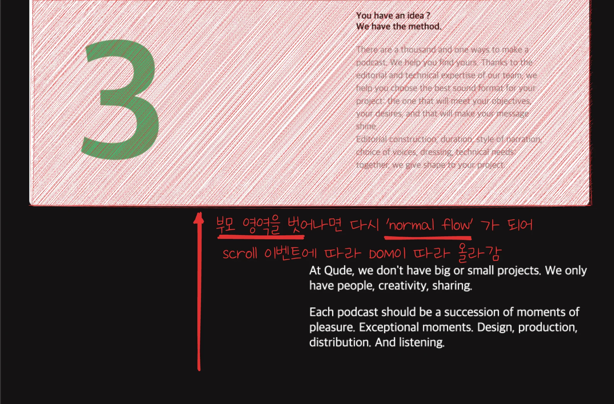

<a id="1d5eda9b0fe180878c3ae80cfd45cc5f"></a>

## postion&#58; sticky 활용

---

> 📖 
> 
> <a id="1d5eda9b0fe18003b8c4ddf69d53b522"></a>
> 
> <code>position&#58; </code><strong><code>sticky</code></strong>
> 
> ---
> 
> > ✏️ 
> > 
> > <a id="1d9eda9b0fe180258c6ad2b930d47ab3"></a>
> > 
> > <strong>sticky는 absolute와 fixed의 하이브리드</strong> 같은 개념이다&#46;
> > 
> > > <strong><u>원래는 normal flow </u></strong><strong>처럼 있다가, </strong><strong><u>특정 지점에 도달하면 화면에 ‘고정’</u></strong><strong>되는</strong> 포지션이다&#46;
> 
> <a id="1d5eda9b0fe180cba69ae1fb75e3375a"></a>
> 
> <strong><u>스크롤과 연동</u></strong>하여 <strong>특정요소를 화면에 고정</strong>시킬 수 있다&#46;
> 
> - 이전에는 DOM 고정 시, <code>position&#58; fixed</code>를 사용했지만, sticky 속성이 추가됨으로써 <br>좀더 동적으로 편리하게 처리할 수 있게 되었다&#46; 
> 
> <a id="1d5eda9b0fe18094975ad23e64a44b25"></a>
> 
> <strong>sticky 속성을 갖는 요소</strong>는 <strong><u>자신의 바로 위에 부모 요소에만 적용</u></strong>된다&#46;
> 
> - 페이지 전체에 적용시키려면, body 태그와 같이 페이지 전체를 감싸고 있는 태그 바로 아래에 자식 요소를 배치해야 한다&#46;
> 
> <details>
> <summary><strong>sticky 기본 작동 흐름</strong></summary>
> 
> 1. <strong>처음엔 일반적인 흐름(normal flow)</strong> 으로 존재
> 
> 1. <strong>스크롤을 하다가 </strong><strong><u>특정 기준(top, left 등)을 넘</u></strong><strong>으면 </strong><strong><u>해당 부분 부터는 fixed처럼 화면에 고정</u></strong><strong>된다&#46;</strong>
> 
> </details>

> ☝🏻 
> 
> <a id="1d5eda9b0fe18074b409d5e1823e9f16"></a>
> 
> 주의
> 
> ---
> 
> <a id="1d5eda9b0fe18090beecf900786cc40b"></a>
> 
> <strong><u>sticky 요소의  부모 요소 중</u></strong>에  <strong>overflow가 적용</strong>되어 있으며, <strong><u>sticky는 적용되지 않</u></strong>는다&#46;
> 
> - <code>overflow&#58;auto</code> 
> 
> - <code>overflow&#58;hidden</code>
> 
> - <code>oveflow&#58;scroll</code>
> 
> - …

<details>
<summary>예시 ) content 3</summary>

> <a href="#/post/1d8eda9b-0fe1-8069-b924-f47d9bc5d344">페이지</a> 





<details>
<summary>&#91; 코드 &#93;</summary>

<a id="1d5eda9b0fe1802db627efe0353ec661"></a>

```java

```

</details>

</details>

<details>
<summary>예시 2 ) content 4</summary>

> <a href="#/post/1d8eda9b-0fe1-80e9-9a80-c5c5bbb7b72f">페이지</a> 

<details>
<summary>html</summary>

<a id="1d9eda9b0fe18005b324de584b9a9fba"></a>

```html
<li class="cardBox a">
    <h2>CREATION</h2>
    <h3>1</h3>
    <div class="text">
      <h4>You have an idea ?<br>We have the method.</h4>
      <p>There are a thousand and one ways to make a podcast. We help you find yours. Thanks to the editorial and technical expertise of our team, we help you choose the best sound format for your project: the one that will meet your objectives, your desires, and that will make your message shine.</p>
      <p>Editorial construction, duration, style of narration, choice of voices, dressing, technical needs: together, we give shape to your project.</p>
    </div>                                                                             
  </li>
  <li class="cardBox b">
    <h2>PRODUCTION</h2>
    <h3>2</h3>
    <div class="text">
      <h4>You have an idea ?<br>We have the method.</h4>
      <p>There are a thousand and one ways to make a podcast. We help you find yours. Thanks to the editorial and technical expertise of our team, we help you choose the best sound format for your project: the one that will meet your objectives, your desires, and that will make your message shine.</p>
      <p>Editorial construction, duration, style of narration, choice of voices, dressing, technical needs: together, we give shape to your project.</p>
    </div>                                                                             
  </li>
  <li class="cardBox c">
    <h2>DIFFUSION</h2>
    <h3>3</h3>
    <div class="text">
      <h4>You have an idea ?<br>We have the method.</h4>
      <p>There are a thousand and one ways to make a podcast. We help you find yours. Thanks to the editorial and technical expertise of our team, we help you choose the best sound format for your project: the one that will meet your objectives, your desires, and that will make your message shine.</p>
      <p>Editorial construction, duration, style of narration, choice of voices, dressing, technical needs: together, we give shape to your project.</p>
    </div>                                                                             
  </li>
</ul>
```

</details>

<a id="1d9eda9b0fe18007897ada474c2666ad"></a>

```css
.con4 .listBox .cardBox { 
  background-color: #fff; 
  border-radius: 10px; 
  padding: 50px 80px 60px; 
  margin-bottom: 35px; 
  color: #141212; 
  display: grid; 
  grid-template-columns: 60% auto; 
  position: sticky;
  top: 100px; 
  filter: brightness(1);
}
```

> 동작

<details>
<summary>1&#46; Scroll 이벤트에 따라 DOM 올라옴 &#45; <code>Nomal Flow</code></summary>



</details>

<details>
<summary>2&#46; Sticky로 설정한 위치에 도달하면 고정됨 &#45; <code>Fixed</code></summary>



</details>

<details>
<summary>3&#46; 부모 요소를 벗어나면 다시 Scroll 에 따라 DOM이 올라감 &#45; <code>Nomal Flow</code></summary>



</details>

</details>
