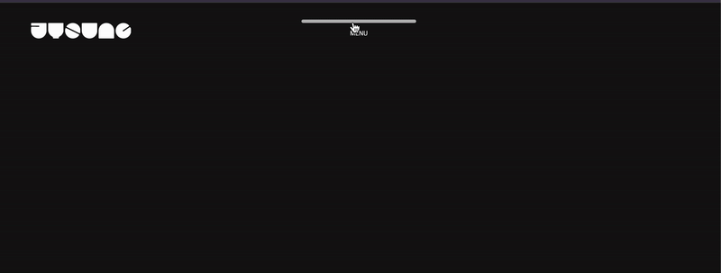
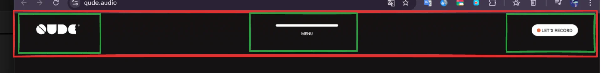
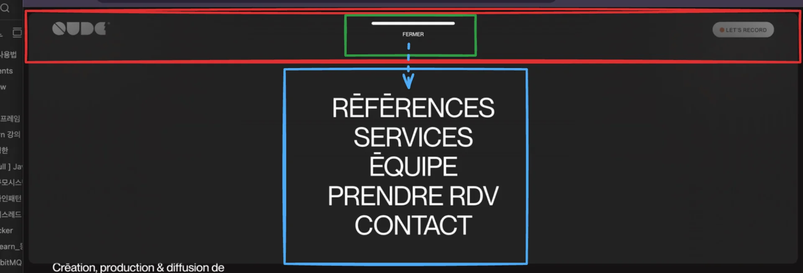

<a id="1d5eda9b0fe181bc9ab5dca676086ced"></a>

## Header

---



<a id="1d5eda9b0fe1810883b5de590d44dbe4"></a>

### 레이아웃





<a id="1d5eda9b0fe180e98d7eeba2e4fadcb4"></a>

### 기본 &#45; html, css, js

<details>
<summary>html</summary>

<a id="1d5eda9b0fe180548173fa943a90901f"></a>

```html
<!DOCTYPE html>
<html lang="ko">
  <head>
    <meta charset="UTF-8" />
    <meta name="viewport" content="width=device-width, initial-scale=1.0" />
    <title>gsap prac</title>
    <link rel="stylesheet" href="style.css" />
    <script src="script.js" defer></script>
  </head>
  <body>
    <div class="wrap">
      <header>
        <div class="inner">
          <a href="#" class="logo">
            <span></span>
            <span></span>
            <span></span>
            <span></span>
            <span></span>
            <span></span>
          </a>
          <nav class="gnb">
            <p class="menuOpen">MENU</p>
            <ul class="menuBox">
              <li><a href="#">HOME</a></li>
              <li><a href="#">ABOUT</a></li>
              <li><a href="#">WORK</a></li>
              <li><a href="#">PORTFOLIO UX</a></li>
            </ul>
          </nav>
        </div>
      </header>
    </div>
  </body>
</html>
```

</details>

<details>
<summary>css</summary>

<details>
<summary>기본, root</summary>

> ✏️ 
> 
> <a id="1d5eda9b0fe1809e92dfddf599fd2835"></a>
> 
> <strong>NOTE </strong>
> 
> ---
> 
> <a id="1d5eda9b0fe180fd85aed1a613e09147"></a>
> 
> 부모 요소에 <code>overflow&#58; hidden</code>이 적용되면 <code>position&#58; sticky</code>가 <strong><u>적용되지 않</u></strong>는다&#46; 
> 
> <a id="1d5eda9b0fe18091b87aecfa570f5326"></a>
> 
> 따라서 <strong><u>sticky를 적용할 부모요소</u></strong>인 <code>wrap</code>에 <code>overflow&#58; hidden</code>을 <strong><u>적용하지 않</u></strong>는다&#46;
> 
> <a id="1d5eda9b0fe18023b04aef3950394c92"></a>
> 
> ```css
> /* overflow: hidden ❌ */
> .wrap { position: relative; margin: 0 auto; background-color: #141212; color: #fff; padding-bottom: 1000px; }
> ```

<a id="1d5eda9b0fe180d48097eba131acaf04"></a>

```css
/* 기본 설정 */
@charset "utf-8";

/* 00. font - 구글폰트에서 Montserrat 300/400/600 가져옴 */
@import url('https://fonts.googleapis.com/css2?family=Montserrat:wght@300;500;600&family=Noto+Sans+KR&display=swap');
@import url('https://fonts.googleapis.com/css2?family=Raleway:wght@300;500;600&display=swap');

/* 00. Reset */
* {margin: 0;padding: 0;}
html, body, div, span, applet, object, iframe, h1, h2, h3, h4, h5, h6, p, blockquote, pre, a, abbr, acronym, address, big, cite, code, del, dfn, em, font, img, ins, kbd, q, s, samp, small, strike, strong, sub, sup, tt, var, b, u, i, center, dl, dt, dd, ol, ul, li, fieldset, form, label, legend, table, tbody, tfoot, thead, tr, th, td{margin:0;padding:0;}
a {color: inherit; text-decoration: inherit;}
li {list-style: none;}
address, em, i {font-style: normal;}
button {background: none; border: none;}
img {vertical-align: middle;}


/* root 설정 */
body { font-family: "Releway", sans-serif; font-size: 16px; letter-spacing: -0.01em; }
.wrap { position: relative; margin: 0 auto; background-color: #141212; color: #fff; padding-bottom: 1000px; }
```

</details>

<details>
<summary>header </summary>

<a id="1d5eda9b0fe180ac9281c9cdac3728a9"></a>

```css
/* header 설정*/
header { position: fixed; width: 100%; z-index: 9999;}
header .inner { padding: 30px 50px 0; }
header .inner .logo { width: 150px; display: flex; justify-content: space-between; }
header .inner .logo span { padding: 0 1px; }
header .inner .logo span img { width: 100%; }

header .gnb { text-align: center; }
header .gnb .menuOpen {font-size:10px; position:absolute; left:50%; transform:translateX(-50%); top: 10px; padding: 30px 0; z-index: 10; cursor: pointer}
header .gnb .menuOpen:before {content:''; width: 150px; height: 5px; background-color: #fff; position: absolute; left: 50%; transform: translateX(-50%); top: 15px; border-radius: 30px; transition: all 0.3s; }
header .gnb .menuOpen:hover:before { width: 170px; opacity: 0.7;}
header .gnb .menuBox { width: 98%; position: absolute; left: 50%; transform: translateX(-50%); top: -1000%; background-color: rgba(55, 55, 55, .4); 
  backdrop-filter: blur(30px); border-radius: 10px; padding: 100px 0 30px; box-sizing: border-box; transition: all 1.5s;}
header .gnb .menuBox li { overflow: hidden; }
header .gnb .menuBox li a { display: block; font-size: 40px; transform: translateY(-100px); transition: all .6s; }
header .gnb .menuBox.on { top: 10px; transition: all .4s; }
header .gnb .menuBox.on li a { transform: translateY(0px); }

header .gnb .menuBox.on li:nth-child(2) a { transition-delay: 0.05s; }
header .gnb .menuBox.on li:nth-child(3) a { transition-delay: 0.1s; }
header .gnb .menuBox.on li:nth-child(4) a { transition-delay: 0.15s; }
```

</details>

</details>

<details>
<summary>js</summary>

<a id="1d5eda9b0fe180af8daedcdf2320c0a3"></a>

```javascript
window.onload = function() {
    // 01 gnb 애니메이션

    const menuOpen = document.querySelector('.gnb .menuOpen');
    const menuBox = document.querySelector('.gnb .menuBox');

    menuOpen.addEventListener('click', function() {
        menuBox.classList.toggle('on');
    });    
}
```

- menuOpen 요소에 click 이벤트 발생 시, menuBox 요소에 ‘on’ 클래스 토글 ( on/off )

</details>

<a id="1d5eda9b0fe18094af5de8a93662c400"></a>

### 리액트 &#45; tailwind css

<details>
<summary>react</summary>

<a id="1d5eda9b0fe1806e9afcf280299139bd"></a>

```javascript

```

</details>
