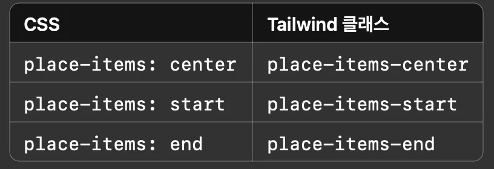
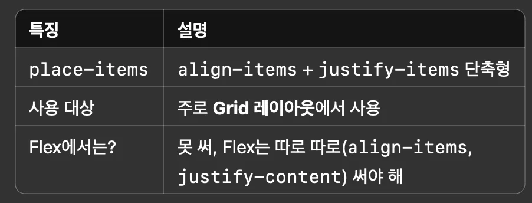

<a id="1d8eda9b0fe1807498a6f8b3feba76d4"></a>

## <strong><code>place&#45;items</code></strong>

---

> 📖 
> 
> <a id="1d8eda9b0fe180d9b890d40cb97eb14b"></a>
> 
> <strong><code>place&#45;items</code></strong>
> 
> ---
> 
> <a id="1d8eda9b0fe1808da575c7665f6849ea"></a>
> 
> ```css
> place-items: <세로 정렬 값> <가로 정렬 값>;
> /*	만약 하나만 쓰면, 양쪽 모두 같은 값이 적용 */
> ```
> 
> - <code>세로 방향 정렬(align&#45;items)</code>과 <code>가로 방향 정렬(justify&#45;items)</code>을 <strong>한 줄에 같이</strong> 설정할 수 있게 만든 속성
>     - <strong><code>align&#45;items</code></strong><strong> &#43; </strong><strong><code>justify&#45;items</code></strong><strong>를 합친 단축 속성</strong>
> 
> - <strong><code>place&#45;items</code></strong>는 <strong><u>Grid 레이아웃</u></strong><strong> </strong> 사용
>     - <strong>flexBox</strong> <strong>사용 불가</strong>

<details>
<summary>예시</summary>

<details>
<summary><strong>1&#46; place&#45;items에 하나만 쓸 때</strong></summary>

<a id="1d8eda9b0fe1803bbcacda3e09c47738"></a>

```css
.container {
  display: grid;
  place-items: center;
}
```

- <code>align&#45;items&#58; center</code> &#43; <code>justify&#45;items&#58; center</code> 둘 다 적용됨

</details>

<details>
<summary><strong>2&#46; place&#45;items에 둘 다 따로 지정할 때</strong></summary>

<a id="1d8eda9b0fe1805ca3b9f2832003a3c7"></a>

```css
.container {
  display: grid;
  place-items: start end;
}
```

- 세로(y축, align&#45;items)&#58; start (위쪽 정렬)

- 가로(x축, justify&#45;items)&#58; end (오른쪽 정렬)

</details>

</details>

<details>
<summary>tailwind css</summary>



<a id="1d8eda9b0fe180a6bcb0fa3af8671beb"></a>

```html
<div class="grid place-items-center h-screen">
  <div>가운데 정렬된 박스</div>
</div>
```

</details>

<details>
<summary>요약</summary>



</details>
