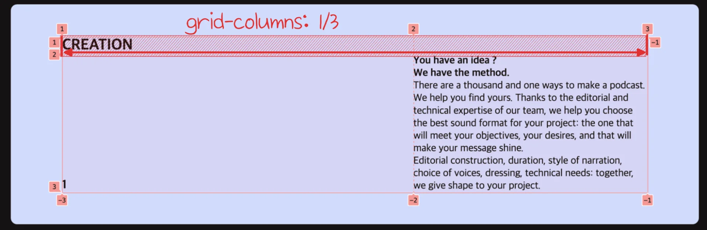

> ✏️ 
> 
> <a id="1d8eda9b0fe180bcb1a2d343bd8cce7f"></a>
> 
> <code>grid&#45;column</code>
> 
> ---
> 
> > 열 시작위치 / 열 끝위치
> 
> <a id="1d8eda9b0fe180b78814c30e2480c3e8"></a>
> 
> <code>grid&#45;columns&#45;start</code>와 <code>grid&#45;columns&#45;end</code>의 단축 속성으로 <strong><u>각 속성을 슬래시로 구분</u></strong>한다

<a id="1d8eda9b0fe18020b9ede56631310952"></a>

<strong>예시) </strong><code>1/3</code>&#58; <code>1 → 3 </code>



<a id="1d8eda9b0fe18068aa63ec897db4060f"></a>

```css
grid-columns: 1/3;
```

- Grid 레이아웃을 기준으로 <strong><u>넘버의 범위까지 요소가 레이아웃을 갖</u></strong>는다&#46;

<a id="1d8eda9b0fe18066a40eea9cccd61984"></a>

<code>grid&#45;row&#45;start </code>&#58; 2 ; 행의 시작 위치는 2번 라인

<a id="1d8eda9b0fe1801896a1c8103440ba18"></a>

 <code>grid&#45;columns&#45;start</code> &#58; 2 ; 열의 시작 위치는 2번 라인
