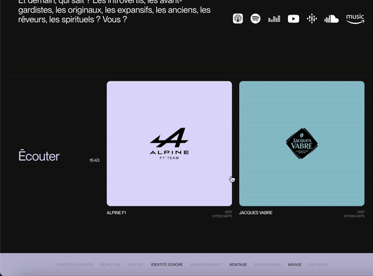

> ✏️ 
> 
> <a id="1d8eda9b0fe180c2b530d6af75663cdb"></a>
> 
> <strong>NOTE </strong>
> 
> ---
> 
> - <code>position&#58; sticky</code>&#58; 자신의 바로 위 부모 요소를 기준으로 고정된다&#46; 
>     - <a href="#/post/1d5eda9b-0fe1-8077-9786-db7fc22a1fd6">페이지</a> 
> 
> - <code>perspective</code>&#58; 애니메이션 효과 ( 뒤에서 앞으로 올라오는 효과 )
>     - <a href="#/post/1d8eda9b-0fe1-80da-98e5-e4ee0a426af2">페이지</a> 
> 
> - data&#45;color
>     - <a href="#/post/1d8eda9b-0fe1-80e4-966f-cf0065e3251f">페이지</a> 

<a id="1d8eda9b0fe1805cbc80d032a2477a6f"></a>

## Content 3

---

<a id="1d8eda9b0fe1807dacfddf296651fbda"></a>

### 레이아웃



<a id="1d8eda9b0fe180a48433c78149f855b4"></a>

### 기본 &#45; html, css, js

> ✏️ 
> 
> <a id="1d8eda9b0fe180aa88abce6f8cca8956"></a>
> 
> 원근감, 애니메이션 효과, footer 색상 연동

<details>
<summary>html</summary>

<a id="1d8eda9b0fe1800a9159fc0dd4727704"></a>

```html
<!-- content 3 -->
<section class="con3">
  <div class="inner">
    <div class="textBox">
      <h4>My Projects</h4>
    </div>
    <ul class="listBox">
      <li data-color="a">
        <p class="img"></p>
        <h4>
          <span class="a">Title</span>
          <span class="b">2025</span>
        </h4>
      </li>
      <li data-color="b">
        <p class="img"></p>
        <h4>
          <span class="a">Title</span>
          <span class="b">2025</span>
        </h4>
      </li>
      <li data-color="c">
        <p class="img"></p>
        <h4>
          <span class="a">Title</span>
          <span class="b">2025</span>
        </h4>
      </li>
      <li data-color="d">
        <p class="img"></p>
        <h4>
          <span class="a">Title</span>
          <span class="b">2025</span>
        </h4>
      </li>
      <li data-color="e">
        <p class="img"></p>
        <h4>
          <span class="a">Title</span>
          <span class="b">2025</span>
        </h4>
      </li>
      <li data-color="a">
        <p class="img"></p>
        <h4>
          <span class="a">Title</span>
          <span class="b">2025</span>
        </h4>
      </li>
      <li data-color="b">
        <p class="img"></p>
        <h4>
          <span class="a">Title</span>
          <span class="b">2025</span>
        </h4>
      </li>
      <li data-color="c">
        <p class="img"></p>
        <h4>
          <span class="a">Title</span>
          <span class="b">2025</span>
        </h4>
      </li>
      <li data-color="d">
        <p class="img"></p>
        <h4>
          <span class="a">Title</span>
          <span class="b">2025</span>
        </h4>
      </li>
    </ul>
  </div>
</section>
```

</details>

<details>
<summary>css </summary>

<a id="1d8eda9b0fe180bc800dd0b6893a2c39"></a>

```css
/* content 3 */
.con3 .inner { display: flex; justify-content: space-between; }
.con3 .textBox { width: 28; }
.con3 .textBox h4 { font-size: 60px; font-weight: normal; position: -webkit-sticky; position: -webkit-sticky; top: 50%; transform: translateY(-50%);}

/* overflow:hidden 주는 이유는 스크롤 트리거를 작성하게 되면 가로 스크롤이 생겨서 이를 가려주기 위해서 이다. */
.con3 .listBox { width: 70%; display: flex; justify-content: space-between; flex-wrap: wrap; perspective: 900px; overflow: hidden;}
.con3 .listBox li { width: 32.2%;}
.con3 .listBox li .img { background-color: var(--sub-color); border-radius: 10px; text-align: center; padding: 30% 0; }
.con3 .listBox li .img img { width: 40%; }
.con3 .listBox li h4 { display: flex; justify-content: space-between; margin: 15px 0 50px; font-weight: normal; }
.con3 .listBox li h4 span.b { opacity: 0.5;}
.con3 .listBox li[data-color="a"]{--sub-color: #d1dbfd;}
.con3 .listBox li[data-color="b"]{--sub-color: #90c3cd;}
.con3 .listBox li[data-color="c"]{--sub-color: #ff764a;}
.con3 .listBox li[data-color="d"]{--sub-color: #47b172;}
.con3 .listBox li[data-color="e"]{--sub-color: #ffb84f;}
```

</details>

<details>
<summary>js</summary>

<a id="1d8eda9b0fe18027b301e6b212161f99"></a>

```javascript

```

- 

</details>

<a id="1d8eda9b0fe180faab26fafc40d4c46e"></a>

### 리액트 &#45; tailwind css

<details>
<summary>react</summary>

<a id="1d8eda9b0fe180348bdbdbfc4ac58d8d"></a>

```javascript

```

</details>
