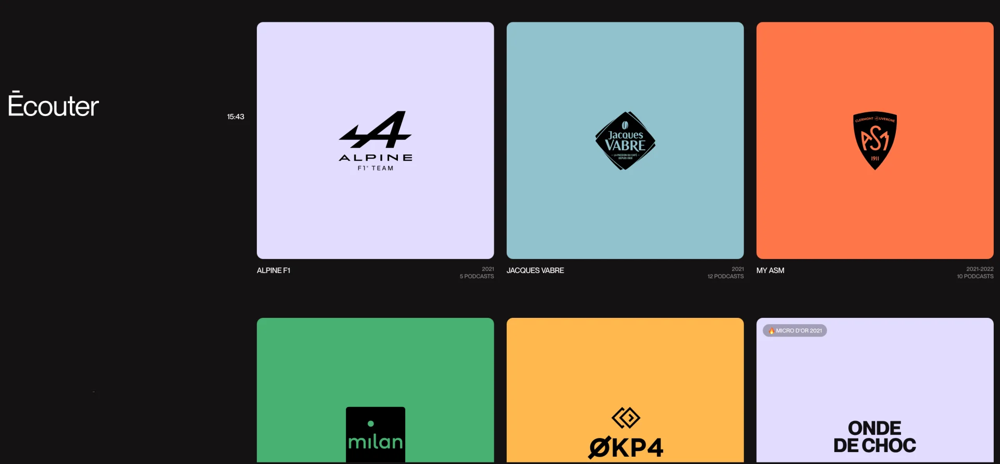
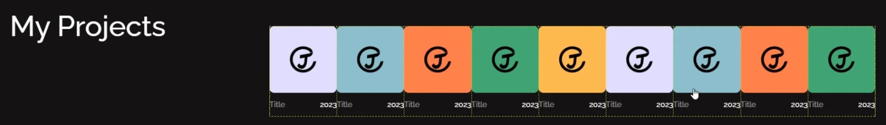

<a id="1d8eda9b0fe1800db1adccb860d85a9b"></a>

```css
flex-wrap: wrap;
```

<a id="1d8eda9b0fe180059717c3ca34ed7ac2"></a>

요소들의 크기가 레이아웃에서 넘칠 경우, 다음(아래) 레이아웃으로 넘긴다&#46; 

<a id="1d8eda9b0fe1805ea5b3fd252f53f916"></a>

<code>flex&#45;wrap</code>의 기본 값은 <code>no&#45;wrap</code>이다,

- <code>wrap</code>
    

    - 크기에 맞춰 요소를 보여준다&#46;

    - 레이아웃을 넘어가는 요소의 경우 다음(아래) 레이아웃에서 이어서 표현한다&#46;

- <code>no&#45;wrap</code>
    

    - 레이아웃 변경없이 요소의 크기를 맞춘다&#46; 

    - <code>flex&#45;wrap</code>의 기본값이다&#46;
