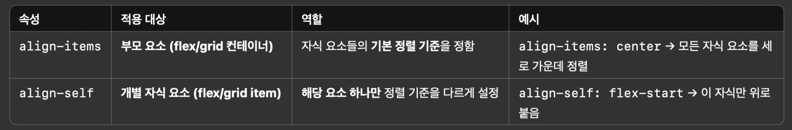
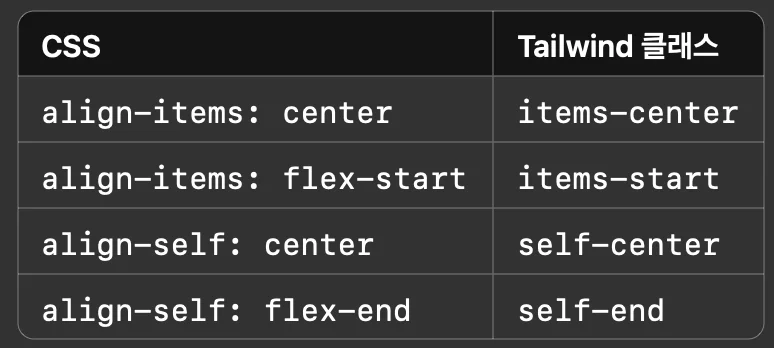

<a id="1d8eda9b0fe1804dadf1f6b5e3c777c3"></a>

## <code>align&#45;items</code> vs <code>align&#45;self</code>

---

> 📖 
> 
> 
> 
> - <code>align&#45;items</code>&#58; <strong>부모가 자식들 전체를 정렬</strong>
> 
> - &#45;<code>align&#45;self</code>&#58; <strong>자식 하나가 </strong><strong><u>나만 정렬 다르게 할래요</u></strong><strong>&#33; 하는 것</strong>

<details>
<summary><strong>예시</strong></summary>

<a id="1d8eda9b0fe18048877becf19f52507f"></a>

```html
<div class="container">
  <div class="box A"></div>
  <div class="box B"></div>
  <div class="box C"></div>
</div>
```

<a id="1d8eda9b0fe180c6a6e2c84e4b80daec"></a>

```css
.container {
  display: flex;
  align-items: center; /* 모든 자식이 세로 가운데 정렬됨 */
}

.box.B {
  align-self: flex-end; /* B 박스만 아래쪽 정렬됨 */
}
```

- <code>align&#45;items&#58; center</code>&#58; A, B, C 모두를 <strong>가운데 기준</strong>으로 정렬

- <code>align&#45;self&#58; flex&#45;end</code>&#58;B만 <strong>개별적으로 아래쪽 정렬</strong>

</details>

<details>
<summary><strong>Tailwind CSS</strong></summary>



<a id="1d8eda9b0fe18062a323e4d1619b9dad"></a>

```html
<div class="flex items-center">
  <div class="self-start">👈 얘만 위로 정렬</div>
  <div>나머지는 가운데 정렬</div>
</div>
```

</details>
