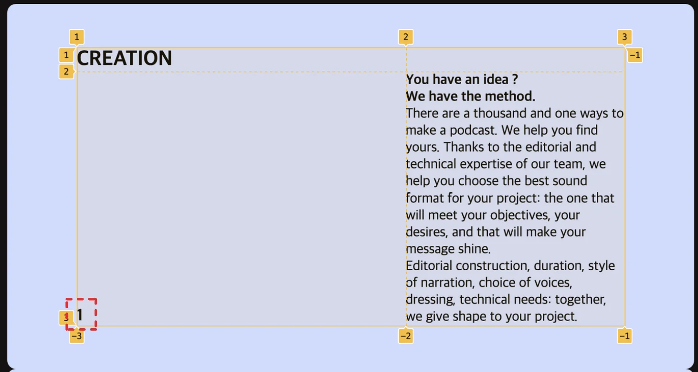

<a id="1d8eda9b0fe1805fb40ffbdbdcab9fe6"></a>

## <code>justify&#45;self</code>, <code>align&#45;self</code>, <code>text&#45;align</code>

---

> 📖 
> 
> <a id="1d8eda9b0fe1807989c5cbc1b3d24257"></a>
> 
> <code>self</code>는 자기 자신 즉, 하위 DOM 하나를 가르킨다&#46; 
> 
> - <code>justify&#45;self</code>&#58;  아이템(Sell) <strong><u>가로(x) 축</u></strong> 기준으로 왼쪽 ↔  오른쪽 정렬
> 
> - <code>align&#45;self</code>&#58; 아이템(Sell) <strong><u>세로(y) 축</u></strong> 기준으로 위 ↔ 아래 정렬
> 
> - <code>text&#45;align</code>&#58; 텍스트 위치 정렬

<details>
<summary>예시) 아래, 왼쪽 정렬</summary>



<a id="1d8eda9b0fe180c2bf50fc74bd2923fb"></a>

```css
/* 부모에 Grid가 적용되어야 함*/
.con4 .listBox .cardBox h3 { 
	grid-column-start: 1; 
	align-self: end;
	justify-self: start; 
	text-align: left;
}
```

<a id="1d8eda9b0fe180feaa55d139e4a6b77a"></a>

```css
/* 강의 코드 */
.con4 .listBox li h2 { grid-column: 1/3; }
.con4 .listBox li h3 { align-self: flex-end; }
```

- <a href="#/post/1d8eda9b-0fe1-8039-8951-ee1fbb838d7d">페이지</a> 

- <code>align&#45;self</code>는 y축 기준으로 <em><strong>맨 아래에 정렬 </strong></em>되도록 한다&#46; 

</details>
