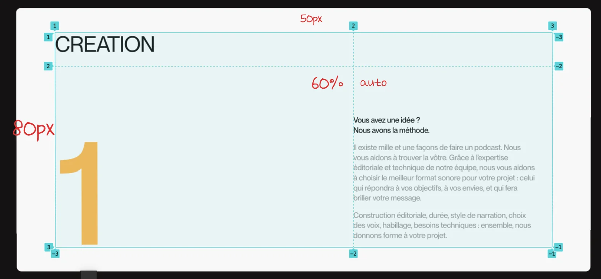

> ✏️ 
> 
> <a id="1d8eda9b0fe18084a9b9cd4d843308eb"></a>
> 
> <strong>NOTE </strong>
> 
> ---

<a id="1d8eda9b0fe180c3a442f09301e52a56"></a>

## Header

---

<a id="1d8eda9b0fe180c58580cfc4cf06e301"></a>

### 레이아웃



<a id="1d8eda9b0fe18033a97ce3105accf5c1"></a>

### 기본 &#45; html, css, js

<details>
<summary>HTML </summary>

<a id="1dbeda9b0fe1809cbd42dd4ffed3f8c3"></a>

```html
<!-- content 4 -->
<section class="con4">
  <div class="inner">
    <div class="mainTextBox">
      <span>NOS SERVICES</span>
      <p class="title a"><i>CREATION</i></p>
      <p class="title b"><i>PRODUCTION</i></p>
      <div class="in">
        <video class="box" playinline="" autoplay="" loop="" muted="">
          <source src="https://cdn.sanity.io/files/u6q95fqm/production/c0594d11b2a34d37493ac112d3cb8d1d315a129e.mp4"
            type="video/mp4">
         </video>
        <p class="title c"><i>DIFFUSION</i></p>
      </div>
    </div>
    <ul class="listBox">
      <li class="cardBox a">
        <h2>CREATION</h2>
        <h3>1</h3>
        <div class="text">
          <h4>You have an idea ?<br>We have the method.</h4>
          <p>There are a thousand and one ways to make a podcast. We help you find yours. Thanks to the editorial and technical expertise of our team, we help you choose the best sound format for your project: the one that will meet your objectives, your desires, and that will make your message shine.</p>
          <p>Editorial construction, duration, style of narration, choice of voices, dressing, technical needs: together, we give shape to your project.</p>
        </div>                                                                             
      </li>
      <li class="cardBox b">
        <h2>PRODUCTION</h2>
        <h3>2</h3>
        <div class="text">
          <h4>You have an idea ?<br>We have the method.</h4>
          <p>There are a thousand and one ways to make a podcast. We help you find yours. Thanks to the editorial and technical expertise of our team, we help you choose the best sound format for your project: the one that will meet your objectives, your desires, and that will make your message shine.</p>
          <p>Editorial construction, duration, style of narration, choice of voices, dressing, technical needs: together, we give shape to your project.</p>
        </div>                                                                             
      </li>
      <li class="cardBox c">
        <h2>DIFFUSION</h2>
        <h3>3</h3>
        <div class="text">
          <h4>You have an idea ?<br>We have the method.</h4>
          <p>There are a thousand and one ways to make a podcast. We help you find yours. Thanks to the editorial and technical expertise of our team, we help you choose the best sound format for your project: the one that will meet your objectives, your desires, and that will make your message shine.</p>
          <p>Editorial construction, duration, style of narration, choice of voices, dressing, technical needs: together, we give shape to your project.</p>
        </div>                                                                             
      </li>
    </ul>
    <div class="subTextBox">
      <div class="subText">
        <p>At Qude, we don't have big or small projects. We only have people, creativity, sharing.</p>
        <p>Each podcast should be a succession of moments of pleasure. Exceptional moments. Design, production, distribution. And listening.</p>
      </div>
    </div>
  </div>
</section>
```

</details>

<details>
<summary>CSS</summary>

<a id="1dbeda9b0fe1809aacbed8e726d381ab"></a>

```css
/* content 4 */
.con4 .mainTextBox { position: relative; }
.con4 .mainTextBox span { position: absolute; top: 0; right: 0; }
.con4 .mainTextBox .title { font-size: 120px; line-height: 1; letter-spacing: -5px; overflow: hidden; }
.con4 .mainTextBox .title.b { text-align: center; }
.con4 .mainTextBox .title.c { align-self: flex-start; }
.con4 .mainTextBox .title i { display: block;}
.con4 .mainTextBox .in { display: flex; justify-content: flex-end; }
.con4 .mainTextBox .in .box { max-width: 550px; margin-right: 20px; }

.con4 .listBox { margin: 100px 0; perspective: 900px; }
.con4 .listBox .cardBox { background-color: #fff; border-radius: 10px; padding: 50px 80px 60px; margin-bottom: 35px; color: #141212; display: grid; grid-template-columns: 60% auto; 
  position: sticky; position: -webkit-sticky; top:100px; filter:brightness(1); }
.con4 .listBox .cardBox h2 { font-size: 40px; font-weight: normal; letter-spacing: -2px; padding-bottom: 20px; border-bottom: solid 1px #ddd; 
  grid-column: 1/3; margin-bottom: 100px;}
.con4 .listBox .cardBox h3 { font-size: 300px; font-weight: bold; line-height: 0.9;  align-items: end; transform: translateY(16%);}
.con4 .listBox .cardBox .text { align-self: end; line-height: 1.4; }
.con4 .listBox .cardBox .text h4 { margin-bottom: 20px; line-height: 1.2; }
.con4 .listBox .cardBox .text p { opacity: .5; }
.con4 .listBox .cardBox.a h3 {color: #ffb84f; }
.con4 .listBox .cardBox.b h3 {color: #90c3cd; }
.con4 .listBox .cardBox.c h3 {color: #47b172; }

.con4 .subTextBox {display: grid; grid-template-columns: repeat(2, 1fr); }
.con4 .subTextBox .subText { max-width: 600px; font-size: 22px; grid-column-start: 2; }
.con4 .subTextBox .subText p:nth-child(1) { margin-bottom: 20px; }
```

</details>

<details>
<summary>JS</summary>

<a id="1dbeda9b0fe180dfac00fcbce71a3d5b"></a>

<a href="#/post/1daeda9b-0fe1-80cb-8966-e7fde551b29a">페이지</a> 

</details>

<a id="1d8eda9b0fe180bfa610e9bb84d4efda"></a>

### 리액트 &#45; tailwind css

<details>
<summary>react</summary>

<a id="1d8eda9b0fe180f0b906db04394882ba"></a>

```javascript

```

</details>
