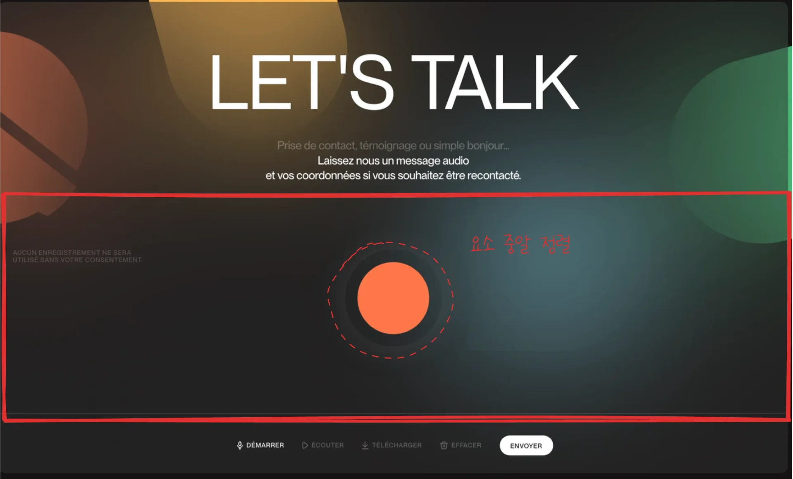

<a id="1d9eda9b0fe180949351ed023ec104be"></a>

<strong>FlexBox</strong>

<a id="1d9eda9b0fe18051afe4fafa0f0b79a5"></a>

```css
display: flex;
justify-content: center;
align-items: center;
```

<a id="1d9eda9b0fe1807dafc2ee1ac6414302"></a>

<strong>Grid</strong>

<a id="1d9eda9b0fe180de937ec958c268f0d6"></a>

```css
display: grid;
place-item: center;
```
