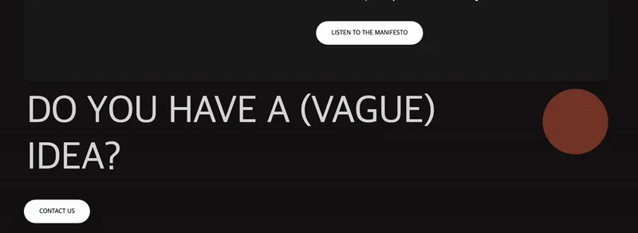

<a id="1daeda9b0fe18027be0ee54e419438f1"></a>

## &#91; TextAni &#93; 텍스트 변경 애니메이션

---

<a id="1daeda9b0fe18076962ce93f1d69a6b8"></a>

### 레이아웃



<a id="1daeda9b0fe180519032f190e156f82d"></a>

### GSAP 인터렉티브 애니메이션 효과

<a id="1daeda9b0fe1807d81aefdaa5a4c92ff"></a>

```
const textAniList = document.querySelectorAll('.con1 .textAni li');
const textAni = gsap.timeline({repeat: -1}); // 무한 반복

textAniList.forEach((selector)=> {
    textAni.to(selector, 0.8, {opacity: 1, repeat: 1, delay: 0, x: 0, yoyo:true, ease: 'power4.out'})
})

textAni.play();
```

<a id="1daeda9b0fe1801a9c65e3b284df6644"></a>

### NOTES

<details>
<summary>1&#46; 해당하는 <code>selector</code>를 전부 배열로 가져옴</summary>

<a id="1daeda9b0fe180ddb95bed9048e52be6"></a>

```javascript
querySelectorAll( selector )
```

</details>

<details>
<summary>2&#46; 애니메이션 무한 반복</summary>

<a id="1daeda9b0fe18069898bd9fe1331de4f"></a>

```javascript
// repeat: -1 = 무한 반복
const textAni = gsap.timeline({repeat: -1});

textAniList.forEach((selector)=> {
    textAni.to(
	    selector, 
	    0.8, 
	    {
		    opacity: 1, 
		    repeat: 1, 
		    delay: 0, 
		    x: 0, 
		    yoyo:true, 
		    ease: 'power4.out'
    })
})
```

| <strong>속성</strong> | <strong>설명</strong> | <strong>비고</strong> |
| --- | --- | --- |
| <code>selector</code> | 애니메이션을 적용할 대상 (HTML 요소) | 예&#58; &#60;li&#62;, &#60;div&#62; 같은 요소 하나 |
| <code>0&#46;8 (두 번째 인자)</code> | 애니메이션 지속시간 (초 단위) | 0&#46;8초 동안 애니메이션 진행 |
| <code>opacity</code> | 투명도 설정 (0=완전투명, 1=완전선명) | 1로 설정 → <strong>완전히 선명하게</strong> |
| <code>repeat</code> | 몇 번 반복할지 설정 | 1번 추가 반복 (총 2번&#58; 원래 &#43; 반복 1회) |
| <code>delay</code> | 애니메이션 시작 전에 기다리는 시간 (초) | 0초 → 바로 시작 |
| <code>x</code> | x축(가로 방향)으로 이동할 거리(px) | 0px → 이동 없음 (기존 위치) |
| <code>yoyo&#58; true</code> | 왕복(yoyo) 애니메이션 여부 | true 설정하면 <strong>갔다가 다시 돌아옴</strong> |
| <code>ease&#58; &#39;power4&#46;out&#39;</code> | 애니메이션 가속도(완급 조정) 설정 | 빠르게 시작해서 부드럽게 멈춤 |

</details>

<a id="1daeda9b0fe180fb8ebee3840b4f1130"></a>

 3&#46; <code>textAni&#46;play()</code> 를 통해 애니메이션 시작

<a id="1daeda9b0fe180c3a781d7ae77f04caa"></a>

### HTML, CSS

> 

<details>
<summary>HTML </summary>

<a id="1daeda9b0fe180ebb211dbca3df6a81a"></a>

```html

```

</details>

<details>
<summary>CSS</summary>

<a id="1daeda9b0fe180b988edcaf2fd77b1de"></a>

```css

```

</details>

<a id="1daeda9b0fe180f39735f8bd54bdb093"></a>

## 리액트 &#45; tailwind css

<a id="1daeda9b0fe18088a3aade8890f8a380"></a>

<strong>react</strong>

<a id="1daeda9b0fe18067baefe5a4932f6859"></a>

```javascript

```
