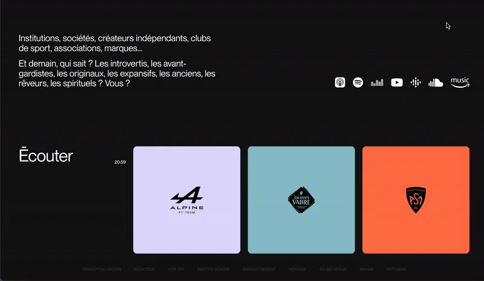
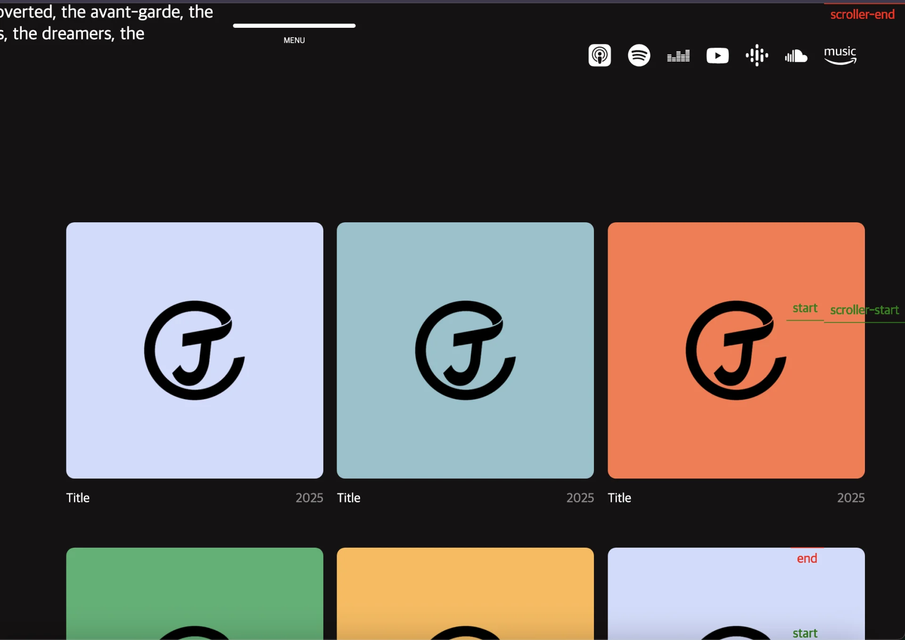

<details>
<summary>직접 구현한 애니메이션 &#45; <code>fromTo()</code></summary>

<a id="1dbeda9b0fe180a19e3bc61914f67008"></a>

### 레이아웃


<a id="1dbeda9b0fe180b28890d0b36c8969b5"></a>

### GSAP

<a id="1dbeda9b0fe18023a2f2ec112334d432"></a>

```java
// con3 listBox Box 애니메이션
    gsap.utils.toArray('.con3 .listBox li').forEach((selector, idx) => {
        let h = 95 - 5 * ( idx % 3)
        gsap.timeline({
            scrollTrigger: {
                trigger: selector,
                start: `0% ${h}%`,
                end: `0% ${h}%`,
                scrub: 1,
                markers: true
            }
        })
        .fromTo(selector, 
		        { y: 40, rotateX: -30, scale: 0.8, opacity: 0}, 
		        { y: 0, rotateX: 0, scale: 1, opacity: 1, duration: 10}
        ,2)
    })
```

</details>

<a id="1dbeda9b0fe180e1817bc98f94497b94"></a>

## &#91; con3 listBox &#93; box 애니메이션

---

<a id="1dbeda9b0fe180659fd1cd1047b72b17"></a>

### 레이아웃





- 아래 스크롤 시에만 애니메이션 효과 진행

- 추가) 특정 Box에 hover 시 하단 MenuBar Box 색상 부여하기 
    <a id="1dbeda9b0fe18019a073f4014a23ce59"></a>

    1&#46;  특정 박스에 대한 색깔 가져오기

    1. 가져온 색깔 하단 MenuBar에 추가하기

<a id="1dbeda9b0fe18031bd81dfbca1617f5c"></a>

### GSAP 인터렉티브 애니메이션 효과

<a id="1dbeda9b0fe180f1b800e43205e56c24"></a>

```javascript
gsap.utils.toArray('.con3 .listBox li').forEach((selector, idx) => {
    ScrollTrigger.create({
        trigger: selector,
        start: '30% 50%',
        onEnter: () => {
            gsap.set(selector, {
                rotationX: '-65deg',
                z: '-500px',
                opacity: 0
            }),
            gsap.to(selector, {
                rotationX: 0,
                z: 0,
                opacity: 1,
                delay: idx % 3 * .05
            })
        },
        markers: true
    })
})
```

<a id="1dbeda9b0fe180e0b053cb33efa2cd3d"></a>

### NOTES

<details>
<summary>각 DOM 요소마다 <code>ScrollTrigger</code> 적용 → <u>인덱스</u>에 따른 <u>딜레이</u> 효과 가능</summary>

> <a href="#/post/1dbeda9b-0fe1-8009-9755-f6379767a452">페이지</a> 

<a id="1dbeda9b0fe18020a213d185daccb8bf"></a>

<code>ScrollTrigger&#46;create()</code> 사용 시&#46; 각 selector(DOM) 마다 Scrolltrigger를 적용 시킨다&#46;

</details>

<details>
<summary>아래 스크롤 시에만 트리거 적용</summary>

> <a href="#/post/1dbeda9b-0fe1-80bf-aba4-ec06c632e1ca">페이지</a> 

- <code>onEnter&#58; () ⇒ {…}</code>
    <a id="1dbeda9b0fe18062924ee7256e94905d"></a>

    <code>onEnter</code> 사용 시 <u>아래 스크롤</u> 통해서<strong><u> 해당 DOM이 설정한 viewport 위치에 들</u></strong>어올 시 <u>트리거가 발생</u><strong>된다&#46;</strong>

</details>

<details>
<summary>timeline을 사용한 방식으로 변경</summary>

<a id="1dbeda9b0fe1807e92fbdf3b10776004"></a>

```javascript
gsap.utils.toArray('.con3 .listBox li').forEach((selector, idx) => {
    const tl = gsap.timeline({
        scrollTrigger: {
            trigger: selector,
            start: '30% 50%',
            toggleActions: 'play none none none',  // onEnter: true, 
            markers: true
        }
    });

    // 타임라인에 순서대로 추가
    tl.set(selector, {
        rotationX: '-65deg',
        z: '-500px',
        opacity: 0
    })
    .to(selector, {
        rotationX: 0,
        z: 0,
        opacity: 1,
        delay: idx % 3 * 0.05
    });
}); 
```

- <code>toggleActions</code>를 사용하면 <code>timeline</code>에서도 동일하게 <code>onEnter</code>(아래 스크롤 시에만) 트리거를 적용할 수 있다&#46;

</details>

<a id="1dbeda9b0fe180629afcd71a7d500d5f"></a>

### HTML, CSS

> <a href="#/post/1d8eda9b-0fe1-8069-b924-f47d9bc5d344">페이지</a> 

<details>
<summary>HTML </summary>

<a id="1dbeda9b0fe1802ab11df9f7991a4b30"></a>

```html
<!-- content 3 -->
<section class="con3">
  <div class="inner">
    <div class="textBox">
      <h4>My Projects</h4>
    </div>
    <ul class="listBox">
      <li data-color="a">
        <p class="img"></p>
        <h4>
          <span class="a">Title</span>
          <span class="b">2025</span>
        </h4>
      </li>
      <li data-color="b">
        <p class="img"></p>
        <h4>
          <span class="a">Title</span>
          <span class="b">2025</span>
        </h4>
      </li>
      <li data-color="c">
        <p class="img"></p>
        <h4>
          <span class="a">Title</span>
          <span class="b">2025</span>
        </h4>
      </li>
      <li data-color="d">
        <p class="img"></p>
        <h4>
          <span class="a">Title</span>
          <span class="b">2025</span>
        </h4>
      </li>
      <li data-color="e">
        <p class="img"></p>
        <h4>
          <span class="a">Title</span>
          <span class="b">2025</span>
        </h4>
      </li>
      <li data-color="a">
        <p class="img"></p>
        <h4>
          <span class="a">Title</span>
          <span class="b">2025</span>
        </h4>
      </li>
      <li data-color="b">
        <p class="img"></p>
        <h4>
          <span class="a">Title</span>
          <span class="b">2025</span>
        </h4>
      </li>
      <li data-color="c">
        <p class="img"></p>
        <h4>
          <span class="a">Title</span>
          <span class="b">2025</span>
        </h4>
      </li>
      <li data-color="d">
        <p class="img"></p>
        <h4>
          <span class="a">Title</span>
          <span class="b">2025</span>
        </h4>
      </li>
    </ul>
  </div>
</section>
```

</details>

<details>
<summary>CSS</summary>

<a id="1dbeda9b0fe180e98409c557192cb014"></a>

```css
/* content 3 */
.con3 .inner { display: flex; justify-content: space-between; }
.con3 .textBox { width: 28vw; }
.con3 .textBox h4 { font-size: clamp(1.2rem, 100vw, 3rem); font-weight: normal; position: -webkit-sticky; position: sticky; top: 50%; transform: translateY(-50%);}

/* overflow:hidden 주는 이유는 스크롤 트리거를 작성하게 되면 가로 스크롤이 생겨서 이를 가려주기 위해서 이다. */
.con3 .listBox { width: 70%; display: flex; justify-content: space-between; flex-wrap: wrap; perspective: 900px; overflow: hidden;}
.con3 .listBox li { width: 32.2%;}
.con3 .listBox li .img { background-color: var(--sub-color); border-radius: 10px; text-align: center; padding: 30% 0; }
.con3 .listBox li .img img { width: 40%; }
.con3 .listBox li h4 { display: flex; justify-content: space-between; margin: 15px 0 50px; font-weight: normal; }
.con3 .listBox li h4 span.b { opacity: 0.5;}
.con3 .listBox li[data-color="a"]{--sub-color: #d1dbfd;}
.con3 .listBox li[data-color="b"]{--sub-color: #90c3cd;}
.con3 .listBox li[data-color="c"]{--sub-color: #ff764a;}
.con3 .listBox li[data-color="d"]{--sub-color: #47b172;}
.con3 .listBox li[data-color="e"]{--sub-color: #ffb84f;}
```

</details>

<a id="1dbeda9b0fe18050a94aef28061b8b90"></a>

### 리액트 &#45; tailwind css

<a id="1dbeda9b0fe18014aa78d15ba7174a8d"></a>

<strong>react</strong>

<a id="1dbeda9b0fe180198f28efab368c752d"></a>

```javascript

```
