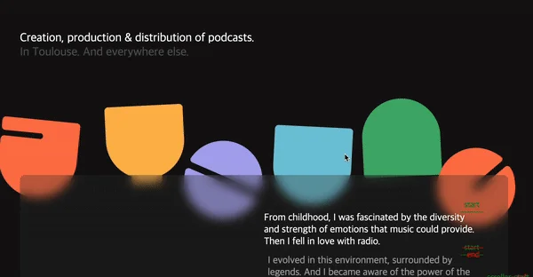
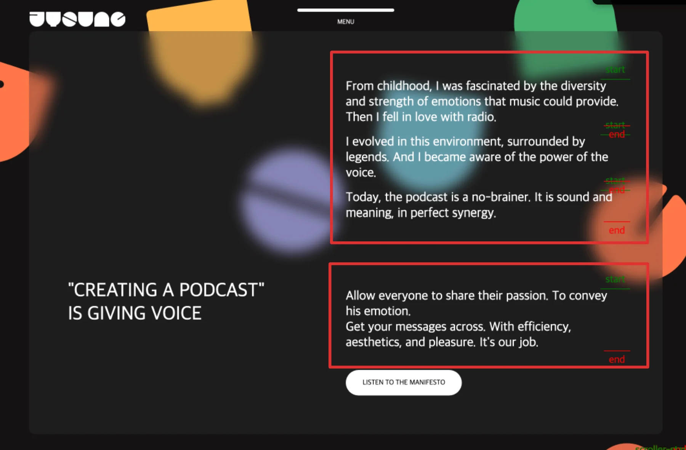
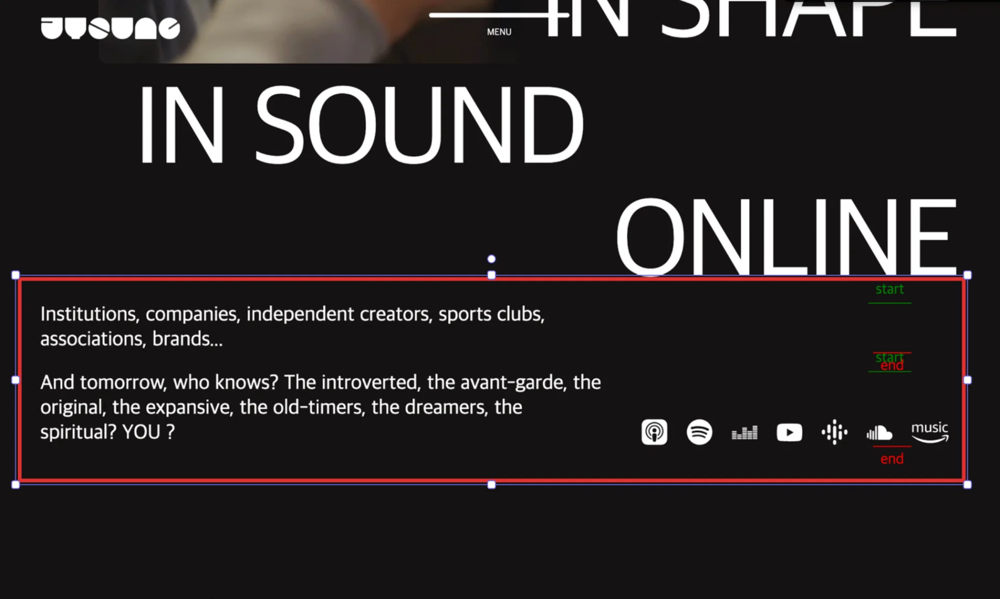

<a id="1daeda9b0fe180228ab4f7be9349a306"></a>

## &#91; SubText 영역 &#93; 애니메이션

---

<a id="1daeda9b0fe1801c836ae4fbd08ab7e9"></a>

### 레이아웃







<a id="1daeda9b0fe1807e8e99c273f2e3a316"></a>

### GSAP 인터렉티브 애니메이션 효과

<a id="1daeda9b0fe1800497a5c740f6f64679"></a>

```javascript
// subText - 애니메이션
gsap.utils.toArray('.subText p').forEach((selector) => {
    console.log(selector)
    gsap.timeline({
        scrollTrigger: {
            trigger: selector,
            start: '0% 100%',
            end: '100% 100%',
            scrub: 1,
            markers: true
        }
    })
    .fromTo(
        selector,
        {overflow: 'hidden', x: 20, opacity: 0},
        {x:0, opacity: 1, ease: 'none', duration: 5},
        0)
})
```

<a id="1daeda9b0fe18069bc7ff845a0758a5c"></a>

### HTML, CSS

> 

<details>
<summary>HTML </summary>

<a id="1daeda9b0fe180868a1ed24a3ac5e3bd"></a>

```html

```

</details>

<details>
<summary>CSS</summary>

<a id="1daeda9b0fe180d58804fa7cae6cc1b8"></a>

```css

```

</details>

<a id="1daeda9b0fe180d88170e561d085e3aa"></a>

## 리액트 &#45; tailwind css

<a id="1daeda9b0fe1800ca8ade49f88972890"></a>

<strong>react</strong>

<a id="1daeda9b0fe1806da379e4fbe6278587"></a>

```javascript

```
