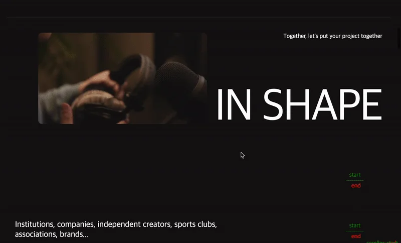
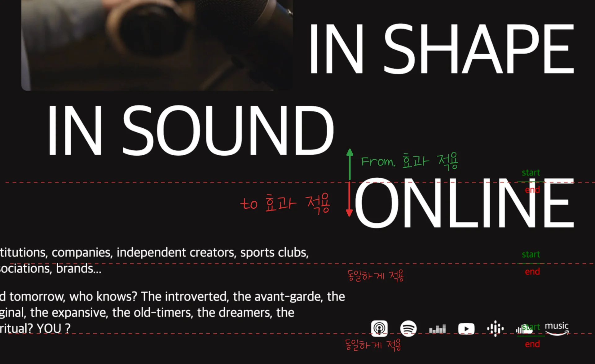
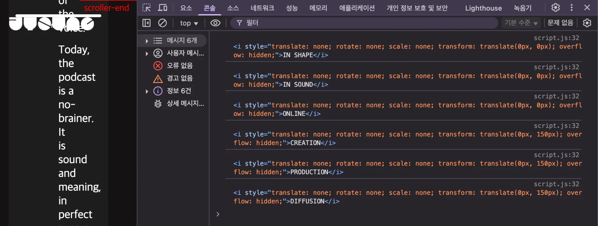
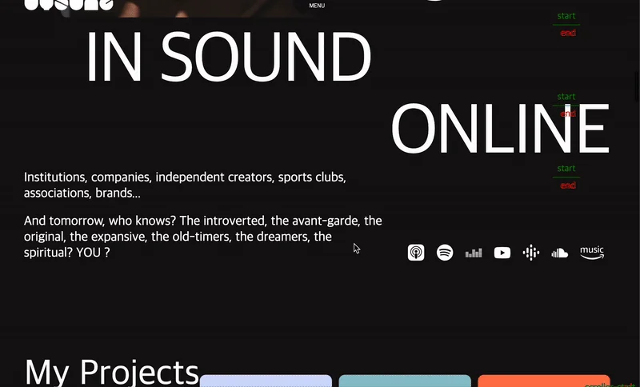

<a id="1daeda9b0fe180bfb07adbf34e0702c5"></a>

<a href="#/post/1daeda9b-0fe1-80ec-8c6e-dfdd1ace87ec">페이지</a> 

<a id="1daeda9b0fe180209747de112aa7140d"></a>

## &#91; text 영역 &#93; 애니메이션

---

<a id="1daeda9b0fe180c58a33e09bae6aafd0"></a>

### 레이아웃



<a id="1daeda9b0fe180fbad89f41c04dbe790"></a>

### GSAP 인터렉티브 애니메이션 효과

<a id="1daeda9b0fe180dd9478d4316e8e2d37"></a>

```javascript
gsap.utils.toArray('.mainTextBox .title i').forEach((selector) => {
    console.log(selector)
    gsap.timeline({
        scrollTrigger: {
            trigger: selector,
            start: '100% 100%',
            end: '100% 100%',
            scrub: 1,
            markers: true,
        }
    })
    .fromTo(selector, {overflow: 'hidden', y:150}, {y:0, ease: 'none', duration: 5}, 0)
})
```

<a id="1daeda9b0fe180a0a577e38056397783"></a>

### NOTES

---

<details>
<summary><strong><code>&#46;fromTo(Dom, from 효과, to 효과, delay)</code></strong><strong>Scroll 이벤트에 따른 </strong><strong><code>From</code></strong><strong>, </strong><strong><code>To</code></strong><strong>  효과 적용</strong></summary>



- <code>start</code> 영역에서는 <strong><u>from 애니메이션 효과</u></strong> 적용

- <code> end</code> 영역에서는 <u>to</u><strong><u> 애니메이션 효과</u></strong> 적용

</details>

<details>
<summary>&#91; 🤬 오류 &#93; DOM 을 잘 가져오나  CSS 효과가 적용되지 않음</summary>

<a id="1daeda9b0fe180ae9019d6be73dc9adc"></a>

### 문제&#58; Content2 DOM에 text 애니메이션 효과가 적용되지 않음

<details>
<summary>HTML (DOM)</summary>

<a id="1daeda9b0fe18065a710eec1c8445753"></a>

```html
<!-- content 2 -->
<section class="con2">
<div class="inner">
  <div class="mainTextBox">
    <span>Together, let's put your project together</span>
    <div class="in">
      <video class="box" playinline="" autoplay="" loop="" muted="">
        <source src="https://cdn.sanity.io/files/u6q95fqm/production/db2bced0a14e9b65aa15357cae7799696903a8d4.mp4"
          type="video/mp4">
      </video>
      <p class="title a"><i>IN SHAPE</i></p>
    </div>
    <p class="title b"><i>IN SOUND</i></p>
    <p class="title c"><i>ONLINE</i></p>
  </div>
  
   . . .
  
```

<a id="1daeda9b0fe180c8a7d8e1a69f0f1a73"></a>

```html
<!-- content 4 -->
<section class="con4">
  <div class="inner">
    <div class="mainTextBox">
      <span>NOS SERVICES</span>
      <p class="title a"><i>CREATION</i></p>
      <p class="title b"><i>PRODUCTION</i></p>
      <div class="in">
        <video class="box" playinline="" autoplay="" loop="" muted="">
          <source src="https://cdn.sanity.io/files/u6q95fqm/production/c0594d11b2a34d37493ac112d3cb8d1d315a129e.mp4"
            type="video/mp4">
         </video>
        <p class="title c"><i>DIFFUSION</i></p>
      </div>
    </div>
  
   . . .
  
```

</details>

<details>
<summary>CSS </summary>

<a id="1daeda9b0fe1803faea0f87d8d46d871"></a>

```css
/* content 2 */
.con2 .inner { position: relative; padding: 40px 50px; }
.con2 .inner:before { content:''; width: 95%; height: 1px; background: #3b3b3b; position: absolute; left: 50%; transform: translateX(-50%); top: 0 }

.con2 .mainTextBox { position: relative }
.con2 .mainTextBox span { position: absolute; right: 0; top: 0; }
.con2 .mainTextBox .in { display: flex; justify-content: flex-end; margin-bottom: 15px; }
.con2 .mainTextBox .in .box { max-width: 450px; margin-right: 20px; }
.con2 .mainTextBox .in .box video { width: 100%;}
.con2 .mainTextBox .title { font-size: 120px; line-height: 1; letter-spacing: -5px; text-align: right; overflow:hidden;}
.con2 .mainTextBox .title.a { align-self: flex-end;}
.con2 .mainTextBox .title.b { margin-right: 400px;}


/* content 4 */
.con4 .mainTextBox { position: relative; }
.con4 .mainTextBox span { position: absolute; top: 0; right: 0; }
.con4 .mainTextBox .title { font-size: 120px; line-height: 1; letter-spacing: -5px; overflow: hidden; }
.con4 .mainTextBox .title.b { text-align: center; }
.con4 .mainTextBox .title.c { align-self: flex-start; }
.con4 .mainTextBox .title i { display: block;}
.con4 .mainTextBox .in { display: flex; justify-content: flex-end; }
.con4 .mainTextBox .in .box { max-width: 550px; margin-right: 20px; }

```

</details>

<a id="1daeda9b0fe180c28cf4ecea1c6bcf79"></a>

```javascript
   gsap.utils.toArray('.mainTextBox .title i').forEach((selector) => {
        console.log(selector)
        gsap.timeline({
            scrollTrigger: {
                trigger: selector,
                start: '100% 100%',
                end: '100% 100%',
                scrub: 1,
                markers: true,
            }
        })
        .fromTo(selector, {overflow: 'hidden', y:150}, {y:0, ease: 'none', duration: 5}, 0)
    })
```

- console&#46;log 로 가져오는 DOM을 확인하니 해당하는 DOM을 잘 가져오는 것을 확인
    

- 그러나 <code>&#46;content2</code>의 텍스트에 <code>&#46;formTo(…)</code>  <strong><u>애니메이션 효과가 적용되지 않</u></strong>음
    

<a id="1daeda9b0fe1805cbd3ef464284c2b28"></a>

### 원인

> <a href="#/post/1daeda9b-0fe1-806e-96e9-f1a8e208afa2">페이지</a> 

<a id="1daeda9b0fe1805d8c6efd30b1f1d996"></a>

&#60;i&#62; 는 기본이 inlin이다&#46; 따라서 transform 적용이 불안정 해서, block으로 만들어야 움직임(transform)이 확실하게 적용된다&#46;

<a id="1daeda9b0fe180d4baeff486b3e0180d"></a>

### 해결 

<a id="1daeda9b0fe1800295c5f26ac54f92b3"></a>

```javascript
.con4 .mainTextBox .title i { display: block; }
```

- 위와 같이 CSS에  <code>block</code> 속성을 추가 →  정상 동작

</details>

<a id="1daeda9b0fe180a38445dad6afc098ef"></a>

### HTML, CSS

> 

<details>
<summary>HTML </summary>

<a id="1daeda9b0fe180e5b46ccb19215130f4"></a>

```html

```

</details>

<details>
<summary>CSS</summary>

<a id="1daeda9b0fe1806fa793ee4f10aff4fb"></a>

```css

```

</details>

<a id="1daeda9b0fe1806c874ad12e85996a2c"></a>

## 리액트 &#45; tailwind css

<a id="1daeda9b0fe180eb8621eb7a47de6dea"></a>

<strong>react</strong>

<a id="1daeda9b0fe1803ba52af073896665f1"></a>

```javascript

```
