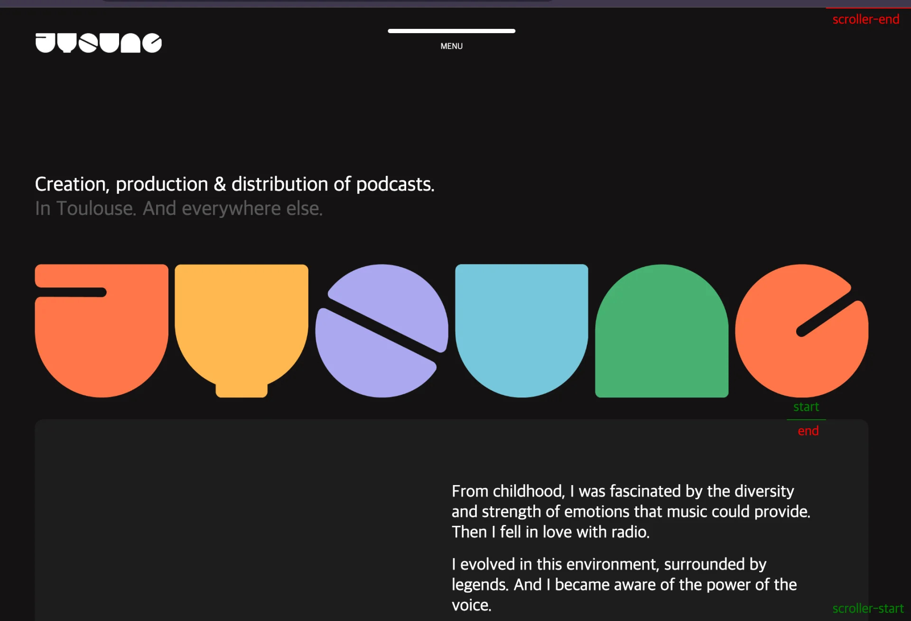
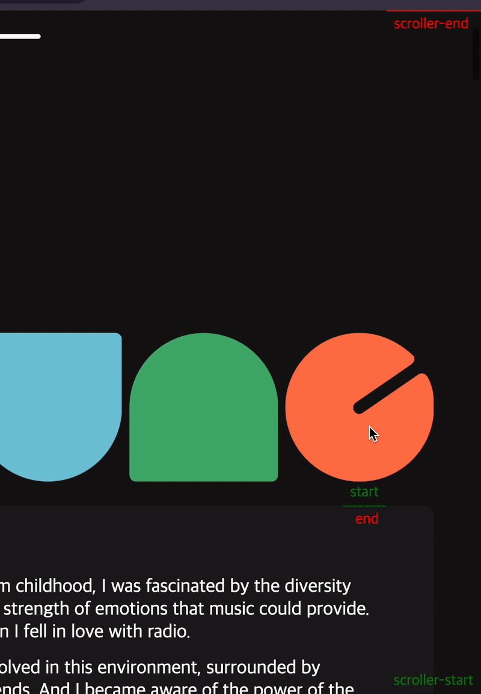

<a id="1daeda9b0fe180bbbbe2dc922d784843"></a>

## ScrollTrigger &#45; markers&#58; true

---

<a id="1daeda9b0fe180339b1ff2a0efea2b20"></a>

```javascript

   gsap .registerPlugin(ScrollTrigger);  // gsap 라이브러리의 ScrollTrigger 등록

    gsap.timeline({
        scrollTrigger: {
            trigger: '.visual',
            start: '100% 100%',
            end: '100% 0',
            scrub: 1,   
            markers: true
        }
    })
```





- <code>scrollTrigger { makers&#58; true }</code>설정 시, 렌더링 화면에 <strong><u>scroll 이벤트의 시작과 끝점을 표시</u></strong>한다&#46;
