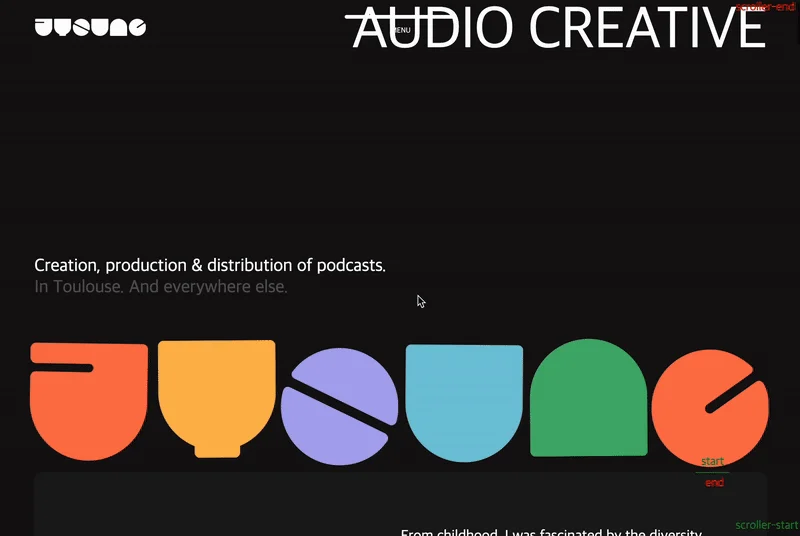
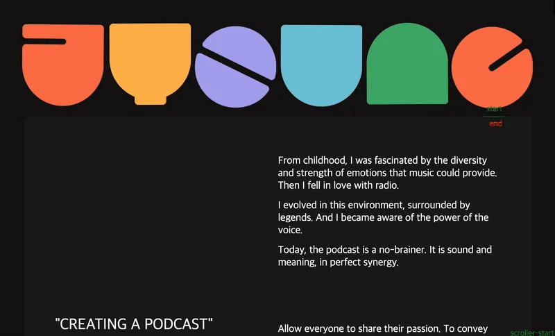

<a id="1daeda9b0fe181adb7f9fad8cd93f20b"></a>

## <code>&#46;visual</code> 영역 로고 애니메이션

---

<a id="1daeda9b0fe181019365f10ad0ea9ebf"></a>

### 레이아웃



<a id="1daeda9b0fe180fe9da3cef9f1ede4c9"></a>

### GSAP 인터렉티브 애니메이션 효과

<a id="1daeda9b0fe1800cb180e1e22dd60bdc"></a>

```javascript
// 띄어쓰기 중요!
gsap .registerPlugin(ScrollTrigger);  // 1. gsap 라이브러리의 ScrollTrigger 등록

   // 2. 애니메이션 트리거 설정, timeline: 일관적인 관리 가능
    gsap.timeline({
        scrollTrigger: {
            trigger: '.visual',
            start: '100% 100%',
            end: '100% 0',
            scrub: 1,   // true 면 바로 효과 시작, 1, 2, 3...: duration(딜레이) 줌
            markers: true
        }
    })
    // 3. DOM 애니메이션 효과: to(DOM, {x축, y축, 회전, ?, 진행속도}, delay)
    .to('.logoWrap #j', {x: -150, y: 250, rotate: 20, ease: 'none', duration: 5}, 0)  
    .to('.logoWrap #y', {x: 30, y: 150, rotate: -10, ease: 'none', duration: 5}, 0)  
    .to('.logoWrap #o', {x: 0, y: 400, rotate: -10, ease: 'none', duration: 5}, 0)  
    .to('.logoWrap #u', {x: 50, y: 300, rotate: 10, ease: 'none', duration: 5}, 0)  
    .to('.logoWrap #n', {x: 100, y: 100, rotate: -10, ease: 'none', duration: 5}, 0)  
    .to('.logoWrap #g', {x: 50, y: 450, rotate: -20, ease: 'none', duration: 5}, 0)  
```

<details>
<summary>1&#46; gsap 에  ScrollTrigger 플러그인 등록</summary>

<a id="1daeda9b0fe180a38a19f5f57874e2db"></a>

```javascript
gsap .registerPlugin(ScrollTrigger)
```

</details>

<details>
<summary>2&#46; 애니메이션 트리거 설정&#58; <code>gsap&#46;timeline</code></summary>

> ✏️ 
> 
> <a id="1daeda9b0fe180d29a38c6e369401350"></a>
> 
> 애니메이션 트리거 설정
> 
> - 애니메이션 DOM 요소들을 일괄적으로 관리 가능함

<a id="1daeda9b0fe180239cb1c019051a229d"></a>

```javascript
gsap.timeline({
        scrollTrigger: {
            trigger: '.visual',
            start: '100% 100%',
            end: '100% 0',
            scrub: 1,   // true 면 바로 효과 시작, 1, 2, 3...: duration(딜레이) 줌
            markers: true
        }
    })
```

- <code>trigger</code>&#58;  애니메이션의 trigger로 설정할 DOM 지정

- <code>start</code>&#58; 해당 지점에서 애니메이션 시작

- <code>end</code>&#58; 해당 지점 도달 시 애니메이션 종료

- <code>scrub</code>&#58;  scroll 이벤트에 맞춰 애니메이션 진행, duration 가능
    - <code>false</code>&#58;  scroll 이벤트에 맞추지 않고 바로 애니메이션 진행

    - <code>true</code>&#58;  scroll 이벤트에 맞춰 애니메이션 진행

    - <code>1, 2, 3…</code>&#58; duration 설정 가능

- <code>makers</code>&#58; scroll 이벤트 화면으로 확인 가능 
    - <a href="#/post/1daeda9b-0fe1-80f5-93f3-d8256752cf15">페이지</a> 

</details>

<details>
<summary>3&#46; <code>&#46;to(&#46;&#46;&#46;)</code>&#58; DOM 애니메이션 효과 지정 </summary>

> ✏️ 
> 
> <a id="1daeda9b0fe180df87fae128fe110925"></a>
> 
> <code>to(DOM, {x, y, rotate, ease, duration}, delay)</code>
> 
> ---
> 
> - <code>x</code>&#58; <code>transform&#58; translateX</code>
> 
> -  <code>y</code>&#58; <code>transform&#58; translateY</code>
> 
> - <code>rotate</code>&#58; DOM 회전
> 
> - <code>ease</code>&#58; <strong>애니메이션 속도 곡선,  duration 동안 속도 ‘빨라졌다, 느려졌다’ 조절 가능</strong>
> 
> - <code>duratian</code>&#58;  애니메이션 진행 속도 
> 
> - <code>delay&#58; 0</code> &#58; 딜레이 없이 바로 진행

<a id="1daeda9b0fe180f0a2a8e5fde18006a0"></a>

```javascript
.to('.logoWrap #j', {x: -150, y: 250, rotate: 20, ease: 'none', duration: 5}, 0)  
.to('.logoWrap #y', {x: 30, y: 150, rotate: -10, ease: 'none', duration: 5}, 0)  
.to('.logoWrap #o', {x: 0, y: 400, rotate: -10, ease: 'none', duration: 5}, 0)  
.to('.logoWrap #u', {x: 50, y: 300, rotate: 10, ease: 'none', duration: 5}, 0)  
.to('.logoWrap #n', {x: 100, y: 100, rotate: -10, ease: 'none', duration: 5}, 0)  
.to('.logoWrap #g', {x: 50, y: 450, rotate: -20, ease: 'none', duration: 5}, 0)  
```

</details>

> ⚠️ 
> 
> <a id="1daeda9b0fe1807bb331d95f37a10813"></a>
> 
> <strong>&#91; 주의 &#93; </strong><strong>scrub을 주지 않</strong><strong>으면 scroll 이벤트와 상관없이 애니메이션이 진행됨</strong>
> 
> ---
> 
> 

<a id="1daeda9b0fe180538363cbc0ab500dd8"></a>

### HTML, CSS

> <a href="#/post/1daeda9b-0fe1-8079-99ff-c29182ebb50f">페이지</a> 

<details>
<summary>HTML </summary>

<a id="1daeda9b0fe180f3967ff970b3b93554"></a>

```html
 <!-- visual -->
  <section class="visual">
    <div class="inner">
      <h1 class="mainText">
        <span><i>AGENCE</i></span>
        <span><i>AUDIO CREATIVE</i></span>
      </h1>
      <h2 class="subText">Creation, production & distribution of podcasts.<br><span>In Toulouse. And everywhere else.</span> </h2>
      <div class="logoWrap">
        <span id="j"></span>
        <span id="y"></span>
        <span id="o"></span>
        <span id="u"></span>
        <span id="n"></span>
        <span id="g"></span>
      </div>
    </div>
  </section>
```

</details>

<details>
<summary>CSS</summary>

<a id="1daeda9b0fe1808cab04ef214dfe5f5a"></a>

```css
.visual { margin-bottom: 0;}
.visual .inner {display: grid; height: 100vh; padding: 25px 50px 25px; box-sizing: border-box; grid-template-rows: auto 1fr auto; }
.visual .inner .mainText { max-width: fit-content; font-weight: normal; font-size: 80px; margin-left: auto; line-height: 0.9; letter-spacing: -2px;}
.visual .inner .mainText span {display: block; overflow: hidden;}

.visual .inner .subText { align-self: flex-end; margin-bottom: 50px; font-weight:normal;}
.visual .inner .subText span { color: #585858; }

.visual .inner .logoWrap { display: flex; justify-content: space-between; }
.visual .inner .logoWrap span { width: 16% }
.visual .inner .logoWrap span img { width: 100%;}
```

</details>

<a id="1daeda9b0fe18138a8c2e88247bbfc72"></a>

## 리액트 &#45; tailwind css

<details>
<summary>react</summary>

<a id="1daeda9b0fe18118b14dd63d4151e2b3"></a>

```javascript

```

</details>
