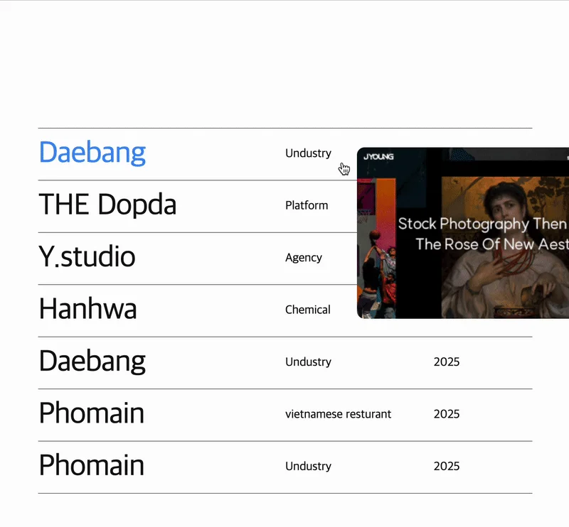

<a id="1dceda9b0fe180cf8dabec23fb781a8d"></a>

## 

---

<a id="1dceda9b0fe180e3befdd279a60bfc18"></a>

### 레이아웃



<a id="1dceda9b0fe180a6add5e16cbcd5699f"></a>

### GSAP 인터렉티브 애니메이션 효과

<a id="1dceda9b0fe180329463cd2646854ea0"></a>

```javascript
// con5 listBox li hover 시 해당하는 이미지 보이는 애니메이션
const listBox = document.querySelectorAll('.con5 .listBox li');
const imgBox = document.querySelector('.con5 .imgBox');
const img = document.querySelector('.con5 .imgBox img');

for(let i = 0; i < listBox.length; i++) {
    listBox[i].addEventListener('mouseenter', () => {
        img.src =`images/img${i}.jpg`;

        gsap.fromTo(imgBox, 
            {scale: 0, opacity: 0},  
            {scale: 1, opacity: 1, duration: 0.3}
        );
    });

    let mouseX = 0;
    let mouseY = 0;
    let currentX = 0;
    let currentY = 0;

    listBox.forEach(item => {
        item.addEventListener('mousemove', (e) => {
            mouseX = e.pageX + 20;
            mouseY = e.pageY - 230;
        });
    });

    // 딜레이 모션
    gsap.ticker.add(() => {
        currentX += (mouseX - currentX) * 0.2;  // 0.2는 따라오는 정도 (0.1 ~ 0.3 추천)
        currentY += (mouseY - currentY) * 0.2;
        
        gsap.set(imgBox, {
            left: currentX,
            top: currentY
        });
    });
    
    listBox[i].addEventListener('mouseleave', () => {
        gsap.to(imgBox, {scale:0, opacity:0, duration:.3})
    });
}

gsap.timeline({
    scrollTrigger: {
        trigger: '.con5',
        start: '0% 100%',
        end: '100% 0%',
        toggleClass: {targets: '.wrap', className: 'on'}
    }
})
```

<a id="1dceda9b0fe1801ca392fb8a0e7b3118"></a>

### NOTES

<details>
<summary><code>gsap&#46;ticker&#46;add()</code></summary>


</details>

<a id="1dceda9b0fe180938362e72eeecc5fa2"></a>

### HTML, CSS

<details>
<summary>HTML </summary>

<a id="1dceda9b0fe18090847bf5fa7b6dc37b"></a>

```html
<!-- content 5 -->
<section class="con5">
  <div class="inner">
    <div class="mainTextBox">
      <h2>Other Project</h2>
    </div>
    <ul class="listBox">
      <li>
        <h3 data-color="a">Daebang</h3>
        <p>Undustry</p>
        <p>2025</p>
      </li>
      <li>
        <h3 data-color="b">THE Dopda</h3>
        <p>Platform</p>
        <p>2025</p>
      </li>
      <li>
        <h3 data-color="c">Y.studio</h3>
        <p>Agency</p>
        <p>2025</p>
      </li>
      <li>
        <h3 data-color="d">Hanhwa</h3>
        <p>Chemical</p>
        <p>2025</p>
      </li>
      <li>
        <h3 data-color="e">Daebang</h3>
        <p>Undustry</p>
        <p>2025</p>
      </li>
      <li>
        <h3 data-color="a">Phomain</h3>
        <p>vietnamese resturant</p>
        <p>2025</p>
      </li>
      <li>
        <h3 data-color="b">Phomain</h3>
        <p>Undustry</p>
        <p>2025</p>
      </li>
    </ul>
    <div class="imgBox box">
      
    </div>
  </div>
</section>
```

</details>

<details>
<summary>CSS</summary>

<a id="1dceda9b0fe1803e87b3c05b576724a2"></a>

```css
/* content 5 */
.con5 {  background-color: #fff; color: #141212; margin-bottom: 0; } 
.con5 .inner { padding: 50px; }
.con5 .inner .mainTextBox h2 { font-size: 100px; letter-spacing: -5px; font-weight: normal; text-transform: uppercase; }

.con5 .listBox { border-top: solid .5px #000; margin-top: 150px; }
.con5 .listBox li { display: grid; grid-template-columns: 1fr minmax(30%, auto) minmax(20%, auto); padding: 10px 0; border-bottom: solid .5px #000; cursor: pointer;}
.con5 .listBox li h3 { font-size: 40px; letter-spacing: -1px; font-weight: normal; }
.con5 .listBox li p { align-self: center;}
.con5 .imgBox { position: absolute; transform: scale(0); opacity: 0; z-index: 100; transition: all .1s; pointer-events: none;  transition: left 0.03s ease, top 0.03s ease;}
.wrap.on { overflow: hidden}

.con5 .listBox li:hover h3 { color: var(--sub-text-color); transition: all 0.2s; }

.con5 .listBox li h3[data-color="a"] { --sub-text-color: #3A8DFF; }  
.con5 .listBox li h3[data-color="b"] { --sub-text-color: #00C2C7; }  
.con5 .listBox li h3[data-color="c"] { --sub-text-color: #9B7EDC; }  
.con5 .listBox li h3[data-color="d"] { --sub-text-color: #FF7F50; }  
.con5 .listBox li h3[data-color="e"] { --sub-text-color: #FFC542; }  

```

</details>

<a id="1dceda9b0fe1801d995ac88bc377d57c"></a>

## 리액트 &#45; tailwind css

<a id="1dceda9b0fe1807da644e74a7bac4e01"></a>

<strong>react</strong>

<a id="1dceda9b0fe1802c8889da6db6fda8e0"></a>

```javascript

```
