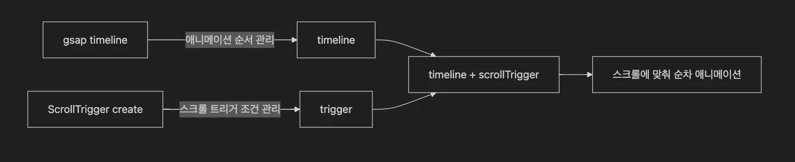

<a id="1dbeda9b0fe18043bdcfd13f99617269"></a>

### <code>gsap&#46;timeline()</code> vs <code>ScrollTiger&#46;create()</code>

---

> 📖 
> 
> <a id="1dbeda9b0fe1801886bbf761d4a0049f"></a>
> 
> <strong><code>gsap&#46;timeline()</code></strong><strong>, </strong><strong><code>ScrollTiger&#46;create()</code></strong><strong> 비교</strong>
> 
> ---
> 
> | <strong>비교 항목</strong> | <strong><code>gsap&#46;timeline()</code></strong> | <strong><code>ScrollTrigger&#46;create()</code></strong> |
> | --- | --- | --- |
> | 주 역할 | 애니메이션 여러 개를 순차적으로 묶기 | 스크롤 이벤트를 기반으로 트리거(조건) 만들기 |
> | 동작 조건 | 코드 실행되면 바로 동작 | 스크롤 위치 조건을 만족하면 동작 |
> | 쓰는 목적 | 여러 애니메이션을 <strong>시간 순서대로 자연스럽게</strong> 연결 | 스크롤을 기반으로 <strong>언제, 어떻게</strong> 애니메이션을 시작할지 정하기 |
> | 트리거링 기준 | 없음 (타임라인 순서만) | 있음 (스크롤 위치가 기준) |
> | 연관성 | ScrollTrigger를 timeline에 연결할 수도 있음&#33; | 단독으로 애니메이션을 트리거할 수도 있음 |

> ✏️ 
> 
> <a id="1dbeda9b0fe180158fa4f970f5dffbe8"></a>
> 
> <strong>도식화</strong>
> 
> ---
> 
> <details>
> <summary>mermaid</summary>
> 
> <a id="1dbeda9b0fe180688a92e640f6054d54"></a>
> 
> ```mermaid
> flowchart LR
>     A[gsap timeline] -->|애니메이션 순서 관리| B[timeline]
>     C[ScrollTrigger create] -->|스크롤 트리거 조건 관리| D[trigger]
>     
>     B --> E[timeline + scrollTrigger]
>     D --> E
>     
>     E --> F["스크롤에 맞춰 순차 애니메이션"]
> ```
> 
> </details>
> 
> 
> 
> <a id="1dbeda9b0fe1804488dde1734d5c7faf"></a>
> 
> 일반적으로 <strong><code>gsap&#46;timeline()</code></strong><strong>  &#43; </strong><code>ScrollTiger</code> 를 합쳐서 사용한다&#46; 
> 
> - <strong><code>timeline</code></strong>은 <strong>애니메이션이 많아질 때 훨씬 깔끔하고 관리하기 편하다&#46;</strong>

<details>
<summary>ex) <strong><code>gsap&#46;timeline()</code></strong></summary>

<a id="1dbeda9b0fe180b48580c115a59d049f"></a>

```javascript
const tl = gsap.timeline();

tl.to('.box', { x: 100, duration: 1 }) // 1초 동안 x축 이동
  .to('.box', { y: 100, duration: 1 }) // 그 다음 1초 동안 y축 이동
  .to('.box', { rotation: 360, duration: 1 }) // 그 다음 1초 동안 회전
```

</details>

<details>
<summary>ex) <strong><code>ScrollTrigger&#46;create()</code></strong></summary>

<a id="1dbeda9b0fe1805ebf0aed6d6de00022"></a>

```javascript
ScrollTrigger.create({
  trigger: '.box',
  start: 'top center',
  onEnter: () => {
    gsap.to('.box', { x: 100, rotation: 360, duration: 2 });
  }
});
```

</details>

<details>
<summary>ex) <strong><code>timeline</code></strong><strong> &#43; </strong><strong><code>ScrollTrigger</code></strong><strong> 결합</strong></summary>

<a id="1dbeda9b0fe180bdbaa0c4b60dec1b38"></a>

```javascript
const tl = gsap.timeline({
  scrollTrigger: {
    trigger: '.box',
    start: 'top center',
    end: 'bottom center',
    scrub: true, // 스크롤에 맞춰 자연스럽게 재생
    markers: true
  }
});

tl.to('.box', { x: 100 })
  .to('.box', { rotation: 360 })
  .to('.box', { y: 200 });
```

- <strong><code>timeline</code></strong><strong>&#58; </strong> 애니메이션 순서를 관리

- <strong><code>ScrollTrigger</code></strong><strong>&#58; </strong> <strong>스크롤 위치</strong>를 기준으로 timeline을 재생/멈춤 제

</details>

<details>
<summary>ex) <code>ScrollTiger&#46;create()</code> →  <code>gsap&#46;timeline()</code> 방식으로 변경</summary>

<a id="1dbeda9b0fe180af8959e8d23d5cbe33"></a>

```javascript
gsap.utils.toArray('.con3 .listBox li').forEach((selector, idx) => {
    const tl = gsap.timeline({
        scrollTrigger: {
            trigger: selector,
            start: '30% 50%',
            toggleActions: 'play none none none',  // onEnter: true, 
            markers: true
        }
    });

    // 타임라인에 순서대로 추가
    tl.set(selector, {
        rotationX: '-65deg',
        z: '-500px',
        opacity: 0
    })
    .to(selector, {
        rotationX: 0,
        z: 0,
        opacity: 1,
        delay: idx % 3 * 0.05
    });
}); 
```

- <code>gsap&#46;timeline()</code>에서 toggleActions를 통해서 아래 스크롤 시에만 트리거가 발생되도록 설정 가능하다&#46; 
    <a id="1dbeda9b0fe18076b4b6ff4826d4f133"></a>

    ```javascript
    // onEnter: true
    toggleActions: 'play none none none'
    ```

</details>
