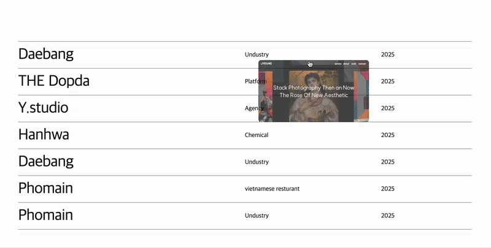
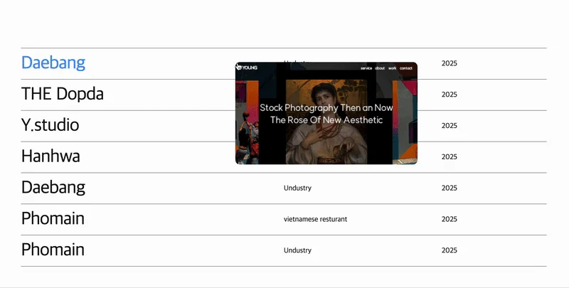

<a id="1dbeda9b0fe180e7afbce5799d5c6701"></a>

### 문제

---



<details>
<summary>js(gsap) 코드</summary>

<a id="1dbeda9b0fe1807caaa8e59ab1bfddda"></a>

```javascript
const listBox = document.querySelectorAll('.con5 .listBox li');
const imgBox = document.querySelector('.con5 .imgBox');
const img = document.querySelector('.con5 .imgBox img');

for(let i = 0; i < listBox.length; i++) {
    listBox[i].addEventListener('mouseenter', () => {
        img.src =`images/img${i}.jpg`;

        gsap.fromTo(imgBox, 
            {scale: 0, opacity: 0},  
            {scale: 1, opacity: 1, duration: 0.3}
        );
    });

    listBox[i].addEventListener('mousemove', (e) => {
        let imgBoxX = e.pageX + 20;
        let imgBoxY = e.pageY - 20;
        imgBox.style.left = imgBoxX + 'px';
        imgBox.style.top = imgBoxY + 'px';
    })
    
    listBox[i].addEventListener('mouseleave', () => {
        gsap.to(imgBox, {scale:0, opacity:0, duration:.3})
    });
}
```

</details>

<a id="1dbeda9b0fe18080a3faf4d3870cddc1"></a>

li hover 시에 생기는 imgBox에 마우스가 hover 되면 

<a id="1dbeda9b0fe180d6a1a0cb3b53ee3a8d"></a>

<code>mouseleave </code>로 인식되어 img가 사라진다&#46; 

- <code>imgBox</code>의 크기가 ‘줄었다 커졌다’하는  애니메이션이 발생됨

<a id="1dbeda9b0fe180ed87bed8ca38913f74"></a>

### 해결&#58; <code>pointer&#45;events&#58; none</code>

---



<a id="1dbeda9b0fe180449bc1f3bc8c568844"></a>

```javascript
.con5 .imgBox { 
	position: absolute; 
	transform: scale(0); 
	opacity: 0; 
	z-index: 100; 
	transition: all .1s; 
	pointer-events: none;
}
```

<a id="1dbeda9b0fe1804190b4f5d73b297470"></a>

&#46;imgBox에 <code>pointer&#45;events&#58; none</code> 을 적용시키면 pointer 이벤트가 발생되지 않는다&#46; 

<a id="1dbeda9b0fe1802da689d44a8b0a2a21"></a>

즉, mouseenter 이벤트가 무시 처리된다&#46; 

<a id="1dbeda9b0fe1804ab73be0381fdd0253"></a>

<br>따라서 위 화면과 같이 크기가 줄었다가 커졌다 하는 애니메이션 효과를  제거 가능하다&#46;
