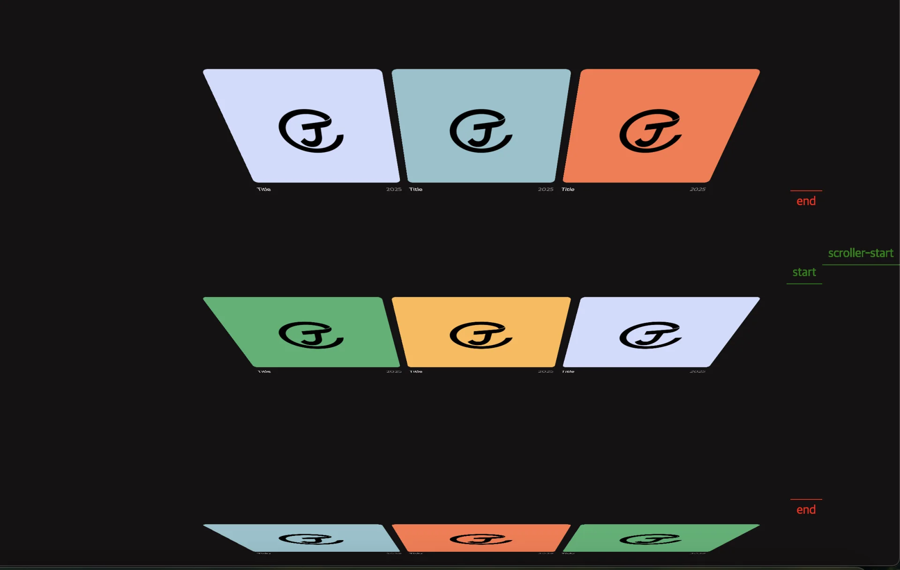

<a id="1dbeda9b0fe180cea1e1e39e872cc2b6"></a>

## <code>gsap&#46;set(selector, {…})</code>

---

> 📖 
> 
> <a id="1dbeda9b0fe180aabef1e8e5364dd3c1"></a>
> 
> <strong><code>gsap&#46;set(selector, {…})</code></strong>
> 
> ---
> 
> <a id="1dbeda9b0fe180248004cd36a2394071"></a>
> 
> <strong>애니메이션 </strong><strong><u>시작 전</u></strong><u> </u><strong><u>미리 상태를 세팅</u></strong>

<a id="1dbeda9b0fe180b4aa83febc47163d89"></a>

ex) 



<a id="1dbeda9b0fe180579114eaf29aa2e0c1"></a>

```javascript
gsap.set(selector, {
    rotationX: '-65deg',
    z: '-500px',
})
```

- <strong><u>애니메이션 시작 전</u></strong>  <strong><u>해당하는 selector(DOM)의 <br>CSS 효과를 정의</u></strong>함
