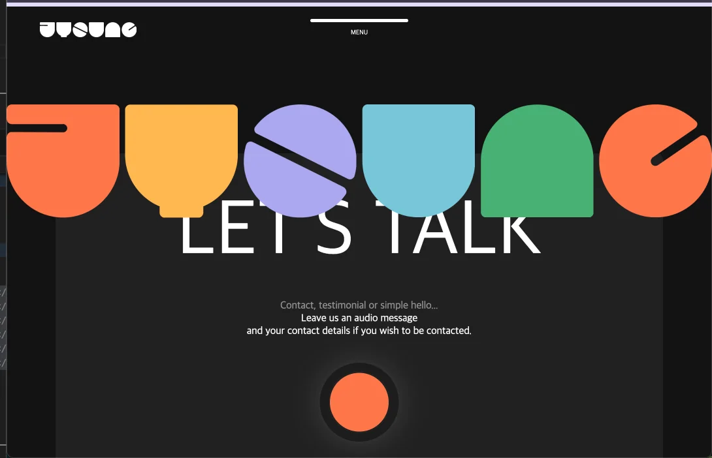
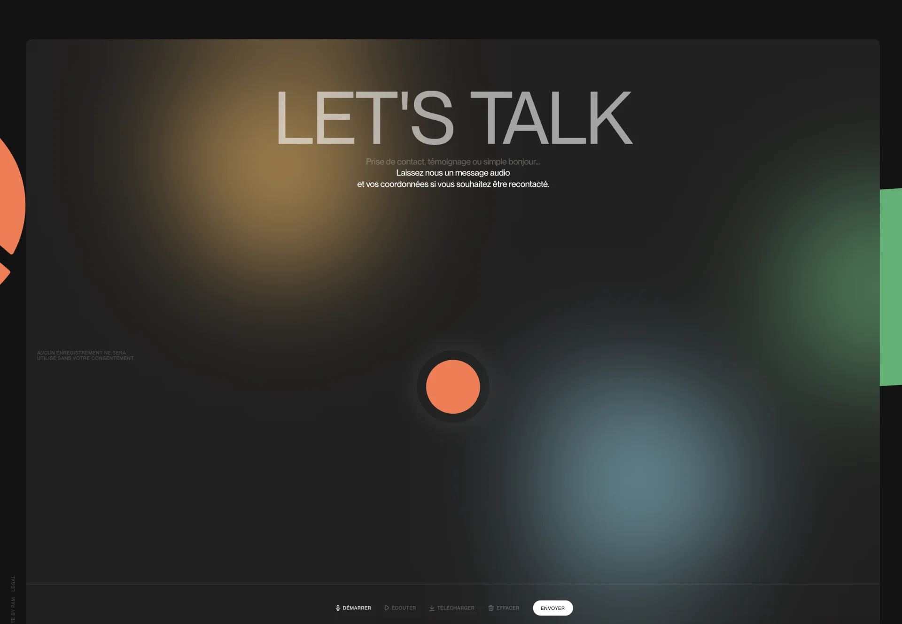

<a id="1dceda9b0fe18051924cdc7f1f6f8505"></a>

## 문제

> ❗ 
> 
> <a id="1dceda9b0fe180c8a83cc6d59cde8974"></a>
> 
> z&#45;index를 사용하여 특정 DOM 뒤로 



<details>
<summary>css</summary>

<a id="1dceda9b0fe180f49455ca1bcaae0bff"></a>

```css
/* footer */
footer { position: relative; overflow: hidden; }
footer .inner { height: 100vh; padding: 75px 75px 25px; box-sizing: border-box; display: flex; flex-direction: column; 
		z-index: 2}
footer .box { padding: 50px 0 0 ; background-color: rgba(55, 55, 55, .4); backdrop-filter: blur(100px); display: flex; flex-direction: column; flex-grow: 1;}

footer .box .mainTextBox { text-align: center; }
footer .box .mainTextBox h2 { font-size: 120px; text-transform: uppercase; letter-spacing: -1px; font-weight: normal; margin-bottom: 30px;}
footer .box .mainTextBox span { opacity: .5; display: block; }

footer .box .talkBtn { display: grid; place-items: center; flex-grow: 1; }
footer .box .talkBtn a { display: block; width: 95px; height: 95px; border-radius: 100%; box-shadow: 0 0 0 13px #1c1c1c, 0 0 50px rgba(255, 255, 255, .3); }
footer .box .talkBtn a span { display: block; width: 95%; height: 95%; margin:2.5% auto; border-radius: 100%; background: #FF764A;  transition: all 0.1s; } 
footer .box .talkBtn a:hover span { width: 100%; height: 100%; margin: 0 auto; }

footer .box .btnBox { display: flex; justify-content: center; flex-direction: row; border-top: 1px solid rgba(255, 255, 255, .2); }
footer .box .btnBox .btn { margin: 20px; padding: 10px; background: none; color: #fff; opacity: .5; }
footer .box .btnBox .btn:hover { opacity: 1;}

footer .copyright { flex-direction: row; text-align: center; padding-top: 25px; font-size: 14px; }

footer .logoWrap { position: absolute; left: 0; top: 0; width: 100%; 
		z-index: 1; display: flex; justify-content: space-between; }
footer .logoWrap span { width: 16%; }
footer .logoWrap span img { width: 100% }
```

</details>

<a id="1dceda9b0fe180ab97b2ecbe25b6a88f"></a>

<strong>html</strong>

<a id="1dceda9b0fe180e9b6f3c1c4c6a5f9e1"></a>

```html
<!-- footer -->
<footer>
  <div class="inner">       <!-- z-index: 2 -->
    <div class="box">
       . . .
  </div>
  <div class="logoWrap">      <!-- z-index: 1 -->
    <span class="j"></span>
    <span class="y"></span>
    <span class="o"></span>
    <span class="u"></span>
    <span class="n"></span>
  </div>
</footer>
```

- <code>logoWrap</code> DOM에 <code>z&#45;index&#58; 1</code> 로 <code>inner</code> DOM (<code>z&#45;index&#58; 2</code>) 뒤로 오도록 

<a id="1dceda9b0fe180ddb8bed0d37dad013a"></a>

### 원인

<details>
<summary>🧐<code> z&#45;inde</code>x는 ‘<code>stacking context</code>(스태킹 컨텍스트)’ 안에서 동작한다&#46;</summary>

> ✏️ 
> 
> <a id="1dceda9b0fe1806f8e85f611db4ddfeb"></a>
> 
> <strong>z&#45;index 동작 순서</strong>
> 
> ---
> 
> > 브라우저는 아래의 순서로 레이어를 쌓아 동작한다&#46;
> 
> 1. 부모가 없으면 기본 흐름 ( HTML 구조 순서 )
> 
> 1. <strong><u>position 속성</u></strong> ( relative, absolute, fixed, sticky)이 있으면 <strong><u>stacking context 생성</u></strong>
> 
> 1. stacking context끼리 각각 z&#45;index를 비교
>     - <strong>형제 DOM 끼리만 z&#45;index 비교 가능</strong>
> 
>     - <strong>다른 부모를 가</strong>지면 stacking context 다르므로 비교 불가<br>

- stacking context
    <a id="1dceda9b0fe180809826d389686638cf"></a>

    이 영역 안에 있는 DOM 끼리의 z&#45;index 순서를 따진다&#46; 

    - 레이어 그룹 같은 개념

- staking context가 만들어지는 조건
    - position&#58; <code>relative</code>, <code>absolute</code>, <code>fixed</code>, <code>sticky</code>

    - z&#45;index 설정

    - opactity&#58; 1 보다 작은 값

    - transform, filter, perspective 같은 효과

    - will&#45;change, mix&#45;blend&#45;mode 

    - …

> ☝🏻 
> 
> <a id="1dceda9b0fe1803a9282ee9a925b948a"></a>
> 
> <code>display&#58; flex</code>는 <code>stacking context</code>를 <u>만들지 않</u>는다&#46; 
> 
> - display&#58; flex는 단순히 flexbox 레이아웃을 만들 뿐이지 stacking context를 생성하지 않는다&#46; 

</details>

> ☝🏻 
> 
> <a id="1dceda9b0fe18098b0a0c9d28751fe75"></a>
> 
> <code>z&#45;index</code>는 &#91; <strong>position&#58; </strong><strong><code>relative</code></strong><strong>, </strong><strong><code>absolute</code></strong><strong>, </strong><strong><code>fixed</code></strong><strong>, </strong><strong><code>sticky</code></strong>  &#93; 중 하나가 적용된<u> “형제”끼리만 작동</u>한다&#46;
> 
> - <strong><u>서로 다른 부모에 묶</u></strong>여 있으면 <u>z&#45;index 비교가 안</u>된다&#46;

<a id="1dceda9b0fe180b69037d3ce67193ba1"></a>

```html
<footer>
├── div.inner (position: relative)  <- z-index: 2
│     ├── div.box
│     └── div.copyright
└── div.logoWrap (position: absolute) <- z-index: 1
</footer>
```

<a id="1dceda9b0fe1806d9f99c89e7c7a0fa4"></a>

현재 프로젝트의 DOM 구조를 보면 <code>z&#45;index</code>를 명시한  <code>div&#46;inner</code> 와 <code>div&#46;logoWrap</code>은 형재 DOM 이 맞다&#46;

> <strong>원인 1</strong>

<a id="1dceda9b0fe180dab371fbf80331472e"></a>

그래서 <code>z&#45;index</code> 비교가 가능해야 정상이지만, <br><strong><u>footer 자체에</u></strong><u> </u><strong><u>position&#58; relative</u></strong> 가 걸려있고, <code>&#46;inner</code>에 <code>z&#45;index&#58; 2</code>가 걸려 있다&#46;

<a id="1dceda9b0fe18017a8dbc7c209cdf2b8"></a>

여기서 <strong><code>&#46;inner</code></strong><strong> 자체가 </strong><strong><code>z&#45;index</code></strong><strong>를 갖고 있지만, </strong><strong><u>그 안의 자식 요소(box, copyright)</u></strong><strong><u>는 별도로 z&#45;index가 적용되지 않</u></strong><strong>으면 </strong><strong><code>&#46;logoWrap</code></strong><strong>보다 </strong><strong><u>우선순위가 </u></strong><strong><u>떨</u></strong><strong>어질 수 있다&#46;</strong>

> <strong>원인 2 </strong>

<a id="1dceda9b0fe18091acf8d6d7e1905648"></a>

 <code>&#46;logoWrap</code>이 <strong><u>absolute</u></strong>이기 때문에 더욱 강하게 떠버린다&#46; 

- positioning context 영향 

> <strong>원인 3</strong>

<a id="1dceda9b0fe18089ba76ed331ff51f3b"></a>

```css
/* z-index가 적용되지 않았다.  */
/* flex Item 이지만 display: flex 가 명시 되어있지 않다.  */
footer .copyright { flex-direction: row; ... }
```

<a id="1dceda9b0fe180a28473ffd76bd5e763"></a>

<strong>inner의 자식 요소인 </strong><strong><code>copyright</code></strong><strong>가 </strong><strong><u>flex 아이템</u></strong><strong>인데, </strong><strong><u>z&#45;index가 적용이 안</u></strong><strong> 되어 있다</strong>

<a id="1dceda9b0fe180a59cc8fea5228b89e9"></a>

또한 flex 아이템이지만 <code>display&#58; flex</code>를 명시하지 않아 <code>flex item</code>으로서의 맥락이 이상해지고,

<a id="1dceda9b0fe18008a5d4dc7ec2414944"></a>

결국 z&#45;index 계층이 깨지면서 <code>&#46;logoWrap</code>이 앞에 오게된다&#46;

<details>
<summary>🤬  flex item에 display&#58; flex를 명시하지 않으면 생기는 문제점</summary>

> ☝🏻 
> 
> <a id="1dceda9b0fe180a397f7dffc6d835d48"></a>
> 
> <code>z&#45;index</code>는 <code>position</code>과 <code>display</code> <u>컨텍스트가 있어야 동작</u>한다&#46;
> 
> <a id="1dceda9b0fe180f1b8aeeed41bcbf588"></a>
> 
> 특히 <code>flex 아이템</code>이면 <strong><u>반드시 </u></strong><strong><u><code>display&#58; flex</code></u></strong><strong><u>를 선언</u></strong>해야 한다&#46;
> 
> - <strong><code>“display&#58; flex”</code></strong><strong> </strong><strong>명시는 CSS 구조에 숨겨진 레이아웃 꼬임을 방지하기 위함이다&#46; </strong>

| <strong>구분</strong> | <strong>설명</strong> |
| --- | --- |
| &#46;copyright가 flex&#45;direction만 있고 display&#58;flex가 없음 | 의미 없는 속성이 되어버림 (flex&#45;direction은 display&#58; flex 없으면 무효) |
| flex 컨텍스트가 명확하지 않음 | 레이아웃/렌더링 기준이 애매해져서, 브라우저가 stacking context 우선순위를 엉뚱하게 계산할 가능성이 커짐 |

<a id="1dceda9b0fe18093b491e44653cea923"></a>

즉,<strong>display&#58; flex가 없으면 구조적으로 애매한 상태</strong>가 되고, 이때 <strong>브라우저 렌더링 엔진이 레이어 순서를 틀리게 해석할 수 있다&#46;</strong>

<a id="1dceda9b0fe1803c96bfeeb6967f7ed0"></a>

따라서 <strong>꼭 flex 기능이 필요한 건 아니지만, 레이아웃 일관성을 보장하려고 display&#58; flex를 명시하는 게 안전하다</strong>

</details>

> ✏️ 
> 
> <a id="1dceda9b0fe1802c993ad2e17ad17cff"></a>
> 
> <strong>결론</strong>
> 
> ---
> 
> - flex&#45;direction만 주고 display&#58; flex를 안 주니까 구조적으로 어색함
> 
> - position이 명확하지 않아서 stacking context가 제대로 안 잡힘
> 
> - 그래서 z&#45;index 비교가 어긋남
> 
> - 결과적으로 &#46;logoWrap이 &#46;inner나 &#46;copyright 위에 올라오는 현상 발생
> 
> <a id="1dceda9b0fe18001b668ddbfbd6dc992"></a>
> 
> 즉, <strong><u>레이아웃 흐름 &#43; stacking context 문제</u></strong><u>가 겹쳐서 생긴 오류</u>였다&#46; 

<a id="1dceda9b0fe180318961da2a514b7e84"></a>

### 해결 



<a id="1dceda9b0fe1805ea8dfe6ec8d8b299e"></a>

```css
footer .inner { 
		position: relative;
		height: 100vh; 
		padding: 75px 75px 25px; 
		box-sizing: border-box; 
		display: flex; 
		flex-direction: column;  
		z-index: 2
}
```

<a id="1dceda9b0fe180fa998ee18aae994e55"></a>

<code>position&#58; relative</code>를 통해 새로운 <code>stacking context</code>를 만들고, 그 안에서 하위 요소들이 정리된 레이어 순서를 따르게 된다&#46;

- <strong>z&#45;index는 stacking context 단위로만 비교된다</strong>

- <strong>position&#58; relative &#43; z&#45;index를 부모에 주면</strong>, 그 부모 안의 자식들은 다 그 stacking context 안에 들어간다

- <strong>따라서 부모 z&#45;index만 높이면, 안쪽 자식들까지 다 자연스럽게 위로 올라온다</strong>
