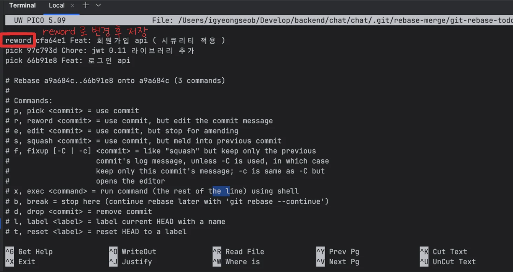
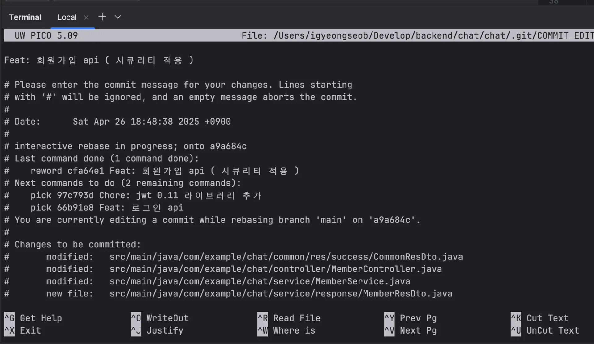

<a id="1e1eda9b0fe180dcb2d5ca5b00e5786c"></a>

### 방법 1&#58; <code>rebase</code>

<a id="1e1eda9b0fe180c68054fcd1552f0b7b"></a>

```bash
git rebase -i HEAD~N
```

- <strong><code>N</code></strong><strong>&#58; 최근 몇 개 커밋까지 보고 싶은지를 정하는 숫자</strong>

- <strong>ex) </strong><strong><code>HEAD&#126;3</code></strong><strong>&#58; 최근 3개 커밋 보여줌</strong>

<a id="1e1eda9b0fe180659991d4cd8aa7b532"></a>

```bash
git rebase -i HEAD~3

# 커밋 리스트
pick 1a2b3c4 Original commit message 1
pick 5d6e7f8 Original commit message 2
pick 9a0b1c2 Original commit message 3

# 수정하고 싶은 커밋 줄의 pick을 reword로 변경
pick 1a2b3c4 Original commit message 1
reword 5d6e7f8 Original commit message 2   <-- 수정하고 싶은 커밋
pick 9a0b1c2 Original commit message 3
```

<a id="1e1eda9b0fe180a1a33bdc3eaf368218"></a>

수정할 커밋을 <strong>reword</strong>로 변경 후 저장하면 해당하는 커밋을 바로 수정 가능하다&#46;



- 저장&#58; <code>ctrl</code> &#43; <code>o</code> → 종료&#58; <code>ctrl</code> &#43; <code>x</code> 



- 위와 같이 reword로 변경한 커밋이 에디터로 바로 뜨는 것을 확인 할 수 있다&#46;
