

## RDS ( Relation Database Service )

---

> 📖 
> 
> 
> 
> <strong><code>RDS</code></strong><strong> ( Relation Database Service )</strong>
> 
> ---
> 
> - AWS 에서 지원하는 클라우드 환경의 <strong><u>관계형 DB</u></strong> 서비스이다&#46; 
> 
> - ex) <code>Postgres</code>, <code>MySQL</code>, <code>MariaDB</code>, <code>Orcle</code>, <code>Microsoft SQL service</code> …

### 1&#46;  RDS 소개

<code>EC2  DB</code> 보다 <code>RDS</code> 사용의 이점

- DB를 위한 인프라 자동 구축(provisioning), 및  업데이트

- 지속적인 백업과 복구 기능 지원

- 모니터 대시보드 지원

- 성능 향상을 위한 read replicas 지원

- Disaster Recovery를 위한 multi AZ 지원

- 수평/수직 확장성 지원

- EBS 백업 지원

---

- <strong>SSH 접속 불가능 </strong><strong> (  단점 )</strong>

- 비용이 비싸다

<strong><code>Storage Auto Scaling</code></strong>

- DB가 꽉 찬 경우, <strong>자동으로 용량을 늘</strong>려준다&#46; 
    - <code>Maximum Storage Threshold</code> ( 최대 용량 ) 지정 필요

- 예측 불가능한 트래픽이 발생될 경우 유용하다&#46; 

<strong><code>RDS Read Replicas</code></strong>

> ✏️ 
> 
> 
> 
> 실제 서비스의 경우, Read가 90%, Write가 10% 정도의 비율을 가진다고 할 정도로 압도적으로 Read 연산이 많이 발생된다&#46; 
> 
> 
> 
> 따라서 트래픽 증가에 따른 Read 연산을 빠르게 최적화하기 위해서는 Read 연산을 실행할 수 있는 여러 RDS를 만들고 분산 처리한다&#46; 

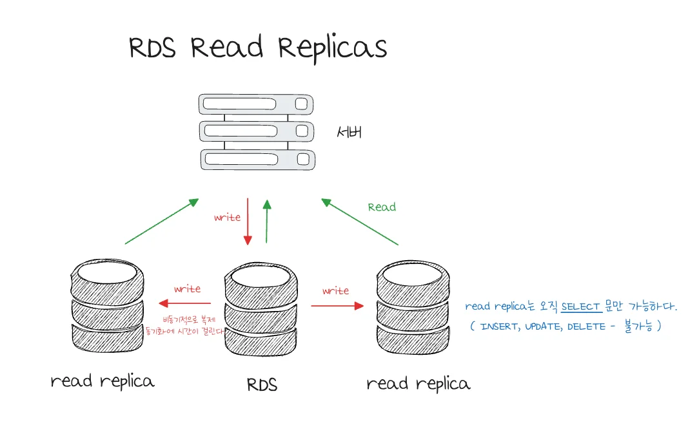

<strong><code>RDS Multi AZ</code></strong>

> ✏️ 
> 
> 
> 
> 다른 Avality Zone에 DB 백업을 하는 것이다&#46; 
> 
> - 비용이 비싸다&#46; 
> 
> - 고가용성  ( 확장성 X )
> 
> - 수동 설정 X
> 
> - read replica를 multi az 승격해서 사용 가능하다&#46; 

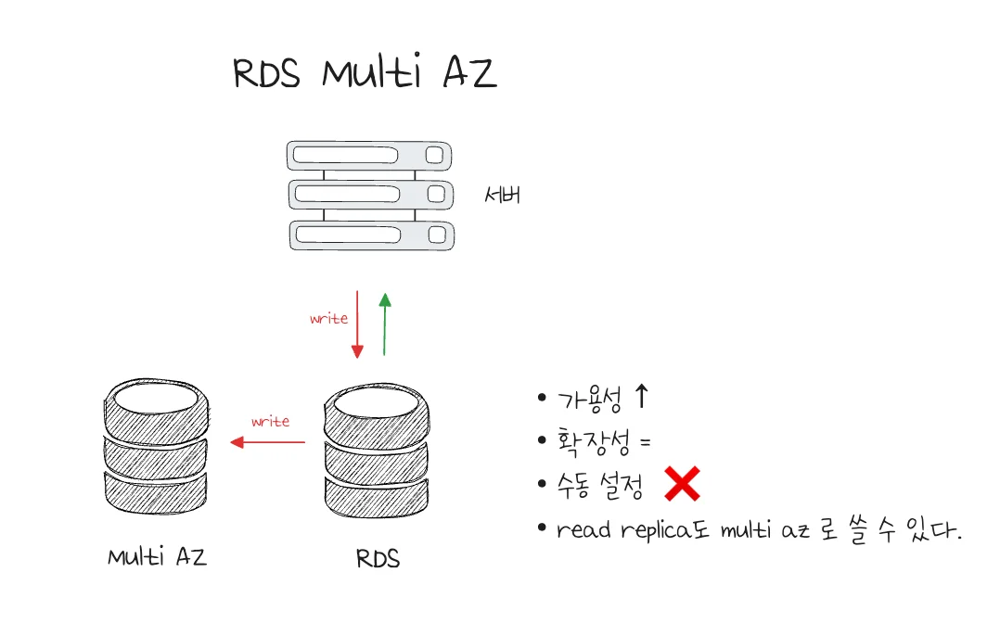

### 2&#46;  RDS 실습

RDS 생성 ( 버전 &#45; 25&#46;05&#46;09  )

> Option

<code>Choose a database creation method</code>

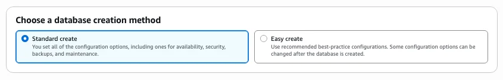

Easy create

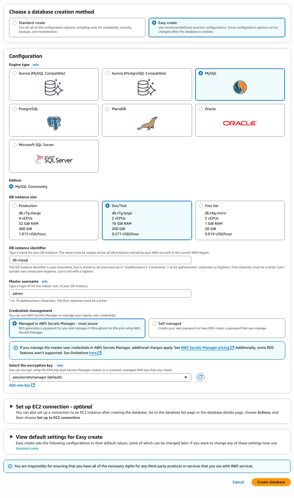

- 훨씬 간단하게 생성할 수 있는 템플릿을 제공함

<code>Engine options</code>

> ✏️ 
> 
> 
> 
> 사용할 RDS  유형 선택 
> 
> - 실습 &#45; MySQL 선택

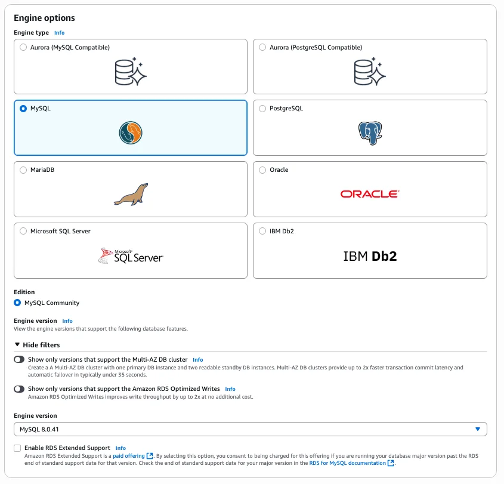

<code>Template</code>, <code>Availability and durability</code>

> ✏️ 
> 
> 
> 
> <strong>인프라 템플릿 유형</strong>
> 
> - <strong><code>Production</code></strong><strong>, </strong><strong><code>Dev/Test</code></strong><strong> </strong>는 고가용성 및 확장성을 위한 <code>Read Replicas</code>, <code>Multi&#45;AZ</code> 환경 제공한다&#46;
> 
> - <code>Free tier</code>는 하나의 RDS 인스턴스만을 제공한다&#46; 
>     - 개인 프로젝트인 경우, <strong><u>Free tier 사용</u></strong>을 권장한다&#46; ( 비용이 많이 나옴 )

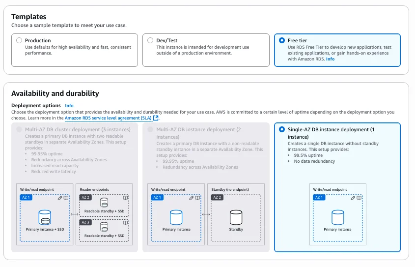

Settings &#45; <code>Credentials Settings</code>

> ✏️ 
> 
> 
> 
> RDS 식별 및 인증 정보를 설정한다&#46;  
> 
> - <code>DB 이름</code>, <code>유저명</code>, <code>비밀번호</code>  <strong>( DB 연결 시 사용 )</strong>

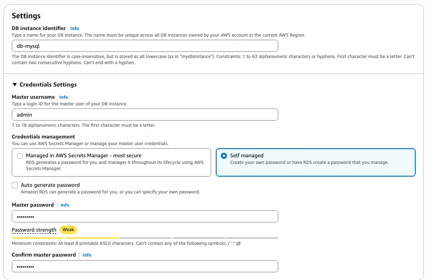

<code>Instance configuration</code>

> ✏️ 
> 
> 
> 
> <strong>DB 스펙 선택</strong>

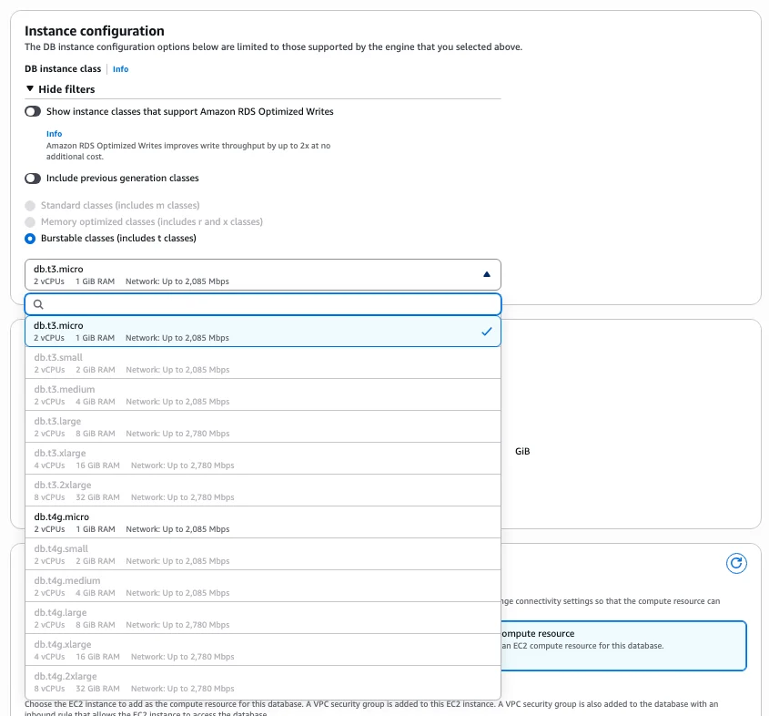

<code>Storage</code>

> ✏️ 
> 
> 
> 
> <u>SSD 유형</u> 및 <u>저장 용량</u> 선택

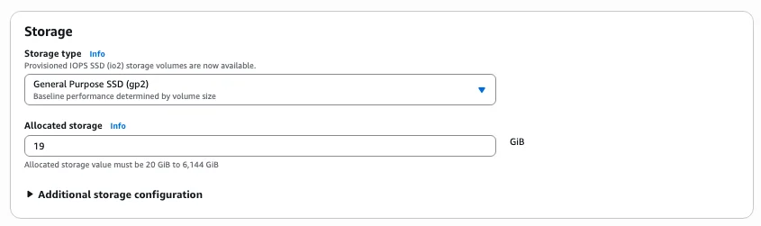

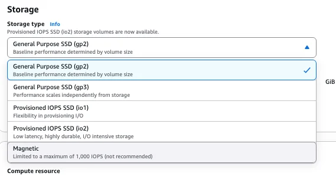

<code>Connectivity</code> 

> ✏️ 
> 
> 
> 
> EC2 연결, 네트워크 유형 및 보안 설정
> 
> 

> 
RDS &#45; EC2 연결

> 
> 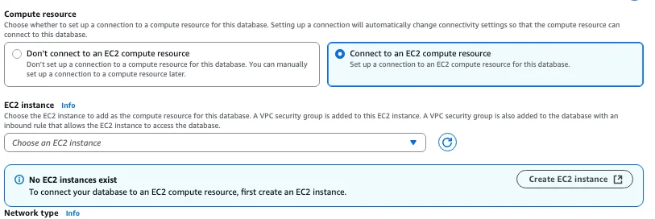
> 
> 

> 
> - 네트워크 유형
> 
> - VPC 설정
> 
> - Public 접속 가능 여부
> 
> - AZ 설정

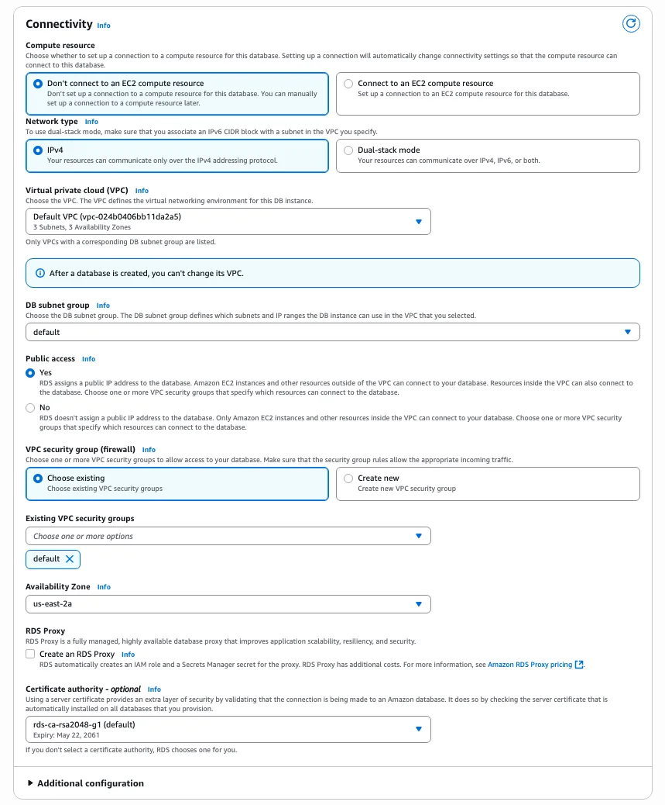

인스턴스 연결 시, 조금 옵션이 달라짐

> ✏️ 
> 
> - EC2 인스턴스 선택
> 
> - 네트워크 유형
> 
> - DB subnet 그룹
> 
> - Public 접근 여부
> 
> - VPC 설정
> 
> - AZ 설정

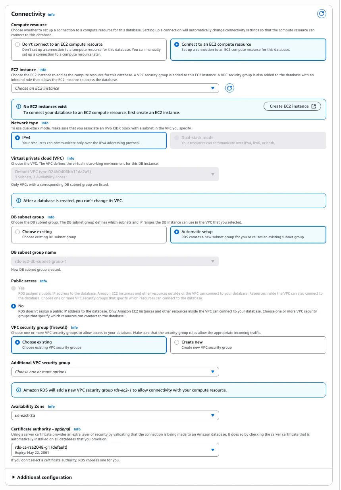

<code>Database authentication</code>

> ✏️ 
> 
> 
> 
> DB 보안 설정
> 
> - 생성 실습이기 때문에 설정한 password만으로 진행 만약 추가 보안 설정이 필요하다면 2, 3 고려 
> 
> - 2&#45;IAM 인증 추가, 3&#45;Kerberos 인증 추가

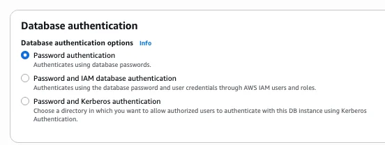

<code>Monitoring</code>

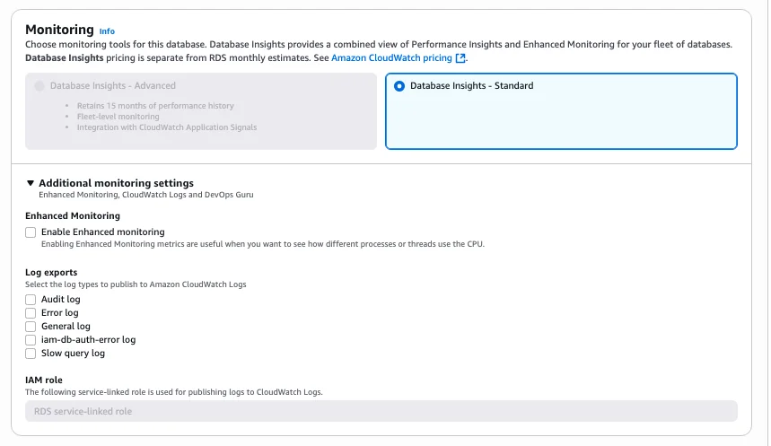

<code>Addtional configuration</code>

> ✏️ 
> 
> - 처음 생성할 db 명 &#45; 연결 시 필요
> 
> - backup 설정 &#45; 실제 운영 상황에서는 권장

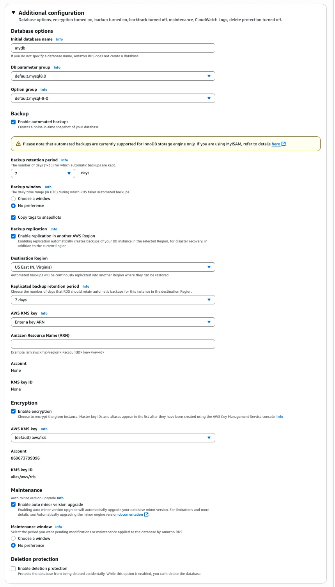

RDS 접속

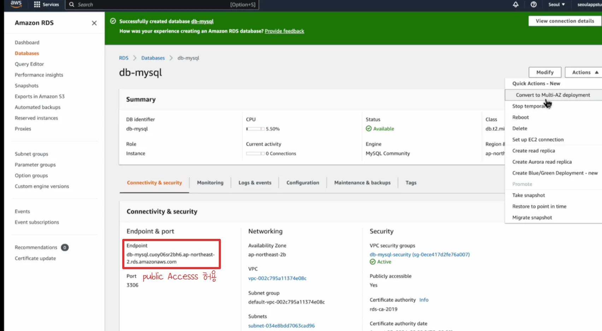

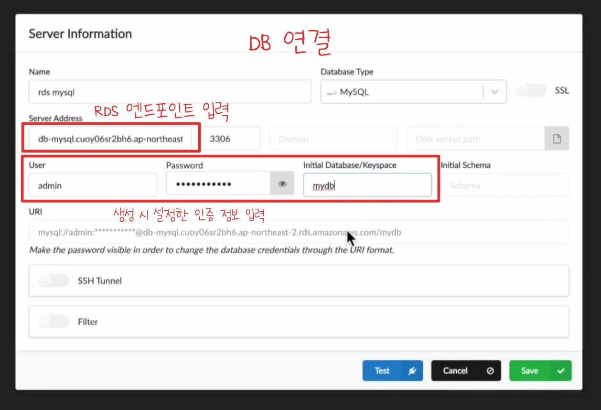

DB 복제

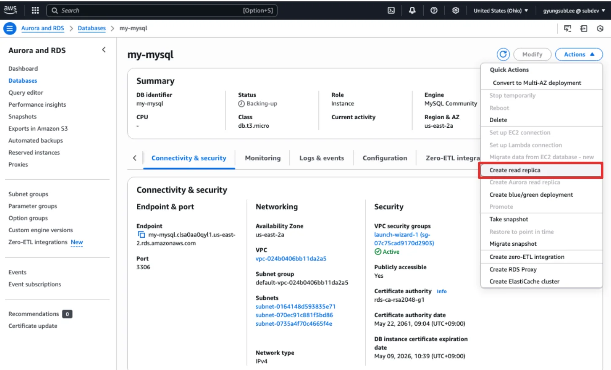

모니터링

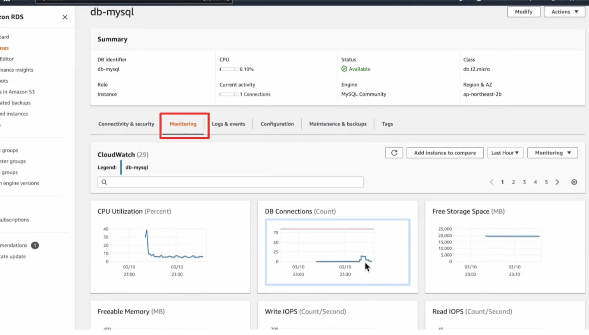

