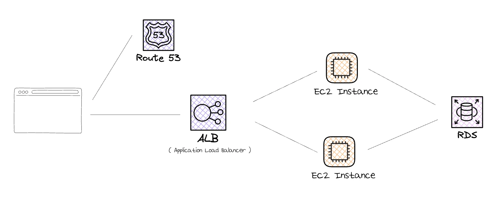
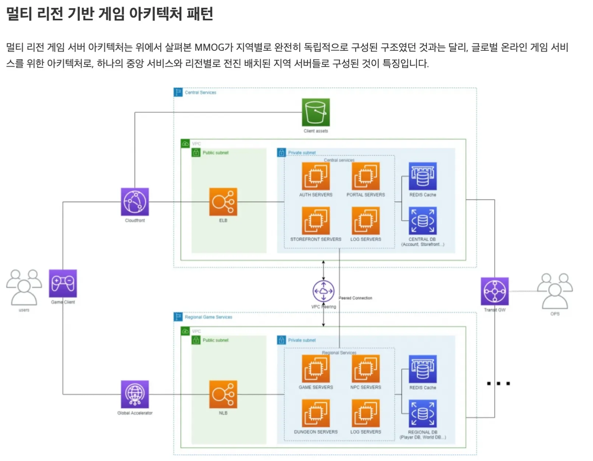
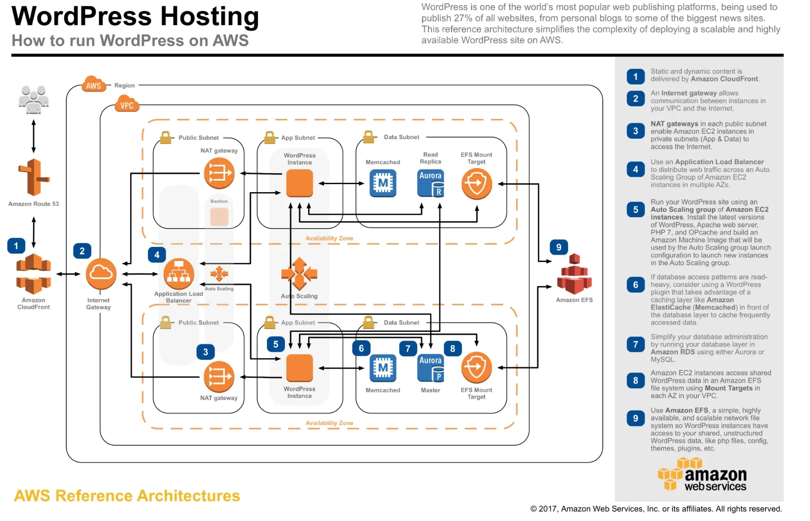
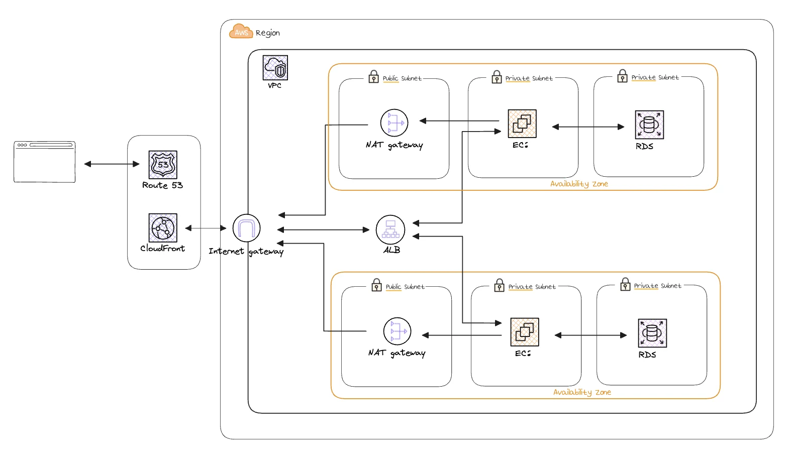

## VPC

---

> 📖 
> 
> 
> 
> <strong><code>VPC</code></strong> ( Virtual Private Cloud )
> 
> ---
> 
> 
> 
> AWS에서 제공하는 클라우드 컴퓨팅 리소스를 사용하는  <strong><u>가상 사설 네트워크</u></strong>이다&#46; 
> 
> - VPC 내에서 I<strong><u>P 주소 범위, 라우팅 테이블, 서브넷 및 보안 그룹을 설정</u></strong>할 수 있다 &#46;
> 
> - VPC를 사용 시 <strong><u>가상 서버, 스토리지 및 데이터베이스</u></strong> 와 같은 다양한 AWS 리소스를 생성하고 관리할 수 있다&#46;

예시 인프라

ex 1 ) 

ex 2 ) 

ex 3 ) <strong>3 Tier Architecture</strong>

- Public 서브넷&#58; 로드 벨런서, NAT

- Private 서브넷&#58; EC2 인스턴스

- Data 서브넷&#58; RDS …

> ✏️ 
> 
> 
> 
> 하나의 Region 안에 있는 VPC 내부의 <code>로드 밸런서</code>가 <strong><u>여러 AZ에 나눠서 트래픽을 분산 처리</u></strong>한다&#46; 
> 
> 
> 
> <code>Availiablity Zone</code> 안에서 다시 서비스들을 묶어서 처리할 수 있는데, 이때 <strong><u>논리적으로 나눠 그룹핑 해놓은 단위</u></strong>를 <code>서브넷</code>이라 한다&#46; 
> 
> - <strong><u>내부에서만 통신할 수 있도록 제한</u></strong>함으로써 <strong>보안과 성능을 향상</strong>시킨다&#46;
> 
> - <strong><u>하나의 서브넷 안</u></strong>에는 <strong>매핑 정보를 저장</strong>하는 <strong><u>하나의 라우팅 테이블</u></strong>이 있다&#46;  ( 이를 통해 각 서비스들이 연결될 수 있다&#46;)

서브넷

> ✏️ 
> 
> 
> 
> <code>서브넷</code>은 <strong><u>VPC 내</u></strong><strong><u>에서 </u></strong><strong><u>IP 주소 범위를 지정</u></strong>하는 <strong><u>가상의 네트워크</u></strong>이다&#46;  
> 
> - 서브넷은 <strong><u>라우팅 테이블에 연결</u></strong>되며 <strong><u>각 서브넷은 </u></strong><strong><u>하나의 라우팅 테이블에만 연결</u></strong>될 수 있다&#46;
> 
> - 서브넷을 사용하면 <strong><u>VPC 내</u></strong>에서 <strong><u>다른 서브넷과 격리</u></strong><strong><u>된 가상 네트워크를 생성</u></strong>할 수 있다&#46;
> 
> - 이를 통해 다양한 서비스에서 필요한 보안 요구 사항을 충족시킬 수 있다&#46; 

퍼블릭 서브넷

<code>퍼블릿 서브넷</code>은 <strong><u>인터넷 게이트웨이와 연결된 서브넷</u></strong>으로, <strong>인터넷에 직접 연결</strong>되어 있는 서브넷이다&#46; 

- 퍼블릿 서브넷을 통해 <u>인터넷에 직접 액세스 가능한 인스턴스를 실</u>행할 수 있다&#46; 

- 이러한 인스턴스는 공<u>인 IP 주소</u>를 사용하며, 인터넷 게이트웨이를 통해 <u>인터넷으로 트래픽을 보낼 수 있</u>다&#46;

프라이빗 서브넷

<code>프라이빗 서브넷</code>은 <strong><u>인터넷과 직접 연결되지</u></strong><strong><u> 않</u></strong>는 <u>가상 네트워크</u>이다&#46; 

이러한 서브넷에서 실행되는 인스턴스는 <u>인터넷에 직접 엑세스할 수 없</u>다&#46;

<strong><u>NAT 게이트웨이</u></strong>를 통해 연결되거나, VPC 피어링 등을 사용하여 <strong><u>다른 VPC와 연결</u></strong>하여 통신한다&#46; 

VPC 라우팅 테이블

<strong><u>VPC  내 트래픽이 전달되는 방법을 제어</u></strong>하는데 사용한다&#46; 

- 라우팅 테이블은 서브넷과 연결되며, 각 서브넷은 하나의 라우팅 테이블이 있어야 한다&#46; 

- 라우팅 테이블은 <code>목적지 IP 주소</code>와 <code>대상 게이트웨이</code>, <code>NAT 게이트웨이</code> 와 같은 대상을 매핑한다&#46; 

- 라우팅 테이블은 여러 개의 라우팅 규칙을 포함할 수 있으며, 이를 사용하여 서브넷에서 트래픽을 전달하는 방법을 제어할 수 있다&#46;

IGW ( Internet Gateway )

<strong><u>VPC와 인터넷 간의 통신을 가능</u></strong>하게 하는 게이트웨이 이다&#46; 

인터넷에서 인터넷 게이트웨이를 통해 VPC 내부로 들어오는 트래픽을 받아 해당 VPC에 연결된 서브넷으로 라우팅한다&#46; 

NAT ( Network Address Translation ) Gateway

- <strong><u>프라이빗 서브넷에 있는 인스턴스</u></strong>가 <strong>인터넷으로 나갈(접속) 수 있</strong><strong>도록 도와주는 중간자 역할을 한다&#46;  ( 공인 IP 대신 사용 ) </strong>
    - 프라이빗 서브넷에서 <strong><u>아웃바운드 인터넷 트래픽을 가능</u></strong>하게 한다&#46;

    - 단, 외부에서 들어오는 트래픽을 프라이빗 서브넷으로 직접 전달해주지 않는다&#46; ( Internet Gateway 가 담당 )

