<a id="1f0eda9b0fe180ce9aceddf06f525a11"></a>

## <code>EBS</code> ( Elastic Beanstalk )

---

> 📖 
> 
> <a id="1f0eda9b0fe180cd9c3ddf8d962d9471"></a>
> 
> EBS( Elastic Beanstalk )는 AWS에서 제공하는 Pass(Platform as a Service) 서비스이다&#46; 
> 
> > 사용자는 애플리케이션 <strong><u>코드만 업로드</u></strong>하면 <strong><u>자동으로 인프라를 구성하고 베포</u></strong> 한다&#46; 
> 
> - <strong><u>베포 프로세스를 자</u></strong><u>동 처리</u> 필요한 인프라 자원을 <strong><u>프로비저닝</u></strong>하고, <br><strong><u>로드 벨런싱</u></strong>과 <strong><u>오토 스케일링 </u></strong>등의 기능을 자동으로 제공한다&#46;
> 
> - <code>Auto Scaling</code>, <code>ELB</code>, <code>보안 그룹, CloudWatch</code> 등

<details>
<summary>EBS 등장 배경</summary>

1. Public Subnet&#58; 로드 밸런서 

1. Private Subnet&#58; 비즈니스 로직을 처리하는 레이어입니다&#46; 보통 웹 애플리케이션 서버

1. Data Subnet&#58; 데이터를 저장하는 레이어입니다&#46; 보통 데이터베이스 서버, 파일 서버 등이 사용

<a id="1f0eda9b0fe1801fb9c8dc9f71ed3029"></a>

3&#45;tier 아키텍처는 애플리케이션의 확장성과 유연성을 향상시키고, 높은 가용성과 성능을 제공합니다&#46; 각 레이어를 독립적으로 확장할 수 있으며, 부하 분산과 장애 극복 기능을 쉽게 추가할 수 있습니다&#46; 또한, 애플리케이션의 유지보수와 업그레이드가 용이하며, 보안성이 높습니다&#46;

<a id="1f0eda9b0fe180bd95b2c35a46694870"></a>

대부분의 웹앱은 같은 아키텍처를 가지고 있다&#46; 

<a id="1f0eda9b0fe180c4ace0d33b704a31dd"></a>

서비스를 만들때마다 같은 인프라를 만들어야 한다면?

<a id="1f0eda9b0fe1800b9f46db1a3f901f79"></a>

EBS는 개발자 관점으로 AWS를 접근한다&#46;

- DB설정, 로드밸런서 자동 설정

- 그러면서 자동으로 스케일링(확장성)을 지원

<a id="1f0eda9b0fe180ec8b0df98a166f5539"></a>

기본적인 초기 설정들을 도와주어서 개발자는 코드에 집중할 수 있게 해주지만 세부설정은 여전히 다 건들일 수 있기 때문에 각 서비스들에 알고 있는 것은 필수입니다&#33;

<details>
<summary>reference</summary>

<a id="1f0eda9b0fe18081a055c2676138326d"></a>

‣

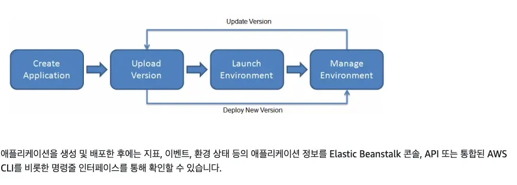

</details>

</details>

<details>
<summary><code>EBS</code></summary>

> ✏️ 
> 
> <a id="1f0eda9b0fe180178978f2eefc2615cd"></a>
> 
> 아래 두 가지 설정을 통해 <strong><u>빠르게 베포</u></strong>를 진행하고 <strong><u>간편하게 Config</u></strong> 할 수 있다&#46; 

- <code>Application</code>
    - 애플리케이션 코드, 구성 및 관련 파일

    - Elastic Beanstalk는 다양한 프로그래밍 언어와 프레임워크를 지원한다&#46; 

- <code>Environment</code>
    - Amazon EC2 인스턴스, 데이터베이스 인스턴스, 로드 벨런서 등

> ☝🏻 
> 
> <a id="1f0eda9b0fe180ceb269cadc55d6a960"></a>
> 
> 처음부터 Elastic Beanstalk을 사용하면 내부에 사용되는 기술들을 잘 모르기 때문에 오류 상황 및 상황에 따른 수정이 불가능하다
> 
> - <u>’문제가 생겼을 경우’</u> 나 <u>‘내부 구조를 변경하고 싶은 경우’</u> 해결 및 수정을 할 수 없다&#46;
> 
> <a id="1f0eda9b0fe18075be1df877c3ebb4bf"></a>
> 
> 지금까지의 실습을 통해서 하나하나 배웠으니, 이제는 원할하게 사용이 가능할 것이다&#46; 그럼 실습을 시작해보자&#33;

<a id="1f0eda9b0fe1807d9e83d962c1989af6"></a>

 

</details>

<details>
<summary>실습) EBS로 인프라 구성</summary>

<details>
<summary>🧐 <strong><code>EB Process</code></strong><strong> vs </strong><strong><code>VPC Route Table</code></strong><strong> (</strong><strong><code>RT</code></strong><strong>)</strong></summary>

> ✏️ 
> 
> <a id="1f0eda9b0fe1805a93e5da87b456dfec"></a>
> 
> 겉으로 보면 <strong>둘 다 </strong><strong><u>트래픽을 ‘어디로 보낼지’ 결정</u></strong><strong>한다는 점에서 비슷</strong>하지만 이 둘은 <strong><u>계층이 다</u></strong><strong>르고, </strong><strong><u>대상이 다</u></strong><strong>르고, </strong><strong><u>목적도 완전히 다</u></strong><strong>르다&#46;</strong>

| <strong>구분</strong> | <strong><code>EB Process</code></strong> | <strong><code>VPC Route Table</code></strong><strong> (</strong><strong><code>RT</code></strong><strong>)</strong> |
| --- | --- | --- |
| <strong>OSI 계층</strong> | <code>L7</code> (Application Layer) | <code>L3</code> (Network Layer) |
| <strong>동작 대상</strong> | <code>ALB</code> → <code>애플리케이션</code>(EC2의 특정 포트) | <code>패킷</code> → <code>IP 경로 설정</code> |
| <strong>기능</strong> | <u>URL 경로, 포트, 프로토콜 기준</u>으로 <strong>HTTP 라우팅</strong> | <u>IP 주소 범위(CIDR) 기준</u>으로 <strong>네트워크 경로 지정</strong> |
| <strong>예시</strong> | /api → 포트 5000, <br>/admin → 포트 3000 | 0&#46;0&#46;0&#46;0/0 → IGW, 10&#46;0&#46;1&#46;0/24 → NAT |
| <strong>사용 위치</strong> | ELB / EB 환경 내부 설정 | VPC / Subnet 단위 설정 |

</details>

<details>
<summary> Elastic Beanstalk  &#45; <code>Create application</code> 클릭</summary>

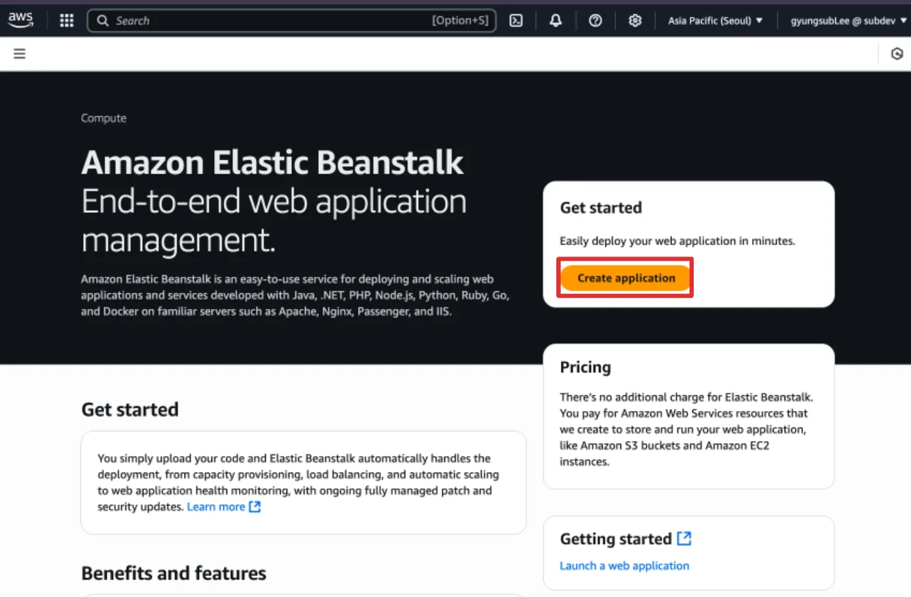

</details>

<details>
<summary>Elastic Beanstalk  environment 생성</summary>

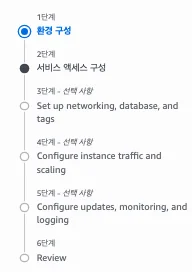

<details>
<summary>1&#46; 환경 구성</summary>

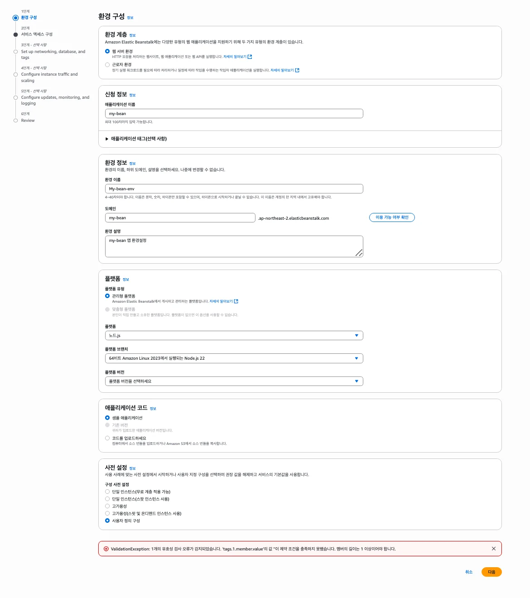

- 환경 계층&#58; 웹서버 환경, worker 환경

- 신청 정보&#58; Application 이름

- 환경 정보&#58; environment 이름, 도메인명, 설명

- 플랫폼&#58; 언어, 버전, 하드웨어 스펙 설정

- 애플리케이션 코드&#58; <code>샘플</code>, <code>코드 업로드</code> 

- 사전 설정&#58; 인프라 구성 유형 &#45; 단일 인스턴스, 고가용성, 사용자 정의

</details>

<details>
<summary>2&#46; 서비스 액세스 </summary>

> ✏️ 
> 
> <a id="1f0eda9b0fe180f3b34cef49c00aa450"></a>
> 
> Elastic Beanstalk 에서 사용될 권한 

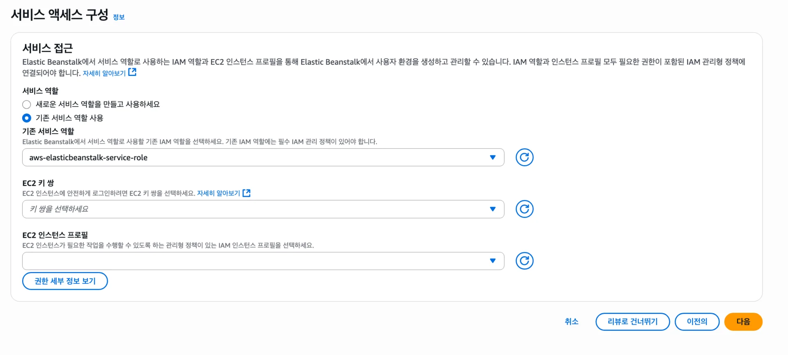

<details>
<summary>&#91; JSON &#93; Elastic beanstalk Role</summary>

- <code>Role name</code>&#58; aws&#45;elasticbeanstalk&#45;service&#45;role

- <code>Trusted entity</code>&#58; elasticbeanstalk&#46;amazonaws&#46;com

- <code>Permissions</code>
    <details>
    <summary><strong><code>AWSElasticBeanstalkEnhancedHealth</code></strong></summary>

    <a id="1f0eda9b0fe18073903fd3673ca03379"></a>

    ```json
    {
      "Version": "2012-10-17",
      "Statement": [
        {
          "Effect": "Allow",
          "Action": [
            "elasticloadbalancing:DescribeInstanceHealth",
            "elasticloadbalancing:DescribeLoadBalancers",
            "elasticloadbalancing:DescribeTargetHealth",
            "ec2:DescribeInstances",
            "ec2:DescribeInstanceStatus",
            "ec2:GetConsoleOutput",
            "ec2:AssociateAddress",
            "ec2:DescribeAddresses",
            "ec2:DescribeSecurityGroups",
            "sqs:GetQueueAttributes",
            "sqs:GetQueueUrl",
            "autoscaling:DescribeAutoScalingGroups",
            "autoscaling:DescribeAutoScalingInstances",
            "autoscaling:DescribeScalingActivities",
            "autoscaling:DescribeNotificationConfigurations",
            "sns:Publish"
          ],
          "Resource": [
            "*"
          ]
        }
      ]
    }
    ```

    </details>

    <details>
    <summary><strong><code>AWSElasticBeanstalkManagedUpdatesCustomerRolePolicy</code></strong></summary>

    <a id="1f0eda9b0fe1808cacede607d15dfce0"></a>

    ```json
    {
      "Version": "2012-10-17",
      "Statement": [
        {
          "Sid": "ElasticBeanstalkPermissions",
          "Effect": "Allow",
          "Action": [
            "elasticbeanstalk:*"
          ],
          "Resource": "*"
        },
        {
          "Sid": "AllowPassRoleToElasticBeanstalkAndDownstreamServices",
          "Effect": "Allow",
          "Action": "iam:PassRole",
          "Resource": "arn:aws:iam::*:role/*",
          "Condition": {
            "StringEquals": {
              "iam:PassedToService": [
                "elasticbeanstalk.amazonaws.com",
                "ec2.amazonaws.com",
                "ec2.amazonaws.com.cn",
                "autoscaling.amazonaws.com",
                "elasticloadbalancing.amazonaws.com",
                "ecs.amazonaws.com",
                "cloudformation.amazonaws.com"
              ]
            }
          }
        },
        {
          "Sid": "ReadOnlyPermissions",
          "Effect": "Allow",
          "Action": [
            "autoscaling:DescribeAccountLimits",
            "autoscaling:DescribeAutoScalingGroups",
            "autoscaling:DescribeAutoScalingInstances",
            "autoscaling:DescribeLaunchConfigurations",
            "autoscaling:DescribeLoadBalancers",
            "autoscaling:DescribeNotificationConfigurations",
            "autoscaling:DescribeScalingActivities",
            "autoscaling:DescribeScheduledActions",
            "ec2:DescribeAccountAttributes",
            "ec2:DescribeAddresses",
            "ec2:DescribeAvailabilityZones",
            "ec2:DescribeImages",
            "ec2:DescribeInstanceAttribute",
            "ec2:DescribeInstances",
            "ec2:DescribeKeyPairs",
            "ec2:DescribeLaunchTemplates",
            "ec2:DescribeLaunchTemplateVersions",
            "ec2:DescribeSecurityGroups",
            "ec2:DescribeSnapshots",
            "ec2:DescribeSpotInstanceRequests",
            "ec2:DescribeSubnets",
            "ec2:DescribeVpcClassicLink",
            "ec2:DescribeVpcs",
            "elasticloadbalancing:DescribeInstanceHealth",
            "elasticloadbalancing:DescribeLoadBalancers",
            "elasticloadbalancing:DescribeTargetGroups",
            "elasticloadbalancing:DescribeTargetHealth",
            "logs:DescribeLogGroups",
            "rds:DescribeDBEngineVersions",
            "rds:DescribeDBInstances",
            "rds:DescribeOrderableDBInstanceOptions",
            "sns:ListSubscriptionsByTopic"
          ],
          "Resource": [
            "*"
          ]
        },
        {
          "Sid": "EC2BroadOperationPermissions",
          "Effect": "Allow",
          "Action": [
            "ec2:AllocateAddress",
            "ec2:AssociateAddress",
            "ec2:AuthorizeSecurityGroupEgress",
            "ec2:AuthorizeSecurityGroupIngress",
            "ec2:CreateLaunchTemplate",
            "ec2:CreateLaunchTemplateVersion",
            "ec2:CreateSecurityGroup",
            "ec2:DeleteLaunchTemplate",
            "ec2:DeleteLaunchTemplateVersions",
            "ec2:DeleteSecurityGroup",
            "ec2:DisassociateAddress",
            "ec2:ReleaseAddress",
            "ec2:RevokeSecurityGroupEgress",
            "ec2:RevokeSecurityGroupIngress"
          ],
          "Resource": "*"
        },
        {
          "Sid": "EC2RunInstancesOperationPermissions",
          "Effect": "Allow",
          "Action": "ec2:RunInstances",
          "Resource": "*",
          "Condition": {
            "ArnLike": {
              "ec2:LaunchTemplate": "arn:aws:ec2:*:*:launch-template/*"
            }
          }
        },
        {
          "Sid": "EC2TerminateInstancesOperationPermissions",
          "Effect": "Allow",
          "Action": [
            "ec2:TerminateInstances"
          ],
          "Resource": "arn:aws:ec2:*:*:instance/*",
          "Condition": {
            "StringLike": {
              "ec2:ResourceTag/aws:cloudformation:stack-id": [
                "arn:aws:cloudformation:*:*:stack/awseb-e-*",
                "arn:aws:cloudformation:*:*:stack/eb-*"
              ]
            }
          }
        },
        {
          "Sid": "ECSBroadOperationPermissions",
          "Effect": "Allow",
          "Action": [
            "ecs:CreateCluster",
            "ecs:DescribeClusters",
            "ecs:RegisterTaskDefinition"
          ],
          "Resource": "*"
        },
        {
          "Sid": "ECSDeleteClusterOperationPermissions",
          "Effect": "Allow",
          "Action": "ecs:DeleteCluster",
          "Resource": "arn:aws:ecs:*:*:cluster/awseb-*"
        },
        {
          "Sid": "ASGOperationPermissions",
          "Effect": "Allow",
          "Action": [
            "autoscaling:AttachInstances",
            "autoscaling:CreateAutoScalingGroup",
            "autoscaling:CreateLaunchConfiguration",
            "autoscaling:DeleteLaunchConfiguration",
            "autoscaling:DeleteAutoScalingGroup",
            "autoscaling:DeleteScheduledAction",
            "autoscaling:DetachInstances",
            "autoscaling:DeletePolicy",
            "autoscaling:PutScalingPolicy",
            "autoscaling:PutScheduledUpdateGroupAction",
            "autoscaling:PutNotificationConfiguration",
            "autoscaling:ResumeProcesses",
            "autoscaling:SetDesiredCapacity",
            "autoscaling:SuspendProcesses",
            "autoscaling:TerminateInstanceInAutoScalingGroup",
            "autoscaling:UpdateAutoScalingGroup"
          ],
          "Resource": [
            "arn:aws:autoscaling:*:*:launchConfiguration:*:launchConfigurationName/awseb-e-*",
            "arn:aws:autoscaling:*:*:launchConfiguration:*:launchConfigurationName/eb-*",
            "arn:aws:autoscaling:*:*:autoScalingGroup:*:autoScalingGroupName/awseb-e-*",
            "arn:aws:autoscaling:*:*:autoScalingGroup:*:autoScalingGroupName/eb-*"
          ]
        },
        {
          "Sid": "CFNOperationPermissions",
          "Effect": "Allow",
          "Action": [
            "cloudformation:*"
          ],
          "Resource": [
            "arn:aws:cloudformation:*:*:stack/awseb-*",
            "arn:aws:cloudformation:*:*:stack/eb-*"
          ]
        },
        {
          "Sid": "ELBOperationPermissions",
          "Effect": "Allow",
          "Action": [
            "elasticloadbalancing:ApplySecurityGroupsToLoadBalancer",
            "elasticloadbalancing:ConfigureHealthCheck",
            "elasticloadbalancing:CreateLoadBalancer",
            "elasticloadbalancing:DeleteLoadBalancer",
            "elasticloadbalancing:DeregisterInstancesFromLoadBalancer",
            "elasticloadbalancing:DeregisterTargets",
            "elasticloadbalancing:RegisterInstancesWithLoadBalancer",
            "elasticloadbalancing:RegisterTargets"
          ],
          "Resource": [
            "arn:aws:elasticloadbalancing:*:*:targetgroup/awseb-*",
            "arn:aws:elasticloadbalancing:*:*:targetgroup/eb-*",
            "arn:aws:elasticloadbalancing:*:*:loadbalancer/awseb-*",
            "arn:aws:elasticloadbalancing:*:*:loadbalancer/eb-*",
            "arn:aws:elasticloadbalancing:*:*:loadbalancer/*/awseb-*/*",
            "arn:aws:elasticloadbalancing:*:*:loadbalancer/*/eb-*/*"
          ]
        },
        {
          "Sid": "CWLogsOperationPermissions",
          "Effect": "Allow",
          "Action": [
            "logs:CreateLogGroup",
            "logs:DeleteLogGroup",
            "logs:PutRetentionPolicy"
          ],
          "Resource": "arn:aws:logs:*:*:log-group:/aws/elasticbeanstalk/*"
        },
        {
          "Sid": "S3ObjectOperationPermissions",
          "Effect": "Allow",
          "Action": [
            "s3:DeleteObject",
            "s3:GetObject",
            "s3:GetObjectAcl",
            "s3:GetObjectVersion",
            "s3:GetObjectVersionAcl",
            "s3:PutObject",
            "s3:PutObjectAcl",
            "s3:PutObjectVersionAcl"
          ],
          "Resource": "arn:aws:s3:::elasticbeanstalk-*/*"
        },
        {
          "Sid": "S3BucketOperationPermissions",
          "Effect": "Allow",
          "Action": [
            "s3:GetBucketLocation",
            "s3:GetBucketPolicy",
            "s3:ListBucket",
            "s3:PutBucketPolicy"
          ],
          "Resource": "arn:aws:s3:::elasticbeanstalk-*"
        },
        {
          "Sid": "SNSOperationPermissions",
          "Effect": "Allow",
          "Action": [
            "sns:CreateTopic",
            "sns:GetTopicAttributes",
            "sns:SetTopicAttributes",
            "sns:Subscribe"
          ],
          "Resource": "arn:aws:sns:*:*:ElasticBeanstalkNotifications-*"
        },
        {
          "Sid": "SQSOperationPermissions",
          "Effect": "Allow",
          "Action": [
            "sqs:GetQueueAttributes",
            "sqs:GetQueueUrl"
          ],
          "Resource": [
            "arn:aws:sqs:*:*:awseb-e-*",
            "arn:aws:sqs:*:*:eb-*"
          ]
        },
        {
          "Sid": "CWPutMetricAlarmOperationPermissions",
          "Effect": "Allow",
          "Action": [
            "cloudwatch:PutMetricAlarm"
          ],
          "Resource": [
            "arn:aws:cloudwatch:*:*:alarm:awseb-*",
            "arn:aws:cloudwatch:*:*:alarm:eb-*"
          ]
        }
      ]
    }
    ```

    </details>

</details>

<details>
<summary>&#91; JSON &#93; IAM profile</summary>

- <code>Trusted entity</code><strong>&#58;  </strong>ec2&#46;amazonaws&#46;com

- <code>Permissions</code>
    <details>
    <summary><strong><code>AWSElasticBeanstalk</code></strong><strong><code>WebTier</code></strong></summary>

    <a id="1f0eda9b0fe1807386d6fe3ac3f10139"></a>

    ```json
    {
      "Version": "2012-10-17",
      "Statement": [
        {
          "Sid": "BucketAccess",
          "Action": [
            "s3:Get*",
            "s3:List*",
            "s3:PutObject"
          ],
          "Effect": "Allow",
          "Resource": [
            "arn:aws:s3:::elasticbeanstalk-*",
            "arn:aws:s3:::elasticbeanstalk-*/*"
          ]
        },
        {
          "Sid": "XRayAccess",
          "Action": [
            "xray:PutTraceSegments",
            "xray:PutTelemetryRecords",
            "xray:GetSamplingRules",
            "xray:GetSamplingTargets",
            "xray:GetSamplingStatisticSummaries"
          ],
          "Effect": "Allow",
          "Resource": "*"
        },
        {
          "Sid": "CloudWatchLogsAccess",
          "Action": [
            "logs:PutLogEvents",
            "logs:CreateLogStream",
            "logs:DescribeLogStreams",
            "logs:DescribeLogGroups"
          ],
          "Effect": "Allow",
          "Resource": [
            "arn:aws:logs:*:*:log-group:/aws/elasticbeanstalk*"
          ]
        },
        {
          "Sid": "ElasticBeanstalkHealthAccess",
          "Action": [
            "elasticbeanstalk:PutInstanceStatistics"
          ],
          "Effect": "Allow",
          "Resource": [
            "arn:aws:elasticbeanstalk:*:*:application/*",
            "arn:aws:elasticbeanstalk:*:*:environment/*"
          ]
        }
      ]
    }
    ```

    </details>

    <details>
    <summary><strong><code>AWSElasticBeanstalk</code></strong><strong><code>WorkerTier</code></strong></summary>

    <a id="1f0eda9b0fe180baa8a6d1b96e0d8a48"></a>

    ```json
    {
      "Version": "2012-10-17",
      "Statement": [
        {
          "Sid": "MetricsAccess",
          "Action": [
            "cloudwatch:PutMetricData"
          ],
          "Effect": "Allow",
          "Resource": "*"
        },
        {
          "Sid": "XRayAccess",
          "Action": [
            "xray:PutTraceSegments",
            "xray:PutTelemetryRecords",
            "xray:GetSamplingRules",
            "xray:GetSamplingTargets",
            "xray:GetSamplingStatisticSummaries"
          ],
          "Effect": "Allow",
          "Resource": "*"
        },
        {
          "Sid": "QueueAccess",
          "Action": [
            "sqs:ChangeMessageVisibility",
            "sqs:DeleteMessage",
            "sqs:ReceiveMessage",
            "sqs:SendMessage"
          ],
          "Effect": "Allow",
          "Resource": "*"
        },
        {
          "Sid": "BucketAccess",
          "Action": [
            "s3:Get*",
            "s3:List*",
            "s3:PutObject"
          ],
          "Effect": "Allow",
          "Resource": [
            "arn:aws:s3:::elasticbeanstalk-*",
            "arn:aws:s3:::elasticbeanstalk-*/*"
          ]
        },
        {
          "Sid": "DynamoPeriodicTasks",
          "Action": [
            "dynamodb:BatchGetItem",
            "dynamodb:BatchWriteItem",
            "dynamodb:DeleteItem",
            "dynamodb:GetItem",
            "dynamodb:PutItem",
            "dynamodb:Query",
            "dynamodb:Scan",
            "dynamodb:UpdateItem"
          ],
          "Effect": "Allow",
          "Resource": [
            "arn:aws:dynamodb:*:*:table/*-stack-AWSEBWorkerCronLeaderRegistry*"
          ]
        },
        {
          "Sid": "CloudWatchLogsAccess",
          "Action": [
            "logs:PutLogEvents",
            "logs:CreateLogStream"
          ],
          "Effect": "Allow",
          "Resource": [
            "arn:aws:logs:*:*:log-group:/aws/elasticbeanstalk*"
          ]
        },
        {
          "Sid": "ElasticBeanstalkHealthAccess",
          "Action": [
            "elasticbeanstalk:PutInstanceStatistics"
          ],
          "Effect": "Allow",
          "Resource": [
            "arn:aws:elasticbeanstalk:*:*:application/*",
            "arn:aws:elasticbeanstalk:*:*:environment/*"
          ]
        }
      ]
    }
    ```

    </details>

    <details>
    <summary><strong><code>AWSElasticBeanstalk</code></strong><strong><code>MulticontainerDocker</code></strong></summary>

    <a id="1f0eda9b0fe180d9912eeb3b4c0d42eb"></a>

    ```json
    {
      "Version": "2012-10-17",
      "Statement": [
        {
          "Sid": "ECSAccess",
          "Effect": "Allow",
          "Action": [
            "ecs:Poll",
            "ecs:StartTask",
            "ecs:StopTask",
            "ecs:DiscoverPollEndpoint",
            "ecs:StartTelemetrySession",
            "ecs:RegisterContainerInstance",
            "ecs:DeregisterContainerInstance",
            "ecs:DescribeContainerInstances",
            "ecs:Submit*"
          ],
          "Resource": "*"
        }
      ]
    }
    ```

    </details>

    <details>
    <summary>WebTier 커스텀</summary>

    > ✏️ 
    > 
    > - 위에 제시된 IAM 정책은 <u>Web Tier 기본 수준용</u><strong> 이다&#46;</strong>
    > 
    > - 고가용성과 인프라 자동화(Auto Scaling, RDS 등)를 제대로 활용하려면 <strong>EC2, ELB, Auto Scaling, CloudFormation 등 서비스에 대한 권한도 추가해야 한다&#46;</strong>
    > 
    > - 추가 필요 

    <a id="1f0eda9b0fe1805c948ed928855ec96b"></a>

    ```json
    {
      "Version": "2012-10-17",
      "Statement": [
        ... 위 WebTier 정보
       
        // EC2 
       {
    		  "Effect": "Allow",
    		  "Action": [
    		    "ec2:Describe*",
    		    "ec2:AttachVolume",
    		    "ec2:CreateTags",
    		    "ec2:ModifyInstanceAttribute",
    		    "ec2:AssociateAddress",
    		    "ec2:DisassociateAddress"
    		  ],
    		  "Resource": "*"
    		},
    		
    		// ELB 
    		{
    		  "Effect": "Allow",
    		  "Action": [
    		    "elasticloadbalancing:Describe*",
    		    "elasticloadbalancing:RegisterInstancesWithLoadBalancer",
    		    "elasticloadbalancing:DeregisterInstancesFromLoadBalancer",
    		    "elasticloadbalancing:DescribeTargetGroups",
    		    "elasticloadbalancing:RegisterTargets",
    		    "elasticloadbalancing:DeregisterTargets"
    		  ],
    		  "Resource": "*"
    		},
    		
    		// Autoscaling 
    		{
    		  "Effect": "Allow",
    		  "Action": [
    		    "autoscaling:Describe*",
    		    "autoscaling:UpdateAutoScalingGroup"
    		  ],
    		  "Resource": "*"
    		}
      ]
    }
    ```

    </details>

</details>

</details>

<details>
<summary>3&#46; 네트워크, DB 설정</summary>

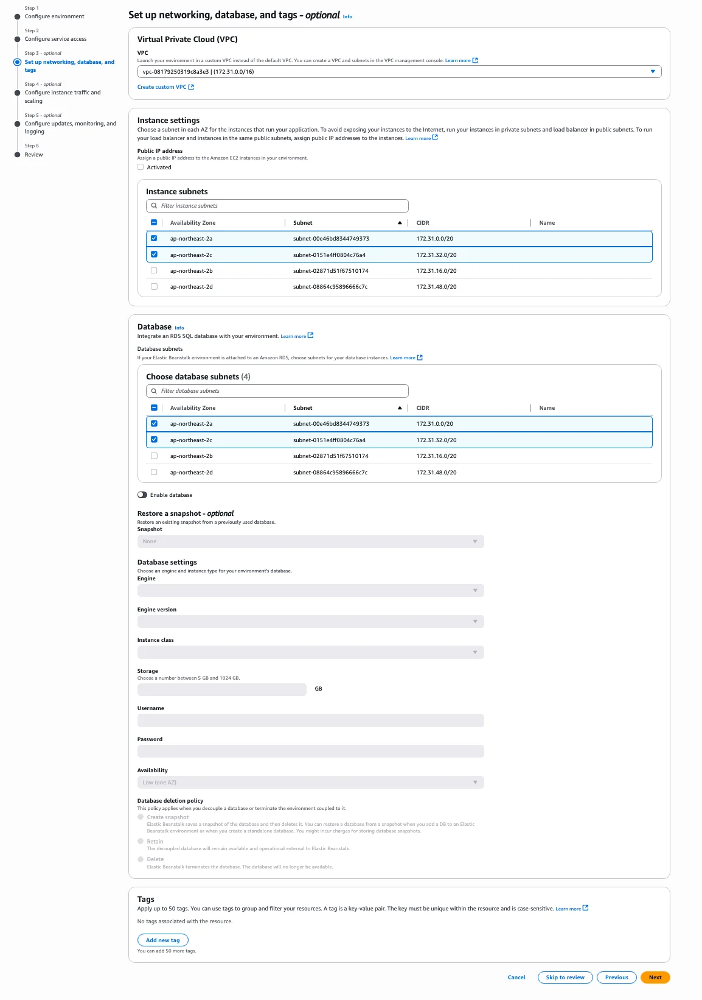

- VPC 설정

<details>
<summary>서브넷 설정</summary>

- 인스턴스 ( EC2 ), DB
    > ✏️ 
    > 
    > 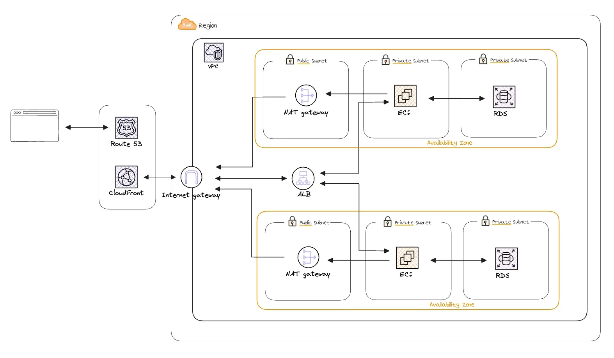
    > 
    > <a id="1f0eda9b0fe180f884fefa46926198b6"></a>
    > 
    > 동일한 AZ에서 인스턴스(EC2) 레이어 와 DB 레이어의 서브넷을 나눠 구성하는 것을 권장한다&#46; 
    > 
    > - 고가용성을 위해 2 개 이상의 AZ로 구성하는 것이 좋다&#46; 
    > 
    > - 아래의 경우 간단한 실습이기 때문에 같은 서브넷으로 진행한다&#46; <br>실무 상황의 경우, 서브넷을 생성 후 나눠서 설정하는 것을 권장

    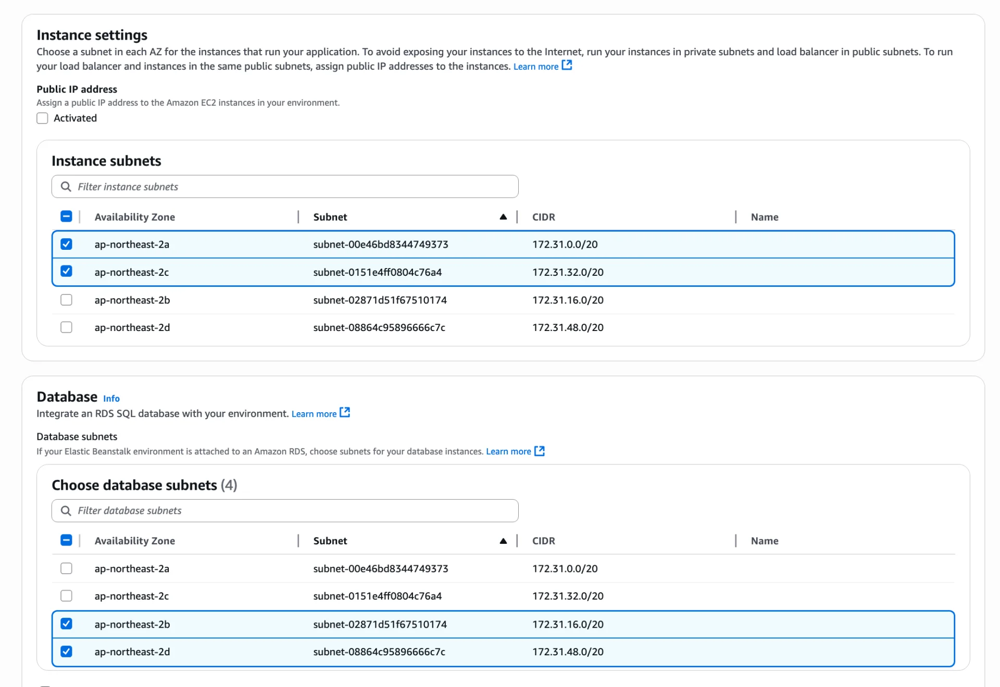

    - EC2 인스턴스와 RDS 인스턴스 서브넷을 나누지 않고 2개의 AZ를 선택

</details>

</details>

<details>
<summary>4&#46; <strong>Configure instance traffic and scaling</strong></summary>

<details>
<summary>Instances</summary>

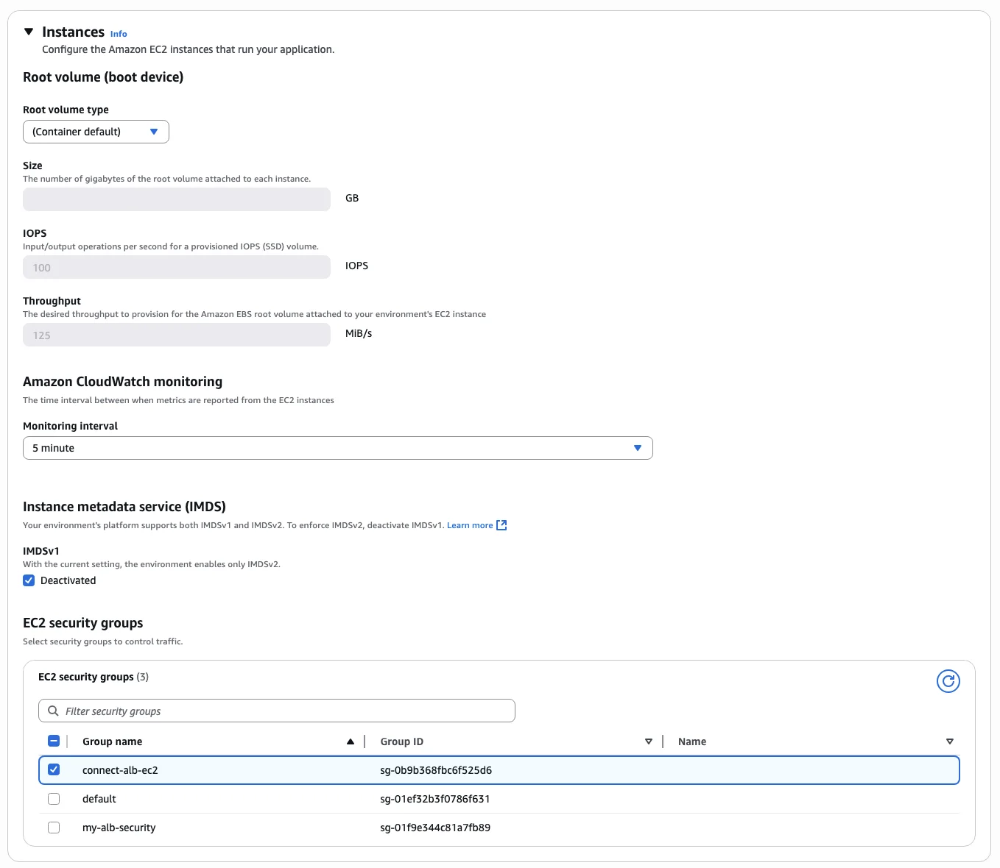

- 인스턴스 volum 설정

- 인스턴스 security groups 설정

</details>

<details>
<summary>capacity ( 가용성 )</summary>

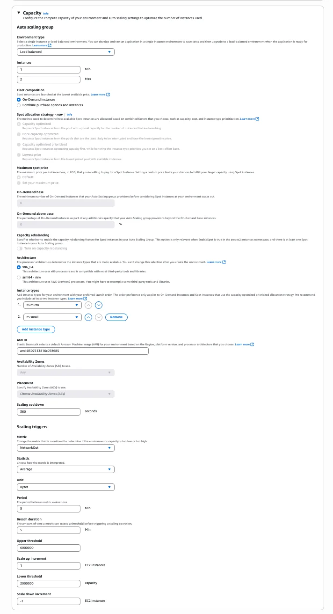

<details>
<summary>Auto scaling group</summary>

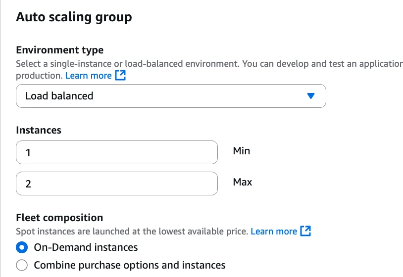

- 고가용성을 위헤 로드벨런서 구성

- scale &#45; 인스턴스  1 &#126; 2  → 간단한 실습이기 때문에 최소 수로 진행

- On&#45;Demand Instances → 사용한 만큼 금액 나옴

</details>

<details>
<summary>Architecture</summary>

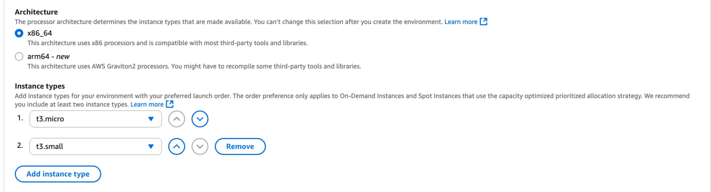

- 인스턴스 유형 ( 스펙 ) 설정
    - 최소 2개 설정을 권장함

</details>

<details>
<summary>AMI ID</summary>

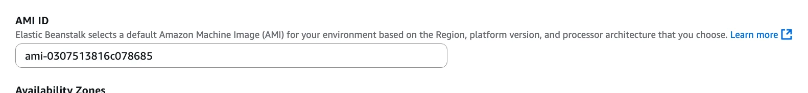

- AMI 우선 보류 &#45; 기본 설정으로 진행함

</details>

- 나머지 옵션 기본으로 진행

</details>

<details>
<summary> 로드벨런서 구성</summary>

<details>
<summary>AZ, subnets</summary>

> ✏️ 
> 
> <a id="1f0eda9b0fe180d0b0dfefa8679d5de9"></a>
> 
> <code>로드 밸런서</code>(특히 ALB&#58; Application Load Balancer)에서는 <strong><u>Availability Zone(AZ) 설정이 반드시 필요</u></strong>하다&#46; 
> 
> <details>
> <summary><strong>🧐 왜 로드밸런서는 </strong><strong><code>AZ</code></strong><strong> 설정이 필요한가?</strong></summary>
> 
> | <strong>이유</strong> | <strong>설명</strong> |
> | --- | --- |
> | <strong>고가용성(HA)</strong> | 한 AZ가 장애나도, 다른 AZ의 Subnet을 통해 계속 서비스 가능하게 함 |
> | <strong>로드 밸런싱의 본질</strong> | 인스턴스를 여러 AZ에 배치하고, 그 사이에서 트래픽을 분산시키는 게 ALB의 핵심 기능 |
> | <strong>네트워크 구조</strong> | ALB는 Subnet 안에 ENI(Network Interface)를 생성하여 트래픽을 수신함 → 따라서 <strong>AZ별 Subnet 선택이 필요</strong> |
> | <strong>정책적 요구</strong> | AWS ALB는 <strong>최소 2개 AZ/Subnet 설정</strong>을 권장 (1개만 설정해도 되긴 하지만 권장되지 않음) |
> 
> </details>

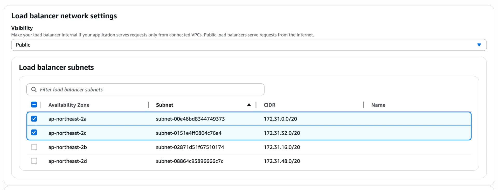

</details>

<details>
<summary>Type</summary>

<details>
<summary>🧐  <strong><code>Dedicated</code></strong><strong> vs</strong><strong><code> Shared</code></strong></summary>

| <strong>항목</strong> | <strong><code>Dedicated</code></strong> | <strong><code>Shared</code></strong> |
| --- | --- | --- |
| <strong>의미</strong> | EB 환경 전용 ALB 생성 | 기존 ALB 재사용 |
| <strong>ALB 리소스</strong> | EB가 자동으로 새로 생성 | 내가 만든 ALB를 지정해서 사용 |
| <strong>환경 간 격리</strong> | ✅ 완전 격리 | ❌ 여러 환경이 같이 사용 |
| <strong>운영 유연성</strong> | ✅ 각 환경별 개별 배포, 수정 가능 | ⚠️ 설정 충돌 가능성 있음 |
| <strong>비용</strong> | 💰 ALB별 과금 (환경마다 추가 요금) | 💸 ALB 공유로 비용 절감 가능 |
| <strong>사용 권장 시점</strong> | 대부분의 EB 환경 (기본) | 고급 운영자, 여러 환경 병렬 운영 시 |

<details>
<summary><strong><code>sDedicated</code></strong></summary>

- EB 환경을 만들면 <strong>ALB, Target Group, Listener 등 전체 리소스를 새로 생성</strong>

- 하나의 환경 안에서만 사용되기 때문에 <strong>구성 간섭 없음</strong>

- ex&#46; 경로만 사용하는 단일 서비스에 적합<br>

</details>

<details>
<summary><strong><code>Shared</code></strong></summary>

- 이미 만들어진 ALB에 새로운 EB 환경을 붙여서 <strong>같은 Listener / Target Group을 공유</strong>

- 라우팅 규칙을 나눠서 사용하거나, EB 외부에서도 <strong>직접 Listener Rule 관리가 필요</strong>

- /app1, /app2처럼 여러 환경을 하나의 도메인 하위 URI로 운영하고 싶을 때 유용

</details>

</details>

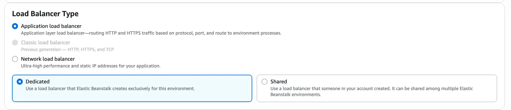

- ALB &#45; Dedicated 

</details>

<details>
<summary>Listeners, Process 설정</summary>

> ✏️ 
> 
> - <code>Listeners</code>&#58; &#91; 외부 → 로드벨런서 &#93; &#45; <code>HTTPS</code> 
> 
> - <code>Process</code>&#58; &#91; 로브밸런서 → EC2 &#93; &#45; 내부 네트워크, <code>HTTP</code>

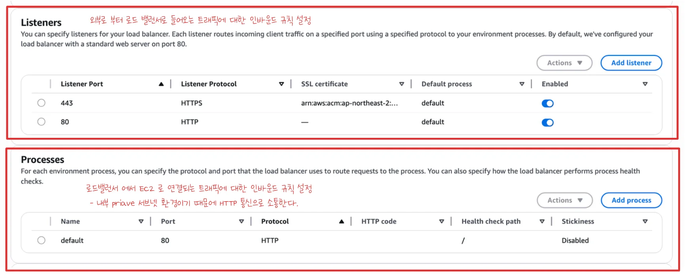

</details>

</details>

- 나머진 스킵 ( 다음에 정리 )


</details>

<details>
<summary>5&#46; <strong>Configure updates, monitoring, and logging</strong></summary>

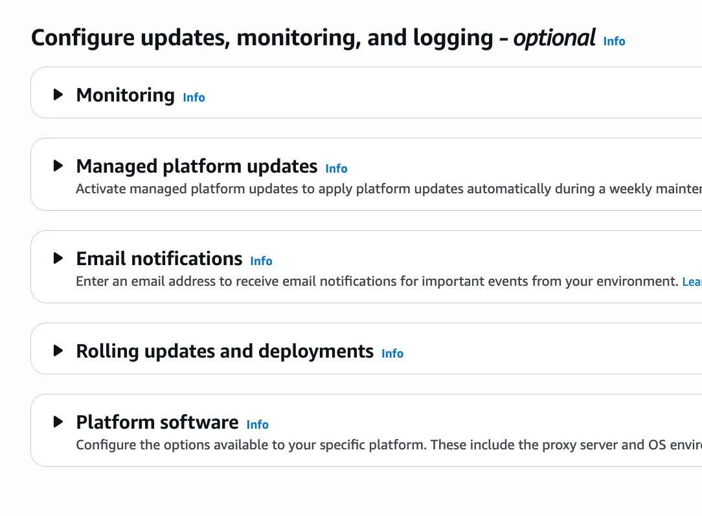

- Monitoring 
    - Health checking

- Platform software ( 우선 보류 )

<details>
<summary>🤬 오류 &#45; </summary>

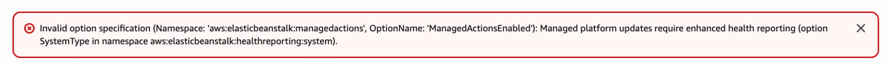

> ✏️ 
> 
> <a id="1f0eda9b0fe180e587e6c78f96585fd9"></a>
> 
> Elastic Beanstalk에서 <strong>Managed platform updates (자동 플랫폼 업데이트)</strong> 기능을 사용하려면, <strong>Enhanced Health Reporting</strong> 기능이 반드시 <strong>활성화되어 있어야 한다</strong>

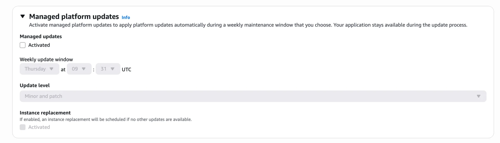

- 우선 취소함

</details>

</details>

<details>
<summary>6&#46; Review </summary>

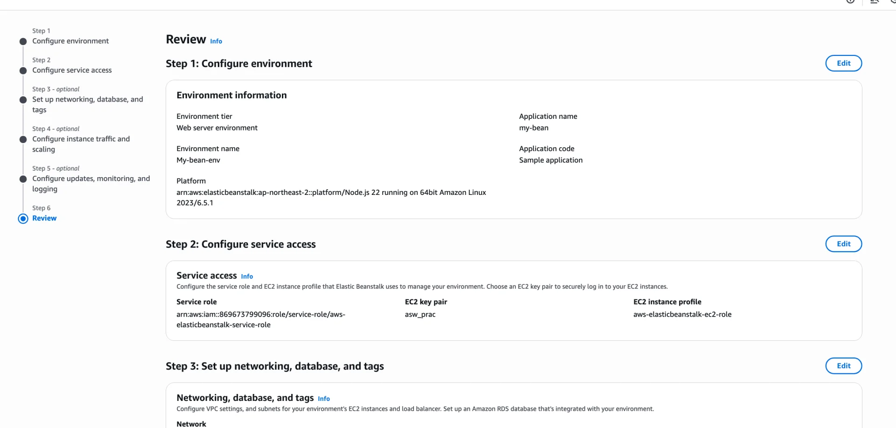

- 각 step 별 입력 정보 확인

- 잘못된 입력이 있는 경우 다시 돌아가서 수정

</details>

</details>

<details>
<summary>생성 확인</summary>

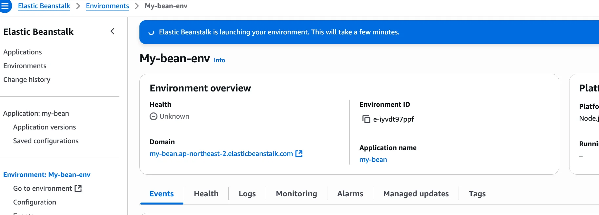

- 설정한 인프라를 구성하는데, 몇 분도 시간이 걸림

</details>

</details>

<details>
<summary>🤬 오류 &#45; IAM 설정 오류</summary>

> ❌ <strong>The instance profile aws&#45;elasticbeanstalk&#45;ec2&#45;role associated with the environment does not exist&#46;</strong>

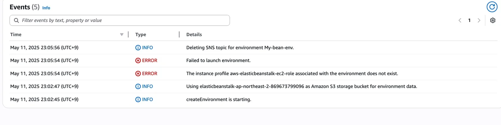

> ✏️ 
> 
> <a id="1f0eda9b0fe180fbb021febd63f387a1"></a>
> 
> Elastic Beanstalk은 EC2 인스턴스를 생성할 때 <strong>IAM 역할(Instance Profile)</strong> 이 반드시 필요하다&#46;
> 
> <a id="1f0eda9b0fe180be846ac18e0f1f52eb"></a>
> 
> aws&#45;elasticbeanstalk&#45;ec2&#45;role이라는 이름의 역할이 <strong>존재하지 않거나 제대로 연결되지 않은 상태</strong>에서 환경을 시작하려 했기 때문에 실패한 것이다&#46;

<details>
<summary></summary>


</details>

</details>

<details>
<summary>실습) EBS &#45; <strong><u>도메인 연결</u></strong> 및 <strong><u>HTTPS </u></strong><u>설정</u></summary>

> ✏️ 
> 
> <a id="1f0eda9b0fe1802c882edf075f909b39"></a>
> 
> 도메인 하나를 생성하면 서브도메인으로 계속 우려먹기 가능하다&#46; 

<details>
<summary>도메인에 EBS와 연결하는 레코드 생성</summary>

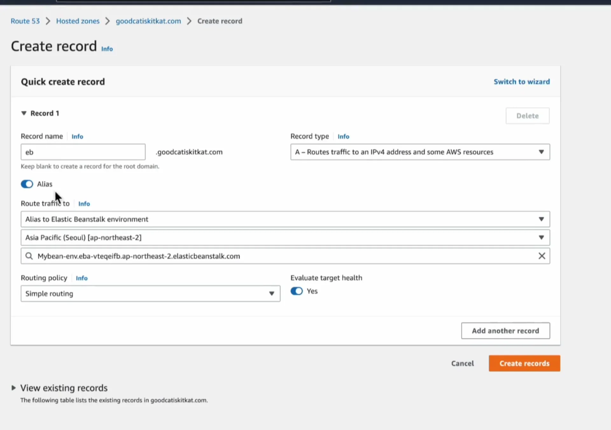

- 서브 도메인&#58; <code>eb</code>

- A / Alias 

- 서비스&#58; Alias to Elastic Beanstalk environment

- 리전&#58; ap&#45;northeast&#45;2

- 서비스 인스턴스 &#45; Elastic Beanstalk 인스턴스 선택

- <a href="http://eb.subdev-testcase.com">eb&#46;subdev&#45;testcase&#46;com</a> 접속
    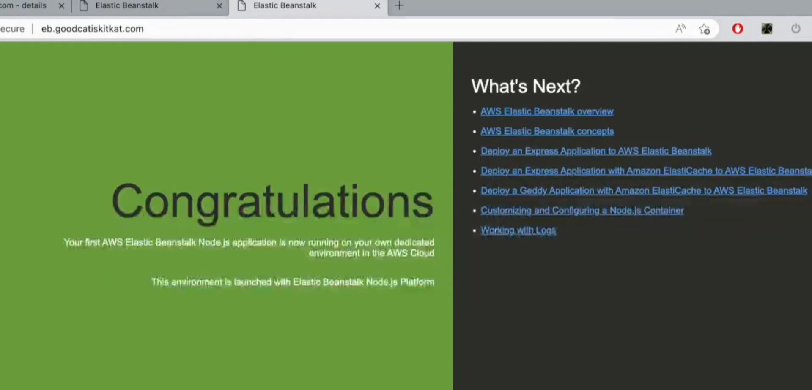

</details>

<details>
<summary>HTTPS 적용</summary>

<a id="1f0eda9b0fe180f58f60e483be2414e7"></a>

로드벨런서 인바운드 규칙 &#45; HTTPS 추가

- 해당 하는 ELB 인스턴스로 가서 인바운드 규칙에 <code>HTTPS</code>를 추가한다&#46;

<a id="1f0eda9b0fe1807cbea8c2451628d0fa"></a>

listener 설정 추가 &#45; SSL 인증서 및 인증 방식을 설정한다&#46;

- Elastic Beanstalks &#45; configure &#45; 해당 서비스 인스턴스 <code>edit</code> 클릭 &#45; <code>add listener</code> 클릭

</details>

</details>
