<a id="1eeeda9b0fe180fd98c3e4a66502b001"></a>

## Route 53

---

> 📖 
> 
> 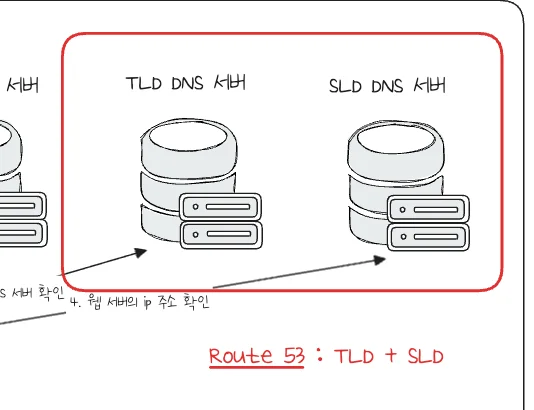
> 
> <a id="1eeeda9b0fe18096a442c75fd743f0dc"></a>
> 
> AWS에서 제공하는 <code>DNS</code> 서비스이다&#46; 
> 
> - 100% 가용성을 제공한다&#46; 
> 
> <details>
> <summary>AWS의 다른 서비스와 원할하게 통합 사용 가능하다&#46; </summary>
> 
> 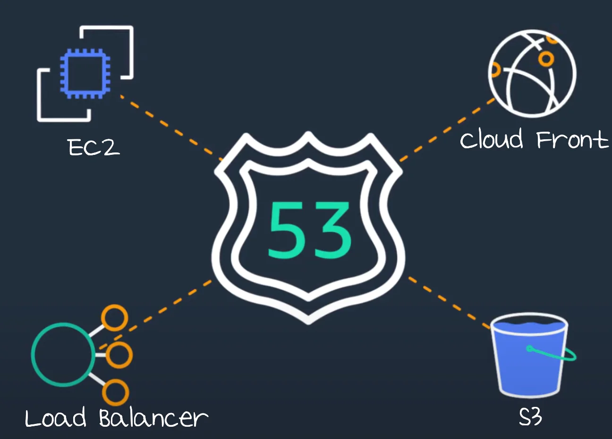
> 
> </details>
> 
> - 트래픽 흐름을 통해 서비스의 안정성을 향상 시킨다&#46; 

<a id="1eeeda9b0fe180719b80c8910985244e"></a>

### 1&#46; Domain Name System

> ✏️ 
> 
> <a id="1eeeda9b0fe18042ba0ad1e1657faa5d"></a>
> 
> <code>DNS</code>( Domain Name System 
> 
> ---
> 
> 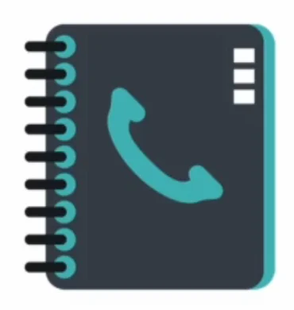
> 
> - 전화번호처럼 IP주소는 <u>외우기도 힘</u>들고 <u>변경될 수 있</u>다&#46;
> 
> - 따라서 ‘<strong><u>문자 형태’로 사람이 식별하기 편리하게 변경</u></strong> 하는데, 이를 <code>DNS</code>( Domain Name System )라 한다&#46; 

<details>
<summary><strong>DNS Hierarchy Tree</strong></summary>

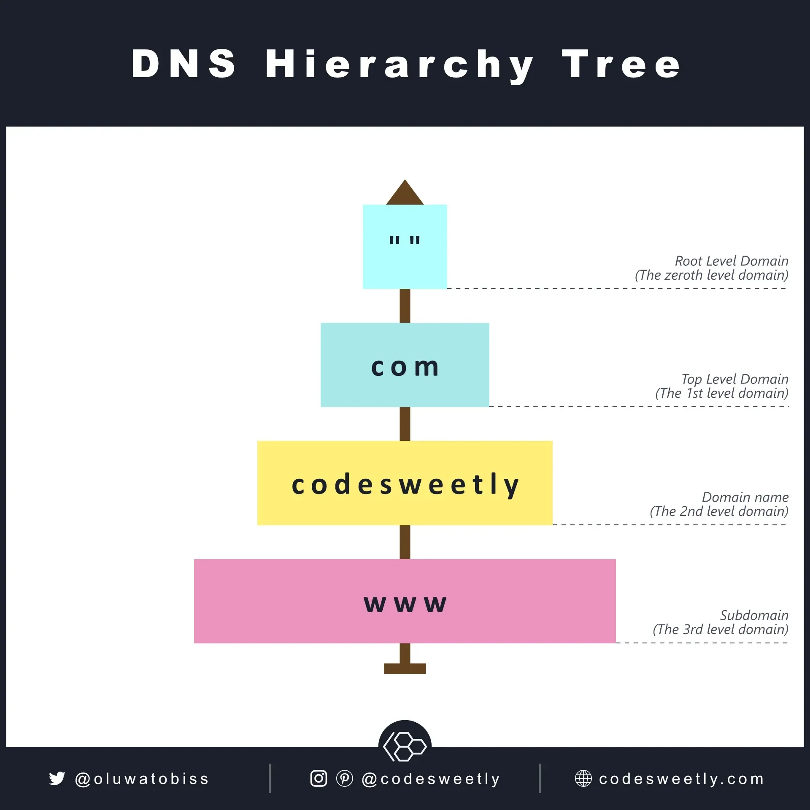

<a id="1eeeda9b0fe18062ba41c08a937179cc"></a>

자세한 내용은  아래 참조

- ‣

</details>

<details>
<summary><strong> DNS 질의 과정</strong></summary>

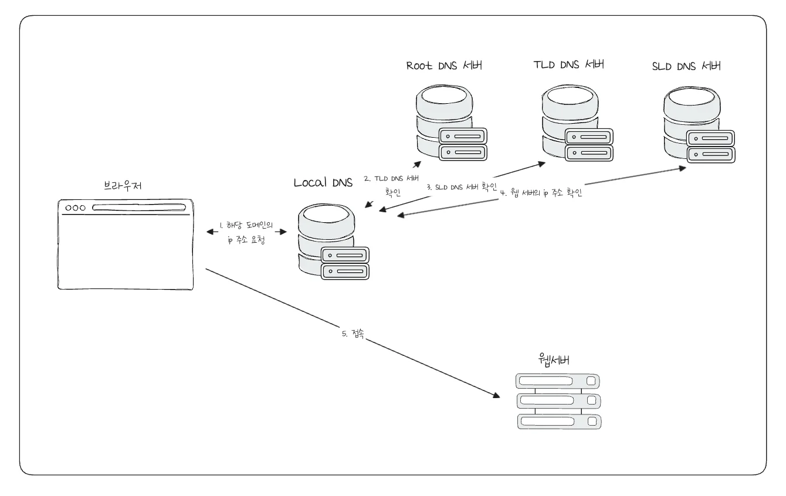

1. 도메인 주소에 해당하는 IP 주소를 Local DNS 서버에 요청한다&#46; 

1. Root DNS 서버에서 TLD DNS 서버 주소를 받아온다&#46; 

1. TLD 서버에서 SLD DNS 서버 주소를 받아온다&#46; 

1. SLD 서버에서 도메인 IP 주소를 받아온다&#46; 

1. 받아온 IP 주소로 해당하는 웹 서버에 접속한다&#46;

<details>
<summary>🧐 매번 이렇게 많은 네트워크 요청이 이뤄지면 네트워크 병목이 발생되지 않나?</summary>

> ✏️ 
> 
> <a id="1eeeda9b0fe180eba83ee1a2072b6e9f"></a>
> 
>  DNS 질의 과정은 <strong>단계가 많고 여러 서버를 거치기 때문에 느릴 수 있어 보이지만</strong>, <u>실제 인터넷에서는 이로 인해 병목이 자주 발생하지 않</u>도록<u> </u><strong><u>다양한 최적화 기법</u></strong>들이 적용되어 있다&#46;

<details>
<summary><strong>1&#46; DNS 캐싱</strong></summary>

- <strong>브라우저, 운영체제, 로컬 DNS 서버</strong>는 모두 캐시를 갖고 있다&#46;

- 만약 <code>naver&#46;com</code>에 한 번 접속하면, <strong>다음 접속은 캐시된 IP로 바로 연결된다&#46; </strong>

- TTL(Time To Live)이라는 설정 시간 동안 캐시된 IP는 계속 재사용 된다&#46; <strong> </strong><br>

</details>

<details>
<summary>2&#46; 로컬 DNS 서버는 권한이 있는 서버를 기억한다&#46; </summary>

- 자주 요청되는 &#46;com, &#46;kr 등의 TLD 서버 주소는 거의 항상 캐시되어 있다&#46;

- 따라서 <strong><u>루트 DNS</u></strong>까지 가는 일은 실제로는 <strong><u>매우 드물다&#46;</u></strong>

</details>

<details>
<summary>3&#46; <strong>병렬처리와 재귀 질의</strong></summary>

- DNS 질의는 보통 재귀 질의( recursive query ) 방식으로 동작하며, 이 과정은<u> </u><strong><u>비동기적으로 빠르게 처리</u></strong>되도록 설계되었다&#46; 

- 클라이언트가 로컬 DNS 서버에 한 번만 요청하면, 나머지는 <strong>로컬 DNS 서버가 알아서 처리</strong><br>

</details>

</details>

</details>

<a id="1eeeda9b0fe1800ead20d4ffef1baa6e"></a>

### 2&#46; 도메인 등록

> ✏️ 
> 
> <a id="1eeeda9b0fe180f4a296c90ffeb0203a"></a>
> 
> DNS의 경우 53번 포트 번호를 사용한다&#46; 

<details>
<summary>Route 53 &#45; 도메인 등록(구입)</summary>

<details>
<summary>1&#46; 도메인 등록</summary>

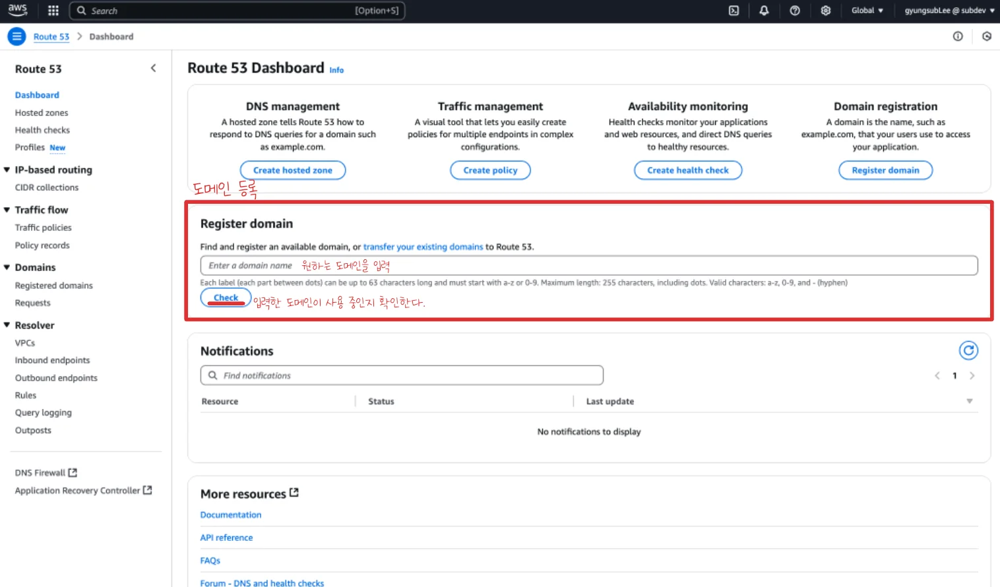

</details>

<details>
<summary>2&#46; 도메인 가능 여부 확인</summary>

<details>
<summary>사용 중인 도메인 <strong><u>등록 불가능</u></strong></summary>

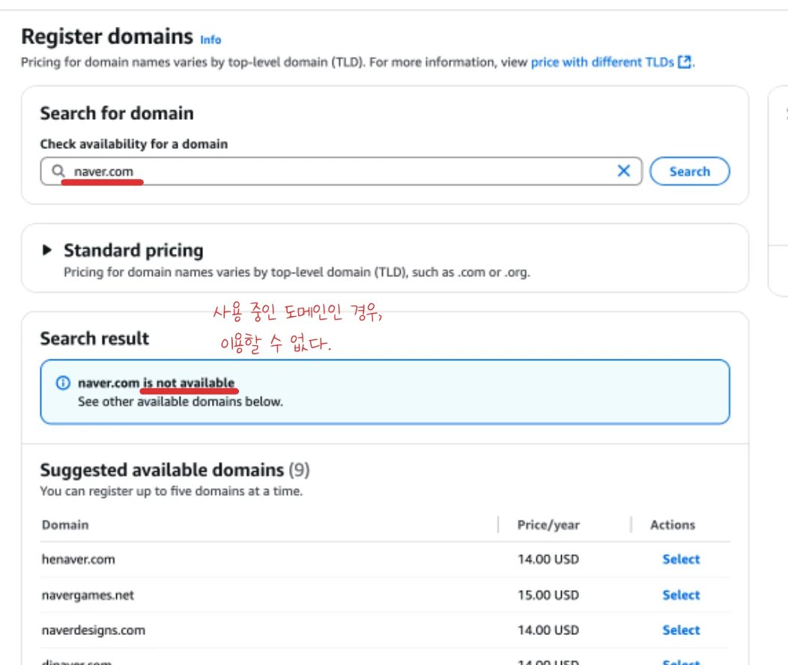

- 사용 중인 도메인인 경우, 위와 같이 이용할 수 없다&#46;

</details>

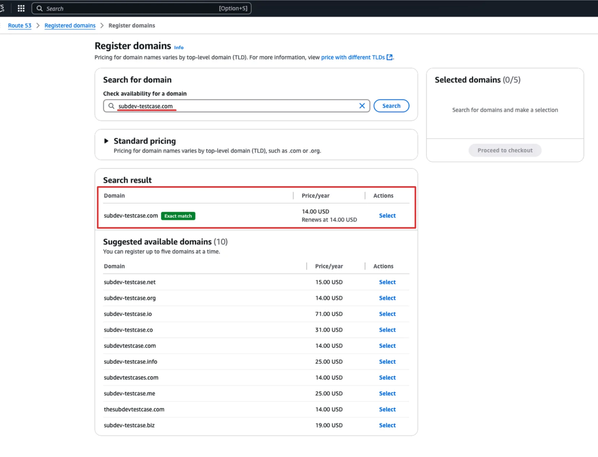

- 사용 가능한 경우, 위와 같이 비용과 선택 가능한 옵션들이 나온다&#46;
    - 등록 시, <code>14&#46;00 USD</code>( 약 2만원 ) 비용 발생 ( 25&#46;05&#46;09일 기준 )

</details>

<details>
<summary>3&#46; 유효기간, 재등록 여부 설정</summary>

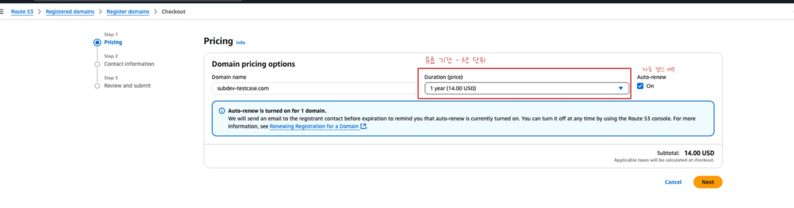

</details>

<details>
<summary>4&#46; 개인 정보 입력</summary>

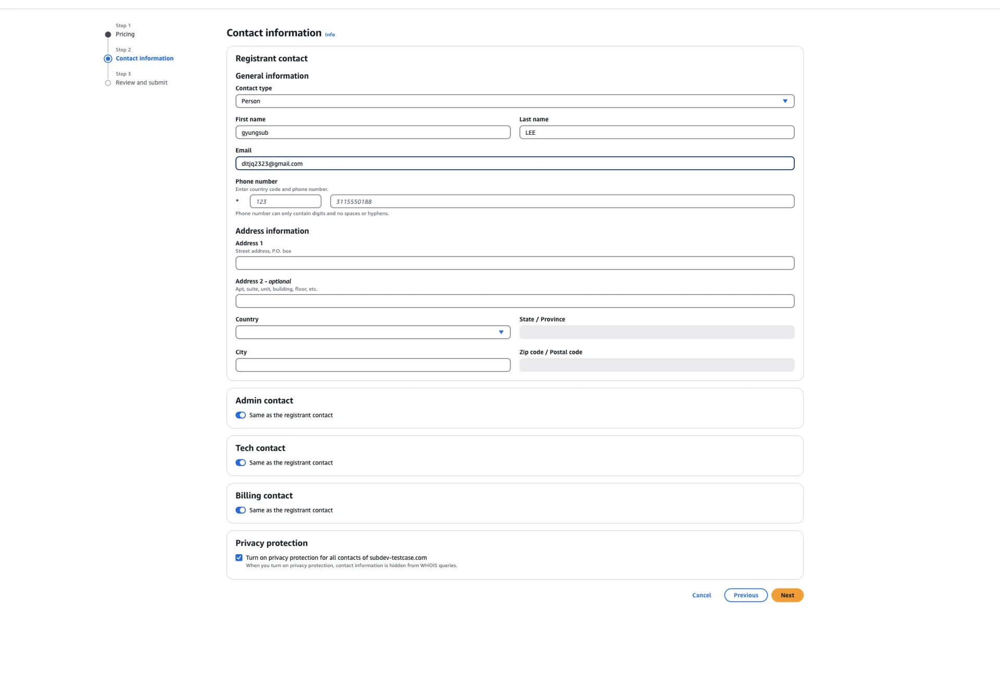

</details>

<details>
<summary>5&#46; 입력한  정보 확인</summary>

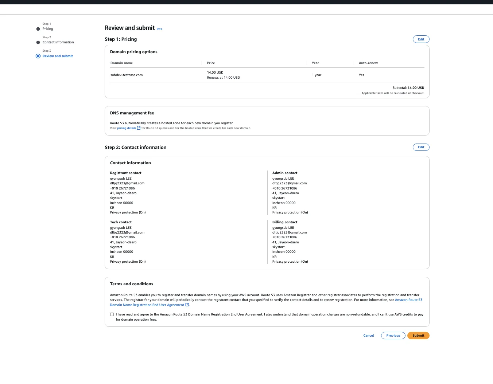

</details>

<details>
<summary>6&#46; 등록 확인</summary>

> ☝🏻 
> 
> <a id="1eeeda9b0fe180c99b47fb05ea36f71f"></a>
> 
> 등록에 약 20분에서 최대 3일까지 시간이 걸린다&#46;

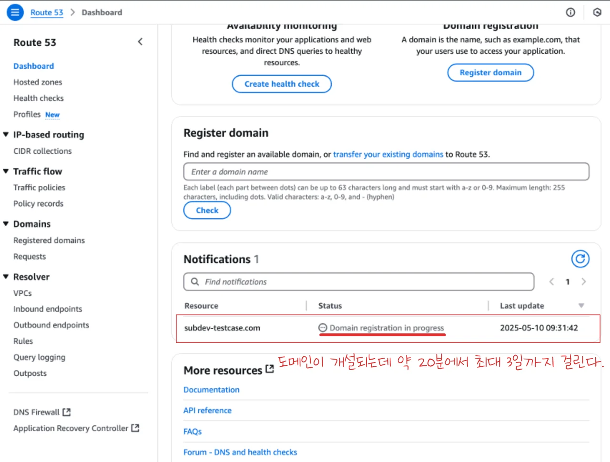

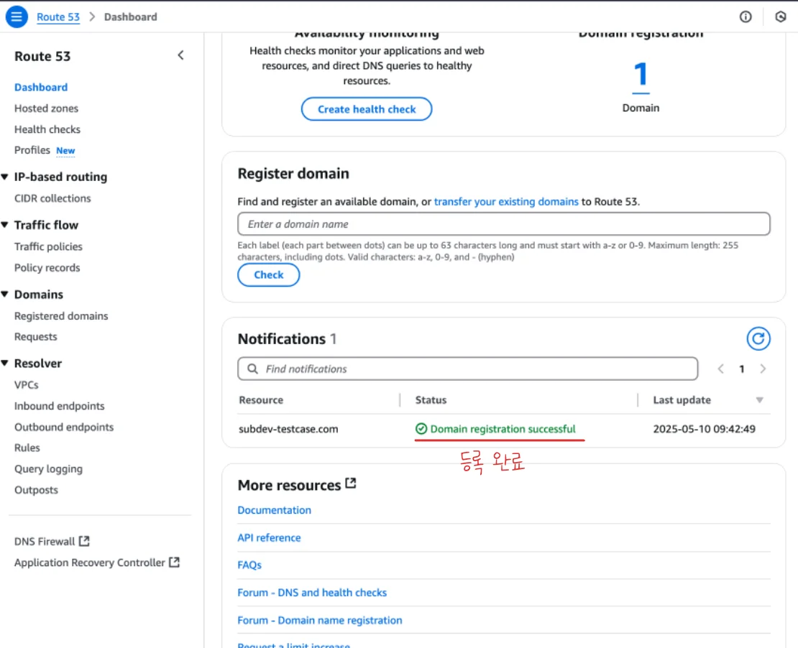

</details>

</details>

<a id="1eeeda9b0fe18068a3f3ea6b0c5d5482"></a>

### 3&#46; IPv4, IPv6, 레코드 타입, TTL

<details>
<summary><strong><code>IPv4</code></strong><strong>, </strong><strong><code>IPv6</code></strong></summary>

> ✏️ 
> 
> <a id="1eeeda9b0fe180f6836fe9e59eb60167"></a>
> 
> <code>IPv4</code>, <code>IPv6</code> 는 <strong><u>인터넷 프로토콜 주소 체계</u></strong>이다&#46; 
> 
> - v5도 있지만 사용되지 않는다&#46; 

<a id="1eeeda9b0fe180ac8ee1d190483d1660"></a>

<code>IPv4</code>는 32 비트로 구성된 주소 체계로, <strong><u>최대 약 43억개</u></strong>의 IP 주소를 사용할 수 있다&#46; 

- ex) <code>192&#46;168&#46;0&#46;1</code>

<a id="1eeeda9b0fe1803c8f1dc30916cffd7f"></a>

그러나 인터넷 사용자의 점진적인 증가로 인해 IPv4 주소가 부족해지는 현상이 발생되어 

<a id="1eeeda9b0fe180c1a573e9374781dad4"></a>

이에 따라 <code>IPv6</code>가 등장 하였다&#46; 

<a id="1eeeda9b0fe180b99d5be6e55197453d"></a>

<code>IPv6</code>는 128비트로 구성된 주소 체계로, <strong><u>약 349경</u></strong>개의 IP 주소를 사용할 수 있다&#46; 

- ex) <code>2001&#58;0db8&#58;85a3&#58;0000&#58;0000&#58;8a2e&#58;0370&#58;7334</code>

<a id="1eeeda9b0fe1802f9062ec39e08f6864"></a>

<code>IPv6</code>를 통해 <strong><u>IPv4의 주소 고갈 문제를 해결하며, 보안성 및 기능 측면에서도 개선</u></strong>되었다&#46; 

</details>

<details>
<summary><strong><code>레코드</code></strong> ( 전화번호부 )</summary>

> ✏️ 
> 
> <a id="1eeeda9b0fe1801280a4da3f57fd16f3"></a>
> 
> <code>IP주소</code>와 <code>도메인</code>의 <strong><u>매핑 정보</u></strong>를 저장한 값이다&#46; 

<details>
<summary>레코드 유형</summary>

<details>
<summary>🧐 호스트 존</summary>

- 호스트존은 주소록이다&#46;
    - public 호스트존은 도메인 네임의 IP 주소를 가리칸다&#46;

    - private 호스트존은 사설망 내부에서 사용된다&#46; 

</details>

- <code>A 레코드</code>&#58;  <code>호스트네임</code>  ↔  <code>IPv4 주소</code>

- <code>AAAA 레코드</code>&#58;  <code>호스트네임</code>  ↔  <code>IPv6 주소</code>

- <code>CNAME 레코드</code>&#58;  <code>호스트네임</code> ↔ <code>호스트 네임</code>
    - 다른 호스트 네임은 반드시 A or AAAA 레코드가 있어야 한다&#46; 

- <code>NS 레코드</code>&#58; 호스트존의 네임 서버를 저장 및 매핑

- SOA 레코드&#58; 메타데이터를 저장 및 지정한다&#46;

</details>

</details>

<details>
<summary><strong><code>CNAME</code></strong><strong> vs </strong><strong><code>Alias</code></strong></summary>

> ✏️ 
> 
> <a id="1efeda9b0fe1802f8ba0cf237eed424d"></a>
> 
> <code>CNAME</code> 과 <code>Alias</code>는 DNS 레코드의 유형이다&#46; 
> 
> <a id="1efeda9b0fe180209dece83183e3e636"></a>
> 
> 두 레코드는 <strong><u>호스트 이름을 다른 호스트 이름에 매핑</u></strong>하는데 사용한다&#46; 
> 
> - 호스트명 ↔ 호스트명
> 
> <a id="1efeda9b0fe180558d0ac3126bb9d7c6"></a>
> 
> 그러나 두 레코드는 <strong><u>서로 다른 용도를 가지고 있</u></strong>다&#46; 

<details>
<summary><code>CNAME</code> 레코드</summary>

<a id="1efeda9b0fe1805eb0c8fe79a01cc4be"></a>

이전에 정의된 <strong><u>모든 호스트 이름 레코드</u></strong>를 복사하여 새<strong><u> 호스트 이름에 할당</u></strong>한다&#46; 

<a id="1efeda9b0fe1809f9af7c5f061effe8a"></a>

이는 호스트 이름이 변경 되었거나 호스트 이름이 서로 다른 IP 주소를 가리키도록 하려는 경우 유용하다&#46; 

> ☝🏻 
> 
> <a id="1efeda9b0fe1800795f0e77c512a8c03"></a>
> 
> <code>CNAME</code>은 <strong>루트 도메인이 </strong><strong><u>아닌 경우</u></strong><strong>에만 적용가능</strong>하다&#46; 
> 
> - <strong>&#91; ✅ &#93; app&#46;mydomain&#46;com</strong>
> 
> - <strong>&#91; ❌ &#93; mydomain&#46;com</strong>

</details>

<details>
<summary><code>Alias</code> 레코드 </summary>

> ✏️ 
> 
> <a id="1efeda9b0fe180efa0d0ccae846986ee"></a>
> 
> Alias 레코드는 <code>Route 53</code>에서만 지원된다&#46; 

<a id="1efeda9b0fe18063b405f0c60951a692"></a>

<strong><u>호스트 이름</u></strong>을 S3 버킷, ELB, CloudFront 등의<strong> AWS 리소스에 매핑</strong>한다&#46; 

<a id="1efeda9b0fe1805fa7fbf3c3f19d6c85"></a>

이를 통해 <u>AWS 리소스에 대한 DNS 레코드를 만</u>들 수 있다&#46; 

<details>
<summary>ex) ELB &#45; DNS name</summary>

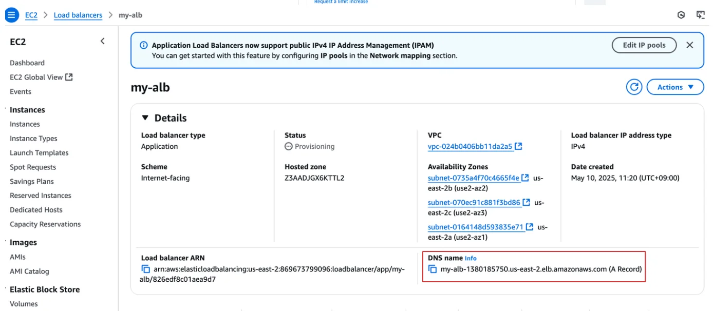

- <code>my&#45;alb&#45;1380185750&#46;us&#45;east&#45;2&#46;elb&#46;amazonaws&#46;com</code>

</details>

</details>

</details>

<details>
<summary><strong><code>TTL</code></strong></summary>

> ✏️ 
> 
> <a id="1eeeda9b0fe1801ba518eedd6198d6ba"></a>
> 
> <strong><code>TTL</code></strong><strong> ( Time to Live )</strong>
> 
> ---
> 
> <a id="1eeeda9b0fe1803e8837f3a4d7c1253f"></a>
> 
>  <strong><u>DNS 레코드가 </u></strong><strong><u>캐싱될 수 있는 최대 시간</u></strong>을 나태내는 값이다&#46; 

- TTL이 클수록 DNS 레코드가 캐싱될 수 있는 시간이 더 길어진다&#46; 즉, 캐싱 효율성이 높아진다&#46; 

- 일반적으로 TTL은 몇 분에서 몇시간까지로 설정된다&#46; 

</details>

<a id="1eeeda9b0fe18080ad20fe344315d5f3"></a>

### 4&#46;  DNS 레코드 등록

<details>
<summary>기본 레코드</summary>

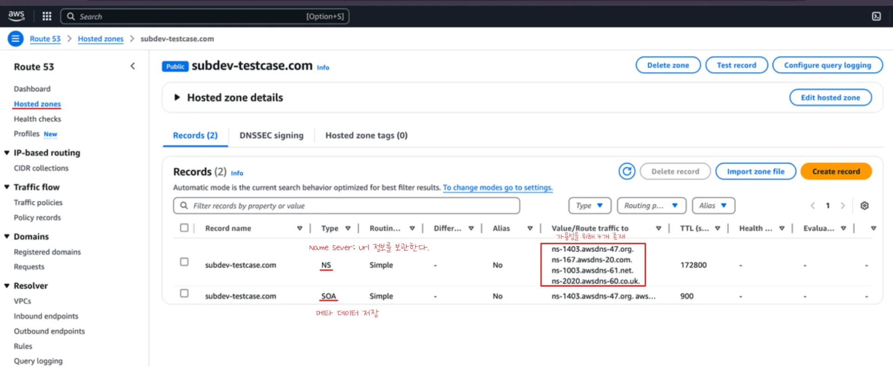

- 도메인 발급 시 기본으로 <code>NS</code>, <code>SOA</code> 레코드가 생성된다&#46; 
    - <code>NS</code>&#58;  URL 정보를 저장한다, 가용성을 위해 4개의 URL 생성 및 매핑된다&#46; 

    - <code>SOA</code>&#58; 메타 정보가 저장된다&#46; 

</details>

<details>
<summary>레코드 생성</summary>

- <code>Create Record</code> 클릭
    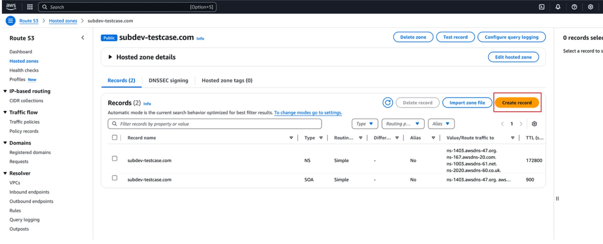

- 옵션 입력
    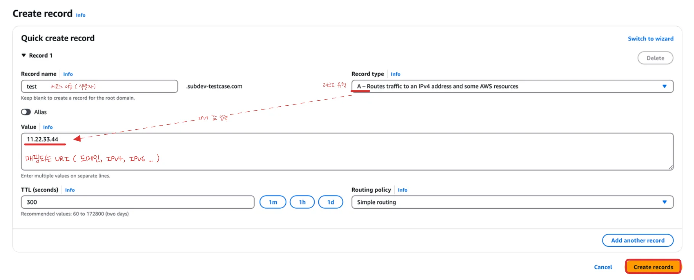

    - <code>레코드 이름</code> ( key)

    <details>
    <summary><code>레코드 유형</code> </summary>

    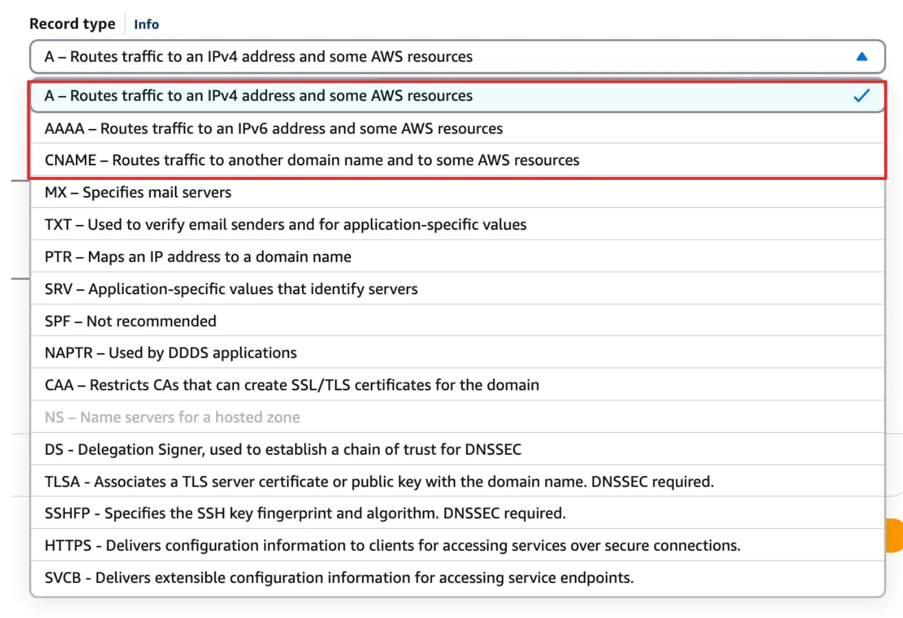

    - 위 설명 참조
        - <code>A</code>(IPv4), <code>AAAA</code>(IPv6), <code>CNAME</code>(도메인명)

    </details>

    - <code>레코드 값</code> ( value )
        - 매핑되는 URI ( 도메인, IPv4, IPv6 … )

    - <code>TTL</code>&#58;  DNS 캐싱 시간
        - 캐싱 이후 다시 질의 과정을 통해 IP 주소를 받아온다&#46; 

- 생성 확인 
    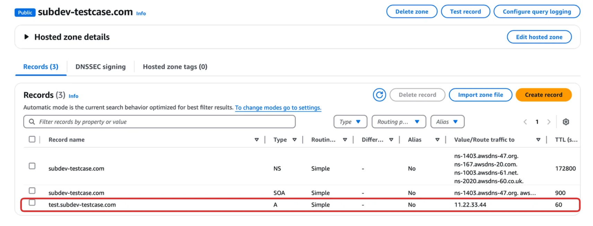

</details>

<details>
<summary>도메인 연결1) <code>A</code> &#45; IPv4 연결</summary>

<a id="1efeda9b0fe1800f8295fefc18a11e8d"></a>

```bash
# nslookup {레코드명}.{도메인}
nslookup test.subdev-testcase.com
```

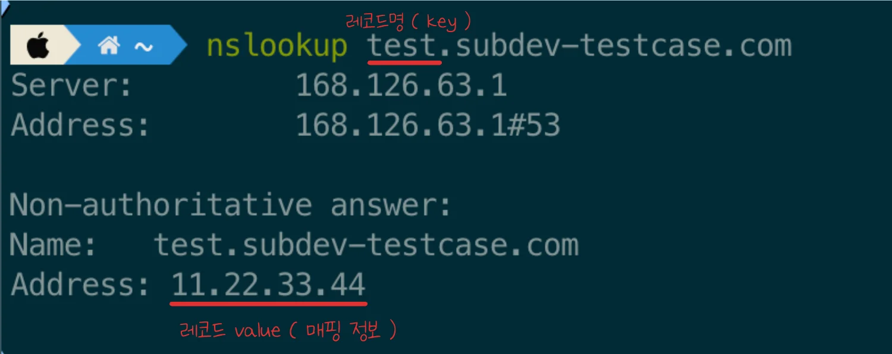

- 아무 숫자나 넣었기 떄문에 해당 도메인으로 접속해서 아무런 결과가 없지만, EC2 나 ALB의 URI로 설정하면 해당 서버로 접속한다&#46;

- 실제 베포 시, cloudfront 와 S3를 연동하여 프론트를 구성한다&#46; <br>따라서 해당 주소를 매핑한다&#46;

</details>

<details>
<summary>도메인 연결2)  <code>CNAME</code> &#45; 로드 벨런서 연결</summary>

> ☝🏻 
> 
> <a id="1efeda9b0fe1800eb551eac3bc42934f"></a>
> 
> <code>CNAME</code>은 서브 도메인(레코드 이름) 이 필수이다&#46;
> 
> <details>
> <summary>🤬 <strong>서브 도메인 없</strong>이 생성 불가</summary>
> 
> 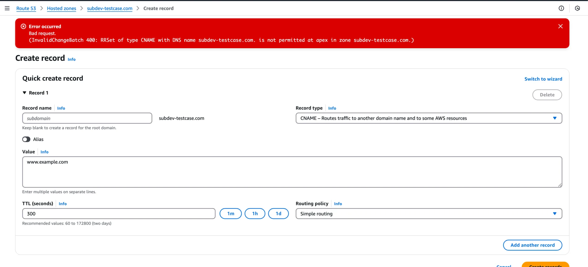
> 
> </details>

- 해당 로드 밸런서의  <code>DNS name</code> 확인
    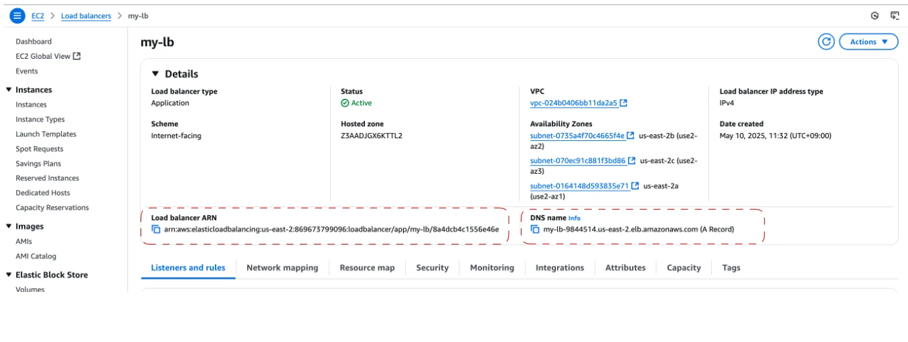

    - ARN을 사용하여 <code>Alias</code> 유형으로도 연결 가능하다&#46; 

- 레코드 생성
    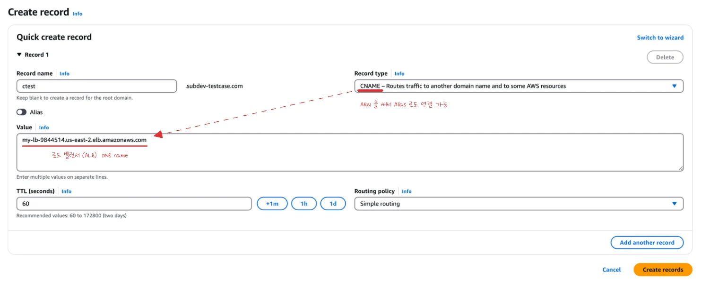

- 레코드 생성 확인
    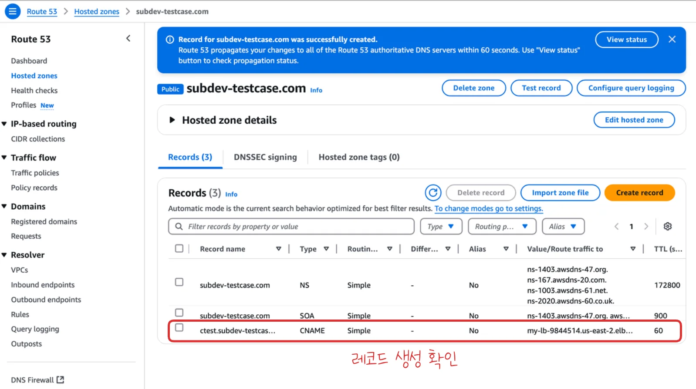

- <code>nslookup</code> 확인
    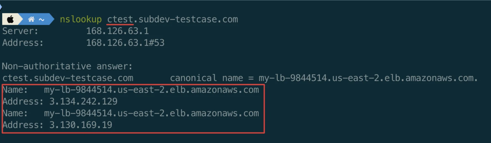

- 브라우저 접속 확인
    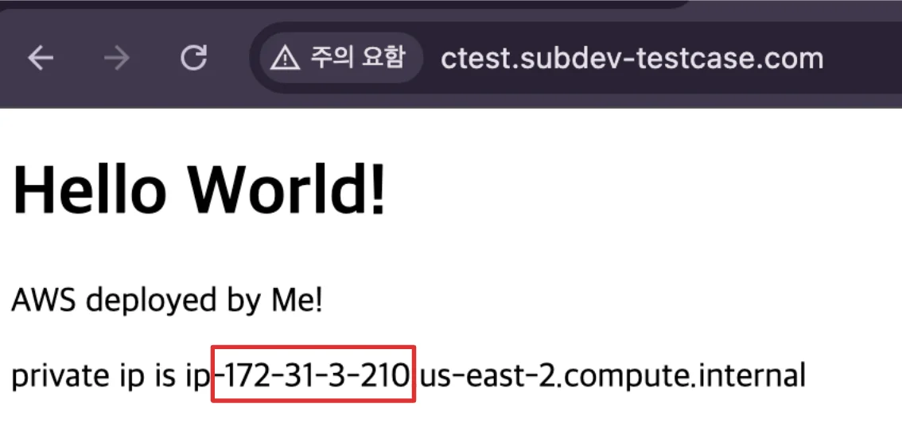

    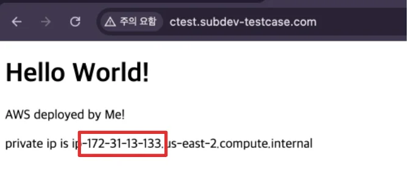

    <a id="1efeda9b0fe18018bfbaeed53e03bd2e"></a>

    로드 벨런서로 접속해서 EC2 인스턴스를 번갈아서  호출하는 것을 확인 가능하다&#46;

</details>

<details>
<summary>도메인 연결 3)  <code>A</code>/<code>Alias</code> &#45;  서브 도메인 없이 연결하기</summary>

- <code>A 타입</code> &#45; <code>Alias</code> 로 로드 밸런서 연결
    > ✏️ 
    > 
    > <a id="1efeda9b0fe1805f930cc71e1b830a1c"></a>
    > 
    > <strong>서브도메인 없</strong>이 로드 밸런서 등  AWS 서비스와 연결 가능하다&#46;
    > 
    > - <code>CNAME</code>은  서브 도메인이 필수다&#46;

    > ☝🏻 
    > 
    > <a id="1efeda9b0fe1802795e6c1dbafd03b6c"></a>
    > 
    > Alias 사용 시, <strong>TTL 설정을 할 수 없</strong>다&#46; ( 따로 해줘야 함 )

    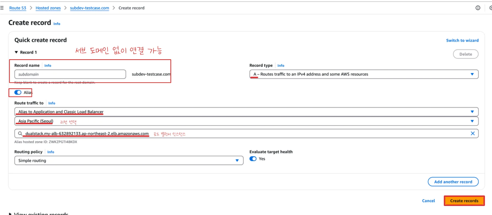

    - <code>서비스 선택</code>&#58; <code>Alias to Application and Classic Load Balancer</code>

    - <code>리전 선택</code>&#58; Asia Pacific ( Seoul )

    - <code>인스턴스 선택</code>&#58; 생성한 로드벨런서 인스턴스 선택

- 브라우저 접속
    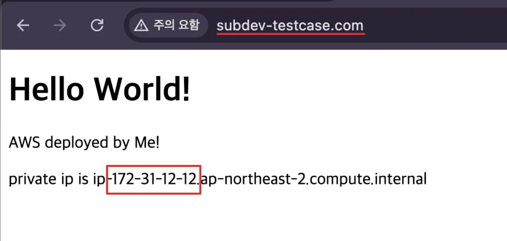

    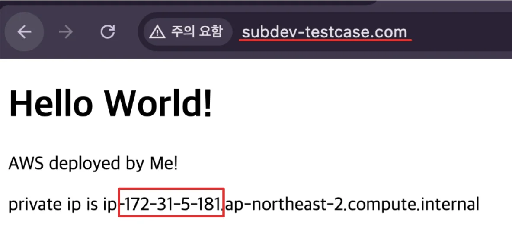

    <a id="1efeda9b0fe18094a63af90945649c0b"></a>

    서브 도메인 없이 도메인 이름만으로도 연결되는 것을 확인

</details>

> ☝🏻 
> 
> <a id="1efeda9b0fe1809cbb08cac56766b8b5"></a>
> 
> EC2의 DNS로는 <code>Alias</code> 불가능하다&#46; 
> 
> - ELB, CloudFront, S3, Elastic Beanstalk 등은 다 가능하다&#46; 

<a id="1eeeda9b0fe1804da2f6e017df0fef6a"></a>

### 5&#46;  ALB &#45;  HTTPS 등록

<details>
<summary>ACM 인증서 발급</summary>

> ✏️ 
> 
> <a id="1eceda9b0fe180eeb790f1f5aa1fd94d"></a>
> 
> <strong><code>ACM</code></strong> ( AWS Certificate Manager )
> 
> ---
> 
> 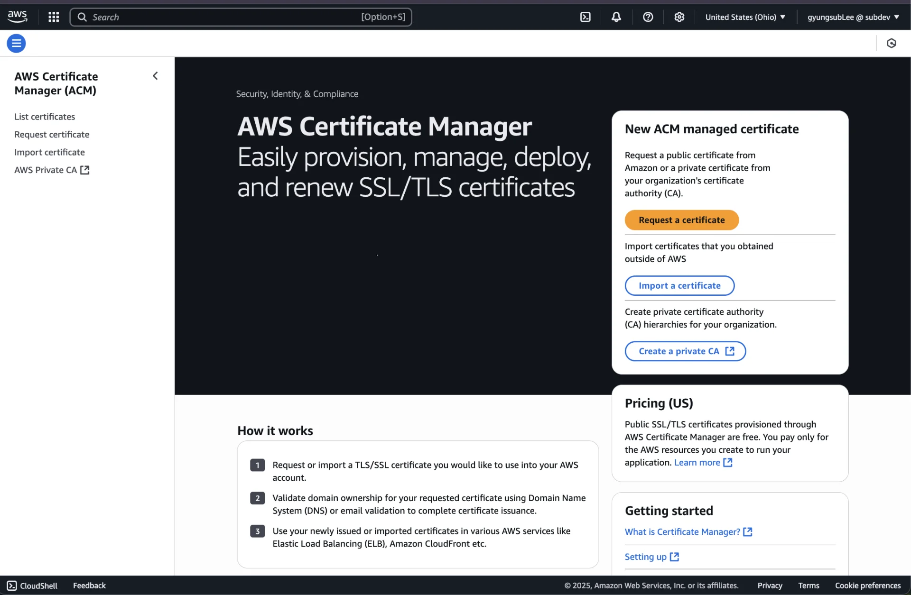
> 
> - <strong><u>SSL/TLS 인증서</u></strong><u>를 </u><strong><u>무료로 발급받고 자동 갱신</u></strong>할 수 있게 도와주는 AWS 서비스
> 
> - 인증서 발급 시, 도메인이 필요하다 

<details>
<summary>인증서 생성</summary>

> ☝🏻 
> 
> <a id="1efeda9b0fe180ad9cd1c9eff6c2f80c"></a>
> 
> 연결할 도메인이 필수적으로 필요하다&#46; 
> 
> <a id="1efeda9b0fe180788871f48953aba6da"></a>
> 
> 따라서 도메인을 발급하지 않았다면 우선 도메인 발급부터 해야한다&#46;
> 
> - 2&#46; 도메인 등록 확인

- public 인증서로 선택
    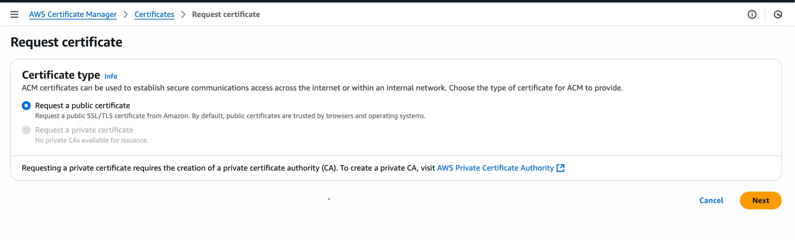

- 옵션 선택 &#45; 생성
    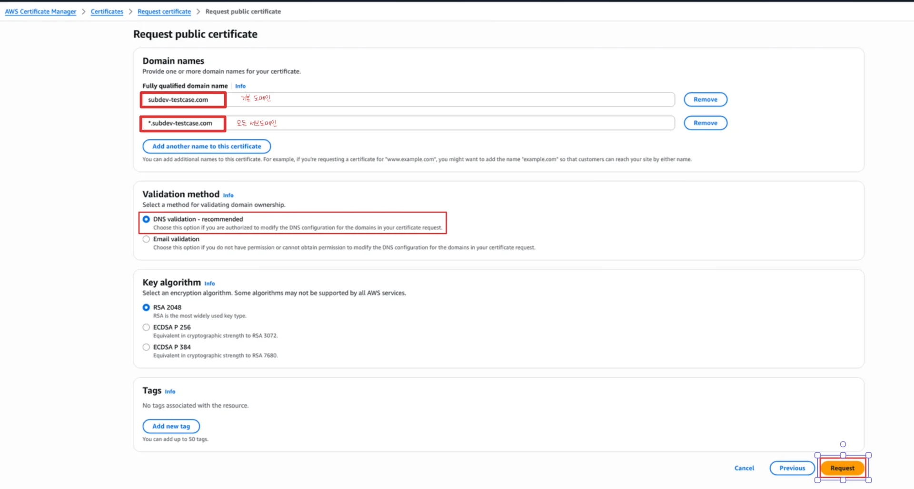

    > TLS (SSL) 인증서를 발급 받으려면 <strong><u>도메인 이름이 필수</u></strong>이다&#46;

    - 기본 도메인 뿐만아니라 모든 서브 도메인 경로까지 명시한다&#46; 
        - <code>subdev&#45;testcase&#46;com</code>

        - <code>&#42;&#46;subdev&#45;testcase&#46;com</code> &#45; 모든 서브 도메인 경로 포함

</details>

<details>
<summary>Route 53에 인증 정보가 담긴 레코드 생성</summary>

<details>
<summary>🧐<strong><u> 왜 인증 정보가 담긴 레코드</u></strong>를 <code>Route53</code>에 추가해야 하는가?</summary>

> ✏️ 
> 
> <a id="1efeda9b0fe1807f872fd0d628debe5d"></a>
> 
> AWS에서 <code>ACM</code> 과 <code>Route 53</code>을 통해 <u>HTTPS 인증서를 설정</u>할 때,   해당 도메인 에 대한 <code>소유권 검증</code>(<code>Domain Validation</code>, <code>DV</code>)이 필요하다&#46; 
> 
> <a id="1efeda9b0fe1806a9515d14d328e22a8"></a>
> 
> 해당 과정은 <strong><u>처음 도메인 발급</u></strong> 시 <strong>한 번만</strong> 이뤄진다&#46; 
> 
> | <strong>구분</strong> | <strong>내용</strong> |
> | --- | --- |
> | 소유권 검증 발생 시점 | <strong>ACM에서 인증서 발급 요청 시</strong> |
> | 인증서 발급 후 | 더 이상 도메인 소유권 검증은 발생하지 않음 |
> | HTTPS 접속 시 | 브라우저는 인증서가 유효한지만 확인 (소유권 검증 X) |
> | CNAME 레코드 | 소유권을 한 번 확인하기 위한 수단 (일회성 또는 갱신 시 재사용 |

<details>
<summary><code>도메인 검증</code>(<code>DV</code>) 과정 </summary>

<a id="1efeda9b0fe18087ae16ff0f7f682d71"></a>

```plaintext
사용자] ACM에서 인증서 요청
     ↓
[ACM] "CNAME 레코드를 이렇게 설정해 주세요" (도메인 소유권 검증 요청)
     ↓
[사용자] Route 53 등 DNS에 CNAME 레코드 등록
     ↓
[ACM] DNS를 확인해서 CNAME 레코드가 존재하는지 검증
     ↓
[ACM] 소유권 검증 완료 → ✅ 인증서 발급 
```

- 처음 인증서를 발급할 때, ACM에 도메인 소유권에 대해 검증 시 한번만 발생된다&#46; 

</details>

<details>
<summary>사용자 접속 시점</summary>

- 사용자가 해당 도메인에 접속할 때, 서버가 H<strong><u>TTPS  인증서를 클라이언트에 전달</u></strong>하고 <strong><u>클라이언트</u></strong><strong>는 </strong><strong><u>인증서가 유효</u></strong><strong>한지, </strong><strong><u>신뢰된 CA</u></strong><strong>인지, </strong><strong><u>도메인과 일치</u></strong>하는지만 확인한다&#46;
    - 인증서는 이미 발급되었기 때문에 소유권 검증은 일어나지 않는다&#46;

    - 인증서가 유효하다면 이미 과거에 ‘소유권 검증이 완료’ 됐다는 뜻이다&#46;  따라서 이후엔 클라이언트가 인증서만 보고 유효한지만 판단하면 된다&#46; 

</details>

</details>

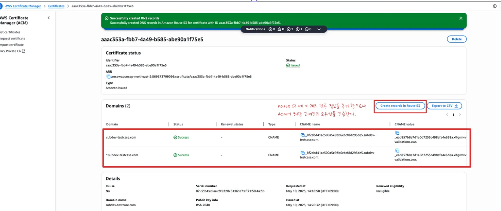

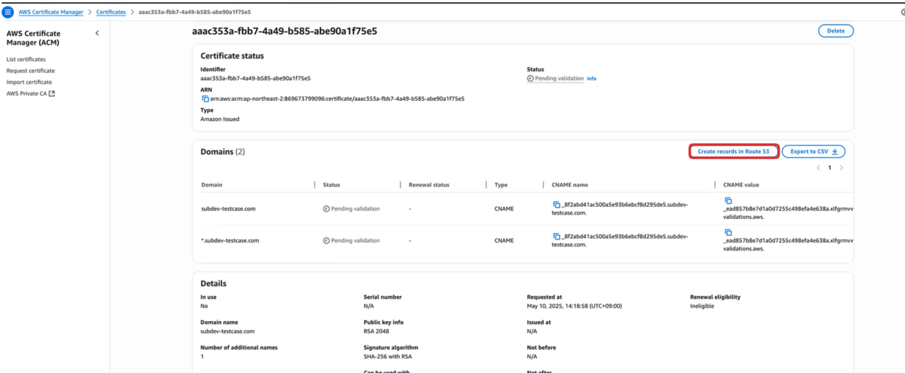

- 생성된 인증서 대시보드 &#45; <code>Create records Route 53</code> 클릭

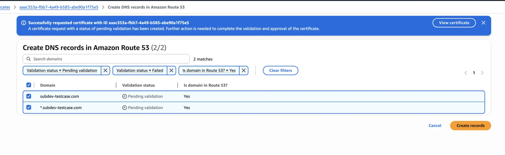

- 생성할 DNS 선택 후 <code>Create records</code> 클릭

</details>

<details>
<summary>Route 53 확인</summary>

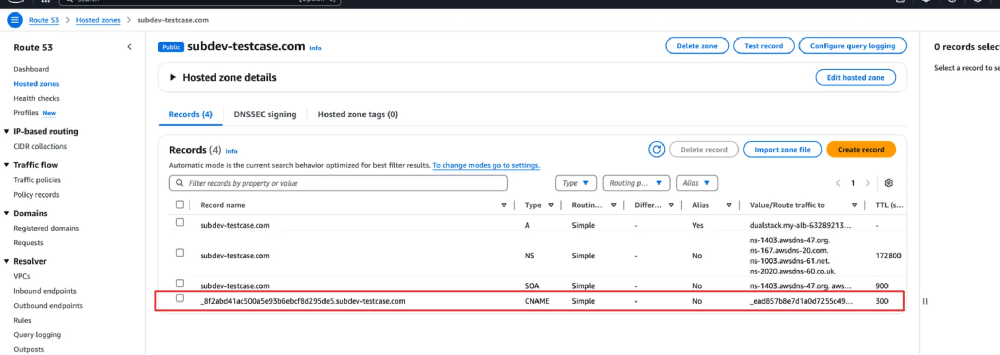

- 설정한 도메인의 인증 정보가 담긴 레코드가 생성된 것을 확인할 수 있다&#46;

</details>

</details>

<details>
<summary>로드 벨런서  HTTPS 등록</summary>

<details>
<summary>HTTPS 적용하려는 로드 밸런서의 대시보드로 이동 &#45; <code>Add listner</code> 클릭</summary>

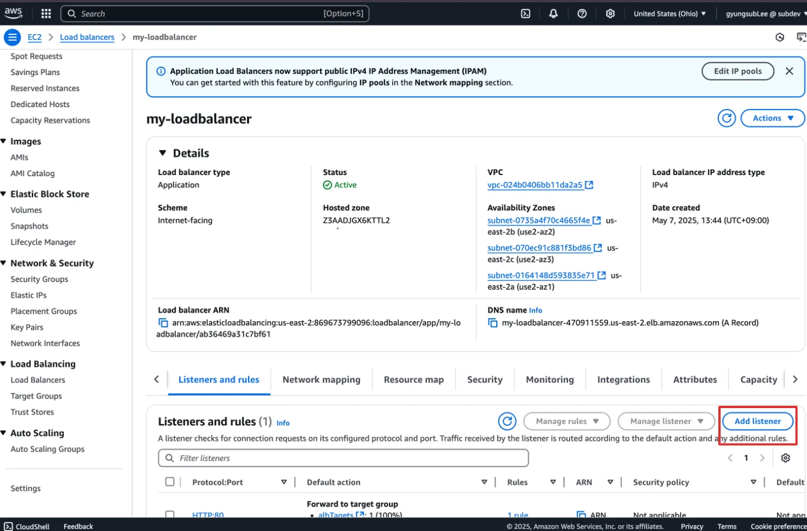

<details>
<summary>Actions &#45; Add Linstener</summary>

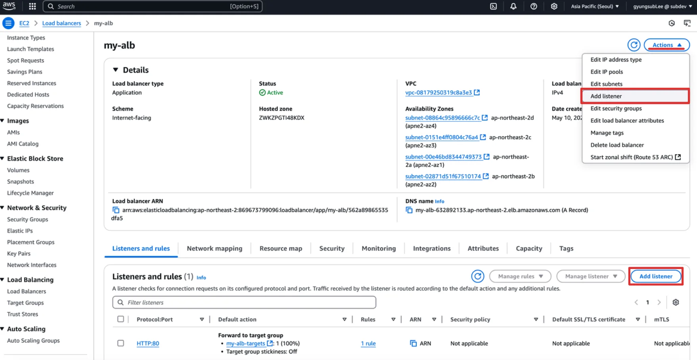

</details>

</details>

<details>
<summary>옵션 입력</summary>

- Listener details &#45; <code>HTTPS</code>, 타겟 그룹 설정
    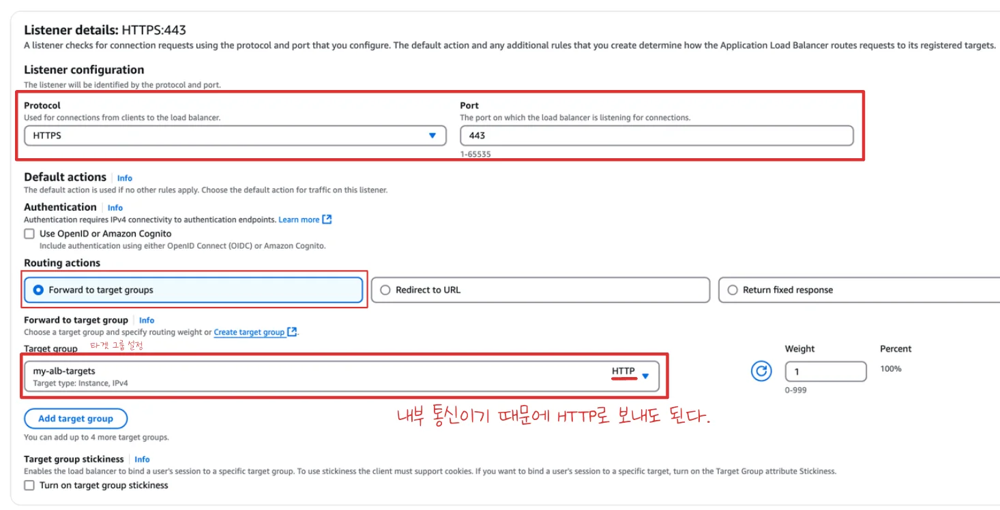

- Secure listener settings &#45; 인증서 연결
    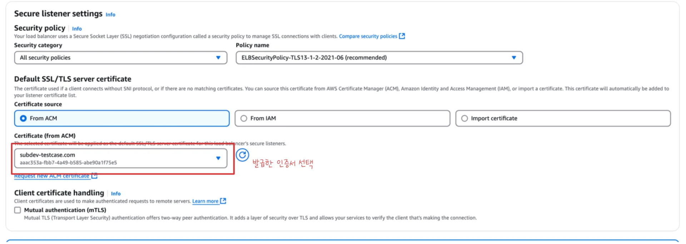

- HTTPS 연결 확인
    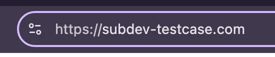

    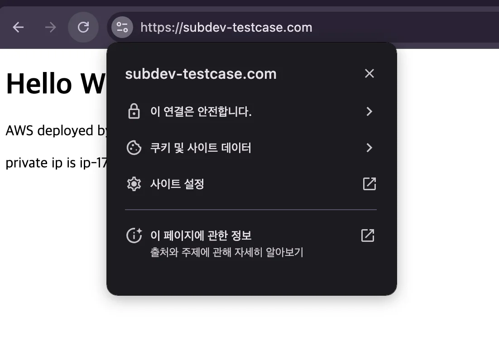

-  인바운드 그룹에서  HTTP 제거

</details>

</details>
