<a id="1efeda9b0fe180179dded73fcdd240fe"></a>

## <code>CloudFront</code>

---

> 📖 
> 
> <a id="1efeda9b0fe180a188a1f0bd54b1ab50"></a>
> 
> AWS에서 제공하는 <code>CDN</code>( Content Delivery Network )  서비스이다&#46;

<details>
<summary><code>CDN</code> ( Content Delivery Netwotk )</summary>

<details>
<summary><code>CDN</code> 이란?</summary>

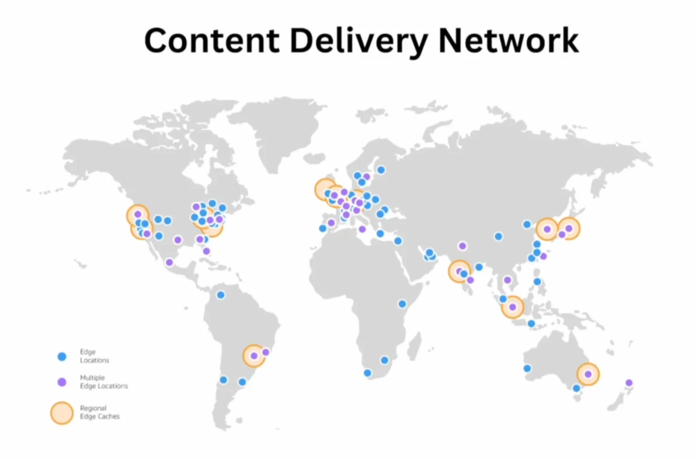

> ✏️ 
> 
> <a id="1efeda9b0fe18092ad52d383401c06cf"></a>
> 
> 데이터를 <code>Edge Locations</code>에 캐싱하여 지역에 따라 유저에게 가까운 <code>Location</code>에서 빠르게 리소스를 응답한다&#46; 

- 서비스가 한국에서 베포 되고 있는데&#46; 만약 영국 유저가 접근하려는 경우 서버와 유저 간 물리적인 거리가 멀다&#46;

- 따라서 데이터가 서버와 유저 사이에서 통신 되려면 물리적으로 긴 거리를 이동해야 하기 매우 오랜 시간이 걸린다&#46; 

- 만약 이를 <strong>가까운 서버에 캐싱하여 바로 응답</strong>하는 경우, 영국 유저는 <strong><u>이전보다 훨씬 빠르게 서비스를 이용</u></strong>할 수 있다&#46; 

- 이러한 <strong><u>국제적 서비스</u></strong> 위해 <strong>지역에 따라 서버 데이터를 캐싱하여 하여 배치</strong>하는 서비스를 <code>CDN</code>이라 한다&#46;

</details>

<details>
<summary>장점</summary>

- <code>향상된 속도</code>
    - 지리적으로 가까운 서버에 캐싱된 데이터를 갖고 오기 때문에 무척 빠르다&#46; 

- <code>안전</code>
    - CDN 서비스를 해주는 업체에서 방화벽을 제공한다&#46; 

    -  DDoS 공격이 와도 서버가 분산되어 있기 때문에, 오리진 서버 트래픽은 늘어나지 않는다&#46; 
        - 또한 static 한 캐시 데이터를 응답하기 때문에 빠르게 처리한다&#46;

</details>

<details>
<summary>단점</summary>

- <code>캐시</code>
    - 최신 동적 컨텐츠를 제공해야 하는 경우, 적합하지 않다&#46; 

- <code>비용</code>
    - 비용이 추가로 발생한다&#46; 

</details>

<details>
<summary>사례) 넷플릿스 CDN &#45; OCA  </summary>

<a id="1efeda9b0fe180ac9519c6f96332a2c4"></a>

‣

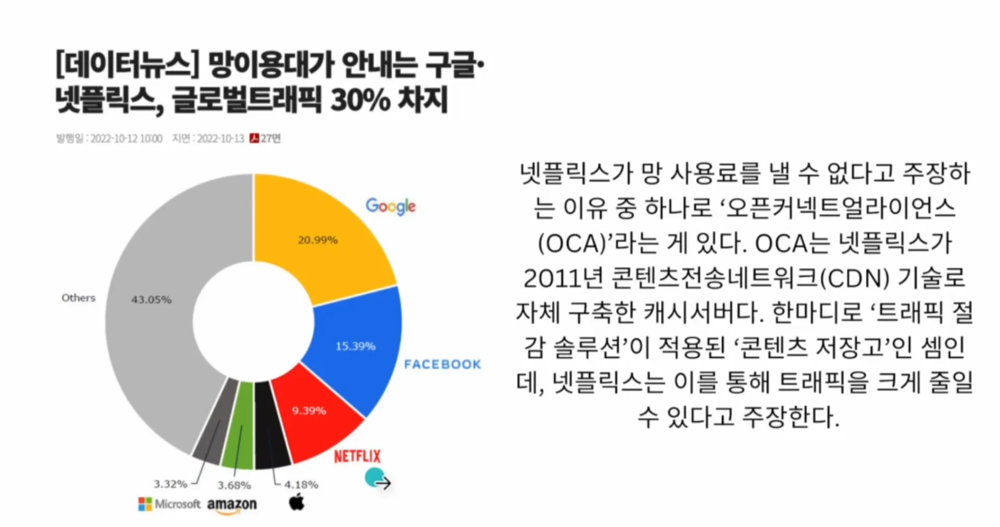

- 실제보는 유튜브나 넷플릭스 등에서 보는 영상들은 저용량들이 아니다&#46; 
    - 영상의 화질 및 해상도가 높으며 종류도 많다&#46; 

    - 이러한 고화질의 영상을 전세계적으로 서비스해야 한다&#46; 

<a id="1efeda9b0fe18008b6ddd963b2fb6964"></a>

예전에 국내에 서버스 했던 판도라 티비 등 굉장히 버퍼링이 길고 화질도 뛰어나지 않았다&#46;

<a id="1efeda9b0fe180ceb3fbe4fd8dfd481f"></a>

그러나 넷플릭스나 유튜브는 실시간으로 고화질의 영상을 볼 수 있으며, <br>보다가 스킵을 하면서 영상을 넘겨도 빠르게 끊김없이 이어 볼 수 있다&#46;

<a id="1efeda9b0fe1808f894cdb8fb7b60fc9"></a>

이러한 기술의 핵심은 <code>CDN</code> 이다&#46; 

<a id="1efeda9b0fe1808cae24c8961f1afc68"></a>

넷플릭스 같은 영상들은 드라마, 영화 같은 컨턴츠를 가지고 서비스한다&#46; 

<a id="1efeda9b0fe1802e8ccbf4d02ee80f40"></a>

용량이 크지만, 컨텐츠들이 변경이 되지 않는다&#46;

- 엄청나게 큰 static 파일이다&#46; 


<a id="1efeda9b0fe18028957efccc0c728ee8"></a>

따라서 주기적으로 신작이 나올때 마다 업데이트하고 각 Edge Locations에 캐싱 처리를 해두면 전세계 유저들이 빠르게 서비스를 이용할 수 있다&#46;

</details>

</details>

<details>
<summary>실습) S3 &#45; <code>CloudFront</code>,  <code>HTTPS</code> 적용</summary>

> ✏️ 
> 
> <a id="1f0eda9b0fe18050b6a6e66fa2aa9571"></a>
> 
> <strong> </strong><strong><code>CloudFront</code></strong>를 통해 <strong><code>S3 정적 웹사이트</code></strong>를 <code>HTTPS</code>로 서비스한다&#46; 

<details>
<summary>버킷 생성 </summary>

> 📌 
> 
> - 이전에는 <code>Route53</code> 과 <code>S3</code> 도메인을 맞추기 위해서 버킷 이름을 동일하게 설정했다&#46;
>     -  <strong><code>Route53 ↔ S3</code></strong><strong>   </strong>
> 
> - 지금 실습은 <code>CloudFront</code>를 추가한 인프라이기 때문에 <code>Route53</code> 도메인과 <code>S3</code> 버킷 이름을 <strong><u>동일하게 설정할 필요가 없</u></strong>다&#46; 
>     - <strong><code>Route53</code></strong><strong> &#45; </strong><strong><code>CloudFront</code></strong><strong> &#45; </strong><strong><code>S3</code></strong>

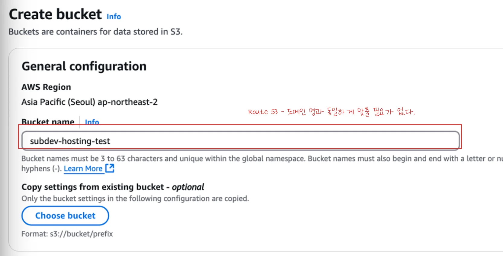

- Route53 &#45; 도메인명 과 <strong><u>동일한 버킷 이름을 사용하지 않</u></strong>아도 된다&#46; 

> 📌 
> 
> - 이전 <code>S3</code>만 사용한 경우 <code>퍼블릭 접근 권한 허용</code>, <code>Static website hosting 설정</code>, <code>Permission 추가</code> 가 필요했다&#46;
> 
> - 그러나  <code>Cloudfront</code>를 사용하는 경우 해당 설정을 하지 않아도 된다&#46; 

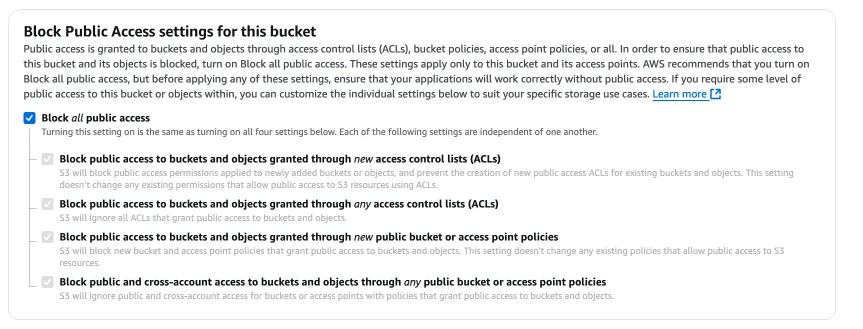

- <strong><code>퍼블릭 접근 권한 제한</code></strong>
    - Cloudfront를 통해 트래픽이 들어오기 때문에 퍼블릭 접근 권한을 제한한다&#46; 

- 또한 <strong><code>static website hosting</code></strong> 및 <strong><code>permission 추가</code></strong><strong> 설정을 </strong>하지 않아도 된다&#46;

- 나머지 옵션 &#45; 기본 설정

</details>

<details>
<summary>CloudFront 생성</summary>

- CloudFront  &#45; <code>Create a CloudFront distribution</code> 클릭
    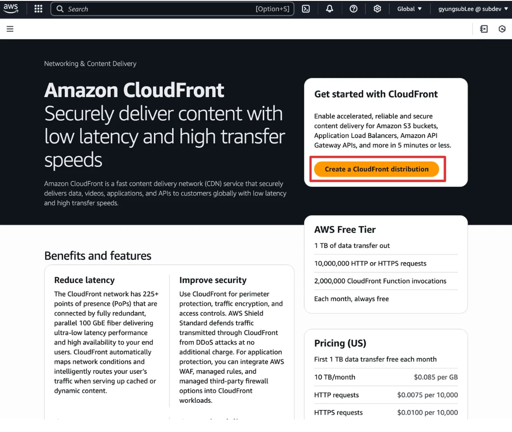

- 옵션 선택
    <details>
    <summary><strong>Distribution options</strong> </summary>

    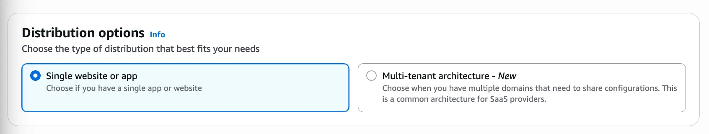

    <details>
    <summary>🧐 <code>Multi&#45;Tenant Architecture</code> </summary>

    <a id="1f7eda9b0fe18034a485f55156b92289"></a>

    하나의 소프트웨어 인스턴스나 인프라가 여러 ‘고객(tenant)’을 논리적으로 분리하여 서비스하는 구조

    - 하나의 서버/서비스를 여러 사용자(회사, 팀 등)가 공유함

    - 각 테넌트는 데이터와 설정이 분리되어 있다&#46;<br>

    </details>

    - Multi&#45;Tenant Architecture 여부 선택

    </details>

    <details>
    <summary><strong>Origin</strong></summary>

    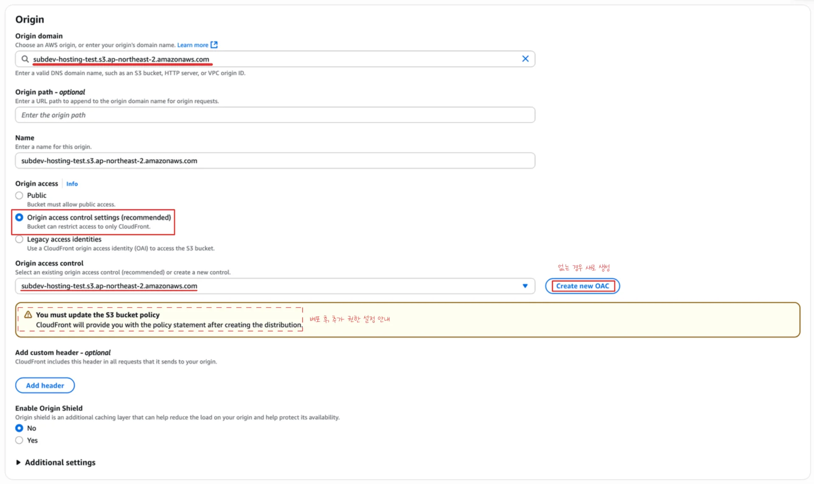

    <details>
    <summary>Origin domain</summary>

    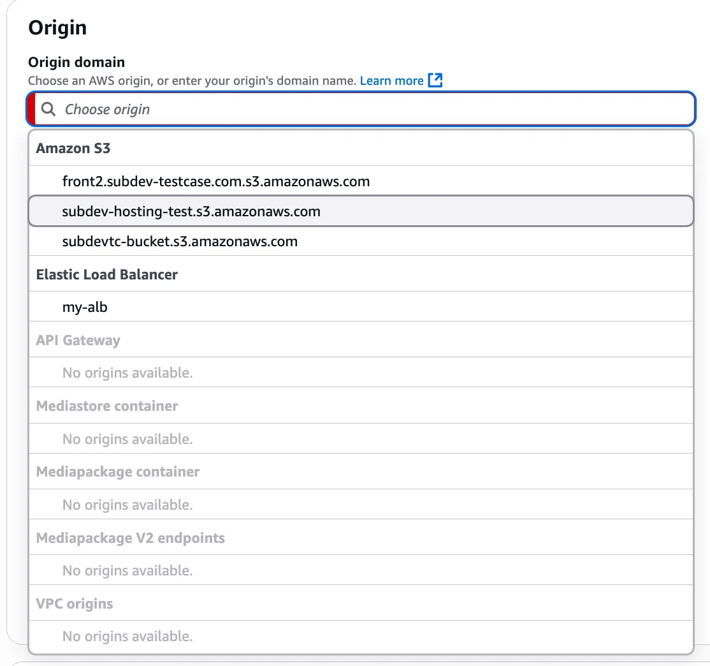

    - S3 버킷 연결

    </details>

    <details>
    <summary>Origin access &#45; S3 접근 권한 설정</summary>

    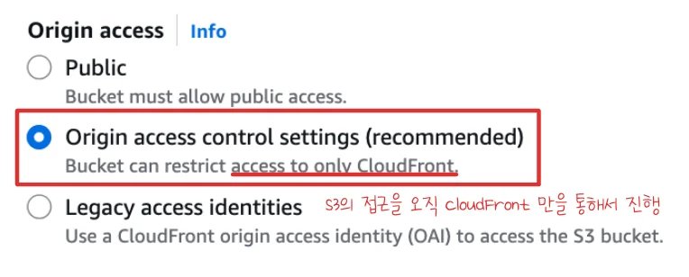

    - &#91; 권장 &#93; <code>Origin access control settings </code>
        - <code>S3</code>의 접근이 오직 <code>CloudFront</code>만을 통해 가능하도록 제한

    </details>

    <details>
    <summary>Origin access control</summary>

    - Create new OAC
        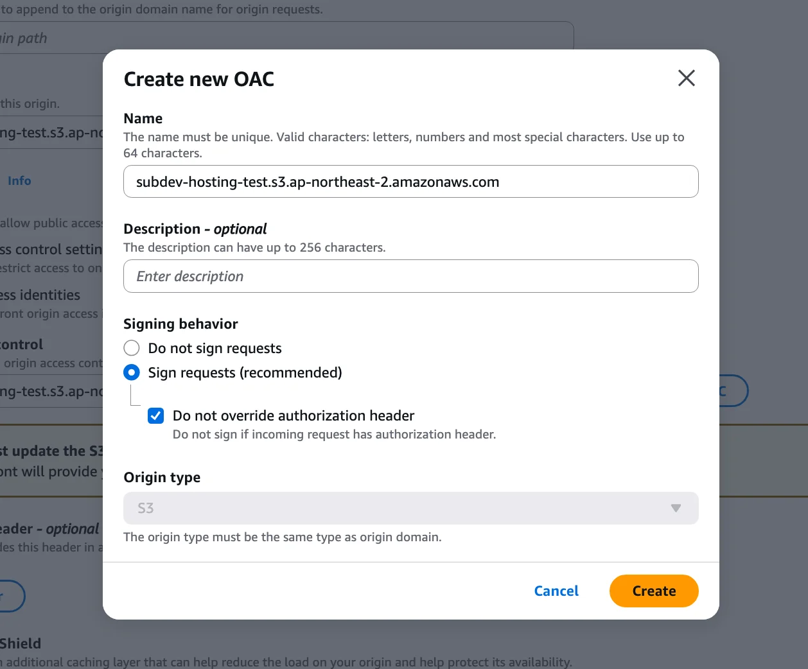

    - CloudFront 베포 후, 정책(Policy) 수정 필요
        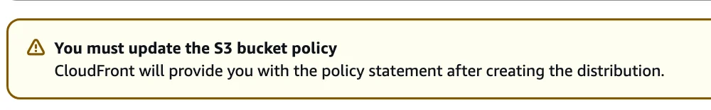

    </details>

    </details>

    <details>
    <summary><strong>Default cache behavior</strong></summary>

    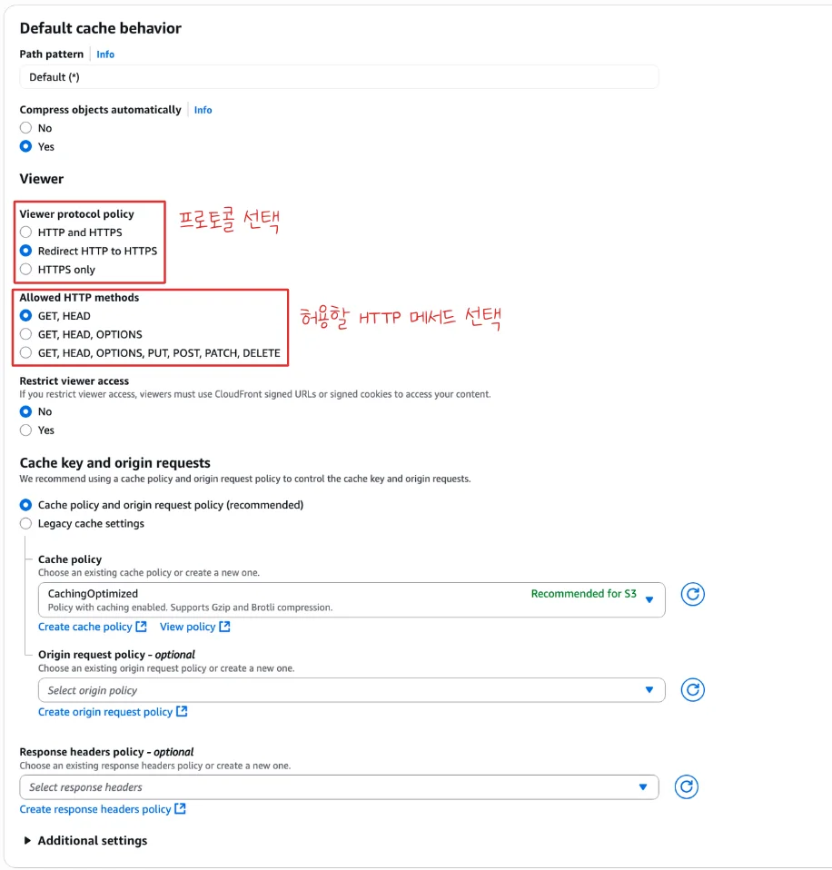

    </details>

    <details>
    <summary><strong>Settings</strong></summary>

    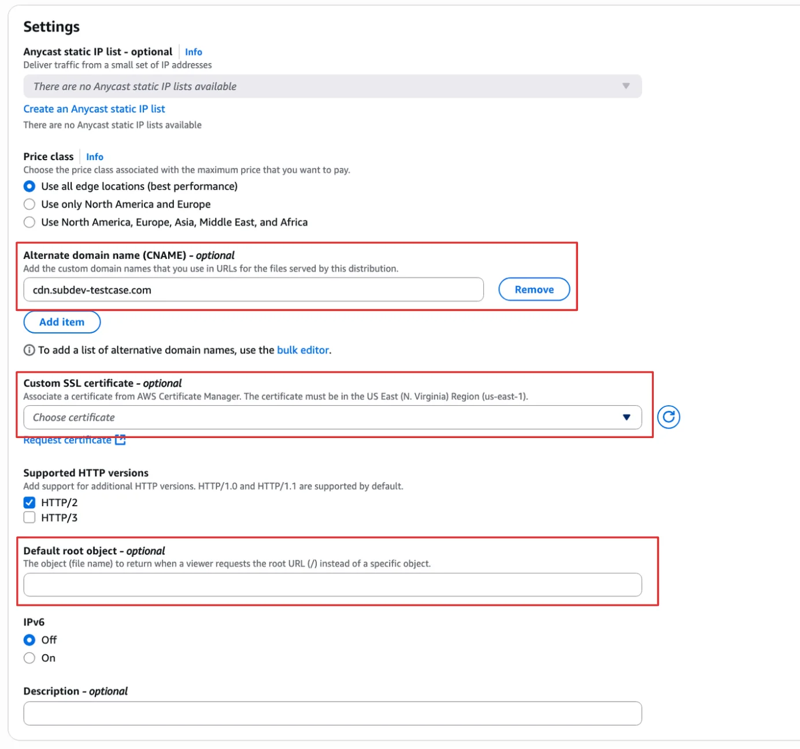

    <details>
    <summary><strong>Alternate domain name (CNAME) </strong></summary>

    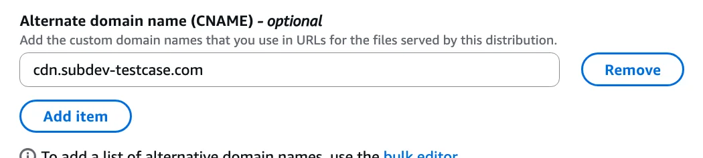

    - CNAME을 설정하지 않으면 Route53의 endpoint가 조회되지 않는다&#46; 

    - 해당 레코드 설정을 Route 53에 해야한다&#46; 

    </details>

    <details>
    <summary><strong>Custom SSL certificate</strong></summary>

    <details>
    <summary>🤬 이전에 생성한 인증서 없음</summary>

    <details>
    <summary><strong>오류</strong></summary>

    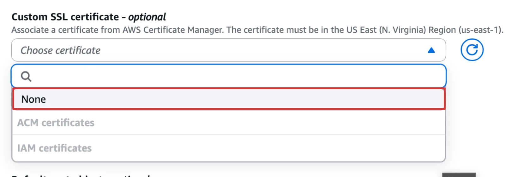

    - 이전에 생성한 ACM 인증서가 검색되지 않음

    </details>

    <details>
    <summary><strong>원인</strong></summary>

    > ✏️ 
    > 
    > <a id="1f0eda9b0fe180b2b0fcc0a8615f0868"></a>
    > 
    > <strong><code>CloudFront</code></strong><strong>는 오직 </strong><strong><u>미국 동부</u></strong><strong> ( 버지니아 북부, </strong><strong><code>us&#45;east&#45;1</code></strong><strong>) </strong><strong><u>리전의 인증서만 사용</u></strong><strong>할 수 있다&#46;</strong>
    > 
    > | <strong>항목</strong> | <strong>설명</strong> |
    > | --- | --- |
    > | <strong>CloudFront의 배포 위치</strong> | 전 세계 (글로벌 서비스) |
    > | <strong>SSL 인증서 요구 위치</strong> | <strong>ACM(AWS Certificate Manager)</strong>의 <strong>us&#45;east&#45;1</strong> 리전 |
    > | <strong>왜?</strong> | CloudFront는 글로벌 리소스이기 때문에, 인증서도 글로벌하게 접근 가능한 us&#45;east&#45;1에 있어야 함 |

    - <strong>발급 받은 인증서</strong>는<strong><u> 서울(ap&#45;northeast&#45;2)에서 생성</u></strong> 했기 때문에 리전이 달라 검색되지 않았다&#46;

    </details>

    <details>
    <summary>✅ 해결</summary>

    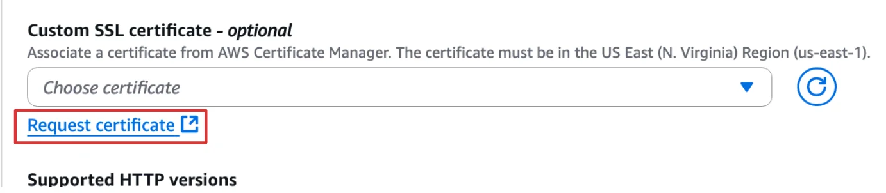

    - <code>Request certificate</code> 클릭

    <a id="1f0eda9b0fe180d9a331cca093b5ae0e"></a>

    ACM 인증서 생성

    <details>
    <summary>이전 ACM 인증서 생성과 동일</summary>

    - 요청 인증 접근자 설정
        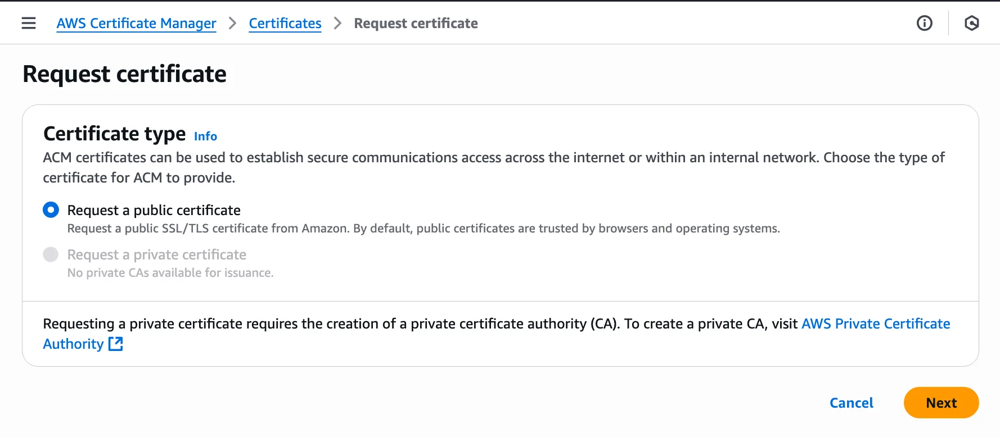

        -  a public certificate 

    - 도메인 및 옵션 입력
        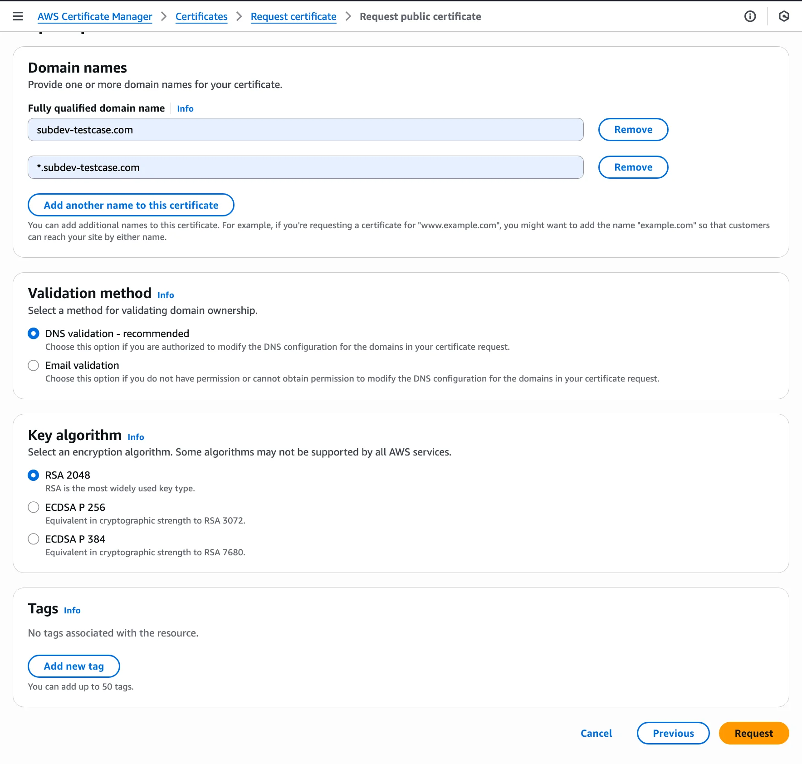

        - 발급한 도메인 과 모든 하위 도메인을 허용하는 URL 추가
            - subdev&#45;testcase&#46;com

            - &#42;&#46;subdev&#45;testcase&#46;com

    - 도메인 검증
        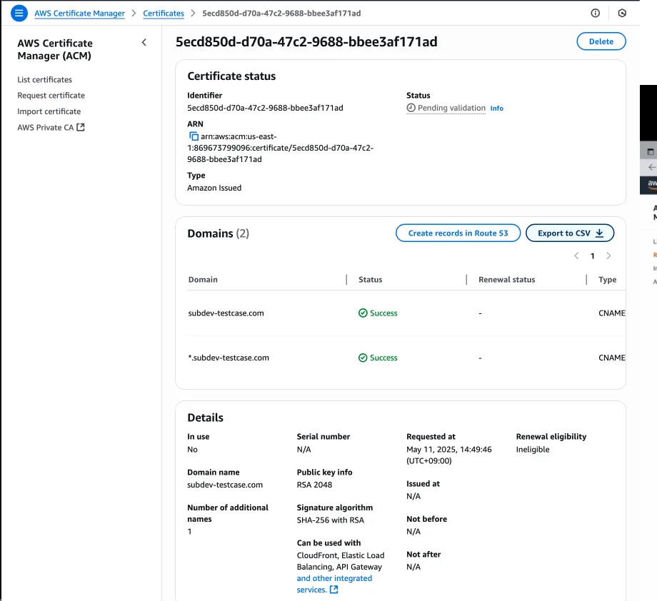

        - 도메인 검증을 위해 아래 레코드 추가
            - <code>Create records in Route 53</code> 클릭

        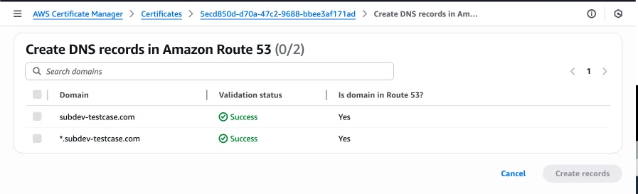

        - 인증 완료

    </details>

    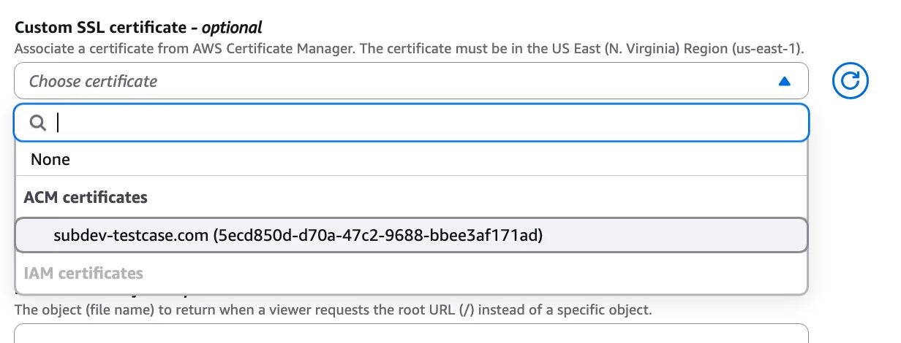

    <a id="1f0eda9b0fe1801ebe86e5d40e3392cb"></a>

    정상적으로 검색됨

    </details>

    </details>

    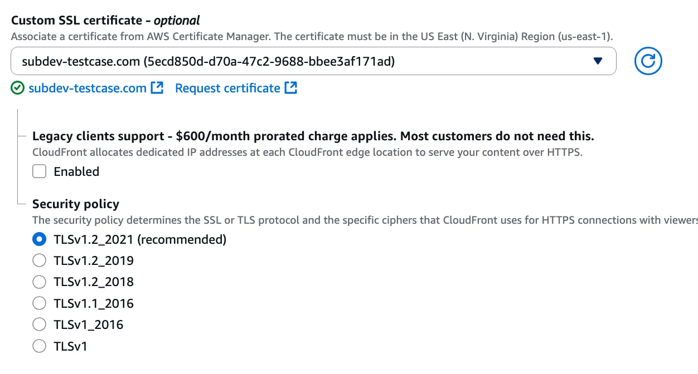

    - 인증서 설정 → HTTPS 서비스 가능

    </details>

    <details>
    <summary><strong>Default root object</strong></summary>

    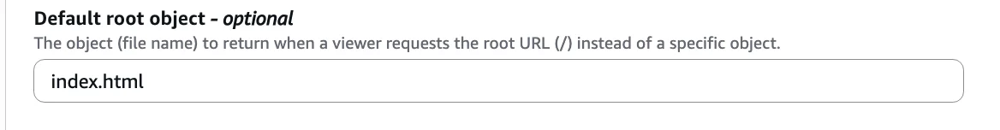

    - 루트 파일을 설정하지 않을 경우, 베포 링크에 들어갔을 때<br><code>Site map not found access denied</code> 오류가 발생된다&#46; 

    </details>

    </details>

- 생성 확인
    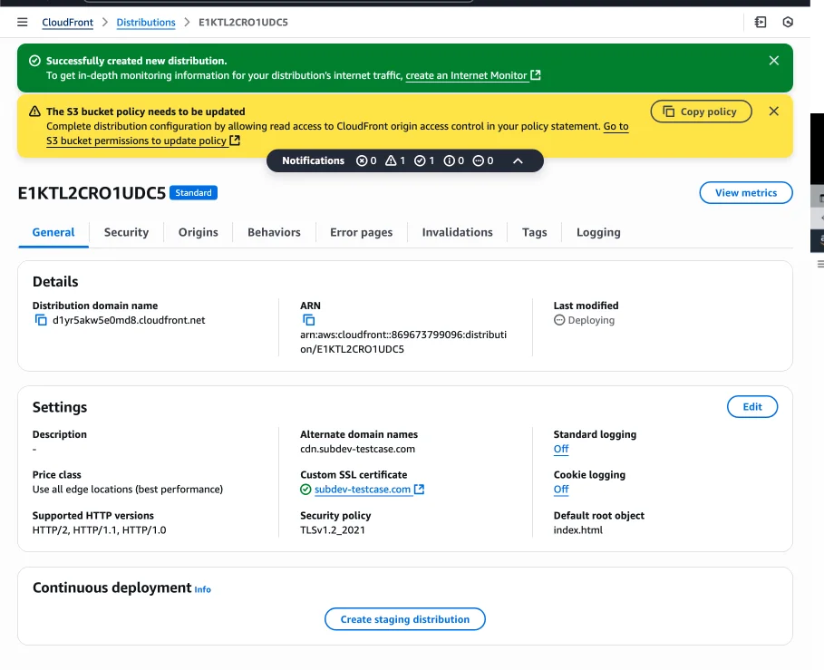

    - CloudFront 인스턴스 정상 생성 확인

</details>

<details>
<summary>S3 버킷에 Policy 업데이트</summary>

> ✏️ 
> 
> <a id="1f0eda9b0fe180a7a498f3165a82ae02"></a>
> 
> CloudFront 생성 시 <code>Origin &#45; Origin access control</code>에서 설정한 Policy를 <strong><u>S3 버켓 Policy에 추가</u></strong>해야 한다&#46;

<details>
<summary>CloudFront &#45; Policy 확인</summary>

> ☝🏻 
> 
> <a id="1f0eda9b0fe18091bda1f64bb16b4c1c"></a>
> 
>  아래의 coyp 창을 실수도 닫은 경우, 아래와 같이 찾아서 추가하면된다 &#46;

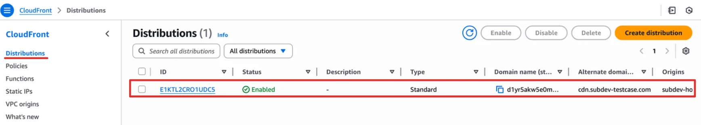

- CloudFront &#45; Distributions &#45; <code>해당 인스턴스</code> 클릭

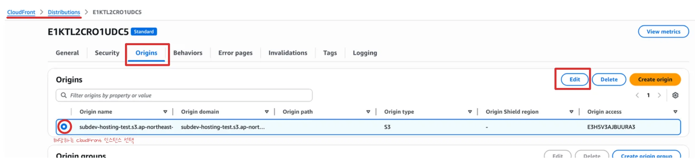

- 대시보드 &#45; Origins &#45; 해당 Origin 선택 &#45; <code>Edit</code> 클릭

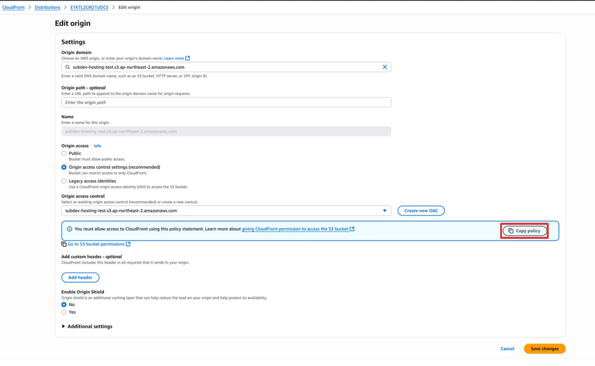

- <code>Copy Policy</code> 클릭하여 Policy 복사 후 해당 S3 버켓 정책에 추가
    - 아래와 동일한 Policy가 복사된다&#46;

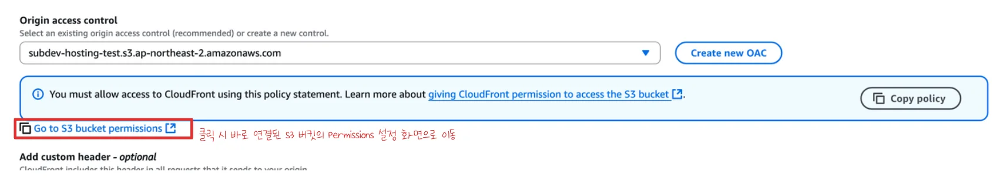

- 해당하는 Bucket의 Permissions 설정 화면으로 바로 이동

</details>

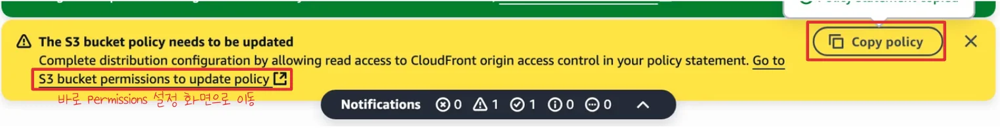

<details>
<summary>복사된 Policy</summary>

<a id="1f0eda9b0fe180a9bf5be0d996daacb4"></a>

```json
{
  "Version": "2008-10-17",
  "Id": "PolicyForCloudFrontPrivateContent",
  "Statement": [
      {
          "Sid": "AllowCloudFrontServicePrincipal",
          "Effect": "Allow",
          "Principal": {
              "Service": "cloudfront.amazonaws.com"
          },
          "Action": "s3:GetObject",
          "Resource": "arn:aws:s3:::subdev-hosting-test/*",
          "Condition": {
              "StringEquals": {
                "AWS:SourceArn": "arn:aws:cloudfront::869673799096:distribution/E1KTL2CRO1UDC5"
              }
          }
      }
  ]
}
```

</details>

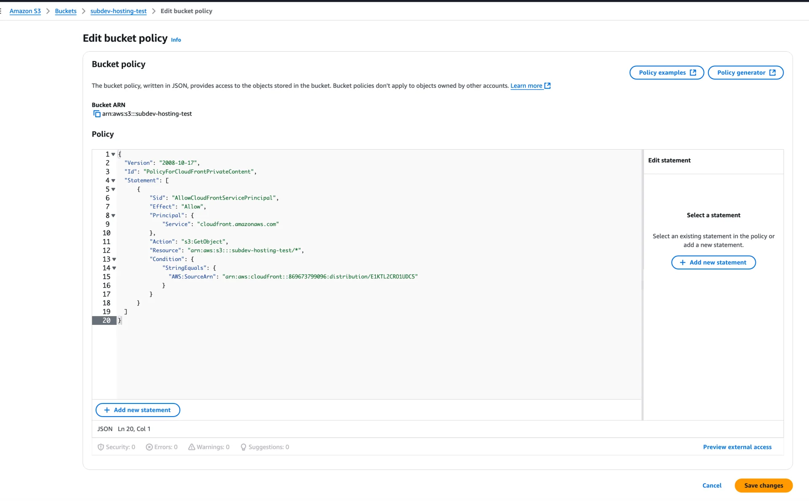

<details>
<summary>해당하는 S3 버킷에 정책 추가</summary>

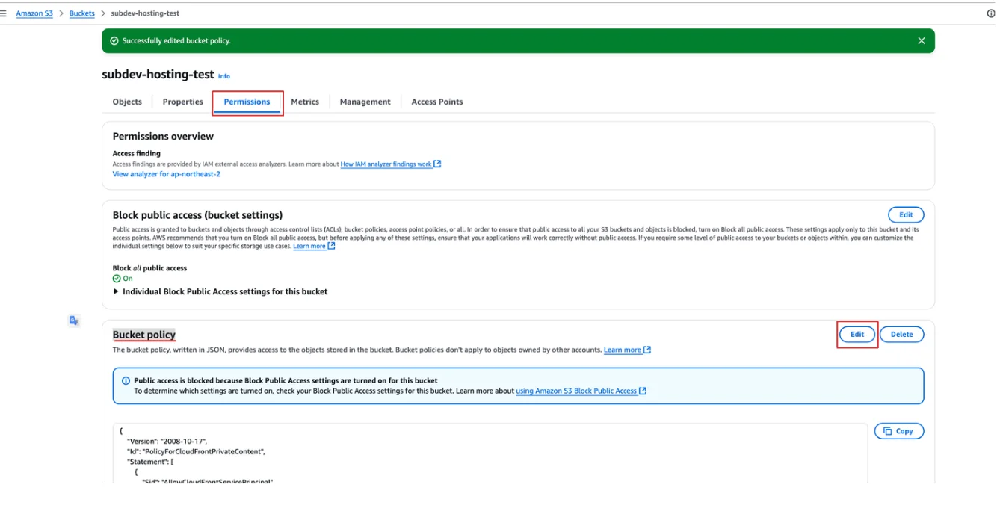

- 버킷 대시보드 &#45; Permissioms &#45; Bucket Policy &#45; Edit 클릭


</details>

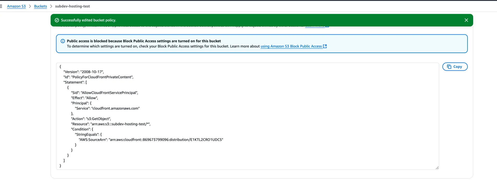

- Permissions의 Bucket Policy에 해당 정책이 추가된 것을 확인할 수 있다&#46; 

</details>

<details>
<summary>Route 53에 cdn 레코드 추가</summary>

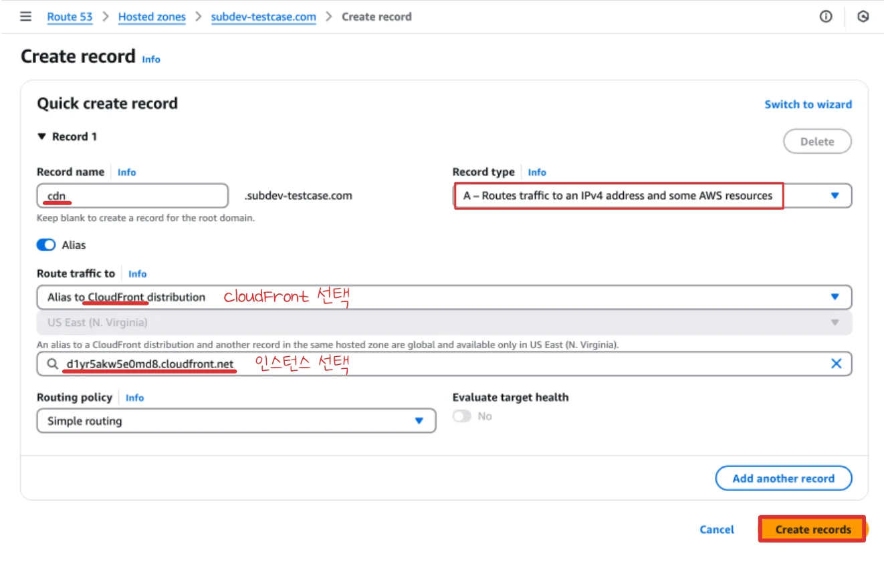

- Record name(subdomain)&#58; <code>cdn</code>
    - CloudFront 생성 시, 설정한 이름으로 명시

- Record Type&#58; <code>A 타입</code> 

- Alias
    - CloudFront, 생성한 CloudFront 인스턴스 선택

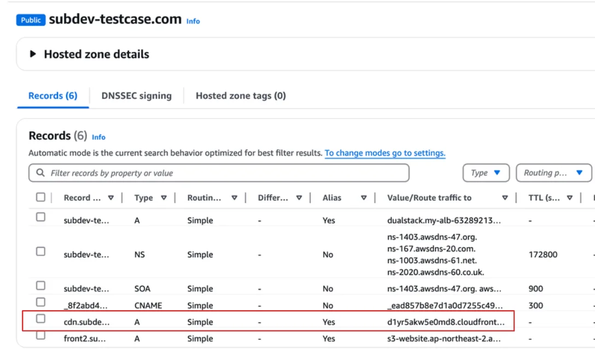

- 레코드 생성 확인

</details>

<details>
<summary>HTTPS 적용 확인</summary>

<details>
<summary>CloudFront 엔드포인트  &#45; HTTPS 적용 확인</summary>

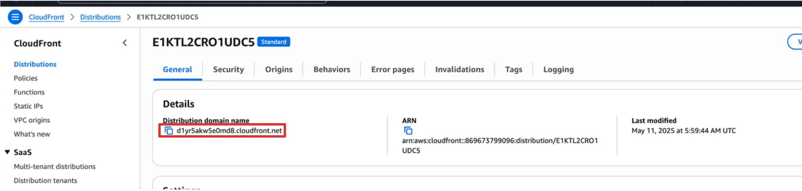

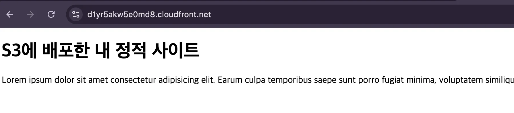

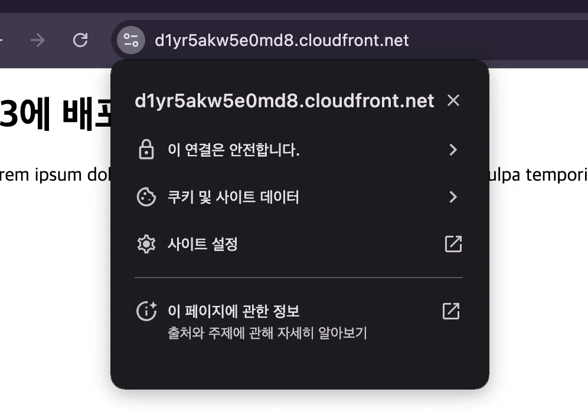

- HTTPS 적용 확인

</details>

<details>
<summary>도메인 &#45; HTTPS 적용 확인</summary>

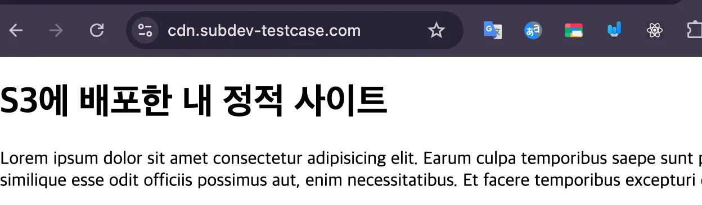

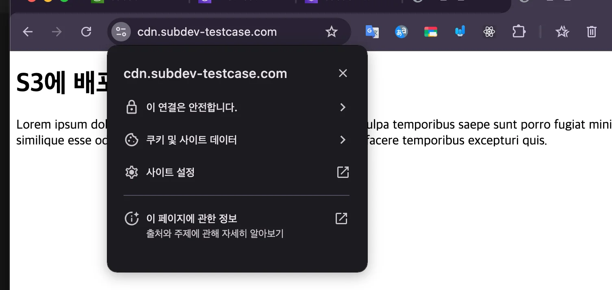

- HTTPS로 정상 접속 확인

</details>

</details>

</details>

<details>
<summary>실습) 캐싱 인벨리데이션</summary>

> ❗ 
> 
> <a id="1f0eda9b0fe18065b2c9ca634f4bb87a"></a>
> 
> 정적 리소스를 업데이트 했을 경우, 캐싱 설정 때문에 업데이트 내용이 반영되지 않을 수 있다&#46; 
> 
> <a id="1f0eda9b0fe180d6a522fe3ddcc85446"></a>
> 
> 따라서 <code>Invalidation</code>을 추가해서 해결한다&#46; 

<details>
<summary>CloudFront &#45; Invalidation 추가</summary>

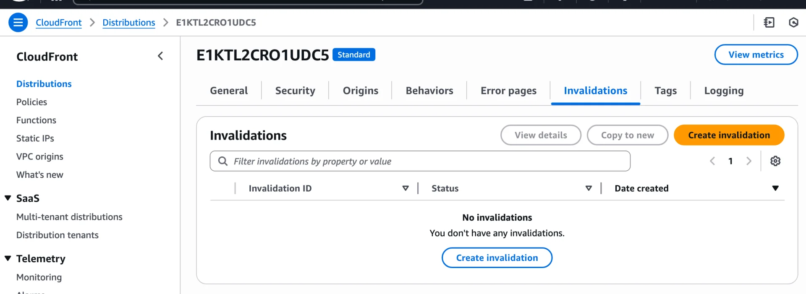

- 해당 CloudFront 인스턴스 대시보드 <br>&#45; Invalidations  &#45; <code>Create Invalidation</code> 클릭

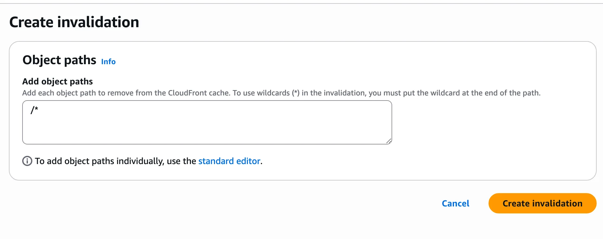

- <code>/&#42;</code> 입력 → 캐싱 초기화

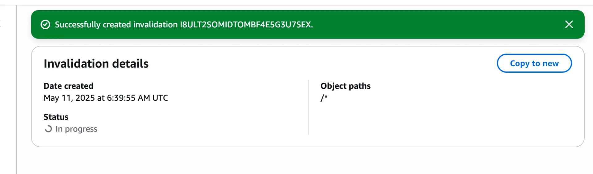

</details>

</details>
