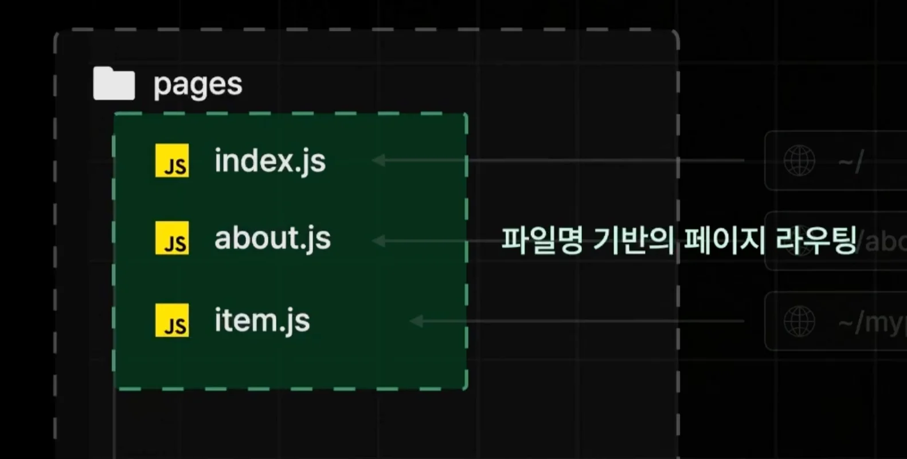
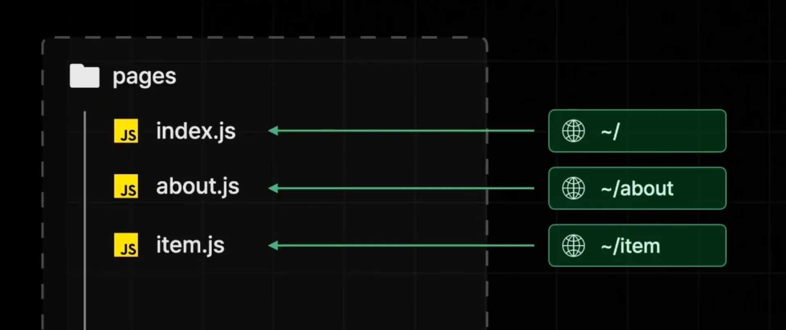
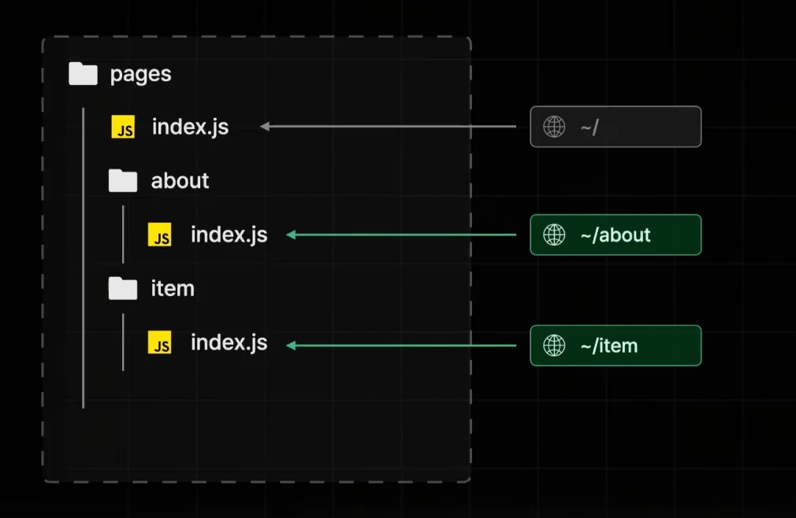
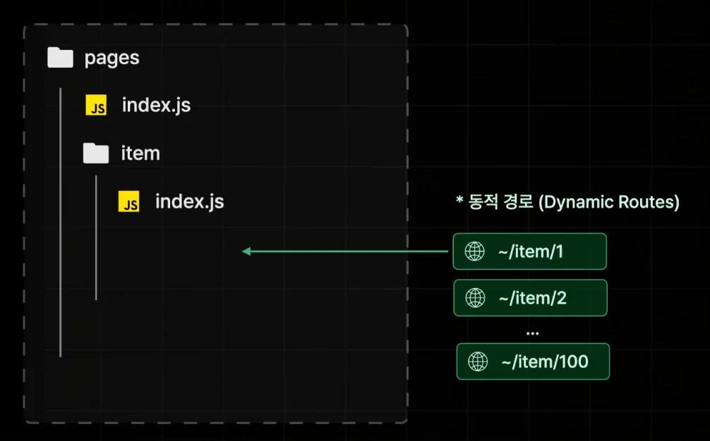
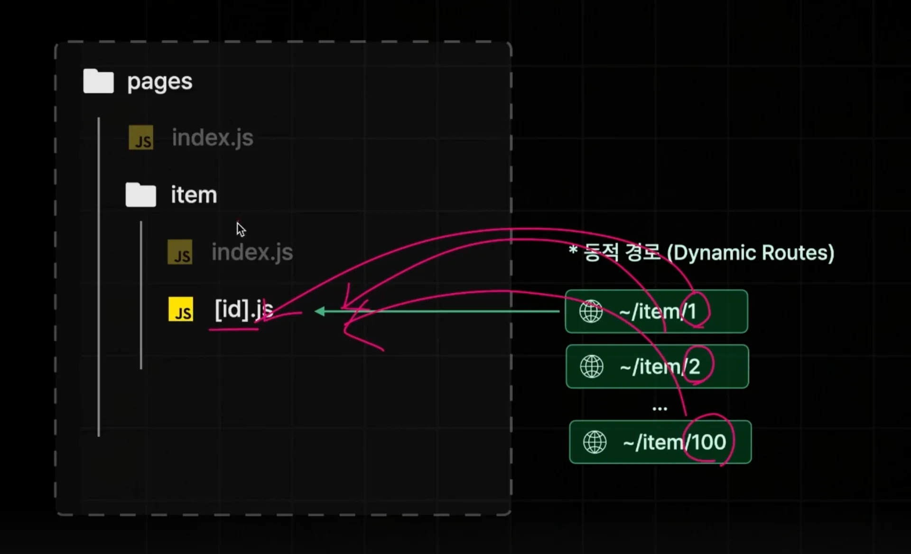
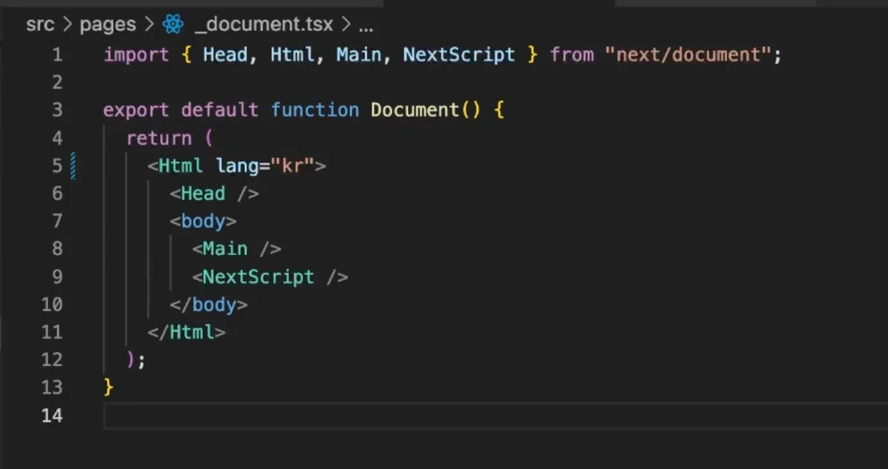
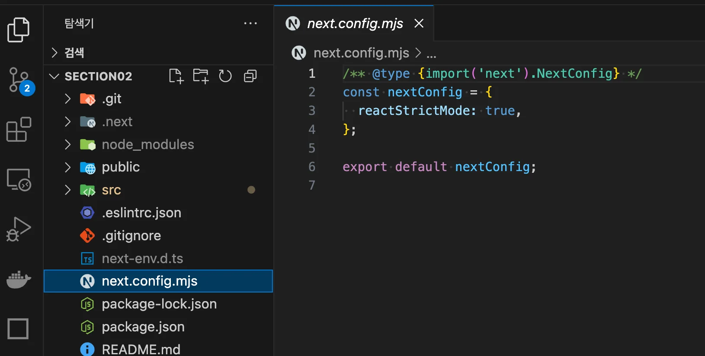

<a id="1e5eda9b0fe1801a8de2d2eb1fdfea34"></a>

## Page Router

---

> 📖 
> 
> <a id="1e5eda9b0fe18092bf46d64c06c4104a"></a>
> 
> <code>Page Router</code> 
> 
> ---
> 
> 
> 
> - <code>Pages</code> 폴더의 구조를 기반으로 페이지 라우팅 제공
> 
> - <u><code>pages</code></u><u> 폴더 내부</u>에 <strong><u>파일명, 폴더명</u></strong>을 기반으로 <strong>url 매핑을 자동</strong>으로 해준다&#46; 

<details>
<summary><code>pages</code> 폴더 내부에서 페이지 자동 매핑</summary>



<details>
<summary>파일명 기반 매핑</summary>



</details>

<details>
<summary>폴더명 기반 매핑</summary>



</details>

</details>

<details>
<summary>동적 경로 &#45; <code>쿼리 파라미터</code></summary>





- <code>&#91;쿼리&#95;파라미터&#93;</code>&#46;js
    <a id="1e5eda9b0fe180dc954ee274b9fd3878"></a>

    동적으로 매핑될 변수를 <code>&#91;&#93;</code> 대괄호 안에  명시하며 파일명을 만든다&#46;

</details>

<a id="1e5eda9b0fe1802f8919e5b71f7818a0"></a>

### Next&#46;js 프로젝트 세팅 및 기본 구조 살펴보기 

<details>
<summary>🧐 <code>npx</code></summary>

> <code>NPX</code>&#58;  Node Package Executor

<a id="1e5eda9b0fe180f79bf8fca4a5fdddbc"></a>

<code>npmks&#46;com</code>에 있는 최신 버전의 노드 패키지를 다운로드 없이 바로 실행시킬 수 있다&#46; 

- docker의 <code>&#58;latest</code> 와 동일한듯?

</details>

<details>
<summary>next&#46;js 프로젝트 세팅 ( 보일러 플레이트 )</summary>

<a id="1e5eda9b0fe1803f88acc643e7072e91"></a>

```bash
npx create-next-app@14 [생성될 폴더명]
```

- 레거시한 page router 학습을 위해 14 버전 사용

</details>

<details>
<summary>&#95;document&#46;tsx</summary>



- <code>index&#46;html</code> 과 동일

</details>

<details>
<summary><strong><code>next&#46;config&#46;mjs</code></strong><strong> &#45;</strong> <code>reactStrictMode&#58; </code><strong><code>false</code></strong></summary>

> <strong><code>next&#46;config&#46;mjs</code></strong><strong>&#58; </strong><code>Next&#46;js</code>의 설정을 관리한다&#46;



- reactStrictMode&#58; <code>false</code>
    <a id="1e5eda9b0fe1804388a1cec288299f0c"></a>

    스트릭트 모드가 켜져 있으면(<code>true</code>) 리액트 앱에 존재하는 잠재적인 문제를 검사하기 위해, 개발 모드로 실행 시 컴포넌트를 2번이나 실행시킨다&#46; 

</details>
