<details>
<summary>주의 App Router &#45;  type check</summary>

<a id="1ededa9b0fe18035b767fb3667174253"></a>

‣

</details>

<a id="1ededa9b0fe18063826bc8aee37cbc6b"></a>

## App Router

---

> 📖 
> 
> <a id="1ededa9b0fe18046b0b2e614c9eb9584"></a>
> 
> Page Router 방식의 단점을 App Router 방식으로 해결한다&#46;

<a id="1ededa9b0fe18094886de88d70b3ff55"></a>

### 1&#46; 페이지 라우팅

<details>
<summary>페이지 라우팅 설정</summary>

> ✏️ 
> 
> <a id="1ededa9b0fe1802b919dd581f8b0aab2"></a>
> 
> 페이지 라우팅
> 
> - 페이지는 <code>page&#46;tsx</code> 로 명시해야 한다&#46; 
> 
> - 하위 경로는 폴더를 통해서 명시한다 &#46;
> 
> - <strong><u>동적 경로로 매핑</u></strong>하는 경우, <code>&#91;id&#93;</code> 와 같이 폴더를 생성하여 <code>page&#46;tsx</code> 파일로 명시한다&#46; 

<details>
<summary>기본 페이지 라우팅</summary>

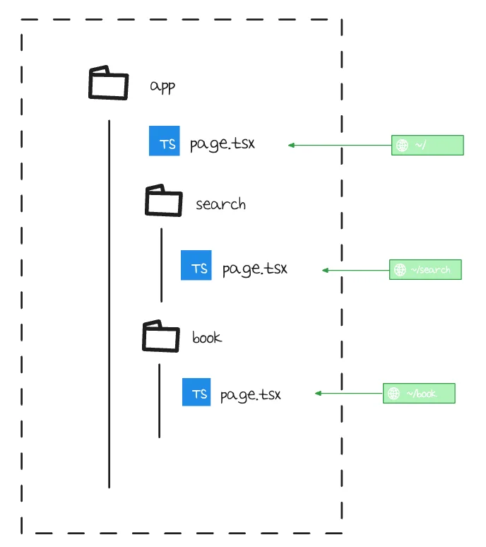

</details>

<details>
<summary>동적 경로 라우팅</summary>

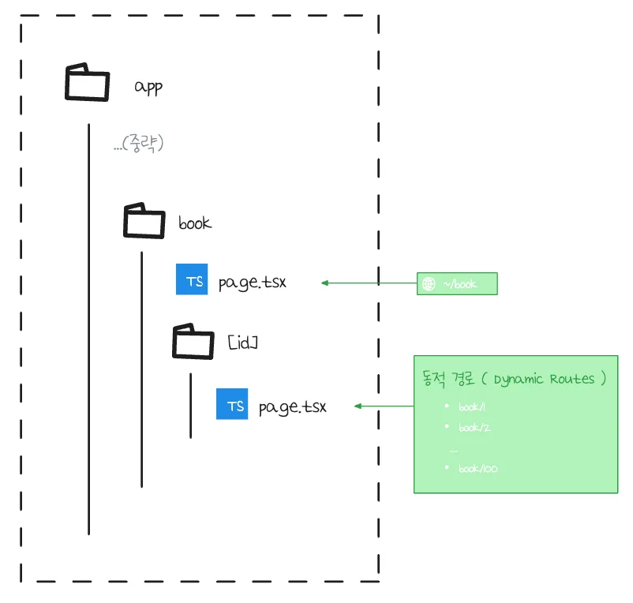

</details>

</details>

<details>
<summary><code>Query Parameter</code>, <code>Path variable</code>  값 받아오기</summary>

> ✏️ 
> 
> <a id="1ededa9b0fe180b0a6f9dfbf82131b12"></a>
> 
> <strong><u>앱 라우터 방식</u></strong>에서 쿼리 스트리의 경우, <strong>컴포넌트에게 </strong><strong><code>props</code></strong><strong>로 자동 전달</strong>된다&#46; 
> 
> <a id="1ededa9b0fe180759a03dccb2dbab62f"></a>
> 
> 따라서 <code>useRouter()</code>를 사용하지 않고 <u><code>p</code></u><strong><u><code>rops</code></u></strong><strong><u>에서 꺼내서 사용</u></strong>하면 된다&#46; 

<details>
<summary><strong><u>쿼리 파라미터</u></strong> 받아오기&#58; <code>props&#46;searchParams</code></summary>

<details>
<summary>props  확인</summary>

<a id="1ededa9b0fe18041b063f0bd4d322442"></a>

```typescript
{
  params: Promise {
      . . .
    }
  },
  searchParams: Promise {
    <pending>,
    q: [Getter/Setter],
    [Symbol(async_id_symbol)]: 269226,
    [Symbol(trigger_async_id_symbol)]: 269220,
    [Symbol(kResourceStore)]: {
      isStaticGeneration: false,
      page: '/search/page',
      fallbackRouteParams: null,
      route: '/search',
      incrementalCache: [IncrementalCache],
      cacheLifeProfiles: [Object],
      isRevalidate: false,
      isPrerendering: undefined,
      fetchCache: undefined,
      isOnDemandRevalidate: false,
      isDraftMode: false,
      requestEndedState: [Object],
      isPrefetchRequest: false,
      buildId: 'development',
      reactLoadableManifest: {},
      assetPrefix: '',
      afterContext: [AfterContext],
      dynamicIOEnabled: false,
      dev: true,
      previouslyRevalidatedTags: [],
      refreshTagsByCacheKind: [Map],
      fetchMetrics: []
    },
    [Symbol(kResourceStore)]: undefined,
    [Symbol(kResourceStore)]: undefined,
    [Symbol(kResourceStore)]: undefined,
    [Symbol(kResourceStore)]: undefined,
    [Symbol(kResourceStore)]: undefined,
    [Symbol(kResourceStore)]: {
      type: 'request',
      phase: 'render',
      implicitTags: [Object],
      url: [Object],
      rootParams: {},
      headers: [Getter],
      cookies: [Getter/Setter],
      mutableCookies: [Getter],
      userspaceMutableCookies: [Getter],
      draftMode: [Getter],
      renderResumeDataCache: null,
      isHmrRefresh: true,
      serverComponentsHmrCache: [LRUCache]
    }
  }
}
```

</details>

<a id="1ededa9b0fe180f4a69dfab0e74388f7"></a>

<strong>&#91; 코드 &#93; search 페이지</strong>

<a id="1ededa9b0fe180c6a3cff9c1e42145dd"></a>

```typescript
export default async function Page({
  searchParams,
}: {
  searchParams: Promise<{ q: string }>;
}) {
  const { q } = await searchParams;

  return <div>Search 페에지: {q}</div>;
}

```

<a id="1ededa9b0fe180d89942e2e8807c91c0"></a>

<strong>확인</strong>


</details>

<details>
<summary>Path Variable 받아오기&#58; <code>props&#46;prams</code> </summary>

<details>
<summary>props 확인</summary>

<a id="1ededa9b0fe1806a8d09eb91526653b6"></a>

```typescript
{
  params: Promise {
    <pending>,
    id: '3',
    [Symbol(async_id_symbol)]: 37113,
    [Symbol(trigger_async_id_symbol)]: 37112,
    [Symbol(kResourceStore)]: {
      isStaticGeneration: false,
      page: '/books/[id]/page',
      fallbackRouteParams: null,
      route: '/books/[id]',
      incrementalCache: [IncrementalCache],
      cacheLifeProfiles: [Object],
      isRevalidate: false,
      isPrerendering: undefined,
      fetchCache: undefined,
      isOnDemandRevalidate: false,
      isDraftMode: false,
      requestEndedState: [Object],
      isPrefetchRequest: false,
      buildId: 'development',
      reactLoadableManifest: {},
      assetPrefix: '',
      afterContext: [AfterContext],
      dynamicIOEnabled: false,
      dev: true,
      previouslyRevalidatedTags: [],
      refreshTagsByCacheKind: [Map],
      fetchMetrics: []
    },
    [Symbol(kResourceStore)]: undefined,
    [Symbol(kResourceStore)]: undefined,
    [Symbol(kResourceStore)]: undefined,
    [Symbol(kResourceStore)]: undefined,
    [Symbol(kResourceStore)]: {
      type: 'request',
      phase: 'render',
      implicitTags: [Object],
      url: [Object],
      rootParams: {},
      headers: [Getter],
      cookies: [Getter/Setter],
      mutableCookies: [Getter],
      userspaceMutableCookies: [Getter],
      draftMode: [Getter],
      renderResumeDataCache: null,
      isHmrRefresh: false,
      serverComponentsHmrCache: [LRUCache]
    }
  },
  searchParams: Promise {
		 . . .
  }
}
```

</details>

<a id="1ededa9b0fe1802cb056edecb9027b7d"></a>

<strong>&#91; 코드 &#93; search 페이지</strong>

<a id="1ededa9b0fe18071b6fadd12a785938c"></a>

```typescript
export default async function Page({
  params,
}: {
  params: Promise<{ id: string }>;
}) {
  const { id } = await params;

  return <div>books/[id]: {id}</div>;
}
```

<a id="1ededa9b0fe1800a8739d5d7cf1dcc7a"></a>

<strong>확인</strong>

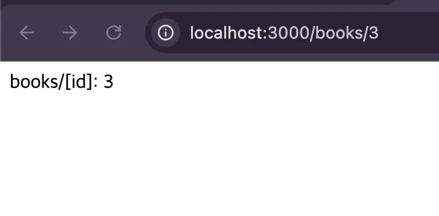

</details>

<details>
<summary>&#91; 추가 &#93; <code>&#91;…id&#93;</code>, <code>&#91;&#91;…id&#93;&#93;</code> </summary>

- <code>Catch All Segment</code>
    - <code>&#91;…id&#93;</code>

    - 중첩 경로 대응 가능
        - ex) <code>/books/1/2</code> , <code>/books/1/2/3/4/5</code>

- <code>Optional Catch All Segment</code>
    - <code>&#91;&#91;…id&#93;&#93;</code>

    - 빈 경로 대응 가능
        - ex) <code>/books</code>

</details>

</details>

<a id="1ededa9b0fe180108b07d78dd5f26f0c"></a>

### 2&#46; 레이아웃 설정

> ✏️ 
> 
> <a id="1ededa9b0fe180c8b81bcd86089fd202"></a>
> 
> App Router 방섹에서는 해당 폴더 내 <code>layout&#46;tsx</code> 파일을 정의하므로써 공통된 레이아웃을 손쉽게 적용할 수 있다&#46; 
> 
> - 중첩 설계 가능하다 &#46;

<details>
<summary>레이아웃 적용 범위</summary>

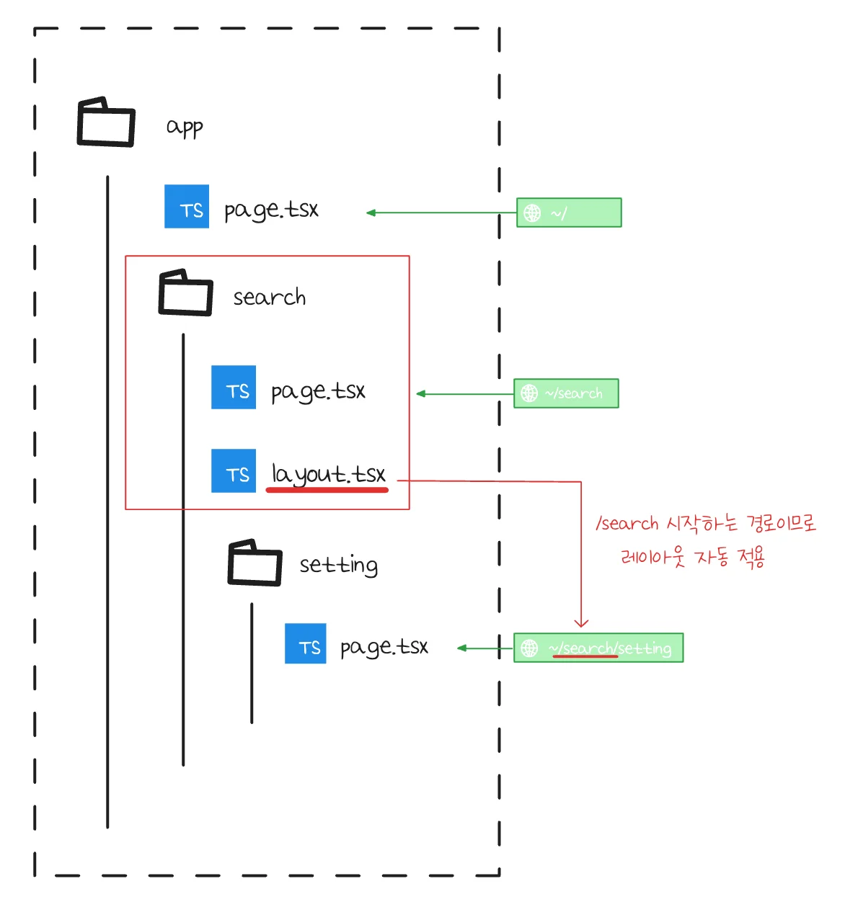

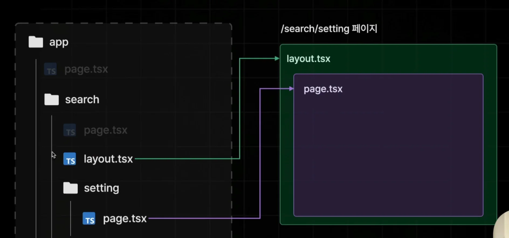

</details>

<details>
<summary>레이아웃 중첩 적용 </summary>

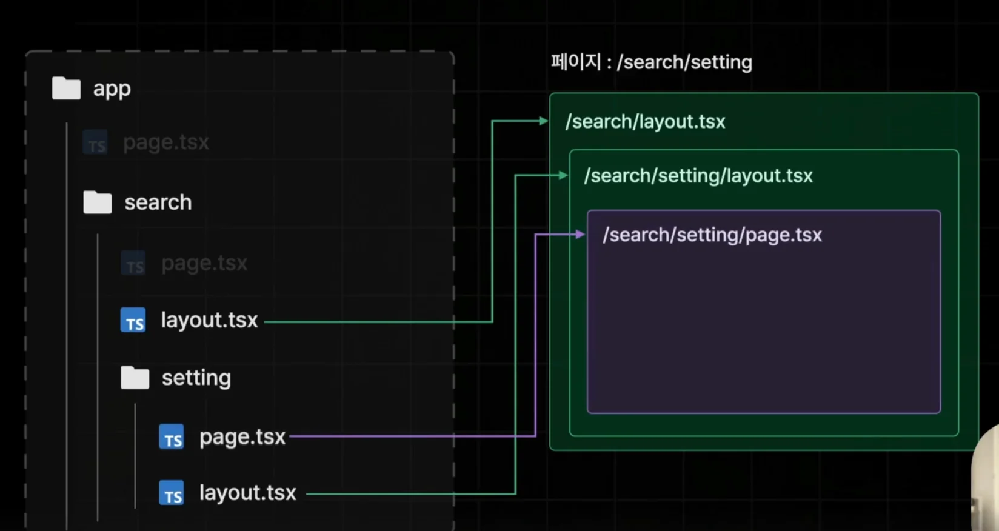

- 하위 경로에 <code>layout&#46;tsx</code> 파일을 중첩해서 만드는 경우, 위와 같이 중첩해서 적용된다&#46; 

</details>

<details>
<summary>루트 <code>layout&#46;tsx</code></summary>

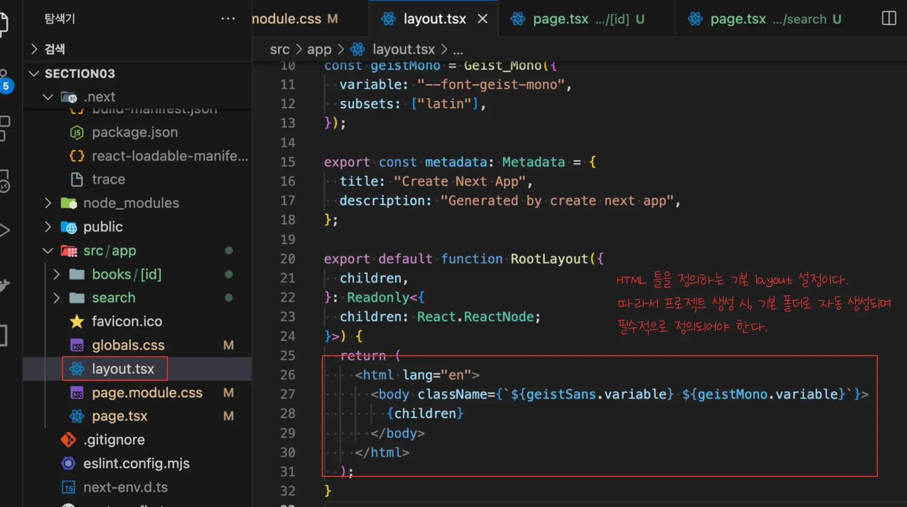

- <strong><u>HTML 기초 틀을 정의</u></strong>하는 기본 layout 설정이다&#46;

- 따라서 프로젝트 생성 시, <strong><u>기본 값으로 자동 생성</u></strong>되며 또한 필수적으로 정의 되어야 한다&#46;
    - 삭제되어도 다시 자동 생성된다&#46;

</details>

<details>
<summary>실습 1) 레이아웃 적용</summary>

> ✏️ 
> 
> <a id="1ededa9b0fe18083932aed862bd9a380"></a>
> 
> <strong>layout 정의</strong> 및 하위 경로까지 적용되는 것을 확인
> 
> ---
> 
> 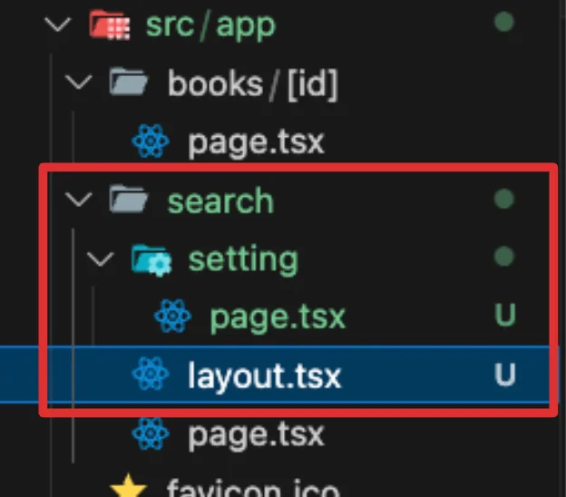
> 
> <a id="1ededa9b0fe1809da365db8e071e0768"></a>
> 
> ```typescript
> 📁 /search  ← layout.tsx 
> ⎿ 📁 /setting  	
> ```

<details>
<summary><strong>&#91; 코드 &#93; </strong><strong><code>/search/</code></strong><strong><code>layout&#46;tsx</code></strong></summary>

<a id="1ededa9b0fe18074a031f82fc368b3e4"></a>

```typescript
export default function layout({ children } : { children: React.ReactNode }) {
  return (
    <div>
      <div>임시 서치바</div>
      {children}
    </div>
  );
}
```

- 공통으로 적용할 레이아웃을 정의

- <code>children</code>  그 외 페이지 컴포넌트들을 상속

</details>

<details>
<summary><strong>확인</strong></summary>

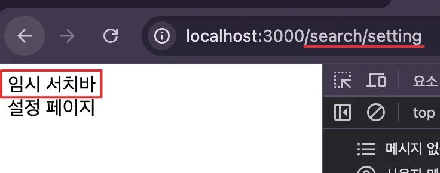

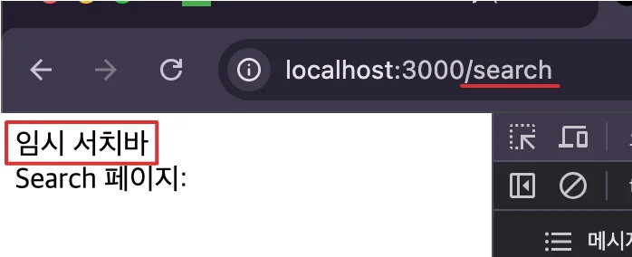

</details>

</details>

<details>
<summary>실습 2) 중첩 레이아웃 적용</summary>

> ✏️ 
> 
> <a id="1ededa9b0fe1807b8ce0d6f5ac3158e9"></a>
> 
> 중첩 레이아웃 설정
> 
> ---
> 
> 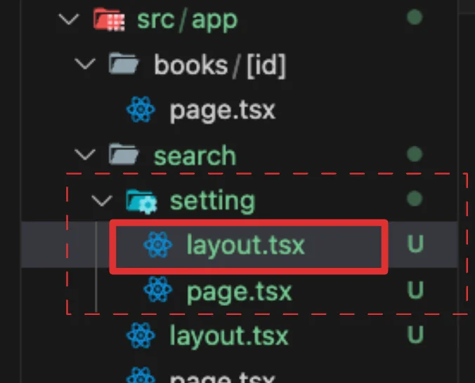
> 
> <a id="1ededa9b0fe1801a89aacf3e6d92e5f4"></a>
> 
> ```typescript
> 📁 /search ← layout.tsx 
> ⎿ 📁 /setting ← layout.tsx
> ```

<details>
<summary><strong>&#91; 코드 &#93; </strong><strong><code>/search/setting/</code></strong><strong><code>layout&#46;tsx</code></strong></summary>

<a id="1ededa9b0fe1804f8434d68748704378"></a>

```typescript
export default function layout({ children }: { children: React.ReactNode }) {
  return (
    <div>
      <div>세팅 헤더</div>
      {children}
    </div>
  );
}
```

- 공통으로 적용할 레이아웃을 정의

- <code>children</code>  그 외 페이지 컴포넌트들을 상속

</details>

<details>
<summary><strong>확인</strong></summary>

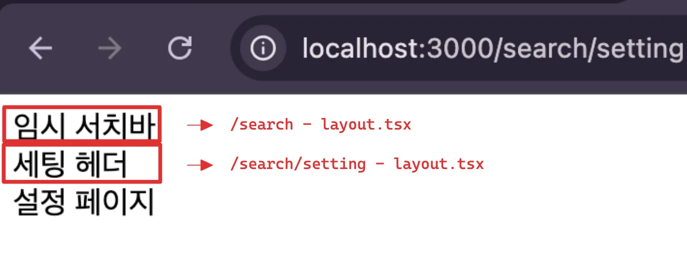

</details>

</details>

<details>
<summary>실습 3) 특정 페이지들만 적용 &#45; <strong>Route Group</strong></summary>

> ✏️ 
> 
> <a id="1ededa9b0fe180278817da95e50e5342"></a>
> 
> <strong>Route Group</strong>
> 
> ---
> 
> <a id="1ededa9b0fe180d8b7afcc2cad508899"></a>
> 
> 경로에 상관없이 특정 페이지들만 부분적으로 적용이 필요한 경우, Route Group를 사용한다&#46; 
> 
> - 라우트 그룹은 경로상에서 아무런 영향도 미치지 않는다&#46;
> 
> - 경로상에는 아무런 영향을 주지 않으면서, 동시에 <u>각기 다른 경로를 갖는 페이지 파일들</u>을 <strong><u>하나의 폴더 안에 묶</u></strong>어 <strong>공통 레이아웃을 적용</strong>할 수 있다&#46;
> 
> <a id="1ededa9b0fe1809298cffa99b518b6a2"></a>
> 
> ```plaintext
> 📁 (with-searchbar)     ← Route Group
> ├── 📁 search
> │    └── page.tsx       ← 검색 페이지
> ├── page.tsx            ← 인덱스 페이지 
> └── layout.tsx          ← SearchBar 공통 적용  
> ```

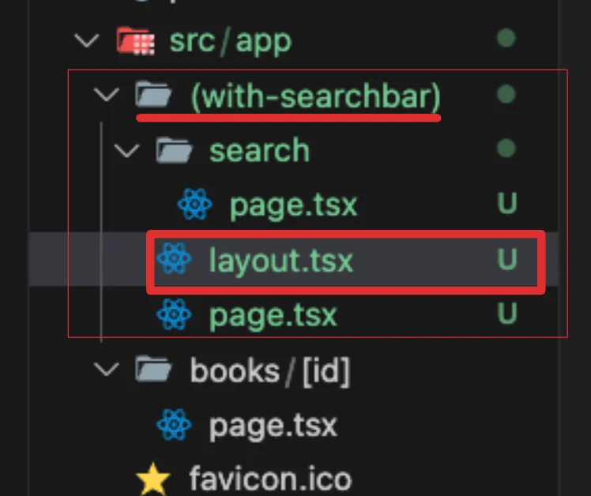

<details>
<summary><strong>&#91; 코드 &#93; </strong><strong><code>/</code></strong><code>(with&#45;searchbar)</code><strong><code>/</code></strong><strong><code>layout&#46;tsx</code></strong></summary>

<a id="1ededa9b0fe180b19897e852b7938689"></a>

```typescript
export default function layout({ children }: { children: React.ReactNode }) {
  return (
    <div>
      <div>임시 서치바</div>
      {children}
    </div>
  );
}
```

- 공통으로 적용할 레이아웃을 정의

- <code>children</code>  그 외 페이지 컴포넌트들을 상속

</details>

<details>
<summary><strong>확인</strong></summary>

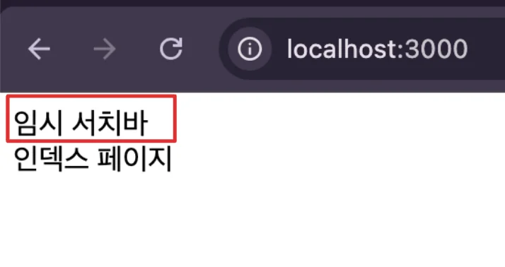

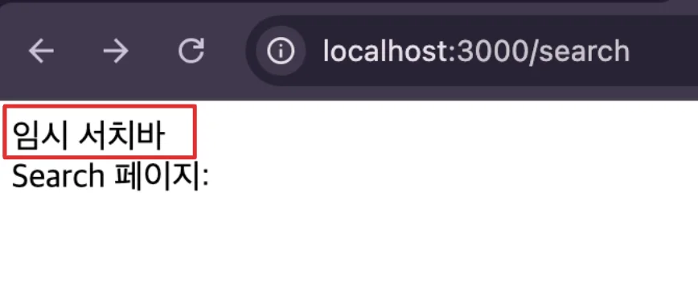

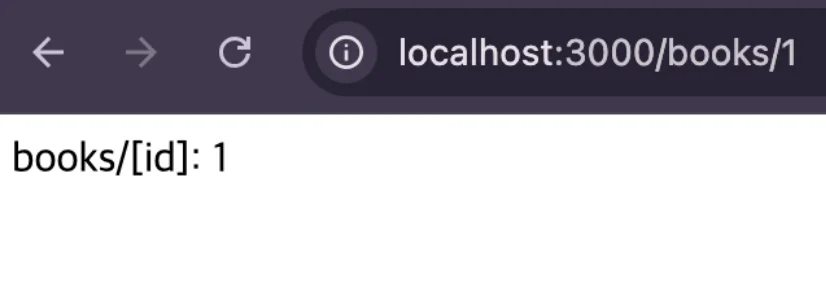

</details>

</details>
