

## Next&#46;js

---

> 📖 
> 
> 
> 
> <strong><code>Next&#46;js</code></strong>
> 
> ---
> 
> 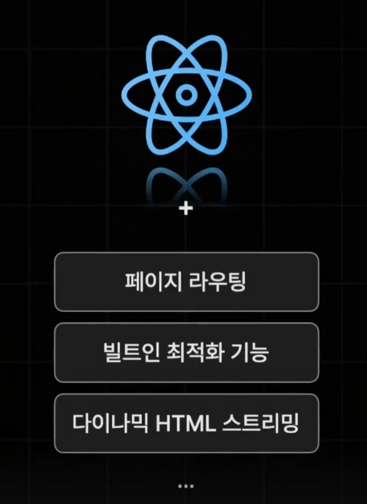
> 
> 
> 
> <strong><u>리액트 전용 </u></strong><strong><u>웹 개발 Framework</u></strong>로 리액트를 보다 더 강력하고 편하게 사용할 수 있는 기능들을 제공한다&#46; 
> 
> - <code>페이지 라우팅</code>
> 
> - <code>빌트인 최적화 기능</code>
> 
> - <code>다이나믹 HTML 스트리밍</code>
> 
> - …&#46;

TMI

- 미국의 Vercel 회사에서 오픈소스로 개발 되고 있다&#46; 

- 가장 인기가 높은 기술이다 &#46; ( 2023년  통계) 
    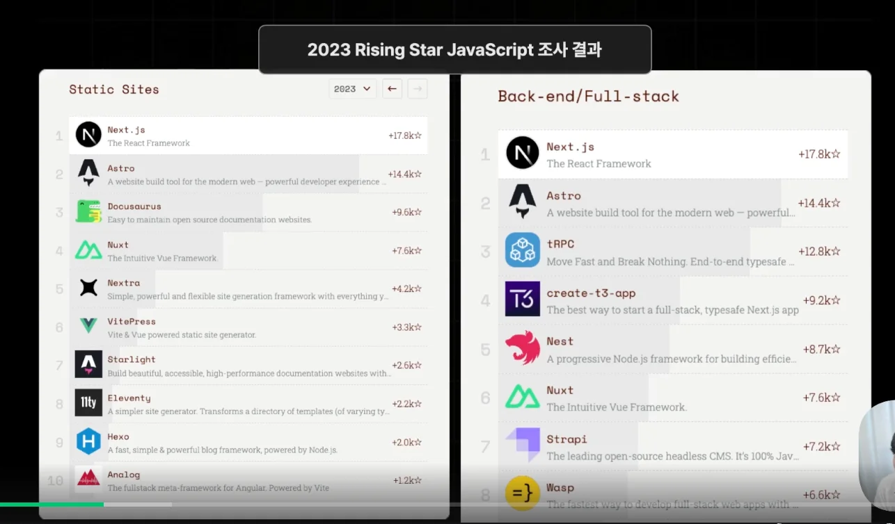

- 여러 국내 메이저 회사에서도 사용 중이다&#46; 
    - op&#46;gg

    - inflearn

    - …

그렇다면 Next&#46;js를 사람들이 <strong><u>많이 사용하는 이유</u></strong>는 무엇인가?  즉, <strong><u>Next&#46;js 의 장점</u></strong>이 무엇인가?

강의 자료

- <code>라이브러리</code> vs <code>프레임워크</code>
    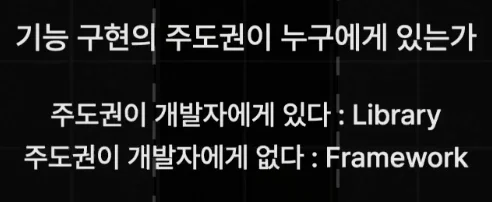

    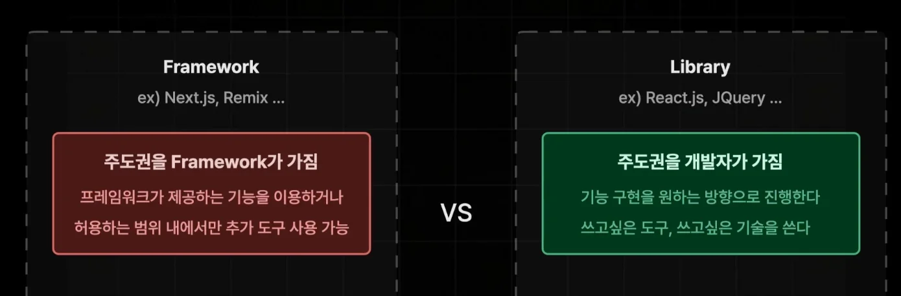

- ex) React(라이브러리) &#45; Routing 개발자가 직접 설정
    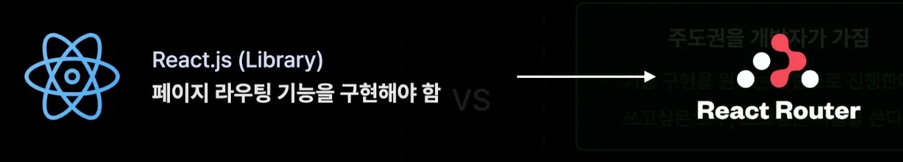

- ex) NextJS(프레임워크) &#45; Routing 프레임워크에서 제공
    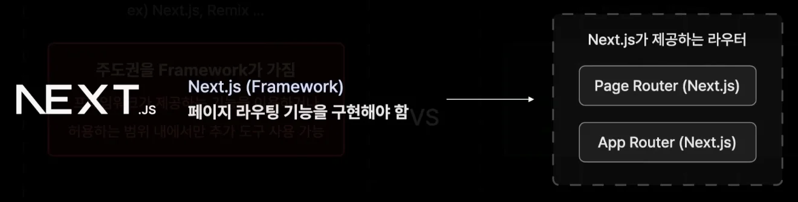

- 웹 개발에서  자유도는 높아도 문제가 될 수 있다&#46; 
    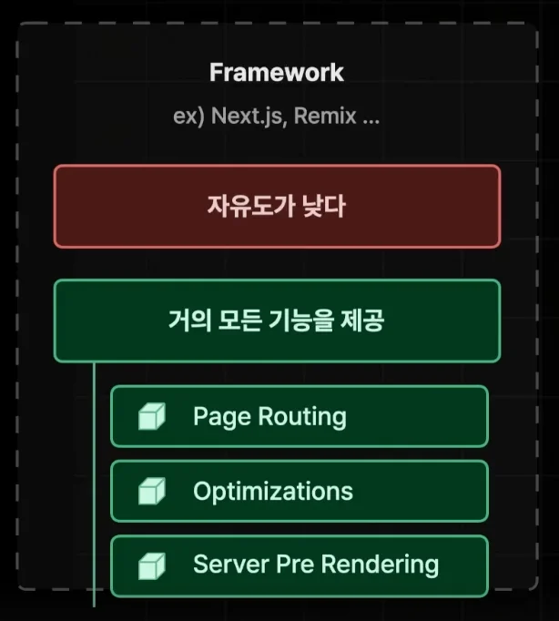

    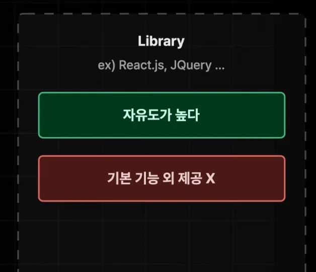

<code>Next&#46;js</code>는 프레임워크이다&#46; 

따라서 라이브러리인 <code>React</code> 보다 <u>기본적으로 제공되는 기능들이 많</u>다&#46; 

이로 인해 개발 생산성을 크게 높일 수 있다&#46;

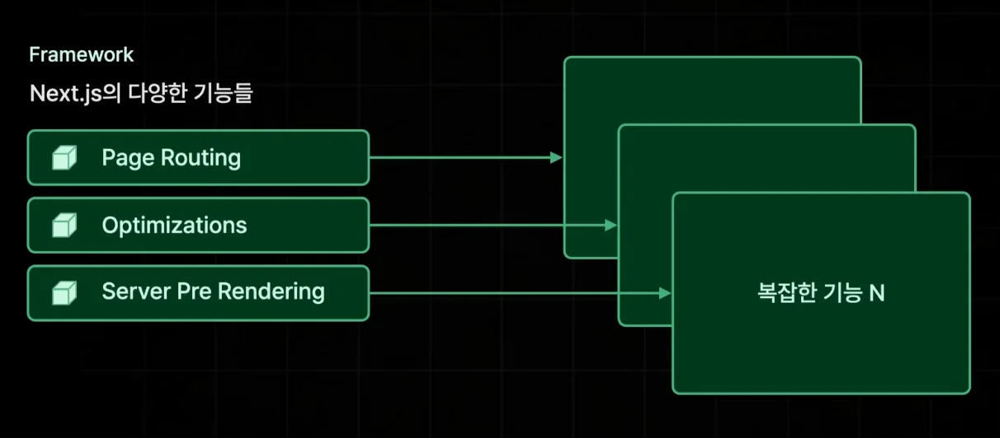

- 훨씬 더 빠르게 웹 서비스를 구축하고, 쉽게 문제를 해결 가능하다&#46;

## NextJS &#45; 사전 렌더링

> 📖 
> 
> 
> 
> <strong><code>사전 렌더링</code></strong>
> 
> ---
> 
> 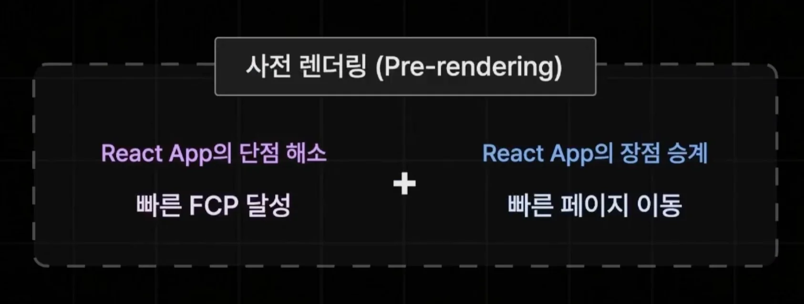
> 
> 
> 
> 브라우저의 요청이 사전에 렌더링이 완료된 HTML을 응답하는 렌더링 방식
> 
> - <strong><code>CSR</code></strong>(<code>Client Side Rendering</code>)의 <strong><u>단점을 효율적으로 해결</u></strong>하는 기술

<strong><code>CSR</code></strong><strong> 및 단점</strong>

> ✏️ 
> 
> 
> 
> <strong><code>Client Side Rendering</code></strong> ( <strong><code>CSR</code></strong> )
> 
> ---
> 
> - <code>React&#46;js</code> 앱의 기본적인 렌더링 방식
> 
> - 클라이언트(브라우저)에서 직접 화면을 렌더링한다&#46;
> 
> 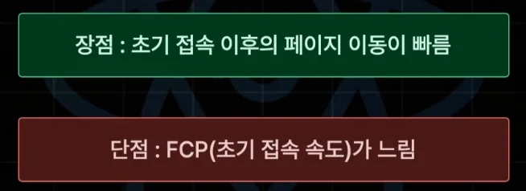

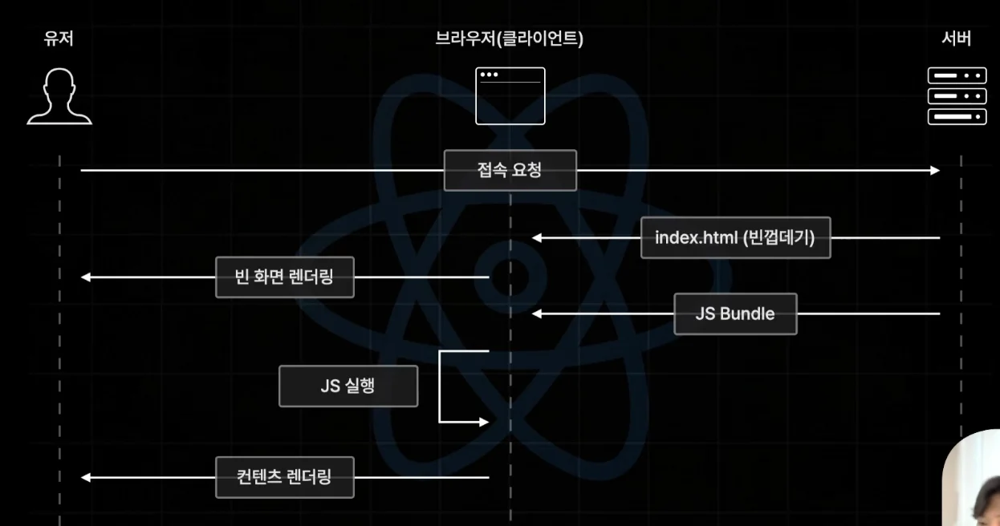

위와 같이 서버에 클라이언트에서 js를 실행해서 컨텐츠를 렌더링한다&#46;

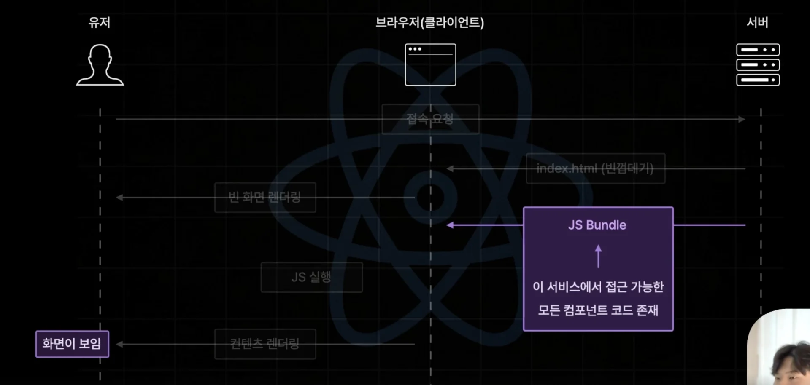

따라서 <u>초기 접속 이후</u> 매우 빠르게 컴포넌트를 갈아 끼우면서 화면을 보여준다 &#46;

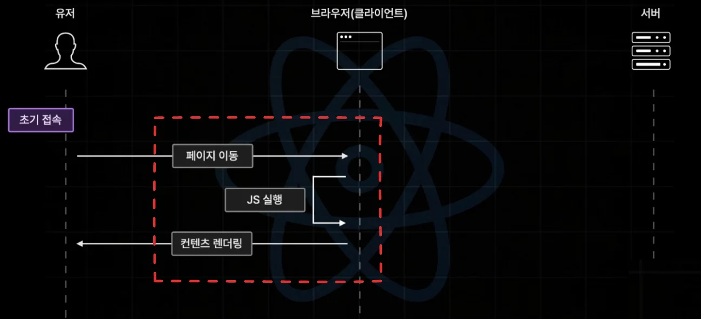

- 이미 번들링이 되었기 때문에 유저가 요청한 페이지를 클라이언트에서 실행하여 바로 보여줄 수 있다&#46; 
    - 네트워크 I/O 비용 ❌

그러나 <strong><u>첫 요청</u></strong> 시, 실제 유저가 <strong><u>정상 화면</u></strong>을 보기까지 <strong><u>너무 오랜 시간이 걸</u></strong>린다&#46; 즉, <code>FCP</code> 가 <strong><u>너무 늦</u></strong>어져 <strong>유저 이탈률이 증가</strong>한다&#46;

🧐 <code>FCP</code> ( <strong>First Contentful Paint</strong> )

> ✏️ 
> 
> 
> 
> <code>FCP</code> 란, 유저의 요청 이후 첫화면이 보이기까지 걸리는 시간을 말한다&#46;

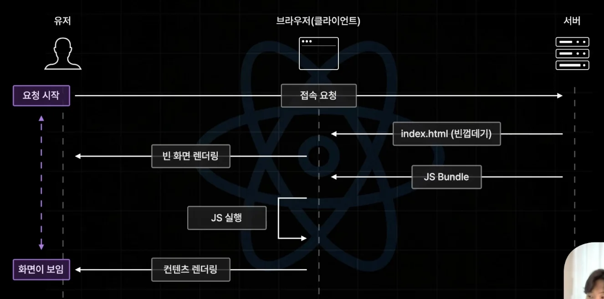

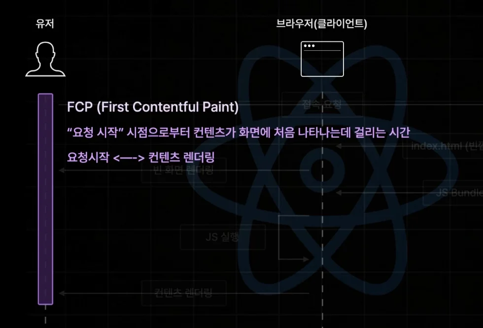

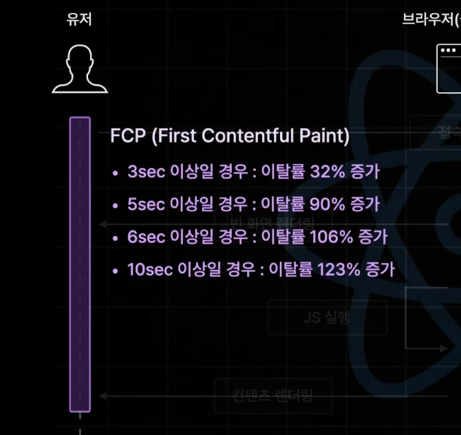

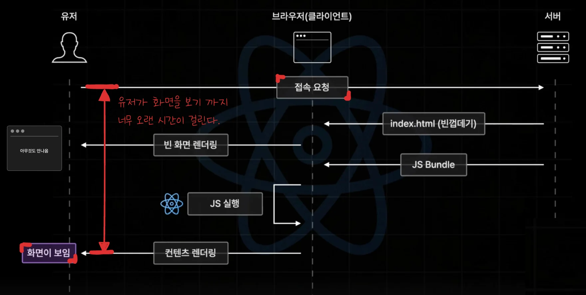

<strong>사전 렌더링</strong>

> ✏️ 
> 
> 
> 
> <code>사전 렌더링</code>
> 
> ---
> 
> 
> 
> 
> 
> <strong><u>CSR의 단점</u></strong>인 <u><code>FCP</code></u><u>가 </u><u>느리다</u>는 단점을 보안하기 위해서 나온 방식이다&#46; 
> 
> - <code>CSR</code>에서는 <strong><u>클라이언트에서 JS를 렌더링</u></strong> ( React → HTML )했지만,
> 
> 
> 
> <code>사전 렌더링</code>은 <strong><u>서버에서 JS를 렌더링( React → HTML )</u></strong> 하고 바로 클라이언트로 내려준다&#46; 
> 
> 
> 
> 이로 인해, <strong><u>FCP 시간을 단축</u></strong>시켜 CSR의 단점을 해결한다&#46; 

사전 렌더링 과정

1&#46; 빠른 화면을 보여주기 위해 서버에서 JS를 렌더링하여 클라이언트로 보낸다&#46; 

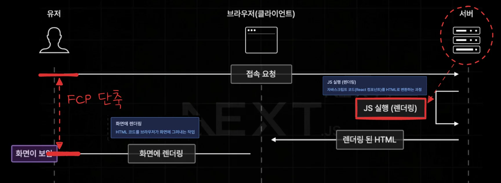

- 이때, React → HTML 변환하여 내려보는데, JavaScriptr가 번들링되지 않았기 때문에 상호작용(interactive)는 불가능하다&#46;
    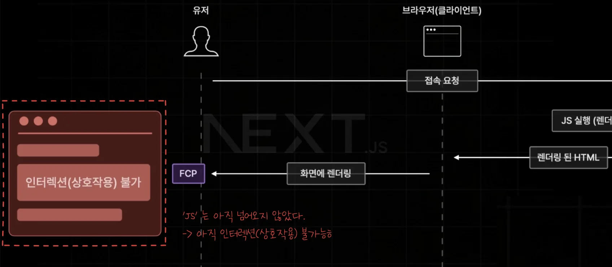

2&#46; 상호작용을 위해 후속으로 JS를 번들링하여 클라이언트로 보낸다&#46;

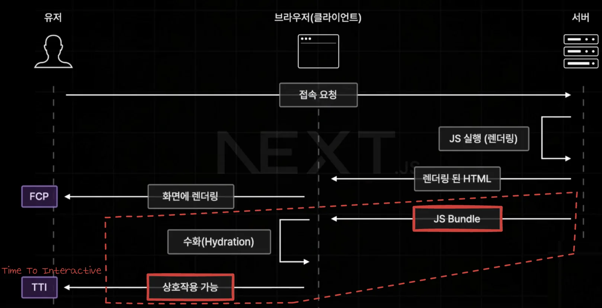

- 이후 유저는 웹 페이지에서 상호작용이 가능하다&#46; 
    - 상호작용이 가능한 지점을 <strong><u>Time To Interactive</u></strong>라 하여 <code>TTI</code>라 부른다&#46;

이렇게 FCP를 낮추기 위해 먼저 HTML, CSS를 보내고, 이후 상호 작용을 위해 JS를 보내는 것을 <strong><u>메마른 땅에 물을 뿌려주는 것과 같</u></strong>다고 하여 <strong><code>수화</code></strong>(<strong><code>Hydraction</code></strong>) 이라고 표현한다&#46;

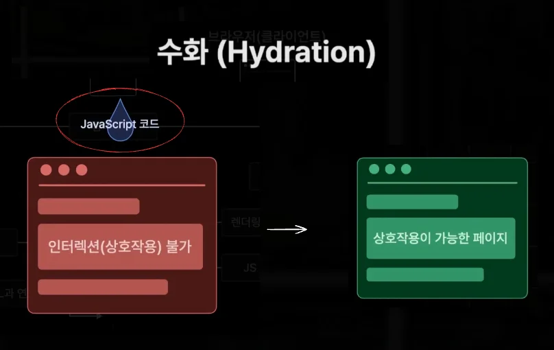

페이지 이동 ( 라우팅 )

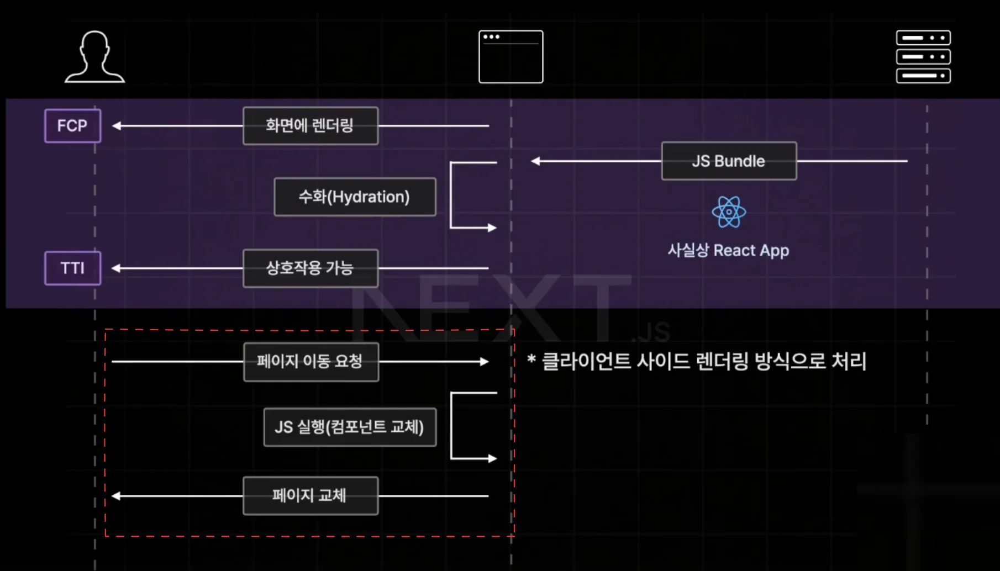

기존의 리액트 방식과 동일하다&#46; 

- 리액트의 단점을 극복하면서 리액트 장점을 계승한다&#46;

