<a id="1e6eda9b0fe180839229dbf224d47897"></a>

## 실습 &#45; 한입 북스 ( Onebite )

<details>
<summary><strong>레이아웃</strong></summary>

1. Index 페이지
    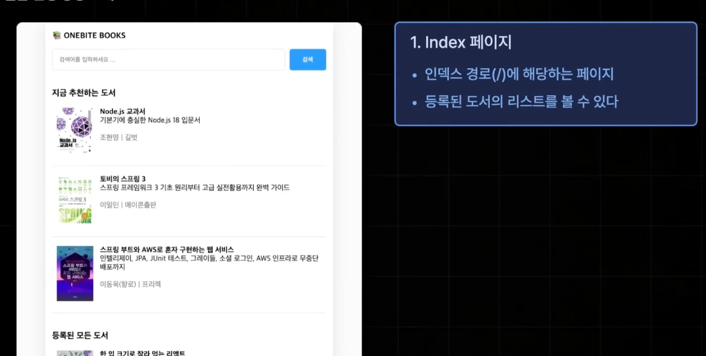

1. 검색 ( Search ) 페이지
    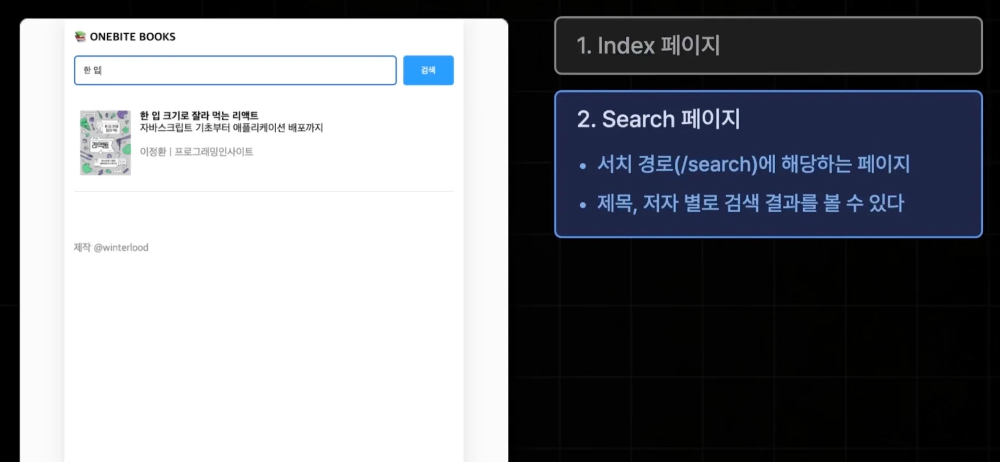

1. Book 페이지
    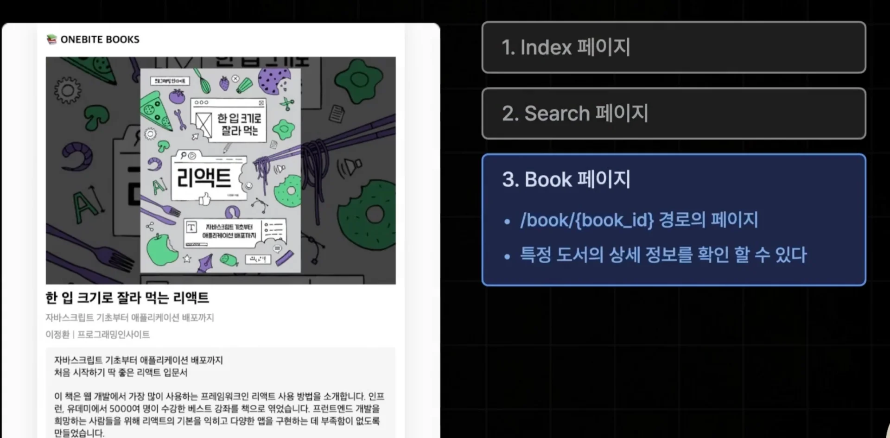

</details>

<a id="1e6eda9b0fe18005896cc32fdc83e51f"></a>

### 1&#46; 페이지 라우팅

<details>
<summary>페이지 라우팅</summary>

> ex&#46; search 페이지

<details>
<summary><code>파일명</code> 으로 매핑</summary>

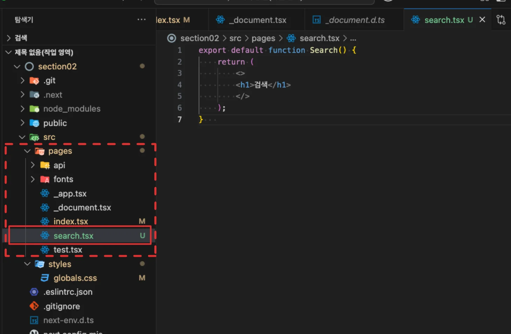

</details>

<details>
<summary><code>폴더명</code>으로 매핑</summary>

> ✏️ 
> 
> <a id="1e6eda9b0fe180b083f3f42914526951"></a>
> 
> 폴더명으로 매핑하는 경우, 파일 명을 <code>index&#46;tsx</code>로 설정해야 한다&#46;

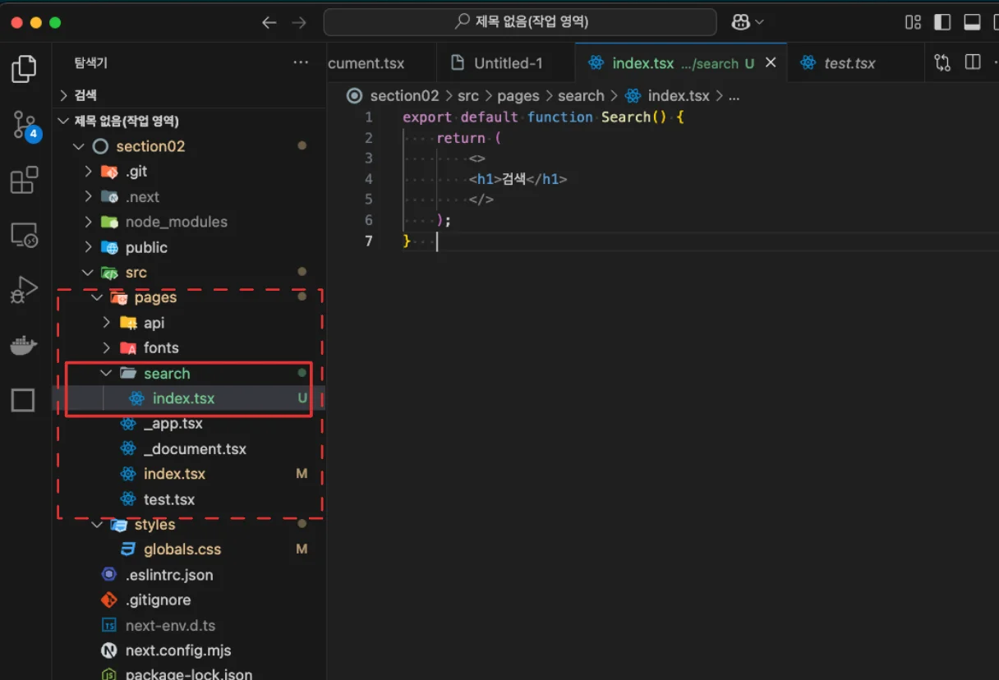

</details>

<details>
<summary>계층 구조&#58; <code>depth 2</code></summary>

> ✏️ 
> 
> <a id="1e6eda9b0fe180f98339e43e736c3993"></a>
> 
> url 계층 구조도 동일하게 매핑 가능하다&#46; ( 방식 동일 ) 
> 
> - 하위 depth를 가지는 url의 경우 폴더 구조를 사용해야 된다&#46;

<details>
<summary><code>파일명</code> 패핑</summary>

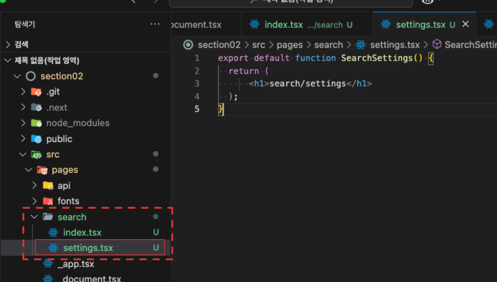

</details>

<details>
<summary><code>폴더명</code> 매핑</summary>

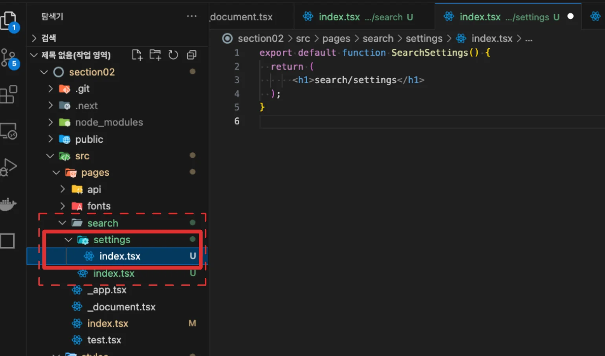

</details>

<details>
<summary>라우팅 확인</summary>

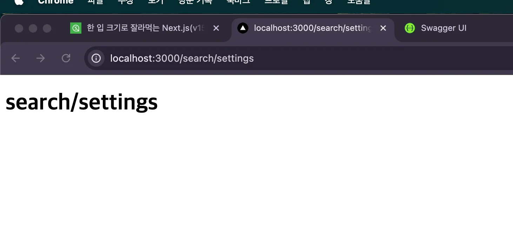

</details>

</details>

</details>

<details>
<summary><code>쿼리 파라미터</code> 받아오기&#58; <strong><code>useRouter()</code></strong></summary>

> ✏️ 
> 
> <a id="1e6eda9b0fe18010abf5e5afcf79063c"></a>
> 
> <code>useRouter()</code>을 사용하면 url의 <strong><u>쿼리 파라미터</u></strong> 값을 가져올 수 있다&#46; 

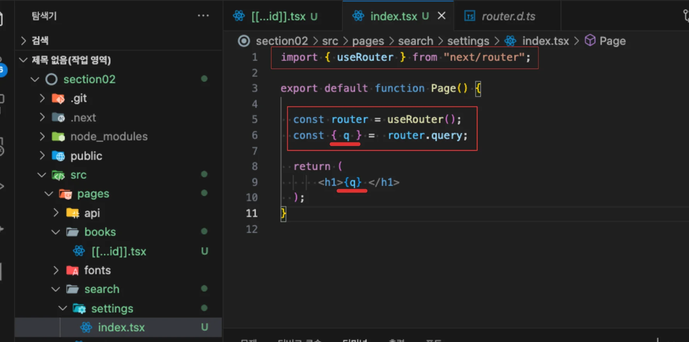

<details>
<summary>&#91; 코드 &#93;</summary>

<a id="1e6eda9b0fe180dfae76fd836f47eba0"></a>

```javascript
import { useRouter } from "next/router";

export default function Page() {

  const router = useRouter();
  const { q } =  router.query;

  return (
      <h1>{q} </h1>
  );
}

```

</details>

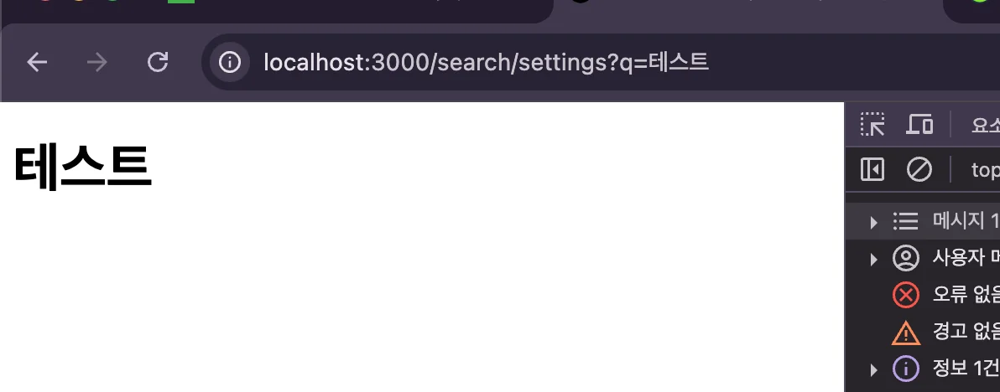

</details>

<details>
<summary>Optional Catch All Segment&#58; <code>&#91;&#91;…id&#93;&#93;</code></summary>

> ✏️ 
> 
> <a id="1e6eda9b0fe18082af94e85b58e91dc6"></a>
> 
> <strong>Optional Catch All Segment</strong>
> 
> ---
> 
> <a id="1e6eda9b0fe18032869de978a15ce8f4"></a>
> 
> Next&#46;js의 <u>파일 기반 라우팅</u>에서 <strong>경로가 0개일 수도, 여러 개일 수도 있는 동적 세그먼트</strong><strong>를 정의</strong>하는 문법

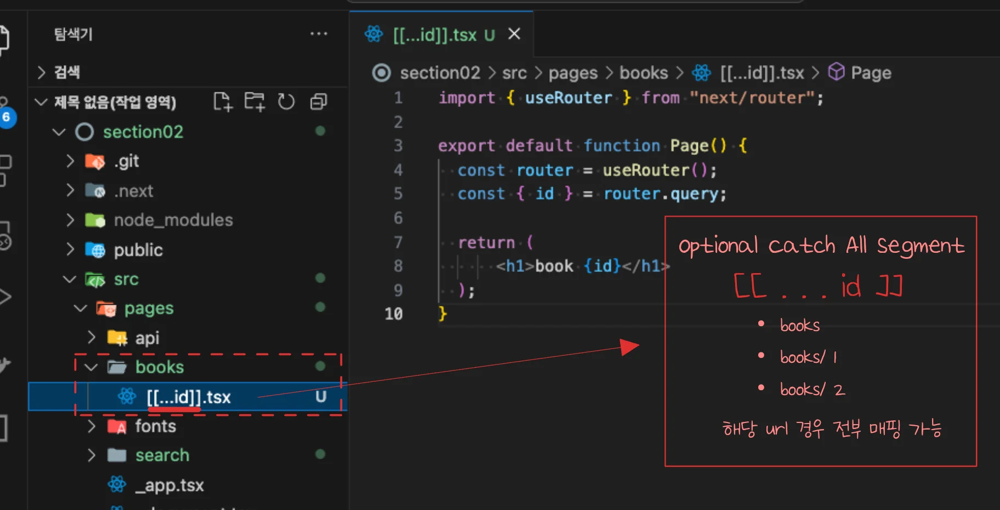

- URI&#58; <code>localhost&#58;3000/books</code>
    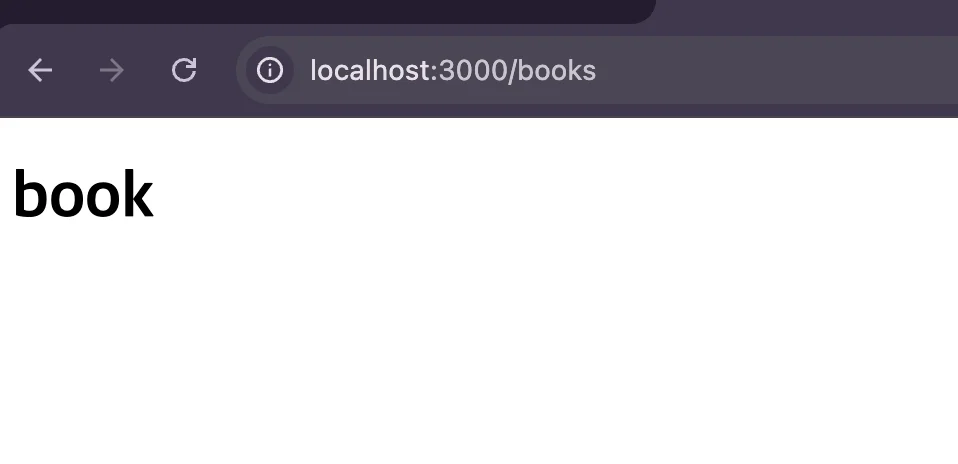

- URI&#58; <code>localhost&#58;3000/books/2</code>
    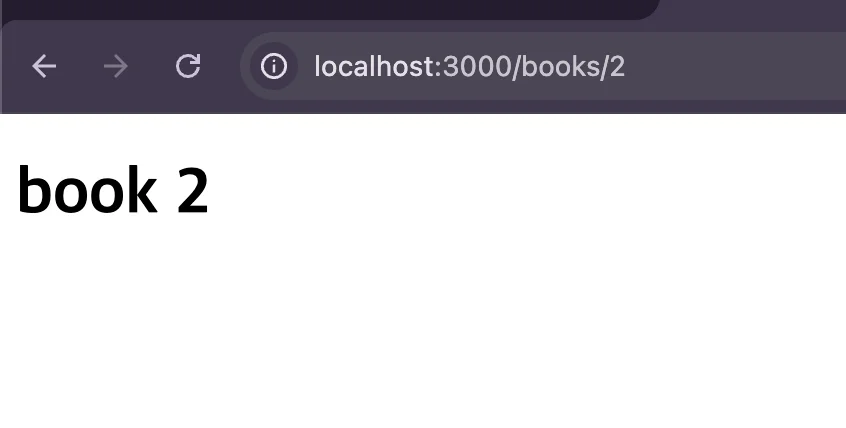

</details>

<details>
<summary>404 페이지</summary>

> ✏️ 
> 
> <a id="1e6eda9b0fe1800b9ec3c1528ce58681"></a>
> 
> 정의되지 않은 url 요청의 경우 <code>404</code>를 반환한다&#46; 
> 
> - 해당 처리를 위한 페이지 설정

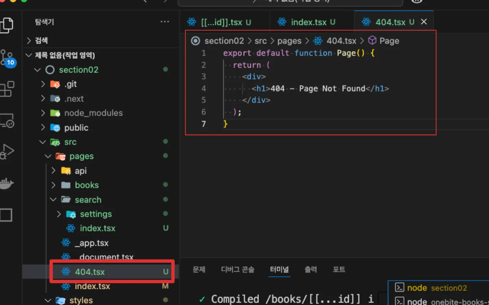

<a id="1e6eda9b0fe1807b8e0ad5ca9285df5f"></a>

<code>404</code> 파일명을 가지는 파일을 생성 후, 해당 파일에 view 로직을 정의한다&#46;

<details>
<summary>&#91; 코드 &#93;</summary>

<a id="1e6eda9b0fe1800bad8ed2f8a0d3ffb4"></a>

```javascript
export default function Page() {
  return (
    <div>
      <h1>404 - Page Not Found</h1>
    </div>
  );
}
```

</details>

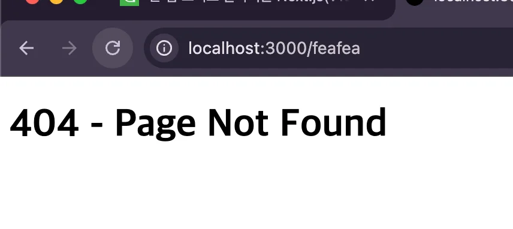

</details>

<a id="1e6eda9b0fe1808286d0c617a3a7b4ef"></a>

### 2&#46; 네비게이팅

> 📖 
> 
> <a id="1e6eda9b0fe1801190ede7312b9386b1"></a>
> 
> Next&#46;js는 React의 장점인 CSR 방식의 빠른 페이지 이동을 계승한다&#46; 
> 
> <a id="1e6eda9b0fe180bc8e8fd7c9ecdc9034"></a>
> 
> 따라서 이번 챕터에서는 <code>Next&#46;js</code>에서는 <strong><u>어떻게 CSR 방식으로 페이지 이동</u></strong>을 하는지를 학습한다&#46;

<details>
<summary>방법1) <code>Link</code> 컴포넌트</summary>

> ✏️ 
> 
> <a id="1e6eda9b0fe1807b98e8e03452c5aeff"></a>
> 
> HTML은 <code>&#60;a/&#62;</code>를 통해서 <u>페이지 이동</u>을 한다&#46; 그러나 이는 CSR가 아닌 즉, 서버에게 매번 해당 페이지를 요청하는 방식으로 동작한다&#46; 
> 
> - 비교적 느리게 동작한다&#46;
> 
> <a id="1e6eda9b0fe18042b35df9c690e74ca0"></a>
> 
> 이를 React 라이브러리에서는 <code>Link</code> 컴포넌트<code>&#60;Link /&#62;</code>를 통해서 CRS 방식으로 페이지 이동을 하는데, 이는 Next&#46;js 에서도 동일 유사하다&#46; ( 내부 동작은 다름 )
> 
> <a id="1e6eda9b0fe1809ab85bf489c892eaf9"></a>
> 
> ```javascript
> import Link from "next/link";
> 
> <Link href={"/"}>index</Link>
> ```

<details>
<summary>&#91; 코드 &#93; App</summary>

<a id="1e6eda9b0fe180d69a03cf24541fd303"></a>

```javascript
import "@/styles/globals.css";
import type { AppProps } from "next/app";
import Link from "next/link";

export default function App({ Component, pageProps }: AppProps) {
  return (
    <>
      <header>
        <Link href={"/"}>index</Link>
      </header>
      <Component {...pageProps} />
    </>
  );
```

</details>

<details>
<summary>확인</summary>

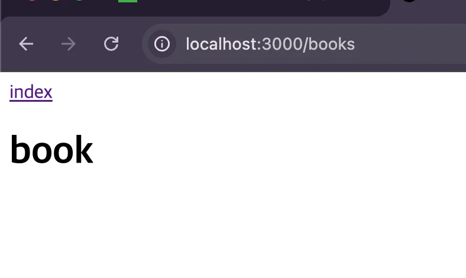

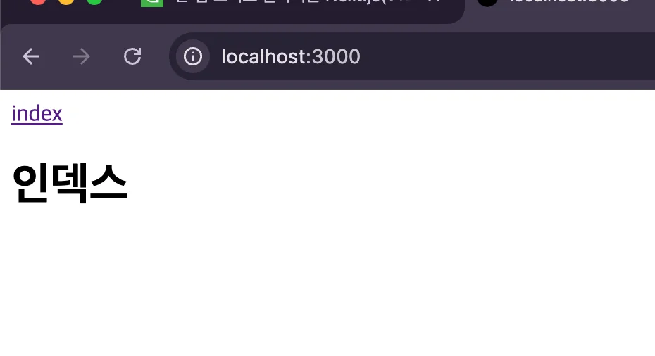

</details>

</details>

<details>
<summary>방법2) 버튼 &#45;  이벤트 함수 ( click ) &#43; <code>useRouter()</code></summary>

> ✏️ 
> 
> <a id="1e6eda9b0fe1805fbaafc6e2193fd6b4"></a>
> 
> <code>useRouter()</code>
> 
> ---
> 
> - <code>push()</code>&#58; 해당 페이지 이동
> 
> - <code>replace()</code>&#58; 뒤로가기 방지
> 
> - <code>back()</code>&#58; 뒤로 가기

<details>
<summary>예제) useRouter()&#46;<code>push()</code></summary>

- &#91; 코드 &#93; App
    <a id="1e6eda9b0fe1804191f3e345a5b10670"></a>

    ```javascript
    import "@/styles/globals.css";
    import type { AppProps } from "next/app";
    import Link from "next/link";
    import { useRouter } from "next/router";

    export default function App({ Component, pageProps }: AppProps) {
      const router = useRouter();

      const onClinckBnt = () => {
        router.push("/books/2");
      };

      return (
        <>
          <header>
            <Link href={"/"}>index</Link>
            <Link href={"/search"}>search</Link>
            <Link href={"/books/1"}>books/1</Link>
            <div>
              <button onClick={onClinckBnt}>/books/2 페이지 이동</button>
            </div>
          </header>
          <Component {...pageProps} />
        </>
      );
    }

    ```

- 해당 버튼 클릭 후 &#45; 페이지 이동 확인
    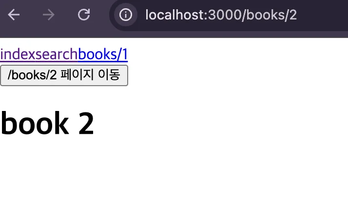

</details>

</details>

<a id="1e6eda9b0fe180e4824de34bf8dfedee"></a>

### 3&#46; 프리페칭 ( Pre&#45;Fetching )

> 📖 
> 
> <a id="1e6eda9b0fe1804a982efc656d1f33c5"></a>
> 
> <strong><code>프리페칭 ( Pre&#45;Fetching )</code></strong>
> 
> ---
> 
> 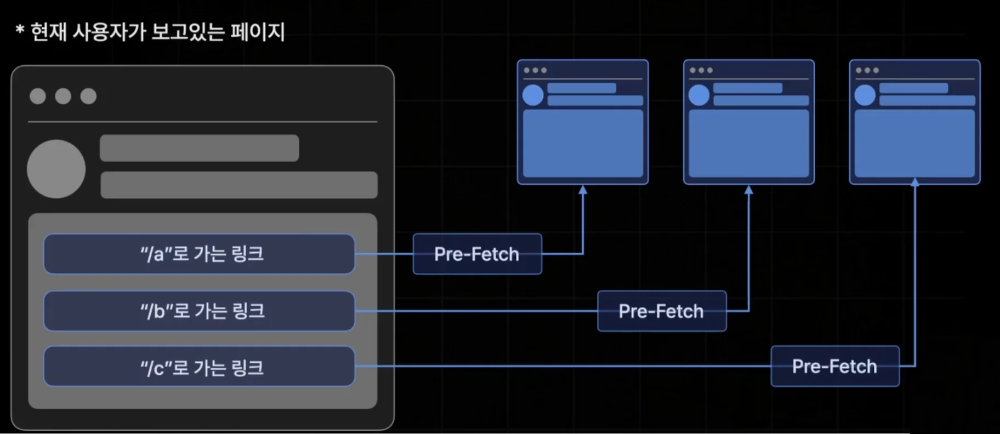
> 
> <a id="1e6eda9b0fe180bd89c0c76abcbaf7dd"></a>
> 
> 초기 렌더링 이후, <strong><u>연결된 모든 페이지의 JS 번들 파일들</u></strong>을 <strong>미리 받아오는 것</strong>을 의미한다&#46;
> 
> - 초기 접속 요청 시, <strong><u>hydration(수화)를 더 빠르게 처리</u></strong>한다&#46;
> 
> - 동시에 <code>pre&#45;fetching</code>을 통해 <strong><u>초기 접속 요청 이후 페이지 이동까지 빠르게 처리</u></strong> 가능하다&#46;

<details>
<summary>🧐 왜 이렇게 동작하는가?</summary>


<a id="1e6eda9b0fe18052b663c2636ae18e22"></a>

<code>Next&#46;js</code> 는 위와 같이 JS 파일을 페이지 별로 분리해서 미리 저장한다&#46;

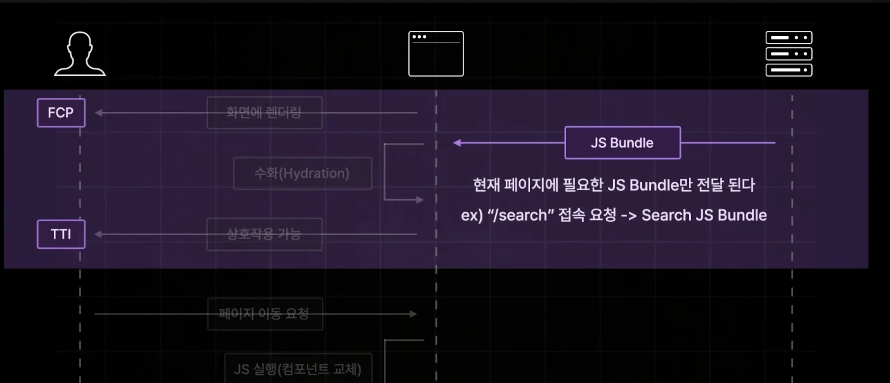

<a id="1e6eda9b0fe1809489a7f6a4add55527"></a>

그리고 페이지 요청 시, <strong>해당 페이지에 필요한 </strong><code>JS Bundle</code><strong>파일들만 전달</strong>한다&#46;  

<a id="1e6eda9b0fe18098b669d7edae12f236"></a>

이렇게 동작하는 이유는 아래와 같다&#46;


- <strong><u>한번에 모든 페이지의 번들 파일을 전달</u></strong>한다면<u> 용량이 너무 커져</u> 자원을 다운로드하는 시간 오래걸린다&#46; 

- 또한  HTML과 JS를 연결하는 <strong><code>Hydration(수화)</code></strong><strong> </strong>과정도 오래 걸리게 된다&#46; 

- 따라서 유저가 처음 페이지와 상호작용 할 수 있는 시간이 늦어진다&#46;<br>즉,  <code>TTI</code>( <code>Time To Interactive</code> ) <strong>늦어진다&#46;</strong>


<a id="1e6eda9b0fe180609720d69fd25aa810"></a>

그래서 <code>NextJS</code>에서는 <strong>해당 페이지의 JS Bundle 파일만 전달</strong>하는 방식으로  <strong><u>Hydration 시간을 줄</u></strong>여 <code>TTI</code>을 단축 시킨다&#46;

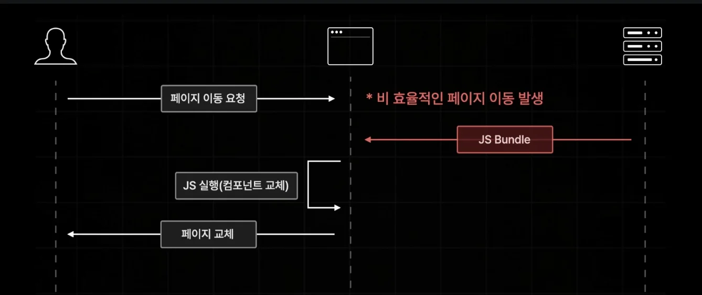

<a id="1e6eda9b0fe180288c52c7af822b0435"></a>

그러나 매번 페이지 요청마다 JS Budle 파일을 요청하면 렌더링의 속도가 느려진다&#46;

<a id="1e6eda9b0fe18065a390dbdbb0d3afef"></a>

따라서 이를 개선하기 위해 나온 방식이<code>프리페칭</code>(<code>Pre&#45;fetching</code>) 이다&#46;

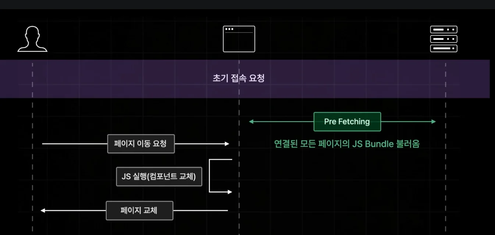

-  초기 페이지 렌더링 이후 연결된 모든 페이지의 JS Bundle 파일을 미리 불러와 실제 요청 시에는 서버에 요청 없이  바로 렌더링 가능하다&#46;
    - 네트워크 I/O 비용 ❌

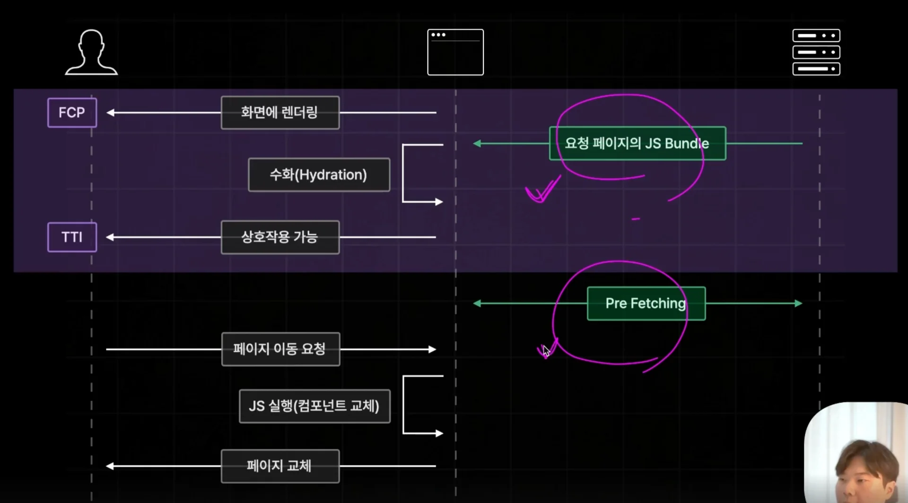

<a id="1e6eda9b0fe180829757de5d03453c67"></a>

현재 요청 페이지의 번들 파일을 제공 후, 링크된 모든 페이지의 번들 파일을 이후에 전달한다&#46; 

- 초기 접속 요청 시, 하드레이션을 더 빠르게 처리한다&#46;

- 동시에 <code>pre&#45;fetching</code>을 통해 초기 접속 요청 이후 페이지 이동까지 빠르게 처리 가능하다&#46;

</details>

<details>
<summary><code>build 확인</code>&#58; 페이지 별로 나눠서 build 함</summary>

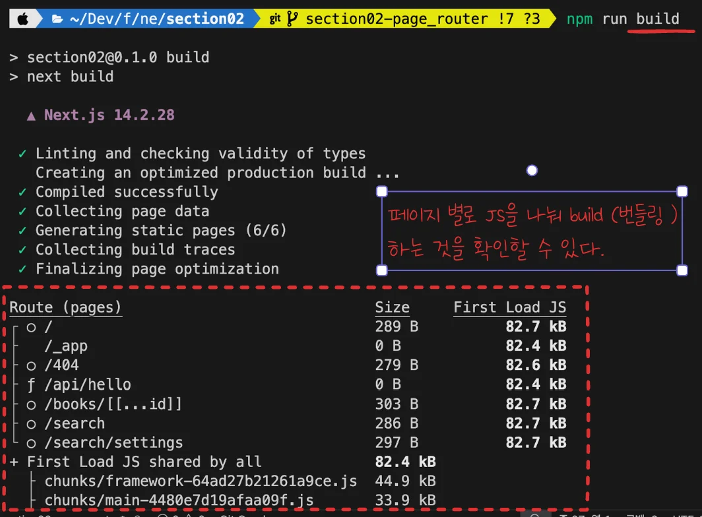

</details>

<details>
<summary>브라우저 네트워크 요청 확인</summary>

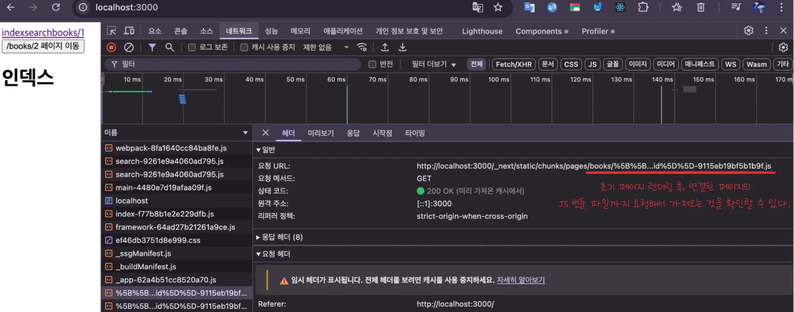

<a id="1e6eda9b0fe1800fb25df8b17fd92375"></a>

초기 요청 시 연결된 페이지의 JS 번들 파일들까지 요청해서 가져오는 것을 확인할 수 있다&#46;

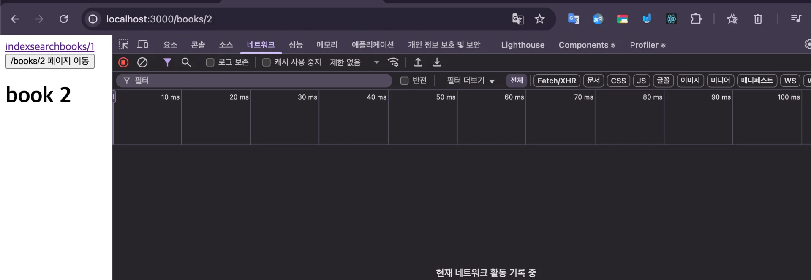

<a id="1e6eda9b0fe18015b4faf544244e3488"></a>

이후 페이지 이동 시, 아무런 요청을 하지 않는 것을 확인할 수 있다&#46;

- 캐시가 만료된 경우 다시 요청을 해서 가져온다&#46;

</details>

<details>
<summary>pre&#45;fetching 수동 요청&#58; <code>useRouter()&#46;prefetch()</code></summary>

> ☝🏻 
> 
> <a id="1e6eda9b0fe18085a658ec49359e1c00"></a>
> 
> <u>Link 컴포넌트 명시한 경로가 </u><strong><u>아닌 경우</u></strong>, pre&#45;fetching이 이뤄지지 않는다&#46; 
> 
> - 방법 2&#58; <code>이벤트 함수</code> &#43; <code>useRouter&#46;push()</code> → <strong><u>수동 요청 필요</u></strong>
> 
> <a id="1e6eda9b0fe1809587cfc8b389d58489"></a>
> 
> <strong>     ⇒ </strong><strong><code>useEffect()</code></strong> &#43; <code>useRouter()</code><strong><code>&#46;prefetch(</code></strong><code>)</code>

<a id="1e6eda9b0fe180959ee4eae68427729c"></a>

```javascript
import "@/styles/globals.css";
import type { AppProps } from "next/app";
import Link from "next/link";
import { useRouter } from "next/router";
import { useEffect } from "react";

export default function App({ Component, pageProps }: AppProps) {
  const router = useRouter();

  const onClinckBnt = () => {
    router.push("/books/2");
  };

  useEffect(() => {
    router.prefetch("/books/2");
  }, []);

  return (
    <>
      <header>
        <Link href={"/"}>index</Link>
        <Link href={"/search"}>search</Link>
        <Link href={"/books/1"}>books/1</Link>
        <div>
          <button onClick={onClinckBnt}>/books/2 페이지 이동</button>
        </div>
      </header>
      <Component {...pageProps} />
    </>
  );
}
```

</details>

<details>
<summary>Link 컴포넌트 &#45; pre&#45;fetching 요청 막기</summary>

> ✏️ 
> 
> <a id="1e6eda9b0fe180d4b8c5d365b642c3b5"></a>
> 
> <code>&#60;Link /&#62;</code> 는 pre&#45;fetching이 기본으로 제공된다&#46;
> 
> <a id="1e6eda9b0fe180c3b689da0ebdf4eb04"></a>
> 
> 이를 막고 싶으면 <code>prefetch={false}</code> props를 넘기면된다&#46;

<a id="1e6eda9b0fe1800dbad1dd02161e087b"></a>

```javascript
. . .  

<header>
  <Link href={"/"}>index</Link>
  <Link href={"/search"} prefetch={false}>
    search
  </Link>
  <Link href={"/books/1"}>books/1</Link>
        
. . .  
```

</details>

<a id="1e6eda9b0fe18080abb5d84c7d366db4"></a>

### 4&#46; API Routes

> 📖 
> 
> <a id="1e6eda9b0fe1807b8267e746e3f874a6"></a>
> 
> <strong><code>API Routes</code></strong>
> 
> ---
> 
> <a id="1e6eda9b0fe1801d9351f45dab551d02"></a>
> 
> Next&#46;js 앱에서 API 구축을 가능하게 만들어주는 기능이다&#46;
> 
> - 간단하게 API를 구축하여 사용자로부터 요청을 받아 DB에서 데이터 조회 가능
> 
> - 다른 서드파티에서 데이터를 불러와 전달 가능

<details>
<summary>api 경로 매핑</summary>

> ✏️ 
> 
> <a id="1e6eda9b0fe180ec8902e297aba1740f"></a>
> 
> controller를 따로 만들 필요없이 <strong><u>pages/api 폴더</u></strong>에서 <u>요청, 응답 내용을 정의</u>하면 <code>NestJS</code>에서 <strong><u>자동으로 API 매핑 및 동작을 처리</u></strong>해준다&#46;

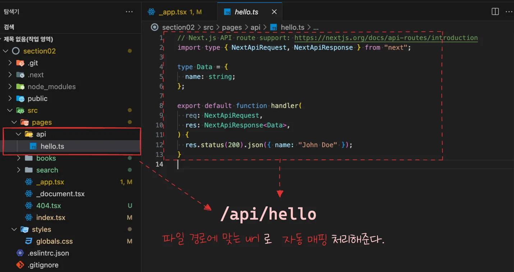

- 요청 URI&#58; <code>http&#58;//localhost&#58;3000/api/hello</code>
    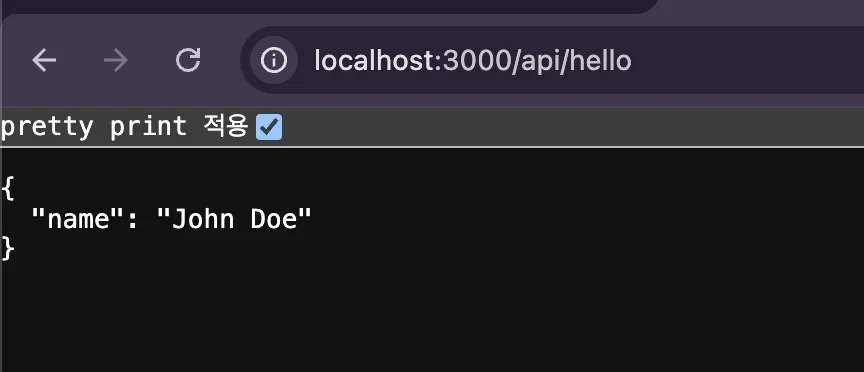

</details>

<details>
<summary>실습&#58; API 생성 ( 요청 URI&#58; <code>/api/time</code>, 응답&#58; <code>time&#58; string</code> )</summary>

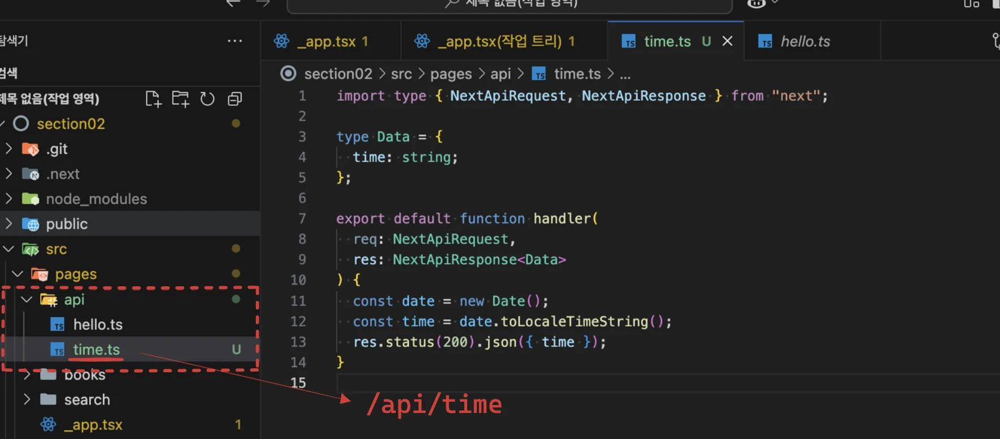

<details>
<summary>&#91; 코드 &#93;</summary>

<a id="1e6eda9b0fe18015a1a1d8ab9f855486"></a>

```javascript
import type { NextApiRequest, NextApiResponse } from "next";

type Data = {
  time: string;
};

export default function handler(
  req: NextApiRequest,
  res: NextApiResponse<Data>
) {
  const date = new Date();
  const time = date.toLocaleTimeString();
  res.status(200).json({ time });
}
```

</details>

<a id="1e6eda9b0fe180219ef6f11dcc24cfb6"></a>

API 요청 확인

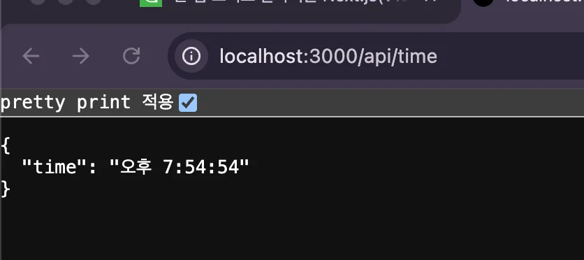

</details>

<a id="1e6eda9b0fe180fe9c7ed9fe0886d432"></a>

### 5&#46; 스타일링 

> 📖 
> 
> <a id="1e6eda9b0fe180f2a55ae1ef80a11d8d"></a>
> 
> NextJS  &#45; CSS 작성 방법 

<details>
<summary><strong>&#91; ⚠️  주의 &#93;</strong> 페이지 마다 <code>&#46;css</code> 파일 <strong><u>import 불가</u></strong></summary>

> ⚠️ 
> 
> <a id="1e6eda9b0fe180b2b567f9f8420286e7"></a>
> 
>  페이지 마다 <code>&#46;css</code> 파일 <strong><u>import 불가</u></strong>
> 
> ---
> 
> <a id="1e6eda9b0fe180058f46ef16e54e7835"></a>
> 
> css 파일 내 <strong><u> </u></strong><strong><u>css 식별자 명 충돌을 방지</u></strong>하기 위해 <code>Next&#46;js</code>에서는 <strong><u>컴포넌트 </u></strong>마다 <strong><u>CSS 파일</u></strong>을 <strong><code>import</code></strong> 하는 것이 <strong><u>막아</u></strong><strong> 놓았다&#46;</strong>

<details>
<summary>예외적으로 모든 컴포넌트의 부모인 <code>App 컴포넌트</code>에서는 <code>globals&#46;css</code> 파일 허용한다&#46;</summary>

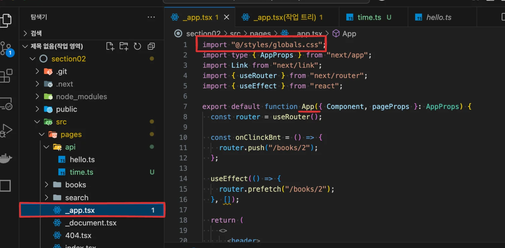

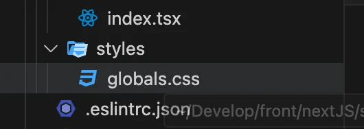

</details>

</details>

<details>
<summary><strong><code>방법1</code></strong>&#58; 태그에 직접 <strong><u>CSS</u></strong> 지정 &#45; <code>style={{&#46;&#46;&#46;}}</code></summary>

> 리액트와 동일

<a id="1e6eda9b0fe18064b574c179c49c2d2f"></a>

```javascript
export function Home() {
	return <h1 style={{ color: "red" }}>인덱스</h1>;
}
```

</details>

<details>
<summary><strong><code>방법2</code></strong>&#58; Next&#46;js 제공하는 <strong><code>CSS 모듈</code></strong> 활용</summary>

> ✏️ 
> 
> <a id="1e6eda9b0fe180a1948ac2d317b6eb58"></a>
> 
> <strong><code>Next&#46;js</code></strong>가 제공하는 CSS 모듈(<code>&#46;module&#46;css</code>  파일)을 활용하면 
> 
> <a id="1e6eda9b0fe180d2b900e0aac1e57ebe"></a>
> 
> 해당 되는 <code>&#46;module&#46;css</code> 파일 안에 들어있는 <strong><u>모든 클래스 네임들</u></strong>이 <strong>자동으로 </strong><strong><u>유니크한 값으로 변환</u></strong>이 되어서 <code>style</code>이라는<strong><u> 객체 안에 저장</u></strong> 된다&#46;<br><br>이를 통해, CSS 클래스 네임 중복 문제를 해결한다&#46;

<details>
<summary>1&#46; <code>&#46;module&#46;css</code> 파일 생성</summary>

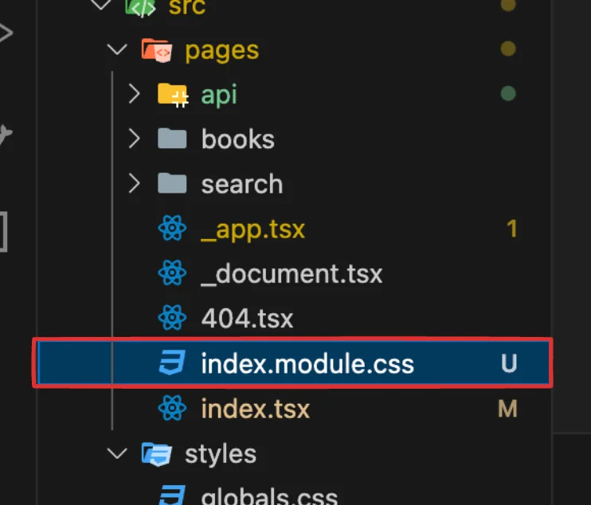

- <code>index&#46;module&#46;css</code>
    <a id="1e6eda9b0fe1801489f2d1a2d229ae38"></a>

    ```css
    .h1 {
    	color: red;
    }

    .h2 {
    	color: blue;
    }
    ```

</details>

<details>
<summary>2&#46; 컴포넌트에 <code>&#46;module&#46;css</code> 파일 <strong><u>import</u></strong> </summary>

<a id="1e6eda9b0fe18082bd23ed99a744adc5"></a>

```javascript
import style from "./index.module.css"; // Next.js가 style 객체 안에 유니크한 값으로 저정한다..
 
export default function Home() {
  return (
    <>
      <h1 className={style.h1}>인덱스</h1>  {/* 빨간색 글자*/}
      <h1 className={style.h2}>인덱스</h1>  {/* 파란색 글자 */}
    </>
  );
}

```

</details>

</details>

<a id="1e6eda9b0fe18056a5def840ff082976"></a>

### 6&#46; 글로벌 레이아웃 설정

> 📖 
> 
> <a id="1e6eda9b0fe180a18d58cff975e60cb1"></a>
> 
> <code>Next&#46;js</code> 앱 <strong><u>모든 페이지</u></strong><strong>에 </strong><strong><u>일괄</u></strong><strong>적으로 적용</strong>되는 <strong><u>글로벌 CSS</u></strong> 설정
> 
> 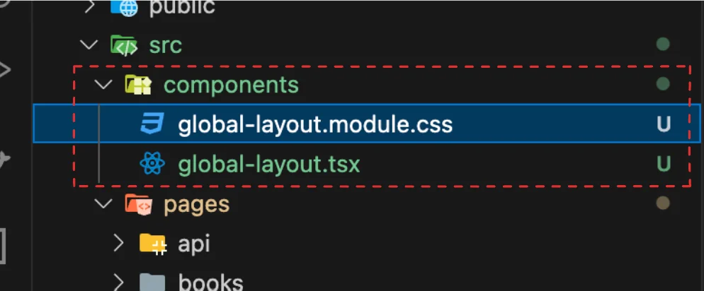
> 
> - <strong><u>root 폴더 아래</u></strong>에 <code>components</code> 폴더 생성 후, 해당 내용을 정의한다&#46; 

<details>
<summary>&#91; 코드 &#93; &#95;app&#46;tsx</summary>

<a id="1e6eda9b0fe180c2931ce56043098484"></a>

```javascript
import "@/styles/globals.css";
import type { AppProps } from "next/app";
import GlobalLayout from "@/components/global-layout";

export default function App({ Component, pageProps }: AppProps) {
  return (
    <div>
      <GlobalLayout>
        <Component {...pageProps} />
      </GlobalLayout>
    </div>
  );
}
```

</details>

<details>
<summary>&#91; 코드 &#93; global&#45;layout&#46;tsx</summary>

<a id="1e6eda9b0fe18072aff6fdbd9c1ed46c"></a>

```javascript
import Link from "next/link";
import style from "./global-layout.module.css";

export default function GlobalLayout({
  children,
}: {
  children: React.ReactNode;
}) {
  return (
    <div className={style.container}>
      <header className={style.header}>
        <Link href={"/"}>📚 ONEBITE BOOKS</Link>
      </header>
      <main className={style.main}>{children}</main>
      <footer className={style.footer}>제작 @LEE</footer>
    </div>
  );
}

```

</details>

<details>
<summary>&#91; 코드 &#93; global&#45;layout&#46;module&#46;css</summary>

<a id="1e6eda9b0fe180ebbd26fbd21e1d721d"></a>

```css
.container {
  position: relative;
  background-color: white;
  max-width: 600px;
  min-height: 100vh;
  margin: 0 auto;
  box-shadow: rgba(100, 100, 100, 0.2) 0px 0px 29px 0px;
  padding: 0 15px;
}

.header {
  position: fixed;
  padding: 10px 0;
  text-decoration: none;
}

.header > a {
  color: inherit;
  text-decoration: none;
  font-weight: bold;
  font-size: 18px;
  line-height: 60px;
  cursor: pointer;
}

.main {
  padding-top: 10px;
}

.footer {
  position: absolute;
  bottom: 0;
  width: 100%;
  text-align: center;
  padding-bottom: 10px;
  color: grey;
}

```

</details>

---

<details>
<summary>적용된 레이아웃</summary>

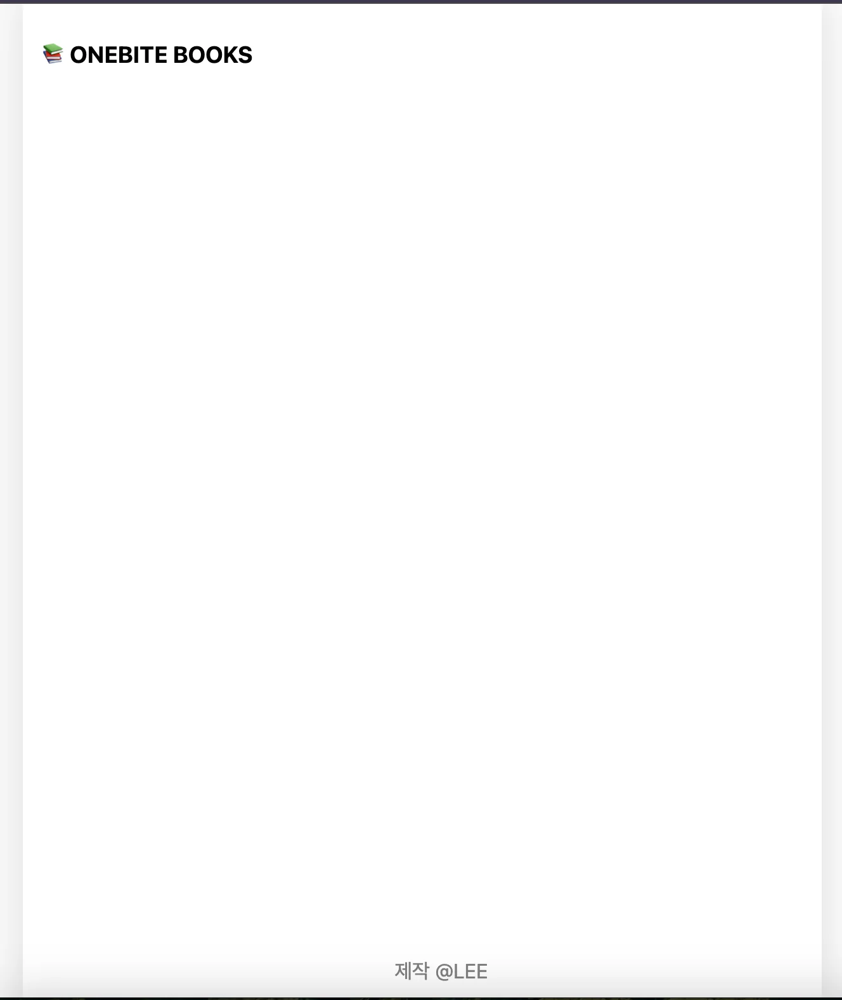

</details>

<a id="1e6eda9b0fe1805e9b7ecbf53a5b0eac"></a>

### 7&#46; 페이지별 레이아웃 설정

> 📖 
> 
> <a id="1e8eda9b0fe1801fa3e5fa5b5c91c841"></a>
> 
> <code>App</code> 컴포넌트의 <code>Component</code>인자는 <strong><u>현재 라우트에 해당</u></strong><strong><u>하는 </u></strong><strong><u>페이지 컴포넌트</u></strong>를 <strong><u>Next&#46;js가 자동으로 주입</u></strong>시키는 값이다<strong>&#46;</strong>
> 
> <a id="1e8eda9b0fe180e68dc2d88181035416"></a>
> 
> 따라서 App 컴포넌트를 통해 각 페이지에 공통된 레이아웃이나 설정을 적용할 수 있다&#46;
> 
> <a id="1e8eda9b0fe180848837de5069d9cc4c"></a>
> 
> 이때, <strong><u>getLayout 패턴</u></strong>을 사용하면 <strong><u>각 페이지마다 다른 레이아웃을 선택적으로 설정</u></strong> 가능하다&#46;

<details>
<summary>🧐 최상의 컴포넌트인 <code>App</code>의 <code>Component</code> 인자</summary>

<a id="1e8eda9b0fe1808ba154e3f6810cf3a2"></a>

Next&#46;js에서는 <code>pages</code> 폴더 구조를 기반으로 라우팅를 자동 설정한다&#46;

<a id="1e8eda9b0fe180c0aac1f89527f56efa"></a>

이에 대한 내부 동작은 아래와 같다&#46;

<a id="1e8eda9b0fe18089ae6ac67e45725e89"></a>

<strong>예시 폴더 구조</strong>

<a id="1e8eda9b0fe18026834fdb35a8288c26"></a>

```javascript
pages/
  ├── index.tsx           => "/"
  ├── about.tsx           => "/about"
  └── posts/
      └── [id].tsx        => "/posts/123"
```

<a id="1e8eda9b0fe1803dae61f722ccd23c47"></a>

<strong>요청 흐름</strong>

1. 사용자가 /about 요청

1. Next&#46;js에서 pages/about&#46;tsx 파일 찾음

1. <code>App</code> → <code>abous&#46;tsx</code> 가 렌더링됨
    <a id="1e8eda9b0fe180ee916bc2b1bcff5df2"></a>

    ```javascript
    export default function App({ Component, pageProps }: AppProps) {
      return <Component {...pageProps} />;
    }
    ```

    - 여기서 <code>Component</code>는  <code>about&#46;tsx</code> 페이지 컴포넌트를 의미한다&#46;

</details>

<details>
<summary>일부 페이지만 <strong><u>컴포넌트 조건적 렌더링</u></strong></summary>

<a id="1e8eda9b0fe18072be2fc489f2fd224f"></a>

### <strong>배경</strong>

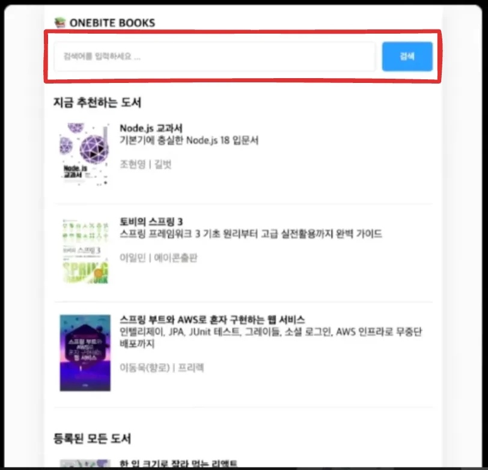

- index(기본) 페이지

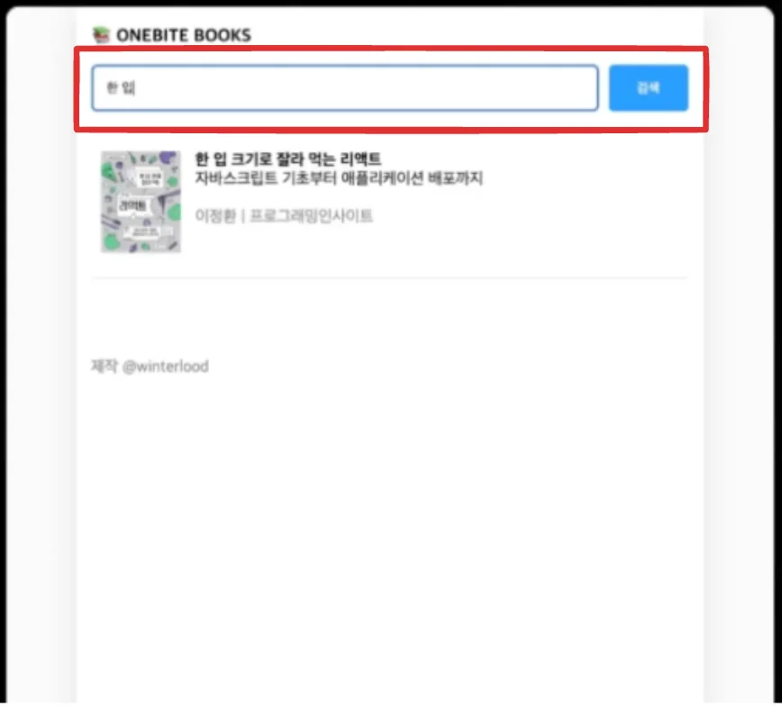

- Search (검색) 페이지


- Detail (상세) 페이지

<a id="1e6eda9b0fe1806ba934ec712df98de6"></a>

위 3개의 레이아웃 중, <u>검색 컴포넌트</u>는 <strong><u>Detail(상세) 페이지에서 보이지 않</u></strong>는다&#46;

<a id="1e6eda9b0fe1809dbce8f5a3d39c11bb"></a>

즉, <strong><u>특정 페이지</u></strong><strong><u>에서만 해당 </u></strong><strong><u>컴포넌트를 조건적으로 렌더링</u></strong> 시켜야한다&#46; 

<a id="1e6eda9b0fe18090984bfdd128a84123"></a>

### 코드

> ✏️ 
> 
> <a id="1e8eda9b0fe18085855ef5d895c286f4"></a>
> 
> 자바스크립트의 함수는 모무 객체이다&#46; 조건적으로 렌더링 해야하는 컴포넌트를  <strong><u>해당 페이지에 getLayout 메서드로 정의</u></strong>하면 <br>최상위 App 컴포넌트에서 불러와 <strong><u>특정 페이지에만 조건적으로 렌더링</u></strong> 시킬 수 있다&#46; 
> 
> - Component 객체 내부에 정의되어 같이 넘어온다&#46;

<details>
<summary>&#91; 코드 &#93; App</summary>

<a id="1e6eda9b0fe1805d87bdca53e6e834cb"></a>

```java
import "@/styles/globals.css";
import type { AppProps } from "next/app";
import GlobalLayout from "@/components/global-layout";
import { ReactNode } from "react";
import { NextPage } from "next";

// type NextPageWithLayout = AppProps & {
//   getLayout?: (page: ReactNode) => ReactNode;
// };

type NextPageWithLayout = NextPage & {
  getLayout?: (page: ReactNode) => ReactNode;
};

export default function App({
  Component,
  pageProps,
}: AppProps & {
  Component: NextPageWithLayout;
}) {
  const getLayout = Component.getLayout ?? ((page: ReactNode) => page);

  return (
    <div>
      <GlobalLayout>{getLayout(<Component {...pageProps} />)}</GlobalLayout>
    </div>
  );
}

```

</details>

<details>
<summary>&#91; 코드 &#93; Home </summary>

<a id="1e8eda9b0fe180feaf53f0131b8b510e"></a>

```java
import SearchableLayout from "@/components/searchable-layout";
import React from "react";

export default function Home() {
  return <></>;
}


// getLayout 패턴: 조건적 컴포넌트 렌더링
Home.getLayout = (page: React.ReactNode) => {
  return <SearchableLayout>{page}</SearchableLayout>;
};

```

</details>

<details>
<summary>&#91; 코드 &#93; Search</summary>

<a id="1e8eda9b0fe18056a2e9c261c6331fa5"></a>

```java
import SearchableLayout from "@/components/searchable-layout";

export default function Search() {
  return (
    <>
      <h1>검색</h1>
    </>
  );
}

// getLayout 패턴: 조건적 컴포넌트 렌더링
Search.getLayout = (page: React.ReactNode) => {
  return <SearchableLayout>{page}</SearchableLayout>;
};

```

</details>

---

<details>
<summary><code>App</code> &#45; <code>Component&#46;getLayout</code> 출력</summary>

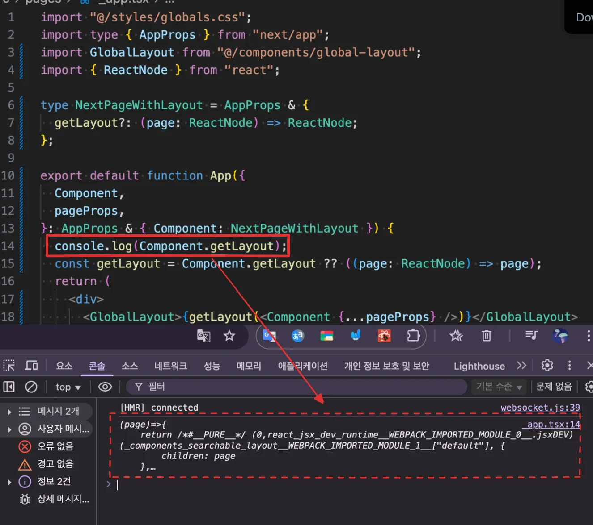

</details>

<details>
<summary>자바스크립트의 <strong><u>모든 함수</u></strong>는 <code>객체</code>이다&#46;  따라서 <strong><u>함수</u></strong><strong>에 </strong><strong><u>메서드 추가</u></strong><strong> 가능</strong>하다&#46;</summary>

> ‣

- 함수에 메서드 추가 정의
    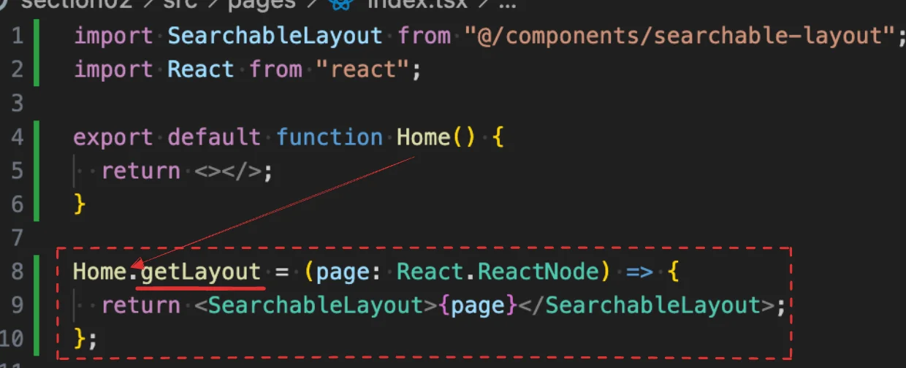

- 하위 컴포넌트에서 해당 메서드 출력 가능
    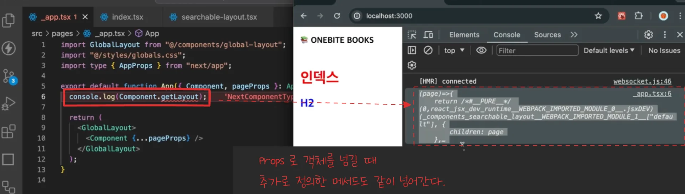

    <a id="1e6eda9b0fe180cdbb2ec243ac129779"></a>

    해당되는 라우팅 페이지의 Component 인자에서 추가로 정의한 <code>getLayout()</code> 메서드가 출력되는 것을 확인할 수 있다&#46;

</details>

</details>

<details>
<summary>&#91; Feat &#93; SearchBar </summary>

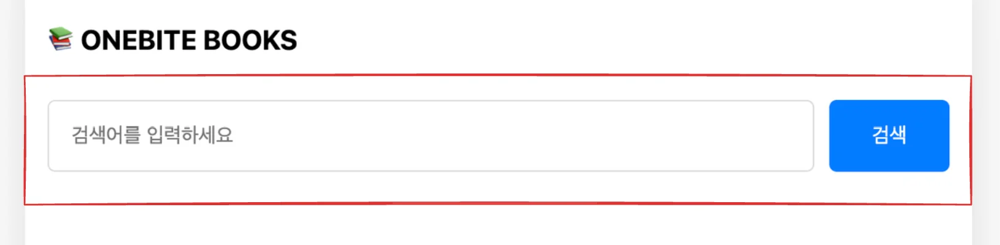

<details>
<summary>&#91; 코드 &#93; SearchableLayout&#46;tsx</summary>

> ✏️ 
> 
> 1. input 입력값 state로 저장 
>     - 이벤트&#58; <code>onChange</code>
> 
>     - 훅&#58; <code>useState()</code>
> 
> <a id="1e8eda9b0fe1800ba5c4ed9a5af8b98b"></a>
> 
> 2&#46; sumit 이벤트 시 라우터 설정
> 
> - 이벤트&#58; <code>onClick</code>, <code>onKeyDown</code>
> 
> - 훅&#58; <code>useRouter()</code>
> 
> 1. 라우팅 경로 값 input value에 고정
>     - 훅&#58; <code>useRouter()</code>, <code>useEffect()</code>
> 
> 1. 예외처리
>     - input 입력값이 <code>null</code> 이거나, 라우팅 경로랑 같은 경우 <br>렌더링 ❌

<a id="1e8eda9b0fe1806b81ecd01a164330d5"></a>

```javascript
import { ReactNode, useEffect, useState } from "react";
import { useRouter } from "next/router";
import style from "./searchable-layout.module.css";

export default function SearchableLayout({
  children,
}: {
  children: ReactNode;
}) {
  const [search, setSearch] = useState("");

  const router = useRouter();
  const q = router.query.q as string;

  useEffect(() => {
    setSearch(q || "");
  }, [q]);

  const onChangeSearch = (e: React.ChangeEvent<HTMLInputElement>) => {
    setSearch(e.target.value);
  };

  const onSubmit = () => {
    if (!search || q === search) return;
    router.push(`/search?q=${search}`);
  };

  const onKeyDown = (e: React.KeyboardEvent<HTMLInputElement>) => {
    if (e.key === "Enter") onSubmit();
  };

  return (
    <div>
      <div className={style.searchable_wrapper}>
        <input
          value={search}
          onKeyDown={onKeyDown}
          onChange={onChangeSearch}
          type="text"
          placeholder="검색어를 입력하세요"
        ></input>
        <button onClick={onSubmit}>검색</button>
      </div>
      {children}
    </div>
  );
}

```

</details>

<details>
<summary>&#91; 코드 &#93; searchable&#45;layout&#46;module&#46;css</summary>

<a id="1e8eda9b0fe180078ce1d1a27f069fa9"></a>

```css
.searchable_wrapper {
  display: flex;
  gap: 10px;
  margin-bottom: 20px;
}

.searchable_wrapper > input {
  flex: 1;
  padding: 15px;
  border-radius: 5px;
  border: 1px solid rgb(220, 220, 220);
}

.searchable_wrapper > button {
  width: 80px;
  border-radius: 5px;
  border: none;
  background-color: #007bff;
  color: white;
  cursor: pointer;
}

.searchable_wrapper > button:hover {
  background-color: #0056b3;
  box-shadow: 0 0 5px rgba(0, 0, 0, 0.2);
}

```

</details>

<details>
<summary>🧐 <code>flex&#58; 1</code></summary>

<a id="1e8eda9b0fe1804e9d52f503e2d1e74d"></a>

<a href="https://beautiful-college-c84.notion.site/1e8eda9b0fe1806ca3c2f79819a6cce8">페이지</a> 

</details>

</details>

<a id="1e8eda9b0fe18059a879cf94ecf8ae34"></a>

### 8&#46; 한입 북스 UI 구현

> 📖 
> 
> <a id="1e8eda9b0fe180de8ddff99783a69014"></a>
> 
> 이후 개념학습 시, CSS 구현과 개념 학습 사이의  switching 비용을 줄이기 위해 미리 UI 구현함

<details>
<summary>🧐 path&#58; <code>&#64;</code></summary>

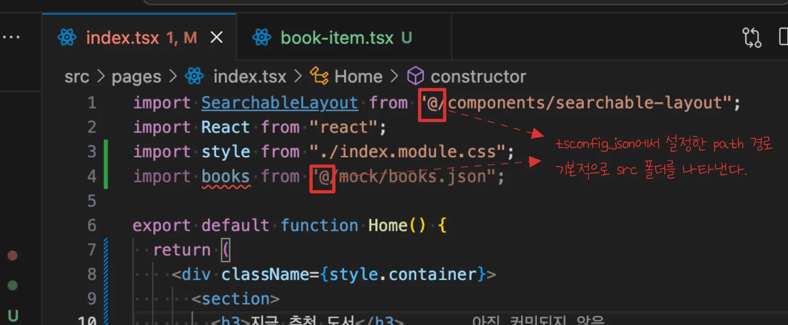

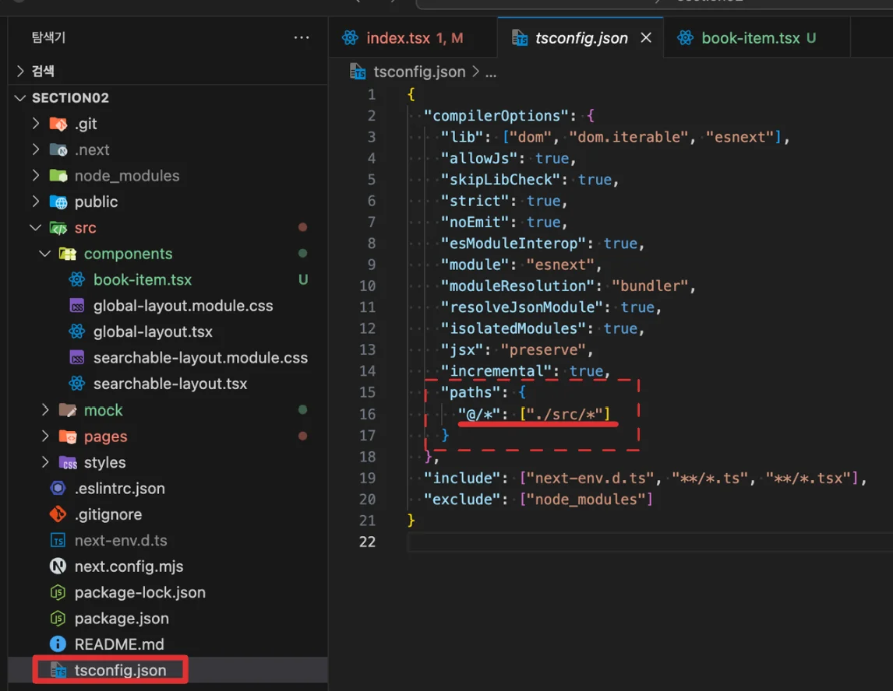

</details>

<details>
<summary>UI 구현</summary>

<a id="1e8eda9b0fe1805a809cc9fa3d5eb12f"></a>

### 코드

[2.9: 한입 북스 UI 구현](https://github.com/gyungsubLee/NextJS_prac/commit/85a11d95d38f6d608964ddd746d232f617b3108b)

<details>
<summary>0&#46; BookDate 타입 정의  &#45; interface </summary>

- src 경로 하위에 <code>types&#46;ts</code> 파일 생성
    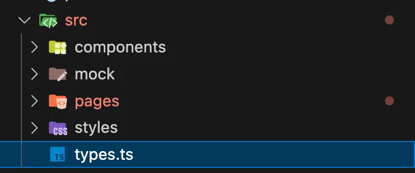

- 응답으로 가져오는 Book 데이터 타입 정의
    <a id="1e8eda9b0fe1803185edf129da016968"></a>

    ```javascript
    export interface BookData {
      id: number;
      title: string;
      subTitle: string;
      author: string;
      publisher: string;
      description: string;
      coverImgUrl: string;
    }
    ```

</details>

<details>
<summary>1&#46;  Mock(가짜) 데이터 생성</summary>

- 루트(src) 경로 하위에 <code>mock/books&#46;json</code>  생성
    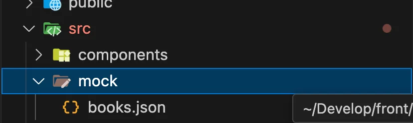

- UI 작업을 위한 <strong><u>실제 응답 포맷과 동일</u></strong>한 가짜 객체 설정
    <a id="1e8eda9b0fe18044a7c5cab769660dad"></a>

    ```javascript
    [
      {
        "id": 1,
        "title": "한 입 크기로 잘라 먹는 리액트",
        "subTitle": "자바스크립트 기초부터 애플리케이션 배포까지",
        "description": "자바스크립트 기초부터 애플리케이션 배포까지\n처음 시작하기 딱 좋은 리액트 입문서\n\n이 책은 웹 개발에서 가장 많이 사용하는 프레임워크인 리액트 사용 방법을 소개합니다. 인프런, 유데미에서 5000여 명이 수강한 베스트 강좌를 책으로 엮었습니다. 프런트엔드 개발을 희망하는 사람들을 위해 리액트의 기본을 익히고 다양한 앱을 구현하는 데 부족함이 없도록 만들었습니다. \n\n자바스크립트 기초 지식이 부족해 리액트 공부를 망설이는 분, 프런트엔드 개발을 희망하는 취준생으로 리액트가 처음인 분, 퍼블리셔나 백엔드에서 프런트엔드로 직군 전환을 꾀하거나 업무상 리액트가 필요한 분, 뷰, 스벨트 등 다른 프레임워크를 쓰고 있는데, 실용적인 리액트를 배우고 싶은 분, 신입 개발자이지만 자바스크립트나 리액트 기초가 부족한 분에게 유용할 것입니다.",
        "author": "이정환",
        "publisher": "프로그래밍인사이트",
        "coverImgUrl": "https://shopping-phinf.pstatic.net/main_3888828/38888282618.20230913071643.jpg"
      },
      {
        "id": 2,
        "title": "러닝스쿨! 자바스크립트 첫걸음",
        "subTitle": "처음 프로그래밍을 시작하는 입문자의 눈높이에 맞춘",
        "description": "실무에 꼭 필요한 자바스크립트 필수 지식과 핵심 기술을 가장 쉽게 설명한 입문서!\n\n《러닝스쿨! 자바스크립트 첫걸음》은 자바스크립트의 기초부터 프런트엔드 개발의 최신 트렌드까지 웹 개발을 시작하려는 분들에게 필수적인 지식을 제공하는 책입니다. 현재 가장 인기 있는 기술인 React.js와 Next.js를 배우고 싶은 초보자부터, 이미 이 기술들을 다루고 있는 개발자 모두에게 적합합니다. \n\n실무에서 자주 사용되는 문법들을 위주로, 이해하기 쉬운 예제와 명확한 설명으로 기초적인 개념부터 심화 내용까지 단계별로 배울 수 있고, 이를 활용해 프로젝트를 개발하는 과정까지 다양한 예제와 친절한 설명으로 쉽게 이해할 수 있도록 도와주는 책입니다. 《러닝스쿨! 자바스크립트 첫걸음》을 통해 웹 개발에 첫걸음을 내딛어 보길 바랍니다.",
        "author": "김효빈",
        "publisher": "위키북스",
        "coverImgUrl": "https://shopping-phinf.pstatic.net/main_4731061/47310617618.20240426090954.jpg"
      },
      {
        "id": 7,
        "title": "이펙티브 타입스크립트",
        "subTitle": "동작 원리의 이해와 구체적인 조언 62가지",
        "description": "타입스크립트는 타입 정보를 지닌 자바스크립트의 상위 집합으로, 자바스크립트의 골치 아픈 문제점들을 해결해 준다. 이 책은 《이펙티브 C++》와 《이펙티브 자바》의 형식을 차용해 타입스크립트의 동작 원리, 해야 할 것과 하지 말아야 할 것에 대한 구체적인 조언을 62가지 항목으로 나누어 담았다.\n각 항목의 조언을 실제로 적용한 예제를 통해 연습하다 보면 타입스크립트를 효율적으로 사용하는 방법을 익힐 수 있다. 타입스크립트를 기초적인 수준에서만 활용했다면 이 책을 통해 타입스크립트 전문가로 거듭나 보자.\n\n이 책에서 다루는 내용\nㆍ 타입스크립트의 타입 시스템에 대한 자세한 이해\nㆍ 안전하고 명료한 코드를 작성할 수 있는 타입 설계\nㆍ 최소한의 타입 구문으로 완전한 안전성을 얻을 수 있는 타입 추론\nㆍ any 타입의 전략적 사용\nㆍ 의존성과 타입 선언 파일이 동작하는 원리\nㆍ 자바스크립트를 타입스크립트로 마이그레이션하는 방법",
        "author": "댄 밴더캄",
        "publisher": "인사이트",
        "coverImgUrl": "https://shopping-phinf.pstatic.net/main_3247334/32473346832.20221227204218.jpg"
      }
    ]
    ```

- import 
    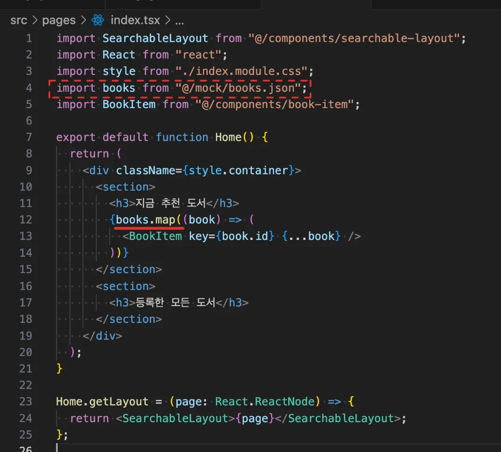

    - <code>&#64;</code>&#58;  root 경로

    - <strong><code>export</code></strong><strong>를 </strong><strong><u>하지 않</u></strong>아도 <code>default</code> 형태로 가져와 사용 가능하다&#46; 

</details>

<details>
<summary>2&#46; 공통(<code>book&#45;item</code>) 컴포넌트 정의 </summary>

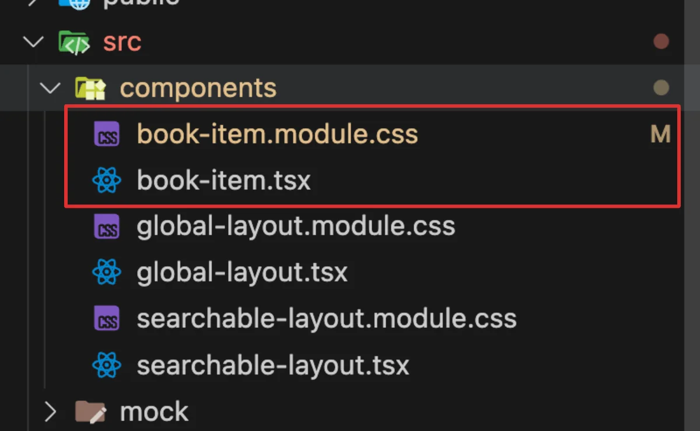

<details>
<summary>&#91; 코드 &#93; <code>book&#45;item&#46;tsx</code></summary>

<a id="1e8eda9b0fe180fca8f8cea633d5123c"></a>

```javascript
import Link from "next/link";
import Image from "next/image";
import style from "./book-item.module.css";
import { BookData } from "@/types";

export default function BookItem(book: BookData) {
  return (
    <Link href={`books/${book.id}`} className={style.booItem_container}>
      <div className={style.img_container}>
        <Image
          src={book.coverImgUrl}
          alt={book.title}
          width={120}
          height={150}
          className={style.bookItem_coverImg}
        />
      </div>
      <div className={style.text_container}>
        <p className={style.title}>{book.title}</p>
        <p className={style.sub_title}>{book.subTitle}</p>
        <p className={style.author}>
          {book.author} | {book.publisher}
        </p>
      </div>
    </Link>
  );
}
```

</details>

<details>
<summary>&#91; 코드 &#93; <code>book&#45;item&#46;module&#46;css</code></summary>

<a id="1e8eda9b0fe180cbb89ccadb24f9fefd"></a>

```css
.container {
  display: flex;
  flex-direction: column;
  height: 100%;
  text-align: center;
}

.cover_img_container {
  display: flex;
  justify-content: center;
  padding: 20px;
  border-radius: 10px;

  background-position: center;
  background-repeat: no-repeat;
  background-size: cover;

  height: 250px;
  position: relative;
}

.cover_img_container::before {
  position: absolute;
  border-radius: 10px;
  top: 0;
  left: 0;
  background-color: rgba(0, 0, 0, 0.5);
  width: 100%;
  height: 100%;
  content: "";
}

.cover_img_container > img {
  height: 100%;
  width: auto;
  object-fit: cover;
  z-index: 1;
}

.title {
  border-bottom: 1px solid rgba(0, 0, 0, 0.2);
  margin: 0 5%;
  padding: 20px 0;
}

.sub_title {
  color: rgba(0, 0, 0, 0.9);
  line-height: 1.8;
  letter-spacing: 0.3px;
}

.description {
  font-size: 13px;
  font-weight: 400;
  line-height: 1.8;
  letter-spacing: 0.3px;
  color: #444;
}

.author {
  font-size: 13px;
  font-weight: bold;
  line-height: 1.8;
  letter-spacing: 0.3px;
  color: rgba(0, 0, 0, 0.5);
  margin: 30px 0 20px 0;
}

```

</details>

</details>

<details>
<summary>3&#46; 기본(index) 페이지</summary>

<a id="1e8eda9b0fe1805abeb9efe52a2e54e7"></a>

<strong>레이아웃</strong>

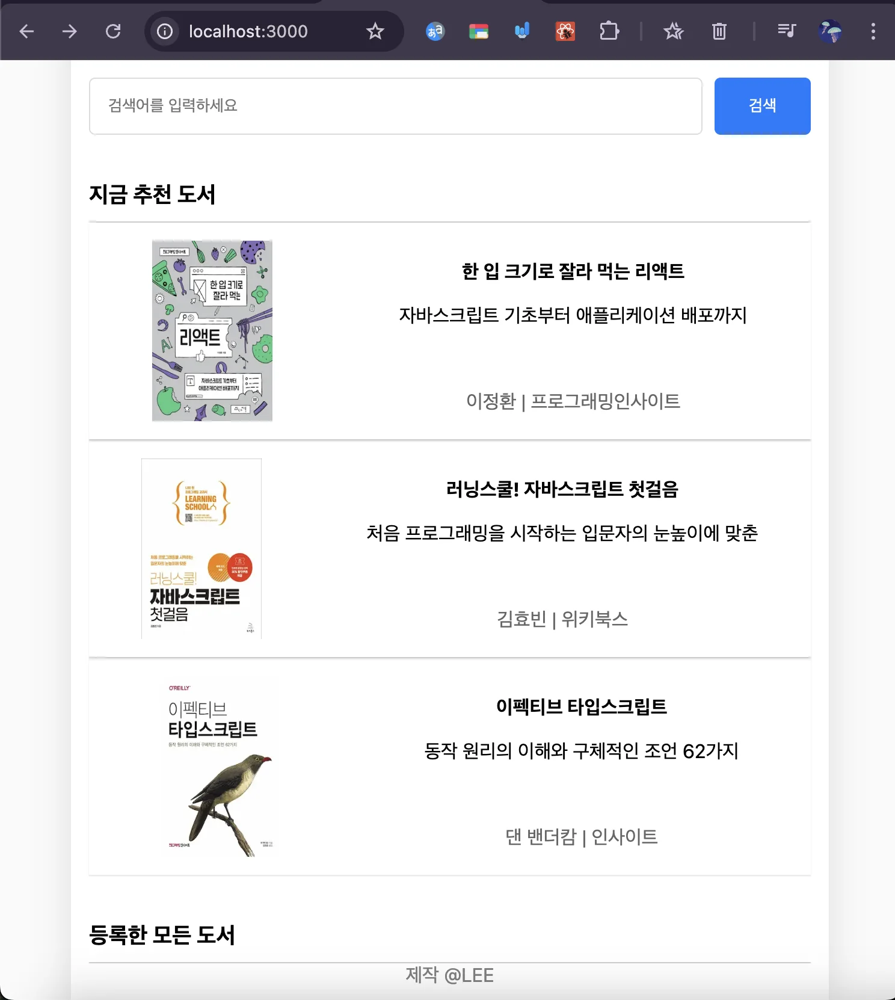

<details>
<summary>&#91; 코드 &#93; <code>index&#46;tsx</code></summary>

<a id="1e8eda9b0fe1807ca4e0e849489aa2dd"></a>

```javascript
import SearchableLayout from "@/components/searchable-layout";
import React from "react";
import style from "./index.module.css";
import books from "@/mock/books.json";
import BookItem from "@/components/book-item";

export default function Home() {
  return (
    <div className={style.container}>
      <section>
        <h3>지금 추천 도서</h3>
        {books.map((book) => (
          <BookItem key={book.id} {...book} />
        ))}
      </section>
      <section>
        <h3>등록한 모든 도서</h3>
      </section>
    </div>
  );
}

Home.getLayout = (page: React.ReactNode) => {
  return <SearchableLayout>{page}</SearchableLayout>;
};

```

</details>

<details>
<summary>&#91; 코드 &#93; <code>index&#46;module&#46;css</code></summary>

<a id="1e8eda9b0fe1809c9fdcfd8ef50a2f85"></a>

```css
.container {
  display: flex;
  flex-direction: column;
  gap: 20px;
}

.container h3 {
  border-bottom: 1px solid #ccc;
  padding-bottom: 10px;
  margin-bottom: 0;
}
```

</details>

</details>

<details>
<summary>4&#46; Search 페이지</summary>

<a id="1e8eda9b0fe1804ea458ce6c87edcfbe"></a>

<strong>레이아웃</strong>

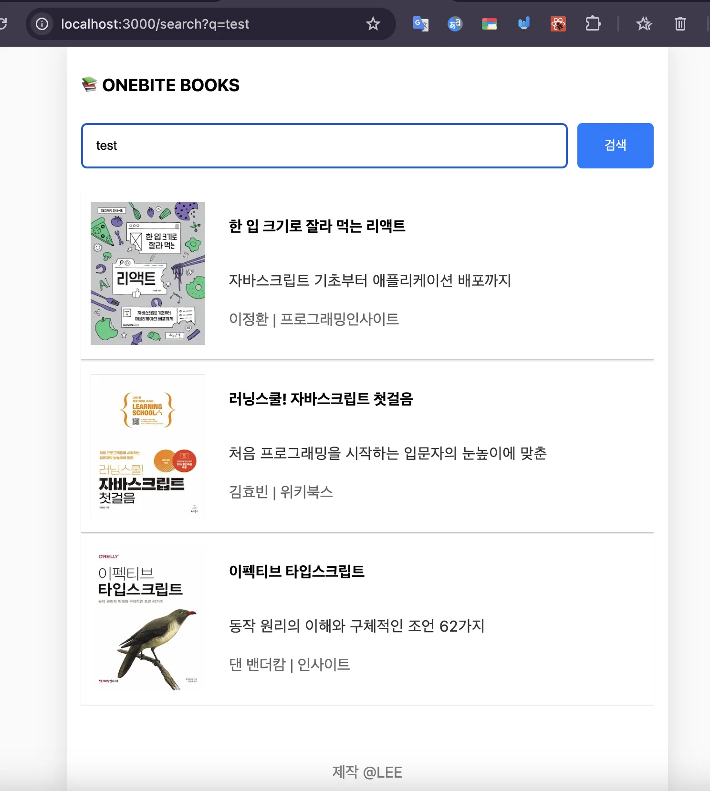

<details>
<summary>&#91; 코드 &#93; <code>index&#46;tsx</code></summary>

<a id="1e8eda9b0fe180febc39cd169b1fe8db"></a>

```javascript
import SearchableLayout from "@/components/searchable-layout";
import React from "react";
import style from "./index.module.css";
import books from "@/mock/books.json";
import BookItem from "@/components/book-item";

export default function Home() {
  return (
    <div className={style.container}>
      <section>
        <h3>지금 추천 도서</h3>
        {books.map((book) => (
          <BookItem key={book.id} {...book} />
        ))}
      </section>
      <section>
        <h3>등록한 모든 도서</h3>
      </section>
    </div>
  );
}

Home.getLayout = (page: React.ReactNode) => {
  return <SearchableLayout>{page}</SearchableLayout>;
};

```

</details>

<details>
<summary>&#91; 코드 &#93; <code>index&#46;module&#46;css</code></summary>

<a id="1e8eda9b0fe180d48812f1ec810ded45"></a>

```css
.container {
  display: flex;
  flex-direction: column;
  gap: 20px;
}

.container h3 {
  border-bottom: 1px solid #ccc;
  padding-bottom: 10px;
  margin-bottom: 0;
}
```

</details>

</details>

<details>
<summary>5&#46; Detail(상세) 페이지</summary>

> ✏️ 
> 
> 1. 파일명 수정&#58; 
>     - <code>&#91;&#91;…id&#93;&#93;</code> → <code>&#91;id&#93;</code>
> 
>     - Optional Catch All Segment → <strong><u>동적 경로 매핑</u></strong>

<a id="1e8eda9b0fe18049b211c1407d0631a2"></a>

<strong>레이아웃</strong>

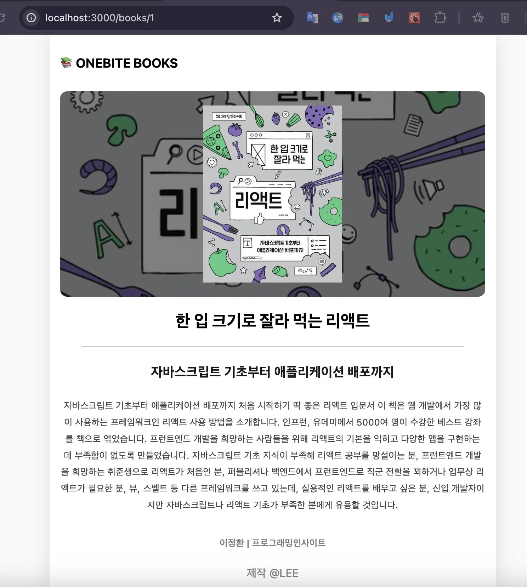

<details>
<summary>&#91; 코드 &#93; <code>&#91;id&#93;&#46;tsx</code></summary>

<a id="1e8eda9b0fe1808bb37ff79413eb8492"></a>

```javascript
import { BookData } from "@/types";
import style from "./[id].module.css";

const MockData: BookData = {
  id: 1,
  title: "한 입 크기로 잘라 먹는 리액트",
  subTitle: "자바스크립트 기초부터 애플리케이션 배포까지",
  description:
    "자바스크립트 기초부터 애플리케이션 배포까지\n처음 시작하기 딱 좋은 리액트 입문서\n\n이 책은 웹 개발에서 가장 많이 사용하는 프레임워크인 리액트 사용 방법을 소개합니다. 인프런, 유데미에서 5000여 명이 수강한 베스트 강좌를 책으로 엮었습니다. 프런트엔드 개발을 희망하는 사람들을 위해 리액트의 기본을 익히고 다양한 앱을 구현하는 데 부족함이 없도록 만들었습니다. \n\n자바스크립트 기초 지식이 부족해 리액트 공부를 망설이는 분, 프런트엔드 개발을 희망하는 취준생으로 리액트가 처음인 분, 퍼블리셔나 백엔드에서 프런트엔드로 직군 전환을 꾀하거나 업무상 리액트가 필요한 분, 뷰, 스벨트 등 다른 프레임워크를 쓰고 있는데, 실용적인 리액트를 배우고 싶은 분, 신입 개발자이지만 자바스크립트나 리액트 기초가 부족한 분에게 유용할 것입니다.",
  author: "이정환",
  publisher: "프로그래밍인사이트",
  coverImgUrl:
    "https://shopping-phinf.pstatic.net/main_3888828/38888282618.20230913071643.jpg",
};

export default function Page() {
  const { id, title, subTitle, description, author, publisher, coverImgUrl } =
    MockData;

  return (
    <div className={style.container}>
      <div
        className={style.cover_img_container}
        style={{ backgroundImage: `url('${coverImgUrl}')` }}
      >
        
      </div>
      <div>
        <h2 className={style.title}>{title}</h2>
        <h3 className={style.sub_title}>{subTitle}</h3>
        <p className={style.description}>{description}</p>
        <p className={style.author}>
          {author} | {publisher}{" "}
        </p>
      </div>
    </div>
  );
}
```

</details>

<details>
<summary>&#91; 코드 &#93; <code>&#91;id&#93;&#46;module&#46;css</code></summary>

<a id="1e8eda9b0fe18080b13ad3c9782195b1"></a>

```css
.container {
  display: flex;
  flex-direction: column;
  height: 100%;
  text-align: center;
}

.cover_img_container {
  display: flex;
  justify-content: center;
  padding: 20px;
  border-radius: 10px;

  background-position: center;
  background-repeat: no-repeat;
  background-size: cover;

  height: 250px;
  position: relative;
}

.cover_img_container::before {
  position: absolute;
  border-radius: 10px;
  top: 0;
  left: 0;
  background-color: rgba(0, 0, 0, 0.5);
  width: 100%;
  height: 100%;
  content: "";
}

.cover_img_container > img {
  height: 100%;
  width: auto;
  object-fit: cover;
  z-index: 1;
}

.title {
  border-bottom: 1px solid rgba(0, 0, 0, 0.2);
  margin: 0 5%;
  padding: 20px 0;
}

.sub_title {
  color: rgba(0, 0, 0, 0.9);
  line-height: 1.8;
  letter-spacing: 0.3px;
}

.description {
  font-size: 13px;
  font-weight: 400;
  line-height: 1.8;
  letter-spacing: 0.3px;
  color: #444;
}

.author {
  font-size: 13px;
  font-weight: bold;
  line-height: 1.8;
  letter-spacing: 0.3px;
  color: rgba(0, 0, 0, 0.5);
  margin: 30px 0 20px 0;
}

```

</details>

</details>

</details>

<a id="1e8eda9b0fe180ea97cef64e716b37db"></a>

### 9&#46; 사전 렌더링, 데이터페칭

> 📖 
> 
> <a id="1e8eda9b0fe18062ab73e64b9b9d4e2d"></a>
> 
> React 와 Next 

<details>
<summary><strong><code>데이터 페칭</code></strong>&#58; <code>React</code> vs <code>Next</code></summary>

> ✏️ 
> 
> 

<details>
<summary><strong><code>React</code></strong><strong> </strong>방식&#58; <code>fetch()</code></summary>

> ✏️ 
> 
> 1. 불러온 데이터를 보관할 State 생성
> 
> 1. 데이터 페칭 함수 생성
> 
> 1. 컴포넌트 마운트 시점에 fetchData 호출
> 
> 1. 데이터 로딩중일 때의 예외처리


<details>
<summary>&#91; 코드 &#93;</summary>

<a id="1e8eda9b0fe18014b369ca0eab8f6a35"></a>

```javascript
import { useEffect, useState } from "react";

export default function Page() {
  const [state, setState] = useState();

  const fetchDate = async () => {
    const response = await fetch("...");
    const data = await response.json();

    setState(data);
  };

  useEffect(() => {
    fetchDate();
  }, []);

  if (!state) return "Loading...";

  return <div>...</div>;
}
```

</details>

---

<details>
<summary> <code>단점</code>&#58; <strong>초기 접속 요청부터 데이터 로딩까지 오랜 시간이 걸림</strong></summary>

> <u>백엔드 서버에 보내는 데이터 요청</u>이 <strong><u>컴포넌트 마운트 시점</u></strong>에 호출된다&#46; 


- 실제 데이터가 로딩 되기까지의 과정이다&#46; 

- 컨텐츠 렌딩 후,<strong> </strong><strong><u>컴포넌트 마운트 시점</u></strong><strong>에 </strong><strong><u>서버에 데이터 요청을 보내고 받</u></strong>아오기 때문에 <strong><u>실제 데이터가 화면에 보이기까지</u></strong> <strong>너무 오랜 시간이 걸</strong>린다&#46;

</details>

</details>

<details>
<summary><strong><code>Next&#46;js</code></strong> 방식&#58; <strong><u>사전 렌더링 과정</u></strong>에서 <strong><u>데이터 페칭까지 같이</u></strong> 진행</summary>


- 사전 렌더링 과정에서 데이터 페칭까지 같이 진행하여 <strong><u>데이터 요청 시점이 매우 빨</u></strong>라진다&#46; 

- 따라서 빠르게 화면을 유저에게 보여줄 수 있다&#46;

</details>

</details>

<details>
<summary><strong>Next&#46;js </strong>&#45; <code>사전 렌더링</code>&#58;  <code>SSR</code> vs <code>SSG</code> vs <code>ISR</code> </summary>

> ✏️ 
> 
> 1. <code>서버사이드 렌더링</code> ( <code>SSR</code> )
>     - 가장 기본적인 사전 렌더링 방식 ( 위 참조 )
> 
>     - 요청이 들어올 때마다 사전 렌더링 진행
> 
> 1. <code>정적 사이트 생성</code> ( <code>SSG</code> )
>     - 빌드 타임에 미리 페이지를 사전 렌더링 한다&#46; ( 아래 참조 )
> 
> 1. <code>증분 정적 재생성</code> ( <code>ISR</code> )
>     - 향후 챕터에서 다룸

<details>
<summary>빌드 타임 ( Build Time ) 렌더링</summary>

> ❗ 
> 
> <a id="1e8eda9b0fe1809a8001d0b6bc64273c"></a>
> 
> <strong>문제</strong>
> 
> <a id="1e8eda9b0fe18087bf53e3f875c3db82"></a>
> 
> <strong>사전 렌더링 과정에서 JS 실행 과정이 오래 걸릴 경우, 오히려 화면 렌더링까지의 시간이 더 걸린다&#46; </strong>


- 위와 같이 사전 렌더링 시, 데이터 페칭 과정에서  <strong><u>백엔드 서버 장애</u></strong>나, <u>리소스가 많아 데이터를 받</u>아오는 시간이 오래 걸리는 경우 <strong>오히려 더 느리게 화면이 보여질 수 있</strong>다&#46;

> ✅ 
> 
> <a id="1e8eda9b0fe1807ba36be40c7564f424"></a>
> 
> <strong>해결</strong>
> 
> <a id="1e8eda9b0fe180b39b13ce9928c49ddc"></a>
> 
> <strong> 빌드 타임 ( Build Time ) 렌더링</strong>


- Next&#46;js에서는 <strong><u>Build 타임에 JS를 실행</u></strong>하여 해결하는 방법을 제공한다&#46;

</details>

</details>

<a id="1e9eda9b0fe18022aee8fce2ad78126f"></a>

### 10&#46; SSR ( 서버 사이드 렌더링 )

> 📖 
> 
> <a id="1e9eda9b0fe180948b36d716ab52385e"></a>
> 
> Next&#46;js의 다양한 렌더링 방식 중 <strong><u>가장 기본적인 렌더링 방식</u></strong>이다&#46; 
> 
> - Next에서 약속된 이름의 함수인 <code>getServerSideProps()</code>를 생성후, <code>export</code> 하면은 자동으로 SSR 방식으로 동작한다&#46;
> 
> - 페이지 로딩 전, 사전 렌더링 과정에서 백엔드로부터 데이터를 페칭하여 가져온다&#46; 

<details>
<summary>☝🏻<code>getServerSideProps()</code>의  return 값은 반드시 <code>props&#58; {}</code> 형태를 가져야 한다&#46;</summary>


</details>

<details>
<summary>✅ <code>props&#58; {…}</code> 형태로 return 시, 자동으로 컴포넌트의 props로 넘겨준다&#46;</summary>


- <code>getServerSideProps</code> 함수 내에서 서버로 받아온 데이터를 <code>props;{ … }</code> 형태로 return 하면 자동으로 컴포넌트의 props로  해당 데이터를 넘겨준다&#46;

</details>

<details>
<summary>⚠️  <code>getServerSideProps()</code> 안에서의  <strong><code>console&#46;log()</code></strong><strong>, </strong><strong><code>브라우저 함수(window&#46;)</code></strong> 사용 불가</summary>


- <code>getServerSideProps</code> 서버 측에서 실행되는 함수이다&#46; 따라서 <code>console&#46;log()</code>를 찍어도 브라우저 콘솔창에서는 보이지 않는다&#46; 


- <code>getServerSideProps()</code>는 <strong><u>&#91; 사전 렌더링 &#45; JS 실행 &#93;</u></strong> 과정에서 처리된다&#46;<br>즉, Next&#46;js 서버와 백엔드 서버 간에 동작되는 함수이다&#46; 따라서 브라우저에서는 접근하지 못한다&#46;

- 동일하게 <u>브라우저에서만 동작하는 함수 호출</u> 시, <strong>오류가 발생</strong>된다&#46;  
    

    

    - <code>getServerSideProps()</code> 내에서 <code>window&#46;location</code> 호출 시 위와 같이 오류가 발생도니다&#46; 

</details>

<details>
<summary>✅<strong><code>console&#46;log</code></strong><strong>, </strong><strong><code>window 함수</code></strong> 등을 <strong><u>클라이언트 동작 함수</u></strong>를 실행 하려면  <code>useEffect()</code>를 사용하여 <strong><u>컴포넌트 마운트 이후 호출</u></strong>해야한다&#46; </summary>


- useEffect 사용 시, 마운트 이후(서버 동작 완료 후) 호출된다&#46;<br>즉, 클라이언트에서만 호출된다&#46; 

<details>
<summary><code>window 함수</code>와 같이 <strong><u>클라이언트에서만 동작</u></strong>하는 경우, <code>useEffect</code>를 사용해야 정상 동작 가능하다&#46; </summary>


</details>

</details>

<details>
<summary><strong>✅ 자동 타입 추론</strong>&#58; <strong><code>InferGetServerSidePropsType</code></strong><strong><code>&#60;</code></strong><strong><code>typeof</code></strong><strong><code> getServerSideProps&#62;</code></strong><strong> </strong></summary>

> ✏️ 
> 
> <a id="1e9eda9b0fe18089ad57ecdd364258b8"></a>
> 
> Next&#46;js에서 제공하는 <code>InferGetServerSidePropsType</code> 사용 시, <code>getServerSIdeProps</code> 반환 값의 타입으로 자동으로 추론한다&#46;


<details>
<summary>&#91; 코드 &#93;</summary>

<a id="1e9eda9b0fe180aa8c1ae73ef1ad20aa"></a>

```javascript
export default function Home({
  data,
}: InferGetServerSidePropsType<typeof getServerSideProps>) {
  useEffect(() => {});
```

</details>

</details>

<a id="1e9eda9b0fe180e79d83d15d4e383acd"></a>

### 11&#46; SSR &#45; 실습

> 📖 
> 
> <a id="1e9eda9b0fe180bf9d42fa120d8a7325"></a>
> 
> <code>getServerSideProps</code>를 사용한 데이터 페칭
> 
> - 기본(index) 페에지 &#45; 추천 도서, 모든 도서 데이터 가져오기 
> 
> - 검색(search) 페이지 &#45; 검색한 문자열로 도서 데이터 가져오기
> 
> - 상세(detail) 페이지 &#45; path의 id 값으로 특정 도서 데이터 가져오기

<details>
<summary>🧐 <code>&#33;</code>  vs <code>?</code></summary>

<details>
<summary><code>&#33;</code>&#58; <strong>Non&#45;null Assertion Operator</strong></summary>

> ✏️ 
> 
> <a id="1e9eda9b0fe1803c8f8dd1f3c2724295"></a>
> 
> <code>&#33;</code>은 컴파일러에게 <strong><u>해당하는 변수에</u></strong><strong><u><code>null</code></u></strong><strong><u>이나 </u></strong><strong><u><code>undefined</code></u></strong><strong><u>를  할당할 수 없게 강제</u></strong>하는 것을 의미한다&#46;

<details>
<summary>ex 1)</summary>

<a id="1e9eda9b0fe180cbba9fe7850ed2826d"></a>

```javascript
const id = context.params!.id;
```

- <code>context&#46;params</code>에 <code>null</code> 또는 <code>undefined</code>가 할당될 수 없다&#46; 

- <code>null</code> or <code>undefined</code>가 할당되는 경우, 런타임 오류가 발생된다&#46; 

</details>

<details>
<summary>ex 2) </summary>

<a id="1e9eda9b0fe1806fa445f09d7ec16957"></a>

```typescript
type Context = {
  params?: { id: string };
};

function handler(context: Context) {
  const id = context.params!.id; // params가 undefined면 런타임 오류
  
  . . . 
```

- <code>context&#46;params</code>가 <code>null</code> or <code>undefinded</code>이면 런타임 오류가 발생된다&#46; 

</details>

</details>

<details>
<summary><code>?</code>&#58; <strong>Optional Chaining</strong></summary>

> ✏️ 
> 
> <a id="1e9eda9b0fe180678c01e3cd2e75e9ac"></a>
> 
> <code>?</code>현식은 해당하는 변수가<code>null</code>이나 <code>undefined</code>이면 <code>undefined</code>가 되게하는 <strong><u>안전한 접근 방식</u></strong>이다&#46;

<details>
<summary><strong>ex 1) </strong></summary>

<a id="1e9eda9b0fe18040b354c0a883ce8fbc"></a>

```typescript
const id = context.params?.id;
```

- <strong><code>params</code></strong>가 <code>undefined</code>이면 <strong><code>id</code></strong>도 <strong><code>undefined</code></strong><strong>로 반환됨</strong>

- 런타임 오류가 발생하지 않음

- id&#58; <code>string &#124; undefined</code> 타입<br>

</details>

<details>
<summary><strong>ex 2)</strong> </summary>

<a id="1e9eda9b0fe1808fbb3ee11264d0e5f9"></a>

```typescript
type Context = {
  params?: { id: string };
};

function handler(context: Context) {
  const id = context.params?.id; // 안전하게 접근
}
```

</details>

</details>

</details>

<details>
<summary>🧐 <code>null</code> vs <code>undefined</code></summary>

| <strong>구분</strong> | <code>null</code> | <code>undefined</code> |
| --- | --- | --- |
| 의미 | “의도적으로 비어 있음” | “정의되지 않음, 아직 할당되지 않음” |
| 위험성 | <strong>존재한다고 믿고 접근하면 에러</strong> 발생 | <strong><u>값이 없음</u></strong><strong>(</strong><strong><code>undefined</code></strong><strong>)이면 </strong><strong><code>undefined</code></strong><strong> 처리</strong> |
| 예외 처리 필요 | 직접 예외처리하지 않으면 런타임 NPE 발생 | 대부분 안전하게 <code>?&#46;</code>, <code>??</code> 등으로 처리 가능 |
| 실무에서 취급 | 서버 사이드에서 NPE 방지를 위해 철저 관리 | 클라이언트에서 옵셔널 체이닝으로 안전 대응 가능 |

</details>

<details>
<summary>병렬 fetch 요청&#58; <code>Promis&#46;all()</code></summary>

<a id="1e9eda9b0fe1803cbbdad8aa15099f50"></a>

```javascript
export const getServerSideProps = async () => {

  // 병렬 방식
  // Promise.all을 사용하여 병렬로 fetch 요청을 보냄
  const [allBooks, randomBooks] = await Promise.all([
    fetchBooks(),
    fetchRandomBooks(),
  ]);

  return {
    props: {
      allBooks,
      randomBooks,
    },
  };
```

<details>
<summary>🤬 직렬 방식</summary>

<a id="1e9eda9b0fe1809b849cc065522cd36c"></a>

```javascript
// 직렬 방식
const allBooks = await fetchBooks();
const randomBooks = await fetchRandomBooks();
```

- 차례로 불러오기 때문에 느리다&#46;

</details>

<details>
<summary>✅ 병렬 방식</summary>

<a id="1e9eda9b0fe18084baeefb87a8605d03"></a>

```javascript
/*
  병렬 방식
   Promise.all을 사용하여 병렬로 fetch 요청을 보냄
*/
const [allBooks, randomBooks] = await Promise.all([
  fetchBooks(),
  fetchRandomBooks(),
]);
```

- JS는 싱글쓰레드로 알고 있는데, 어떻게 병렬 처리가 가능한가?

- 비동기 처리 아닌가?

</details>

</details>

<details>
<summary>fetch API </summary>


<a id="1e9eda9b0fe18081bc26c62eeb9601fb"></a>

```javascript
import { BookData } from "@/types";

const BASE_URL = "http://localhost:12345";
const BASE_URL_BOOK = `${BASE_URL}/book`;

async function fetchTemplate(url: string): Promise<BookData[]> {
  try {
    const response = await fetch(url);
    if (!response.ok) {
      throw new Error("응답이 실패 했습니다.");
    }
    return await response.json();
  } catch (err) {
    console.error(err);
    return [];
  }
}

export const fetchBooks = () => fetchTemplate(`${BASE_URL_BOOK}`);
export const fetchRandomBooks = () => fetchTemplate(`${BASE_URL_BOOK}/random`);
export const fetchSearchBooks = (q: string) =>
  fetchTemplate(`${BASE_URL_BOOK}/search?q=${q}`);

export async function fetchBookById(id: number): Promise<BookData | null> {
  try {
    const response = await fetch(`${BASE_URL_BOOK}/${id}`);
    if (!response.ok) {
      throw new Error("응답이 실패 했습니다.");
    }
    return await response.json();
  } catch (err) {
    console.error(err);
    return null;
  }
}

```

</details>

<details>
<summary>페이지 별 SSR 방식으로 데이터 페칭</summary>

> ✏️ 
> 
> <a id="1e9eda9b0fe18025825ece7fcf9b95e0"></a>
> 
> Next&#46;js에서 제공하느 getServerSideProps 사용 시, 사전 렌더링 방식으로 빠르고 쉽게 데이터페칭이 가능하다&#46;

<details>
<summary>기본(index) 페에지</summary>

<a id="1e9eda9b0fe18073b419c07750ed239b"></a>

```javascript
import SearchableLayout from "@/components/searchable-layout";
import React, { useEffect } from "react";
import style from "./index.module.css";
import BookItem from "@/components/book-item";
import { fetchBooks, fetchRandomBooks } from "@/lib/fetch-books";

export const getServerSideProps = async () => {
  // 병렬 방식
  const [allBooks, randomBooks] = await Promise.all([
    fetchBooks(),
    fetchRandomBooks(),
  ]);

  return {
    props: {
      allBooks,
      randomBooks,
    },
  };
};

export default function Home({
  allBooks,
  randomBooks,
}: InferGetServerSidePropsType<typeof getServerSideProps>) {
  return (
    <div className={style.container}>
      <section>
        <h3>지금 추천 도서</h3>
        {randomBooks.map((book) => (
          <BookItem key={book.id} {...book} />
        ))}
      </section>
      <section>
        <h3>등록한 모든 도서</h3>
        {allBooks.map((book) => (
          <BookItem key={book.id} {...book} />
        ))}
      </section>
    </div>
  );
}

Home.getLayout = (page: React.ReactNode) => {
  return <SearchableLayout>{page}</SearchableLayout>;
};
```

</details>

<details>
<summary>검색(search) 페이지</summary>

<a id="1e9eda9b0fe180119710e0cc52e28ce4"></a>

```javascript
import BookItem from "@/components/book-item";
import SearchableLayout from "@/components/searchable-layout";
import { InferGetServerSidePropsType, GetServerSidePropsContext } from "next";
import { fetchSearchBooks } from "@/lib/fetch-books";

export const getServerSideProps = async (
  context: GetServerSidePropsContext
) => {
  const q = context.query.q as string;

  const searchBooks = await fetchSearchBooks(q);
  return {
    props: {
      searchBooks,
    },
  };
};

export default function Search({
  searchBooks,
}: InferGetServerSidePropsType<typeof getServerSideProps>) {
  return (
    <div>
      {searchBooks.map((book) => (
        <BookItem key={book.id} {...book} />
      ))}
    </div>
  );
}

Search.getLayout = (page: React.ReactNode) => {
  return <SearchableLayout>{page}</SearchableLayout>;
};

```

</details>

<details>
<summary>상세(detail) 페이지</summary>

<a id="1e9eda9b0fe180958392c057c3e72dad"></a>

```javascript
import { BookData } from "@/types";
import style from "./[id].module.css";
import { fetchBookById } from "@/lib/fetch-books";
import { GetServerSidePropsContext, InferGetServerSidePropsType } from "next";

export const getServerSideProps = async (
  context: GetServerSidePropsContext
) => {
  const id = context.params!.id;
  const book = await fetchBookById(Number(id));
  return {
    props: {
      book,
    },
  };
};

export default function Page({
  book,
}: InferGetServerSidePropsType<typeof getServerSideProps>) {
  if (!book) {
    return <div>책을 찾을 수 없습니다.</div>;
  }
  const { title, subTitle, description, author, publisher, coverImgUrl } =
    book as BookData;

  return (
    <div className={style.container}>
      <div
        className={style.cover_img_container}
        style={{ backgroundImage: `url('${coverImgUrl}')` }}
      >
        
      </div>
      <div>
        <h2 className={style.title}>{title}</h2>
        <h3 className={style.sub_title}>{subTitle}</h3>
        <p className={style.description}>{description}</p>
        <p className={style.author}>
          {author} | {publisher}{" "}
        </p>
      </div>
    </div>
  );
}

```

</details>

</details>

<a id="1e6eda9b0fe180c69e96c6feac25925a"></a>

### 12&#46; SSG ( 정적 사이트 생성  )

> 📖 
> 
> <a id="1e6eda9b0fe1809fa57bc237b7d33870"></a>
> 
> <code>SSR</code>의 경우 데이터 페칭 과정에서 오류가 발생되거나 리소스를 받아오는 시간이 오래걸리는 경우, 사용자 경험에 있어서 부정인 영향을 준다&#46; 
> 
> <a id="1e9eda9b0fe1800ea9d6c38583d7d959"></a>
> 
> 이를 해결는 것이 <code>SSG</code> 방식이다&#46; 
> 
> - <strong><u>빌드 타임에 미리 데이터 페칭</u></strong>하여 컨텐츠를 완성시킨다&#46; 

<details>
<summary>SSR 방식의 단점</summary>


- SSR 방식은 위와 같이 사전 렌더링 과정에서 같이 데이터 페칭을 하기 때문에 빠르게 완성된 화면을 보여줄 수 있다&#46; 


- 그러나 위와 같이 <strong><u>백엔드 서버 장애로 인해 정상 응답</u></strong>이 어렵거나

- 가져오는 리소스 크기가 커 페칭 시간이 오래 걸리는 경우, 오히려 실제 완성된 화면이 보이기까지 더 오랜 시간이 걸릴 수 있다&#46; 

<a id="1e9eda9b0fe1802c98b6cad9a41b9c31"></a>

이를 해결하기 위해 나온 방식이 <code>SSG</code>( <strong><u>정적 사이트 렌더링 &#45; 빌드 타임 페칭</u></strong> )이다&#46;

</details>

<details>
<summary><strong>정적 사이트 생성 ( Static Site Generation, SSG )</strong></summary>


- 데이터 페칭이 <strong><u>서버가 가동되기 이전,  build 시점</u></strong>에 이뤄지기 때문에 백엔드 서버가 장애가 발생되거나, 리소스를 받아오는 시간이 오래 걸리더라도 <strong><u>사용자 경험에 아무런 영향이 없</u></strong>다&#46; 


- 실제 화면 렌더링 시에는 이미 build된 파일을 렌더링하면 되기 때문에 빠르게 처리할 수 있다 &#46;

</details>

<details>
<summary><strong><code>SSG</code></strong><strong>의 </strong><strong>단점</strong></summary>


> ❗ 
> 
> <a id="1e9eda9b0fe180ac9bd4cae1f40600c9"></a>
> 
> <strong><u>빌드 타임에 HTML을 고정 생성</u></strong>하기 때문에, 이후 <strong><u>데이터가 바뀌어도 이전에 빌드된 사이트를 고정적으로 보여</u></strong>준다&#46;  
> 
> <a id="1e9eda9b0fe180b587f5ebc9ad2ab1a8"></a>
> 
> 즉, <strong><u>데이터가 자주 바뀌는 경우, stale(오래된) 콘텐츠를 제공</u></strong><strong>할 수 있다는 문제점이 생긴다&#46; </strong>
> 
> <a id="1e9eda9b0fe180b8b200c40d2504a9cb"></a>
> 
>   ⇒  <strong><u>데이터 정합성 문제</u></strong> 발생 

<a id="1e9eda9b0fe180578c27da64f7a48dfc"></a>

이를 <u>정적 페이지 재생성</u> ( ISR, Incremental Static Regeneration )을 통해 해결한다 &#46;

</details>

<a id="1e9eda9b0fe180e7be7ee5258077a5a3"></a>

### 13&#46; SSG 실습 

<details>
<summary>개발(dev) 모드</summary>

> ✏️ 
> 
> <a id="1e9eda9b0fe180fe9418c4118dc3057b"></a>
> 
> <strong>Next 앱의 개발모드 &#91; </strong><strong><code>npm run dev</code></strong><strong> &#93;</strong>
> 
> ---
> 
> <a id="1e9eda9b0fe180b4ace7c76361298347"></a>
> 
> <code>Next</code> 앱의 <strong><u>개발모드</u></strong>에서는 더 편리한 개발을 위해 코드 수정 시, <strong><u>수정 결과가 바로 화면에 반영</u></strong>되도록 동작한다&#46; 
> 
> <a id="1e9eda9b0fe1806f82cadee30c30ee12"></a>
> 
> <code>SSR</code>, <code>SSG</code> 등 <strong><u>렌더링 유형에 상관없</u></strong>이 <strong>요청을 받을 때마다 계속해서 새롭게 페이지를 사전 렌더링</strong>한다&#46; 

> <strong>&#91; 🤬 문제 </strong>&#93; SSG 방식 개발 모드에서는 정상 동작 확인 불가


- SSG 방식으로 데이터를 페칭 했지만,  SSR 방식 처럼 매 요청마다  <code>getStaticProps()</code>가 호출되어 데이터를 넘긴다&#46; 

> <strong>&#91;</strong><strong> ✅ 해결 </strong><strong>&#93;</strong><strong>  개발 모드 → 베포 모드?</strong>

<a id="1e9eda9b0fe180db9b68cee568fddef9"></a>

따라서 정상 동작을 확인하려면 개발 모드를 종료 후, <strong><code>build</code></strong>(<code>npm run build</code>) 후 <strong><code>베포용</code></strong><strong>으로</strong> 서버를 실행(<code>npm run start</code>) 해야한다&#46;  

<a id="1e9eda9b0fe1807989befebb168139e4"></a>

 

</details>

<details>
<summary>정적 경로 적용</summary>

<details>
<summary>1&#46; <code>SSR</code> → <strong><code>SSG</code></strong></summary>

> ✏️ 
> 
> <a id="1e9eda9b0fe18055a142c53b9635ee70"></a>
> 
> <code>SSR</code> → <strong><code>SSG</code></strong>
> 
> ---
> 
> - <strong><code>getServerSideProps</code></strong> → <strong><code>getStaticProps</code></strong>
> 
> - <strong><code>InferGetServerSidePropsType</code></strong> → <strong><code>InferGetStaticPropsType</code></strong>

<details>
<summary>&#91; 코드 &#93; 기본 페이지 </summary>

<a id="1e9eda9b0fe180a88f9bd12cf51e7b4a"></a>

```typescript
import SearchableLayout from "@/components/searchable-layout";
import React from "react";
import style from "./index.module.css";
import BookItem from "@/components/book-item";
import { InferGetStaticPropsType } from "next";
import { fetchBooks, fetchRandomBooks } from "@/lib/fetch-books";

export const getStaticProps = async () => {
  console.log("인덱스 페이지");

  const [allBooks, randomBooks] = await Promise.all([
    fetchBooks(),
    fetchRandomBooks(),
  ]);

  return {
    props: {
      allBooks,
      randomBooks,
    },
  };
};

export default function Home({
  allBooks,
  randomBooks,
}: InferGetStaticPropsType<typeof getStaticProps>) {
  return (
    <div className={style.container}>
      <section>
        <h3>지금 추천 도서</h3>
        {randomBooks.map((book) => (
          <BookItem key={book.id} {...book} />
        ))}
      </section>
      <section>
        <h3>등록한 모든 도서</h3>
        {allBooks.map((book) => (
          <BookItem key={book.id} {...book} />
        ))}
      </section>
    </div>
  );
}

Home.getLayout = (page: React.ReactNode) => {
  return <SearchableLayout>{page}</SearchableLayout>;
};

```

</details>

</details>

<details>
<summary>2&#46; <code>build</code> 및 <strong><u>베포 모드</u></strong>로 실행</summary>

<a id="1e9eda9b0fe18044a9cfc24e58870836"></a>

```bash
npm run build  # 베포용 파일 빌드 ( 축약형 )  
npm run start  # 빌드된 파일 실행
```


- build 시 로그를 확인해보면 정적 페이지로 생성되는 것을 확인할 수 있다&#46;

</details>

<details>
<summary>3&#46;  렌더링 확인</summary>


- 네트워크 화면에서 3G로 속도를 낮춰도 <strong><u>딜레이 없이(그냥 바로 보임) 화면이 렌더링</u></strong> 되는 것을 확인할 수 있다&#46; 
    - 이미 build된 정적 페이지를 바로 보여주기 때문에 매우 빠르게 동작한다&#46;

- build 된 리소스를 새로고침 마다 매번 사용한다&#46;<br>즉, 이전 개발 모드에서 매번 새로고침 마다  <code>getStaticProps()</code>를 호출해서 실행되던 <code>console&#46;log(&#46;&#46;&#46;)</code>가 실행되지 않고, build된 정적 파일을 로드한다&#46;
    -  캐시와 의미상 동일<br>

</details>

</details>

<details>
<summary>검색 페이지 &#45; <code>SSG</code>  &#43; <code>CSR</code> ( 기존 리액트 방식 )</summary>

> ✏️ 
> 
> <a id="1e9eda9b0fe1806d955bcfba710faf6e"></a>
> 
> <strong><u>dynamic 하게 유저로부터 값을 입력받아 데이터 요청(검색)</u></strong>하는 경우, build 시점에 데이터를 fetching 하는 <strong><u>SSG 방식으로는 렌더링할 수 없</u></strong>다&#46;
> 
> <a id="1e9eda9b0fe1800f9f7fd0aa8874ffce"></a>
> 
> 따라서 리액트의 CSR 방식을 합쳐 하이브리드 방식으로 구현한다&#46;
> 
> 
> 
> - 기본 페이지 → SSG
> 
> - 데이터 페칭 → CSR

<details>
<summary><strong>🤬 </strong><strong><code>getStaticProps &#45; context</code></strong>&#58;  query 값 존재 ❌</summary>


- 쿼리 스트링(파라미터)는 사용자가 입력하는 동적으로 정의되는 값이다&#46; 

- 따라서 SSG 방식에서는 사용될 수 없는 값이기 때문에 정의되지 않았다&#46; 

</details>

<details>
<summary>✅<code>SSG</code>(기존 페이지)  &#43; <code>CSR</code>(search 데이터 페칭) </summary>

> ✏️ 
> 
> <a id="1e9eda9b0fe180c783d0fcba59adf661"></a>
> 
> SSG 방식으로 렌더링하려면 <strong><u>데이터를 페칭</u></strong>하는 로직을 <strong>리액트만을 사용한 방식</strong>으로  변경해야 한다&#46;
> 
> <a id="1e9eda9b0fe180ea9067da102dd59cb1"></a>
> 
> <code>useRouter()</code>를 통해 쿼리 스트링을 동적으로 가져오고, <code>useEffect()</code>를 통해 <strong>해당 페이지 </strong><strong><u>마운트 시점에 데이터를 페칭하여 화면을 보</u></strong>여준다&#46; 
> 
> - 페이터 페칭 전 화면만 SSG 방식으로 build 타임에 생성되며, 컴포넌트 마운트 시점에 데이터를 페칭하여 정상 화면을 보여준다&#46;

<details>
<summary>&#91; 코드 &#93; Search&#46;tsx</summary>

<a id="1e9eda9b0fe180b2a9c0d725319906e6"></a>

```typescript
import BookItem from "@/components/book-item";
import SearchableLayout from "@/components/searchable-layout";
import { fetchSearchBooks } from "@/lib/fetch-books";
import { useEffect, useState } from "react";
import { useRouter } from "next/router";
import { BookData } from "@/types";


export default function Search() {
	// CSR ( 리액트 방식 ) 
  const [books, setBooks] = useState<BookData[]>([]);

  const router = useRouter();
  const q = router.query.q as string;

  const fetchSearchResult = async (q: string) => {
    const data = await fetchSearchBooks(q);
    setBooks(data);
  };

  useEffect(() => {
    if (q) {
      fetchSearchResult(q);
    }
  }, [q]);

  return (
    <div>
      {books.map((book) => (
        <BookItem key={book.id} {...book} />
      ))}
    </div>
  );
}

Search.getLayout = (page: React.ReactNode) => {
  return <SearchableLayout>{page}</SearchableLayout>;
};

```

</details>

<details>
<summary>build 확인</summary>


- <code>/search</code>  페이지가 SSG 방식으로 build 되는 것을 확인할 수 있다&#46;
    - <code>O</code>&#58;  SSG 방식

    - <code>f</code>&#58;  SSR 방식

</details>

</details>

<details>
<summary><strong>🧐  &#91; SSR &#45; 사전 렌더링 방식 &#93; 보다 어떤 이점이 있지?</strong></summary>

<a id="1e9eda9b0fe1801791bcfb5dfdca515e"></a>

‣

</details>

</details>

<details>
<summary>동적 경로 적용</summary>

> ✏️ 
> 
> <a id="1e9eda9b0fe1804eb01eceebcf9c7a29"></a>
> 
> SSG는 빌드 시점에 HTML(&#43; 데이터 페칭)을 미리 생성해 두는 방식이다&#46; 
> 
> <a id="1eaeda9b0fe18026aa96f58e02e26f59"></a>
> 
> 그러나 <strong><code>pages/books/</code></strong><strong><code>&#91;id&#93;</code></strong><strong><code>&#46;tsx</code></strong> 와 같이 <strong><u>id값에 따라 동적으로 페이지가 라우팅</u></strong>되는 경우,  <strong><u>빌드 시점에는 어떤 id가 존재하는지 알 수 없 </u></strong>기 때문에, <strong><u>해당 목록을 직접 알려줘</u></strong>야 한다&#46; 
> 
> 
> 
> -  <strong><code>getStaticPaths()</code></strong>

<details>
<summary><strong>🤬</strong> <code>SSR</code> → <strong><code>SSG</code></strong> </summary>

> ❗ 
> 
> <a id="1eaeda9b0fe180e59f23e0c29688d1ce"></a>
> 
> 정적 페이지와 동일한 방식으로 코드를 변경하는 경우, 아래와 같이 오류가 발생된다&#46; 
> 
> - <code>getServerSideProps</code> → <code>getStaticProps</code>
> 
> - <code>InferGetServerSidePropsType</code> → <code>InferGetStaticPropsType</code>


- 동적으로 즉, id 값에 따른 동적 페이지 렌더링 시, <code>getStaticPaths()</code>가 추가적으로 필요하다&#46;

</details>

<details>
<summary>✅ <strong><code>getStaticPaths()</code></strong>로 예상 경로 명시 </summary>

<details>
<summary>&#91; 코드 &#93; books/<code>&#91;id&#93;&#46;tsx</code></summary>

<a id="1eaeda9b0fe1802c81fbda15e28c4fb0"></a>

```typescript
import { BookData } from "@/types";
import style from "./[id].module.css";
import { fetchBookById } from "@/lib/fetch-books";
import { GetServerSidePropsContext, InferGetStaticPropsType } from "next";

export const getStaticProps = async (context: GetServerSidePropsContext) => {
  const id = context.params!.id;
  const book = await fetchBookById(Number(id));
  return {
    props: {
      book,
    },
  };
};

export const getStaticPaths = () => {
  return {
    paths: [
      { params: { id: "1" } }, // url 파라이머 String만 가능
      { params: { id: "2" } },
      { params: { id: "3" } },
    ],
    fallback: false,
  };
};

export default function Page({
  book,
}: InferGetStaticPropsType<typeof getStaticProps>) {
  if (!book) {
    return <div>책을 찾을 수 없습니다.</div>;
  }
  const { title, subTitle, description, author, publisher, coverImgUrl } =
    book as BookData;

  return (
    <div className={style.container}>
      <div
        className={style.cover_img_container}
        style={{ backgroundImage: `url('${coverImgUrl}')` }}
      >
        
      </div>
      <div>
        <h2 className={style.title}>{title}</h2>
        <h3 className={style.sub_title}>{subTitle}</h3>
        <p className={style.description}>{description}</p>
        <p className={style.author}>
          {author} | {publisher}{" "}
        </p>
      </div>
    </div>
  );
}

```

</details>

<details>
<summary>레이아웃</summary>

- <code>getStaticPaths()</code> &#45; <strong><code>id&#58; 1, 2, 3</code></strong>
    

    

    

    <a id="1eaeda9b0fe1801fb169f447990bdf66"></a>

    <code>getStaticPaths()</code>에 명시한 <strong><u>paths &#45; id&#58; 1, 2, 3 </u></strong><u>페이지</u>가 매우 빠르게 렌더링되는 것을 확인할 수 있다&#46; 

- <code>fallback&#58; false</code>
    <a id="1eaeda9b0fe1808f8fb8e8d4a290899d"></a>

    명시한 경로( id&#58; 1, 2,3 ) 외  <code>404 Not Found</code> 처리

    

</details>

</details>

<details>
<summary><strong><code>getStaticPaths</code></strong><strong> &#45; </strong><u>fallback</u><u> 옵션</u></summary>

> ✏️ 
> 
> <a id="1eaeda9b0fe180aeba16f732c8776e72"></a>
> 
> <code>fallback&#58; { option }</code> 
> 
> ---
> 
> 

<details>
<summary>fallback&#58; <code>false</code></summary>

> ✏️ 
> 
> 
> 
> - 정의된 path가 아닌 경우, 무조건 404를 반환한다&#46;

<details>
<summary>ex) </summary>

<a id="1eaeda9b0fe18099bf79fdd178b7c85c"></a>

```
export const getStaticPaths = () => {
  return {
    paths: [
      { params: { id: "1" } }, // url 파라이머 String만 가능
      { params: { id: "2" } },
      { params: { id: "3" } },
    ],
    fallback: false,
  };
};
```


- <code>id&#58; 4</code>의 데이터가 존재함?에도 불구하고 404 페이지를 반환한다&#46; 
    - fallback&#58; false의 경우, 명시된 경로를 제외한 모든 path를 Next&#46;js에서 자체적으로 404 응답으로 판단한다&#46;

</details>

</details>

<details>
<summary>fallback&#58; <code>blocking</code> ( SSG &#43; SSR )</summary>

> ✏️ 
> 
> 
> 
> <a id="1eaeda9b0fe180519a03e682f3a89df2"></a>
> 
> fallback에 <code>blocking</code> 옵션 설정 시, 정의되지 않는 path의 경우 사전 렌더링 방식으로 리소스를 <strong><u>dynamic 하게 받</u></strong>아온다&#46; 

<details>
<summary>ex)</summary>

<a id="1eaeda9b0fe1808180f2ea51662b75af"></a>

```javascript
export const getStaticPaths = () => {
  return {
    paths: [
      { params: { id: "1" } }, // url 파라이머 String만 가능
      { params: { id: "2" } },
      { params: { id: "3" } },
    ],
    fallback: "blocking",
  };
}
```


- paths에 정의하지 않은 <strong><u>id&#58; 4 페이지</u></strong>가 잘 나오는 것을 확인할 수 있다&#46; 

- 한번 리소스를 받아오면 <code>SSG</code> 방식으로  화면을 렌더링한다&#46; 

</details>

<details>
<summary>🤬 단점</summary>


- 사전 렌더링을 기다리는 동안, Next 서버가 브라우저에게 아무런 응답을 하지 않기 때문에, 사전 렌더링 시간이 오래 걸리는 경우 UX에 부정적인 영향을 준다&#46; 

</details>

</details>

<details>
<summary>fallback&#58; <code>true</code></summary>

> ✏️ 
> 
> 
> 
> - 먼저 레이아웃을 반환 후, 데이터(props)만 따로 불러와 UX를 개선한다&#46; 

<details>
<summary>ex) </summary>

> 📌 
> 
> - <code>fallback&#58; true</code> 를 통해 blocking 단점 개선
> 
> - <code>notFound&#58; true</code> 를 통해 리소스가 없는 경우 404 페이지 반환
> 
> - <code>useRouter()&#46;isFallback</code>을 통해 리소스를 받아오는 중에는 로딩화면 표시

<details>
<summary>&#91; 코드 &#93; books/<code>&#91;id&#93;&#46;tsx</code> &#45; 상세(detail) 페이지</summary>

<a id="1eaeda9b0fe180fa9addc0751ea0b6c2"></a>

```javascript
import { BookData } from "@/types";
import style from "./[id].module.css";
import { fetchBookById } from "@/lib/fetch-books";
import { GetServerSidePropsContext, InferGetStaticPropsType } from "next";
import { useRouter } from "next/router";

export const getStaticPaths = () => {
  return {
    paths: [
      { params: { id: "1" } }, // url 파라이머 String만 가능
      { params: { id: "2" } },
      { params: { id: "3" } },
    ],
    fallback: true,
  };
};

export const getStaticProps = async (context: GetServerSidePropsContext) => {
  const id = context.params?.id;
  const book = await fetchBookById(Number(id));

  // 404 페이지 반환
  if (!book) {
    return {
      notFound: true,
    };
  }

  return {
    props: {
      book,
    },
  };
};

export default function Page({
  book,
}: InferGetStaticPropsType<typeof getStaticProps>) {
  const router = useRouter();
	
	// 데이터 받아오는 중
  if (router.isFallback) return <div>로딩 중 입니다 ...</div>;
  if (!book) {
    return <div>문제가 발생했습니다. 다시 시도하세요.</div>;
  }
  const { title, subTitle, description, author, publisher, coverImgUrl } =
    book as BookData;

  return (
    <div className={style.container}>
      <div
        className={style.cover_img_container}
        style={{ backgroundImage: `url('${coverImgUrl}')` }}
      >
        
      </div>
      <div>
        <h2 className={style.title}>{title}</h2>
        <p className={style.author}>
          {author} | {publisher}{" "}
        </p>
        <div className={style.description}>
          <h3 className={style.sub_title}>{subTitle}</h3>
          <p>{description}</p>
        </div>
      </div>
    </div>
  );
}

```

</details>

</details>

</details>

</details>

</details>

<a id="1e9eda9b0fe180d2b9c1c6fe1e0d06ac"></a>

### 14&#46; ISR ( Incremental Static Regeneration ) 

> 📖 
> 
> <a id="1e9eda9b0fe1808a8d67ed72f8ff673d"></a>
> 
> <strong><code>ISR</code></strong><strong> ( Incremental Static Regeneration, 증분 정적 재생성 )</strong>
> 
> ---
> 
> 
> 
> > 단순히<strong><u> 그냥 SSG 방식으로 생성된 정적 페이지</u></strong>를 <strong><u>일정 시간 주기</u></strong><strong>로 다시 생성</strong>하는 기술이다&#46;
> 
> - SSG와 SSR의 장점이 결합된 방식이다&#46;
> 
> - 그러나 데이터가 업데이트 되지 않아도 일정시간이 지나면 계속 리소스를 재생성하기 때문에 <br>낭비가 발생되는 단점이 있다&#46;

<details>
<summary>동작</summary>


- 정적 리소스 생성 시, 만료시간 ( Exparation Time)을 설정하여 리소스에 대한 유통기한을 설정한다&#46; 

- 유통기한이 지나면 다시 리소스를 생성한다&#46; 

</details>

<details>
<summary>실습 ) <code>revalidate&#58; 3</code></summary>

> ✏️ 
> 
> <a id="1ebeda9b0fe18088a64ed7d8a4c0cb91"></a>
> 
> <code>getStaticProps()</code> return 값에  r<u>evalidate 설정</u>을 추가하면 SSG 방식에서 <strong><u>리소스 만료 설정을 추가한 ISR 방식</u></strong>으로 동작한다&#46;
> 
> - <code>revaildate</code>는 <strong><u>‘재검증하다</u></strong><u>’</u> 라는 의미를 갖는다&#46;

<details>
<summary>&#91; 전체 코드 &#93; 메인 페이지</summary>

<a id="1ebeda9b0fe1806c9edffcb756cbda96"></a>

```typescript
import SearchableLayout from "@/components/searchable-layout";
import React from "react";
import style from "./index.module.css";
import BookItem from "@/components/book-item";
import { InferGetStaticPropsType } from "next";
import { fetchBooks, fetchRandomBooks } from "@/lib/fetch-books";

export const getStaticProps = async () => {
  console.log("인덱스 페이지");

  const [allBooks, randomBooks] = await Promise.all([
    fetchBooks(),
    fetchRandomBooks(),
  ]);

  return {
    props: {
      allBooks,
      randomBooks,
    },
    revalidate: 3,
  };
};

export default function Home({
  allBooks,
  randomBooks,
}: InferGetStaticPropsType<typeof getStaticProps>) {
  return (
    <div className={style.container}>
      <section>
        <h3>지금 추천 도서</h3>
        {randomBooks.map((book) => (
          <BookItem key={book.id} {...book} />
        ))}
      </section>
      <section>
        <h3>등록한 모든 도서</h3>
        {allBooks.map((book) => (
          <BookItem key={book.id} {...book} />
        ))}
      </section>
    </div>
  );
}

Home.getLayout = (page: React.ReactNode) => {
  return <SearchableLayout>{page}</SearchableLayout>;
};

```

</details>

<a id="1ebeda9b0fe180ff8e14d87b8f8473c2"></a>

```typescript
export const getStaticProps = async () => {
  console.log("인덱스 페이지");

  const [allBooks, randomBooks] = await Promise.all([
    fetchBooks(),
    fetchRandomBooks(),
  ]);

  return {
    props: {
      allBooks,
      randomBooks,
    },
    revalidate: 3,
  };
};
```

<details>
<summary>빌드 로그 확인</summary>


- 빌드 시, 로그에 ISR 시간 설정이 나오는 것을 확인할 수 있다&#46;

</details>

<details>
<summary><code>revaildate</code> 시간 초과 시, 리소스 재생성</summary>


- <code>revalidate</code> 설정 시간을 초과 시, 다시 리소스를 재생성하여 응답하는 것을 확인할 수 있다&#46; 

</details>

</details>

<a id="1ebeda9b0fe180deaed8f1dfe1406132"></a>

### 15&#46;  주문형 재 검증 ( On&#45;Demand ISR ) 

> 📖 
> 
> <a id="1ebeda9b0fe18052a506eac0f0bcf5df"></a>
> 
> <code>ISR</code>의 경우 <em><strong>특정 시간을 기반으로 데이터를 업데이트  </strong></em>한다&#46; 
> 
> <a id="1ebeda9b0fe1800bb9c9cf597f62ae23"></a>
> 
> 만약 시간이 아닌 <strong><u>사용자의 행동에 따라 데이터가 업데이트</u></strong>되는 페이지의 경우는 <strong><u>ISR 방식을 적용하기 어렵다&#46;</u></strong> 
> 
> <a id="1ebeda9b0fe180a183abdc1d6f468b9c"></a>
> 
> 이를 <code>On&#45;Demand ISR</code> 방식으로 해결한다&#46; 

<details>
<summary>🤬 ISR 방식의 단점</summary>

> ❗ 
> 
> <a id="1ebeda9b0fe180098ce2fad4a90e37b3"></a>
> 
> ISR 방식은 일정 시간을 주기로 리소스를 재생성하여 데이터 정합성을 맞춘다&#46; 
> 
> <a id="1ebeda9b0fe180279c46ddf1bea9397e"></a>
> 
> 그러나 아래와 같이 일정 주기와 사용자의 요청 사이 간격이 존재하고 이로 인해 정합성이 맞지 않을 수 있다&#46; 
> 
> <a id="1ebeda9b0fe1803caa24e9b64e090d73"></a>
> 
> 또한 데이터가 업데이트 되지 않았을 경우에도, 리소스를 재성성하기 때문에 업데이트 시간의 간격이 클수록 불필요한 데이터 재생성이 증가된다&#46; 

> ex) <code>revalidate&#58; 60s</code>

- Case 1 )<strong> revalidate(60s) 이전</strong>, <strong>데이터 업데이트 및 요청 발생</strong>
    

    - 60 이전에 데이터 업데이트 및 사용자 요청이 발생 되다면 업<u>데이트된 내용이 반영되지 않는 이전 생성 리소스 응답</u>하여 <strong>데이터 정합성 문제</strong>가 발생된다&#46; 

- Case 2) 데이터 업데이트 간격 ↑
    

    - 만약 리소스가 60초 마다 재생성 되지만, 리소스의 업데이트는 24시간 이후에 발생된다면<br><strong><u>불필요하게 리소스의 재생성</u></strong>이 계속 발생된다&#46; 

</details>

<details>
<summary>🧐 그렇다면 <strong><u>SSR 방식</u></strong>으로 렌더링 하면 되지 않은가?</summary>


<a id="1ebeda9b0fe18002b709e5f26102811c"></a>

SR 방식의 경우, 브라우저가 요청할 때마다 매번 새롭게 페이지를 사전 렌더링하기 때문에 

<a id="1ebeda9b0fe1803888e5cf7996f102f4"></a>

<strong><u>응답 시간도 많이 느려</u></strong>지며 <u>동시 접속자들이 굉장히 많</u>이 몰릴 경우 <strong><u>서버의 부하까지 커진다</u></strong>&#46;

<a id="1ebeda9b0fe18034935cdafaf10a5790"></a>

따라서 <strong><u>정적인 페이지</u></strong><strong><u>로 처리</u></strong><u>하는 것이 좋</u>다&#46; 

- 요청 기반 ISR 방식 (  On&#45;Demand ISR )

</details>

<details>
<summary>✅ On&#45;Demand ISR</summary>

> ✏️ 
> 
> <a id="1ebeda9b0fe1808a84aeeb7cea74cb21"></a>
> 
> <strong><code>On&#45;Demand ISR</code></strong>
> 
> ---
> 
> 
> 
> - 요청(주문)을 받을 때마다 페이지를 재생성 한다&#46; 
>     - <strong><u>페이지 업데이트 시점을 직접 트리거</u></strong> 할 수 있다&#46;
> 
> - 이를 통해 <strong><u>데이터 정합성</u></strong> 및 <strong><u>불필요한 리소스 재생성</u></strong>을 <strong>해결</strong>한다&#46; 

<details>
<summary>1&#46; <code>pages /api /revalidate&#46;ts</code> 생성 </summary>


<details>
<summary>폴더 구조에 따라 <code>/api/revalidate</code> 경로로 hanlder 자동 매핑</summary>


- <a href="http://localhost:3000/api/revalidate">localhost&#58;3000/api/revalidate</a>로 GET 요청 시 설정한 값 반환 ( 재빌드 필요 )

</details>

</details>

<details>
<summary>2&#46; hadler 정의</summary>

<a id="1ebeda9b0fe18084b3a7f5a569f5bde5"></a>

```typescript
import { NextApiRequest, NextApiResponse } from "next";

export default async function handler(
  req: NextApiRequest,
  res: NextApiResponse
) {
  try {
    await res.revalidate("/");
    return res.json({ revalidated: true });
  } catch (err) {
    res.status(500).send("Revalidation Falied: " + err);
  }
}
```

- Next가 제공하는 <code>NextApiRequest</code>, <code>NextApiResponse</code> 를 사용하면<br>위와 같이 간단하게 revalidate(재생성) 요청을 할 수 있다&#46;

</details>

<details>
<summary>3&#46;  handler 호출 ( 폴더 구조로 경로 자동 설정 ) → <strong><u>리소스 재생성</u></strong></summary>

- <code>/api/revalidate</code> 호출 시마다, 설정한 인덱스 페이지가 재생성된다&#46;  
    

    - <a href="http://localhost:3000/api/revalidate"><code>localhost&#58;3000/api/revalidate</code></a> 호출 
        

    - 설정한 경로의 리소스 재생성
        

</details>

</details>

> 🗒️ 
> 
> <a id="1ebeda9b0fe180949c5dd01f06182152"></a>
> 
> <strong>정리</strong>
> 
> <a id="1ebeda9b0fe1801d9dd2fee52e019c1a"></a>
> 
> <code>On&#45;Demend ISR</code> 방식은 <u>대부분의 케이스에서 효율적으로 대응</u> 가능한 강력한 사전 렌더링 방식이다&#46; 따라서 Next&#46;js로 구축된 대부분의 웹에서는 활발하게 사용되고 있기 때문에 <strong><u>실제 앱 구축 시, 적용</u></strong>하는 것을 권장한다&#46; 

<a id="1ebeda9b0fe180fe8e11f79622a8ec38"></a>

### 16&#46;  <strong>검색 엔진 최적화 &#45; </strong>SEO 설정

> 📖 
> 
> <a id="1ebeda9b0fe1804ca350d82b400c25ef"></a>
> 
> <strong>검색 엔진 최적화 ( </strong><code>SEO</code>, <strong>Search Engine Optimization )</strong>

<details>
<summary>favicon 변경</summary>


- <code>favicon&#46;ico</code> 이름으로 icon 이미지를  public 폴더에 덮어씌우면


- 위와 같이 해당되는 icon으로 변경된다&#46; 

</details>

<details>
<summary>페이지 별 메타 태그 설정</summary>

<details>
<summary>링크 공유 &#45;  썸네일 설정</summary>

<details>
<summary>예시 </summary>

[2&#46;19) SEO 설정하기 &#124; 한 입 크기로 잘라먹는 Next&#46;js(v15)]()

</details>


<a id="1ebeda9b0fe18070b2c3ca8a215bb198"></a>

위와 같이 <strong><u>링크 공유 시 보여지는 썸네일</u></strong>을 메타 태그에 추가하여 설정할 수 있다&#46;

</details>

> ✏️ 
> 
> <a id="1ebeda9b0fe1809892ede928c0b67fc4"></a>
> 
> next 에서는 react와 달리<strong> </strong><strong><u>각 페이지 별로 메타 태그</u></strong>(<code>&#60;meta /&#62;</code>)를 <strong><u>설정</u></strong>할 수 있다 

<details>
<summary>메인 페이지</summary>

<details>
<summary>&#91; 전체 코드 &#93;</summary>

<a id="1ebeda9b0fe18093b780c83b9f2d6d4b"></a>

```typescript
import SearchableLayout from "@/components/searchable-layout";
import React from "react";
import style from "./index.module.css";
import BookItem from "@/components/book-item";
import { InferGetStaticPropsType } from "next";
import { fetchBooks, fetchRandomBooks } from "@/lib/fetch-books";
import Head from "next/head";

export const getStaticProps = async () => {
  const [allBooks, randomBooks] = await Promise.all([
    fetchBooks(),
    fetchRandomBooks(),
  ]);

  return {
    props: {
      allBooks,
      randomBooks,
    },
  };
};

export default function Home({
  allBooks,
  randomBooks,
}: InferGetStaticPropsType<typeof getStaticProps>) {
  return (
    <>
      <Head>
        <title>한입 북스</title>
        <meta property="og:image" content="/thumbnail.png" />
        <meta property="og:title" content="한입북스" />
        <meta
          property="og:description"
          content="한입 북스에 등록된 도서를 만나보세요"
        />
      </Head>
      <div className={style.container}>
        <section>
          <h3>지금 추천 도서</h3>
          {randomBooks.map((book) => (
            <BookItem key={book.id} {...book} />
          ))}
        </section>
        <section>
          <h3>등록한 모든 도서</h3>
          {allBooks.map((book) => (
            <BookItem key={book.id} {...book} />
          ))}
        </section>
      </div>
    </>
  );
}

Home.getLayout = (page: React.ReactNode) => {
  return <SearchableLayout>{page}</SearchableLayout>;
};
```

</details>

<a id="1ebeda9b0fe180d7baa5c8dcc54dc3eb"></a>

```typescript
import Head from "next/head";

  return (
    <>
		<Head>
		  <title>한입북스</title>
		  <meta property="og:image" content="/thumbnail.png" />
		  <meta property="og:title" content="한입북스" />
		  <meta
		    property="og:description"
		    content="한입 북스에 등록된 도서를 만나보세요"
		  />
		</Head>
		
		. . .
```


</details>

<details>
<summary>검색 페이지</summary>

<details>
<summary>&#91; 전체 코드 &#93;</summary>

<a id="1ebeda9b0fe1803db9a8f86bf26a606e"></a>

```typescript
import BookItem from "@/components/book-item";
import SearchableLayout from "@/components/searchable-layout";
import { fetchSearchBooks } from "@/lib/fetch-books";
import { useEffect, useState } from "react";
import { useRouter } from "next/router";
import { BookData } from "@/types";
import Head from "next/head";

export default function Search() {
  const [books, setBooks] = useState<BookData[]>([]);

  const router = useRouter();
  const q = router.query.q as string;

  const fetchSearchResult = async (q: string) => {
    const data = await fetchSearchBooks(q);
    setBooks(data);
  };

  useEffect(() => {
    if (q) {
      // 검색 결과 API
      fetchSearchResult(q);
    }
  }, [q]);

  return (
    <>
      <Head>
        <title>한입북스 - 검색결과</title>
        <meta property="og:image" content="/thumbnail.png" />
        <meta property="og:title" content="한입북스 - 검색결과" />
        <meta
          property="og:description"
          content="한입 북스에 등록된 도서를 만나보세요"
        />
      </Head>
      <div>
        {books.map((book) => (
          <BookItem key={book.id} {...book} />
        ))}
      </div>
    </>
  );
}

Search.getLayout = (page: React.ReactNode) => {
  return <SearchableLayout>{page}</SearchableLayout>;
};

```

</details>

<a id="1ebeda9b0fe18068975fd5147a5d1a65"></a>

```typescript
import Head from "next/head";

  return (
    <>
		<Head>
		  <title>한입북스 - 검색결과</title>
		  <meta property="og:image" content="/thumbnail.png" />
		  <meta property="og:title" content="한입북스 - 검색결과" />
		  <meta
		    property="og:description"
		    content="한입 북스에 등록된 도서를 만나보세요"
		  />
		</Head>
		
		. . .
```


</details>

<details>
<summary>상세 페이지</summary>

<details>
<summary>&#91; 전체 코드 &#93;</summary>

<a id="1ebeda9b0fe180489b6ff35d6cb008d9"></a>

```typescript
import { BookData } from "@/types";
import style from "./[id].module.css";
import { fetchBookById } from "@/lib/fetch-books";
import { GetServerSidePropsContext, InferGetStaticPropsType } from "next";
import { useRouter } from "next/router";
import Head from "next/head";

export const getStaticPaths = () => {
  return {
    paths: [
      { params: { id: "1" } }, // url 파라이머 String만 가능
      { params: { id: "2" } },
      { params: { id: "3" } },
    ],
    fallback: true,
  };
};

export const getStaticProps = async (context: GetServerSidePropsContext) => {
  const id = context.params?.id;
  const book = await fetchBookById(Number(id));

  // 404 페이지 반환
  if (!book) {
    return {
      notFound: true,
    };
  }

  return {
    props: {
      book,
    },
  };
};

export default function Page({
  book,
}: InferGetStaticPropsType<typeof getStaticProps>) {
  const router = useRouter();
	
	/* 
		* fallback 상태 - 데이터 페칭하는 중 * 
		 데이터를 페칭 중인 경우, 즉 fallback 상태의 경우 기본 loading 화면만을 보여준다.
		 따라서 메인 페이지의 meta 설정을 입력하여 SEO 최적화를 한다. 
	*/
  if (router.isFallback)
    return (
      <>
        <Head>
          <title>한입북스</title>
          <meta property="og:image" content="/thumbnail.png" />
          <meta property="og:title" content="한입북스" />
          <meta
            property="og:description"
            content="한입 북스에 등록된 도서를 만나보세요"
          />
        </Head>
        <div>로딩 중 입니다 ...</div>
      </>
    );
  if (!book) {
    return <div>문제가 발생했습니다. 다시 시도하세요.</div>;
  }
  const { title, subTitle, description, author, publisher, coverImgUrl } =
    book as BookData;

  return (
    <>
      <Head>
        <title>{title}</title>
        <meta property="og:image" content={coverImgUrl} />
        <meta property="og:title" content={title} />
        <meta property="og:description" content={description} />
      </Head>
      <div className={style.container}>
        <div
          className={style.cover_img_container}
          style={{ backgroundImage: `url('${coverImgUrl}')` }}
        >
          
        </div>
        <div>
          <h2 className={style.title}>{title}</h2>
          <p className={style.author}>
            {author} | {publisher}{" "}
          </p>
          <div className={style.description}>
            <h3 className={style.sub_title}>{subTitle}</h3>
            <p>{description}</p>
          </div>
        </div>
      </div>
    </>
  );
}

```

</details>

<details>
<summary>fallback 상태의 경우, 기본적인 메타 태그 설정</summary>

> ✏️ 
> 
> <a id="1ebeda9b0fe180b993b0d3bf50464e89"></a>
> 
> 상세 페이지의 경우, <strong><u>fallback 옵션을 </u></strong><strong><u><code>true</code></u></strong>로 설정했다
> 
> <a id="1ebeda9b0fe180c0a8a7d5bffd43c2b3"></a>
> 
> 따라서 <code>paths</code>로 설정한 경로를 제외하고는 SSG 방식으로 요청이 들어왔을 때 즉각적으로 서버에서 생성한다&#46; 
> 
> <a id="1ebeda9b0fe18004b46bc656e17251e8"></a>
> 
> 이때, 브라우저가 페이지의 생성을 너무 오래 기다리지 않게 막기 위해서 일단 빠르게 데이터가 없는 fallback 상태의 페이지를 반환한다&#46; 
> 
> <a id="1ebeda9b0fe180e8b039f2d2e7a35201"></a>
> 
> ```typescript
> if (router.isFallback) return "로딩 중 입니다."
> ```
> 
> <a id="1ebeda9b0fe1805b8efbd54bb1b763aa"></a>
> 
> 따라서 <strong><u>새로운 리소스를 다이나믹(동적)하게 생성</u></strong>하는 경우, SEO 설정 되지 않는 문제가 생긴다&#46; 
> 
> <a id="1ebeda9b0fe180579948c673457064ac"></a>
> 
> 이를, 아래와 같이 <strong><u>fallback 상태</u></strong>일 때 <strong>기본 메타 태그 정보를 설정</strong>하여 SEO 최적화를 한다&#46;

<a id="1ebeda9b0fe1804fb93de878950e2db2"></a>

```typescript
import Head from "next/head";

    . . . 

export default function Page({
  book,
}: InferGetStaticPropsType<typeof getStaticProps>) {
  const router = useRouter();
	
	/* 
		* fallback 상태 - 데이터 페칭하는 중 * 
		 데이터를 페칭 중인 경우, 즉 fallback 상태의 경우 기본 loading 화면만을 보여준다.
		 따라서 메인 페이지의 meta 설정을 입력하여 SEO 최적화를 한다. 
	*/
  if (router.isFallback)
    return (
      <>
        <Head>
          <title>한입북스</title>
          <meta property="og:image" content="/thumbnail.png" />
          <meta property="og:title" content="한입북스" />
          <meta
            property="og:description"
            content="한입 북스에 등록된 도서를 만나보세요"
          />
        </Head>
        <div>로딩 중 입니다 ...</div>
      </>
    );
   
       . . . 
```

</details>

<details>
<summary>fallback 이후 상세 book 데이터로 메타 태그 설정</summary>

<a id="1ebeda9b0fe1805093b2d2b069e4cabf"></a>

```typescript
import Head from "next/head";

	// 해당하는 Book의 데이터를 사용
  return (
    <>
      <Head>
        <title>{title}</title>
        <meta property="og:image" content={coverImgUrl} />
        <meta property="og:title" content={title} />
        <meta property="og:description" content={description} />
      </Head>
		
		. . .
```

- 

</details>

</details>

</details>

<a id="1ebeda9b0fe180ccaea2e4cd977b4a29"></a>

### 17&#46; 베포 &#45; Vercel

<details>
<summary>vercel 세팅</summary>

<details>
<summary>vercel &#45; 회원 가입</summary>

[bookmark]()

</details>

<details>
<summary>vercel 패키지 설치</summary>

<a id="1eceda9b0fe180dc9967c08be8d89ecc"></a>

```bash
# mac, 관리자 권한으로 
sudo npm install -g vercel
```

</details>

<details>
<summary>vs code &#45; vercel 로그인</summary>

<a id="1eceda9b0fe180908323cf119b1a9461"></a>

```bash
vercel login
```

<details>
<summary>가입한 옵션 선택</summary>


</details>

<details>
<summary>정상 로그인</summary>


</details>

</details>

</details>

<details>
<summary>프론트 베포</summary>

<details>
<summary>프로젝트 베포</summary>

<a id="1eceda9b0fe18042aa2cc4e7b9a647a1"></a>

```bash
vercel
```

- 해당하는 옵션 선택
    

- 로그 &#45; 베포된 링크 
    

    <a id="1eceda9b0fe1805f90f5df592bd87578"></a>

    옵션 입력 후, 잠시 기다리면 위와 같이 베포된 링크를 로그로 출력해서 알려준다&#46;

</details>

<details>
<summary>확인</summary>


- 로그에 출력되는 베포 URI로 접속 시, 위와 같이 베포가 된 것을 확인할 수 있다&#46; 

<a id="1eceda9b0fe180ff9a7bf2d3d50798de"></a>

<br>

</details>

</details>

<details>
<summary>백엔드 서버 베포</summary>

> ❗ 
> 
> <a id="1eceda9b0fe180cd8564ce99e7184426"></a>
> 
> 프론트 베포 후,접속 시, 백엔드 와의 api 요청이 정상적으로 이뤄지지 않았다&#46;
> 
> - 백엔드를 로컬에서 실행하고 있어, <u>로컬 인바운드 규칙에 막</u>혀 api 통신이 정상적으로 이뤄지지 않다&#46;
> 
> <a id="1eceda9b0fe180ffbd95f86457ba054e"></a>
> 
> 따라서 백엔드 서버 베포 및 보안 설정을 해줘야 한다&#46; 
> 
> - 로컬에서의 보안 설정 변경은 권장하지 않는다&#46;

<details>
<summary>백엔드 베포</summary>

<a id="1eceda9b0fe1808b825fe33673209e1d"></a>

```bash
vercel
```


- 옵션 선택 ( 프론트와 동일 )


- 출력된 베포 링크로 접속 시, 위와 같이 정상 실행되는 것을 확인할 수 있다&#46; 

</details>

<details>
<summary>요청 API URI 변경&#58; 로컬  → 베포 서버 도메인</summary>

<details>
<summary>베포된 서버 도메인 확인</summary>


- vercel 대시보드에서 확인 가능하다&#46;

</details>

<details>
<summary>fetch API &#45; Base URL 변경 ( 로컬 → 백엔드 서버 도메인 )</summary>


<details>
<summary>&#91; 전체 코드 &#93;</summary>

<a id="1eceda9b0fe18087834ef416e4fa9d9c"></a>

```typescript
import { BookData } from "@/types";

 // const BASE_URL = "http://localhost:12345";
const BASE_URL = "https://onbite-books-server-henna.vercel.app";

const BASE_URL_BOOK = `${BASE_URL}/book`;

async function fetchTemplate(url: string): Promise<BookData[]> {
  try {
    const response = await fetch(url);
    if (!response.ok) {
      throw new Error("응답이 실패 했습니다.");
    }
    return await response.json();
  } catch (err) {
    console.error(err);
    return [];
  }
}

export const fetchBooks = () => fetchTemplate(`${BASE_URL_BOOK}`);
export const fetchRandomBooks = () => fetchTemplate(`${BASE_URL_BOOK}/random`);
export const fetchSearchBooks = (q: string) =>
  fetchTemplate(`${BASE_URL_BOOK}/search?q=${q}`);

export async function fetchBookById(id: number): Promise<BookData | null> {
  try {
    const response = await fetch(`${BASE_URL_BOOK}/${id}`);
    if (!response.ok) {
      throw new Error("응답이 실패 했습니다.");
    }
    return await response.json();
  } catch (err) {
    console.error(err);
    return null;
  }
}

```

</details>

</details>

<details>
<summary>변경된 작업 vercel 프로젝트에 Push&#58; <code>vercel —prod</code></summary>

<a id="1eceda9b0fe18064a736f279ecb5562c"></a>

```bash
vercel --prod
```


</details>

<details>
<summary>확인</summary>

> ‣


<a id="1eceda9b0fe180ed9c24f0600d50a473"></a>

메인 페이지


<a id="1eceda9b0fe18050a4c2d5a11f169a14"></a>

검색 페이지


<a id="1eceda9b0fe180288aeff2571aaf6f3c"></a>

상세 페이지

</details>

</details>

</details>

<details>
<summary>vercel 에서 대시보드 확인</summary>


- healthy checking  및 모니터링이 가능하다&#46; 


-  빌드 상태 확인 가능


- 서버 요청 로그 확인

</details>

<details>
<summary>썸네일 (메타 태그) 적용 확인</summary>

[한입북스]()

[Node&#46;js 교과서]()

</details>

<a id="1ebeda9b0fe180a19cc1d2641b93ec8e"></a>

### 18&#46; 페이지 라우팅 정리

<details>
<summary>페이지 라우팅 &#45; 장점</summary>

<details>
<summary>1&#46; 파일 시스템 기반의 간편한 페이지 라우팅 제공</summary>

<a id="1eceda9b0fe1804db3fdd795204f2e7c"></a>

추가적인 코드 필요없이 폴더 구조만으로 쉽게 페이지의 라우팅 설정을 할 수 있다&#46;

</details>

<details>
<summary>2&#46; 다양한 방식의 사전 렌더링 제공</summary>

<a id="1eceda9b0fe18036aaf4e8d7cb563ea6"></a>

SSR ( 서버 사이드 렌더링 &#45; 사전 렌더링 )


<a id="1eceda9b0fe18071a2e7c4ecaf491bd0"></a>

사전 렌더링 방식을 통해 빠르게 페이지를 보여준다&#46;

<a id="1eceda9b0fe180c6ba3ed36894a911fb"></a>

아래와 같이 3가지 방식을 지원한다&#46;


- SSG ( 정석 사이트 생성 )

- ISR ( 증감 정적 렌더링 &#45; 일정 주기로 정적 사이트 재생성 )

- On&#45;Demend ISR ( 주문형  정적 사이트 재생성 )

</details>

</details>

<details>
<summary>페이지 라우팅 &#45; 단점</summary>

<details>
<summary>1&#46; 페이지별 레이아웃 설정이 번거롭다&#46; </summary>


</details>

<details>
<summary>2&#46; 데이터 페칭이 페이지 컴포넌트에 집중된다&#46; </summary>


</details>

<details>
<summary>3&#46; 불 필요한 컴포넌트들도 JS Bundle에 포함된다&#46; </summary>


</details>

</details>
