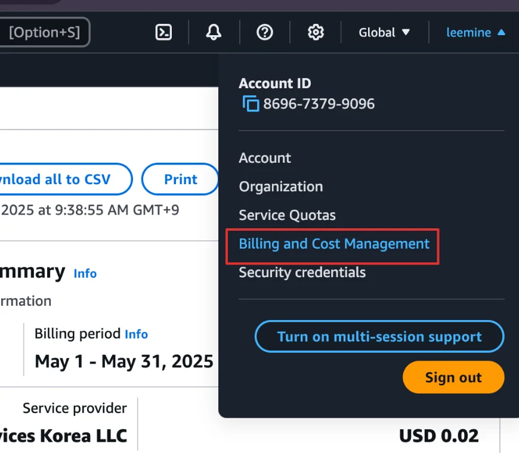
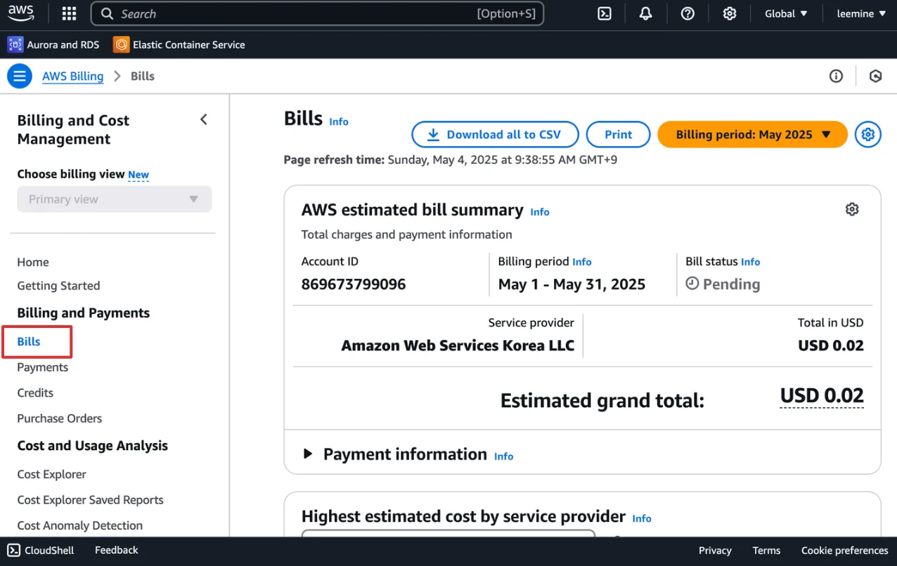
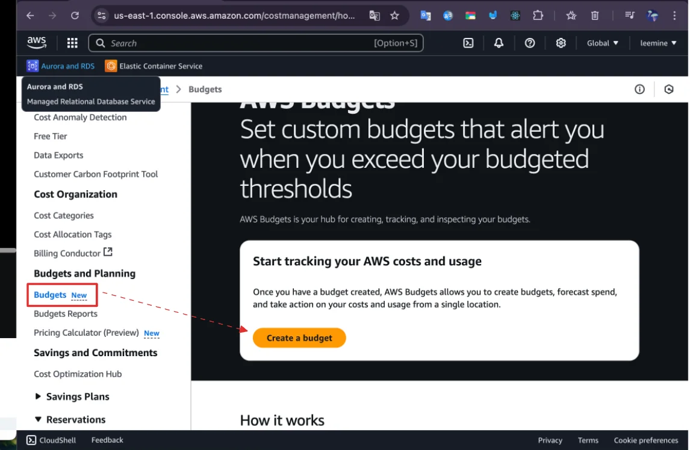
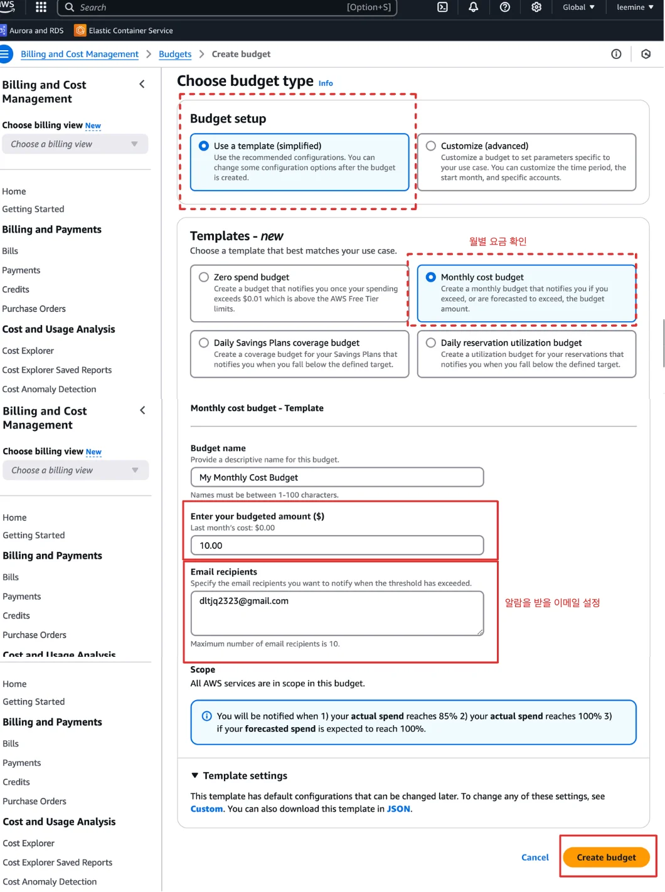
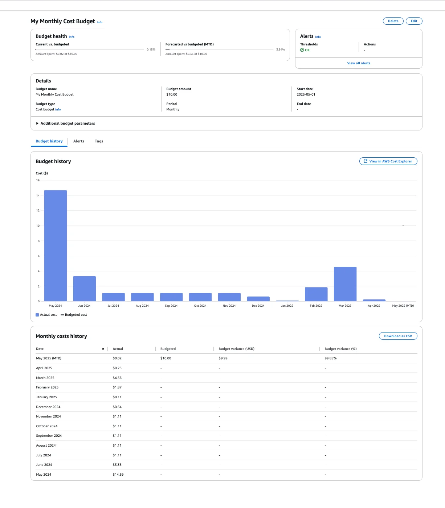

## AWS Budgets

---

> 📖 
> 
> 
> 
> 루트 계정의 경우, 요금 확인 및 특정 금액 초과 시 알림 설정 가능하다&#46;
> 
> - AWS Budgets

요금 확인

> ✏️ 
> 
> 
> 
> 해당 화면에서 서비스 사용과 금액에 대해서 확인할 수 있다&#46;
> 
> - 실제 인프라 구축 시, 다양한 서비스를 이용하기 떄문에 어느 서비스에게 어떤 요금이 발생 되는지 모를 수 있다&#46; 
> 
> - 이때, <code>bills management</code>에 들어와 요금 확인 및 종료까지 관리할 수 있다&#46;
>     - 불필요한 서비스 바로 중지 가능

- 오른쪽 상단 유저명 클릭 &#45; Billing and Cost Management &#45; Bills
    

    

Budgets 설정

> ✏️ 
> 
> 
> 
> 특정 금액 초과 시 알람이 오도록 설정 가능하다&#46;

1&#46; Bugets &#45; Create a budget

2&#46; budget 생성

- 템블릿 기본 사용 &#45; 커스텀도 있으나 우선 패스

- 월별 금액 확인

- 금액 설정 &#45; 해당 금액이 넘어가면 이메일 전송

- 알람을 받을 이메일 설정

3&#46; 생성한 budget 대시보드

- 이전 요금 청구 내역 등 대시보드에서 여러 정보들을 간편하게 확인 가능하다&#46;

