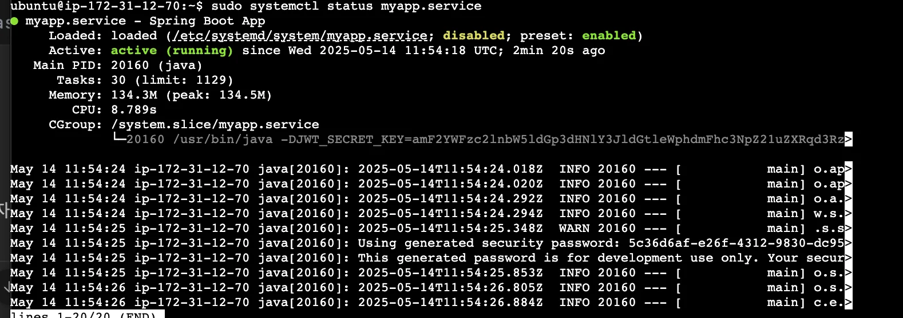

<a id="1f3eda9b0fe18047826cf8f0d7469115"></a>

## <strong>systemd 서비스 유닛 파일</strong>

---

> 📖 
> 
> <a id="1f3eda9b0fe18018811af8f3712d4bb0"></a>
> 
> ```bash
> ┌─────────────────────────────┐
> │       Ubuntu EC2 인스턴스    │
> │ ┌─────────────────────────┐ │
> │ │ assignment.jar          │◄────────────── ExecStart
> │ │ (Spring Boot 서버)       │ │
> │ └────────────┬────────────┘
> │              ▼
> │        systemd가 감시 중       ◄────────── Restart=always
> │   서버가 죽으면 자동 재시작!
> └─────────────────────────────┘
> ```
> 
> <a id="1f3eda9b0fe1804085f2d6191ef097f3"></a>
> 
> <code>systemd</code>는 <strong><u>리눅스에서 서비스의 실행 상태를 관리</u></strong>할 수 있는 툴 이다&#46; 
> 
> - <strong><u>프로그램을 서비스처럼 등록해서 관리</u></strong>할 수 있게 도와주는 설정 파일
> 
> - <strong>별도 설치 필요 없음</strong>
>     - systemd는 <strong>대부분의 현대 리눅스 배포판(Ubuntu, Amazon Linux, CentOS 등)</strong> 에 <strong>기본으로 설치되어 있다&#46;</strong>

1. &#46;env 파일 정의
    <a id="1f3eda9b0fe1806da9ded538c24c63e2"></a>

    ```bash
    vi .env

    # 입력 
    JWT_SECRET_KEY=amF2YWFzc2lnbW5ldGp3dHNlY3JldGtleWphdmFhc3NpZ21uZXRqd3RzZWNyZXRrZXlqYXZhYXNzaWdtbmV0and0c2VjcmV0a2V5amF2YWFzc2lnbW5ldGp3dHNlY3JldGtleWphdmFhc3NpZ21uZXRqd3RzZWNyZXRrZXlqYXZhYXNzaWdtbmV0and0c2VjcmV0a2V5amF2YWFzc2lnbW5ldGp3dHNlY3JldGtleWphdmFhc3NpZ21uZXRqd3RzZWNyZXQ
    JWT_EXPIRATION=3600000
    ```

1. <strong>systemd 서비스 유닛 파일 생성</strong>
    <a id="1f3eda9b0fe1807fb3aae2150cc216e5"></a>

    ```bash
    sudo nano /etc/systemd/system/myapp.service
    ```

1. <strong>서비스 파일 내용 작성</strong>
    <a id="1f3eda9b0fe1800bbf1de23a0cbae3f1"></a>

    ```bash
    [Unit]
    Description=Spring Boot App
    After=network.target

    [Service]
    User=ubuntu
    WorkingDirectory=/home/ubuntu/app
    EnvironmentFile=/home/ubuntu/app/.env
    ExecStart=/bin/sh -c '/usr/bin/java -DJWT_SECRET_KEY=$JWT_SECRET_KEY -DJWT_EXPIRATION=$JWT_EXPIRATION -jar assignment.jar'
    Restart=always
    RestartSec=5
    SuccessExitStatus=143

    [Install]
    WantedBy=multi-user.target
    ```

    <details>
    <summary>자세한 설명</summary>

    <details>
    <summary>1&#46; Unit</summary>

    <a id="1f3eda9b0fe180e2b870d5279bfa11e9"></a>

    ```bash
    [Unit]
    Description=My Spring Boot Application
    After=network.target
    ```

    - <code>Description</code>&#58; 해당 서비스의 설명

    - <code>After=network&#46;target</code> &#58; 네트워크가 준비된 후에 해당 서비스 실행

    </details>

    <details>
    <summary>2&#46; Service</summary>

    <a id="1f3eda9b0fe180d4b124ffe6c52f44f3"></a>

    ```bash
    # nohup java -DJWT_SECRET_KEY=${JWT_SECRET_KEY} -DJWT_EXPIRATION=${JWT_EXPIRATION} -jar "/build/libs/assignment.jar" > "app.log" 2>&1 &
    User=ubuntu
    WorkingDirectory=/home/ubuntu/app/build/libs
    ExecStart=/usr/bin/nohup java -DJWT_SECRET_KEY=${JWT_SECRET_KEY} -DJWT_EXPIRATION=${JWT_EXPIRATION} -jar "/build/libs/assignment.jar" > "app.log" 2>&1 &
    SuccessExitStatus=143
    Restart=always
    RestartSec=5

    ```

    - <code>User=ubuntu</code>&#58; 이 서비스를 실행할 사용자&#46; 보통 EC2에서 사용하는 기본 계정이 ubuntu이므로 맞게 설정&#46;

    - <code>WorkingDirectory</code>&#58; Spring Boot JAR 파일이 있는 디렉토리

    - <code>ExecStart</code>&#58; 실제로 실행할 명령어 (java &#45;jar xxx&#46;jar)

    - <code>SuccessExitStatus=143</code>&#58; 정상 종료로 간주할 exit code (Ctrl&#43;C 시 나오는 종료 코드)

    - <code>Restart=always</code>&#58; 서버가 죽으면 항상 다시 시작함

    - <code>RestartSec=5</code>&#58; 죽고 나서 5초 뒤에 다시 시작

    </details>

    <details>
    <summary>3&#46; Install</summary>

    <a id="1f3eda9b0fe1800984a6decadc8dc4ea"></a>

    ```bash
    [Install]
    WantedBy=multi-user.target
    ```

    - <code>multi&#45;user&#46;target</code>
        - 부팅 시 실행되도록 설정하는 대상(runlevel)

        - 서버 OS가 완전히 부팅된 후 이 서비스를 실행한다&#46;

    </details>

    </details>

1. <strong>서비스 등록 및 시작</strong>
    <a id="1f3eda9b0fe1800bb456dc35094223e4"></a>

    ```bash
    # 서비스 등록 및 시작
    sudo systemctl daemon-reexec
    sudo systemctl daemon-reload
    sudo systemctl enable myapp.service
    sudo systemctl start myapp.service

    # 재시작
    sudo systemctl daemon-reload
    sudo systemctl restart myapp.service
    ```

1. 서비스 상태 확인
    <a id="1f3eda9b0fe18020a040d75b158a7bf7"></a>

    ```bash
    # 서비스 상태 확인
    sudo systemctl status myapp.service

    # 로그 확인
    sudo journalctl -u myapp.service -n 50 --no-pager
    ```

    <details>
    <summary>정상 실행 </summary>

    

    </details>

1. 테스트
    <a id="1f3eda9b0fe180eea32dd0eff35c13b3"></a>

    ```bash
    # 서비스 상태 확인 -> PID 확인
    sudo systemctl status myapp.service # ex)  Main PID: 20160 (java)

    # PID만 출력
    pidof java  # ex) 20160

    # 프로세스(PID) 강제 종료 - Spring 서버 다운
    sudo kill -9 <PID>  # ex) sudo kill -9 20160

    # 서버 재실행 확인
    sudo systemctl status myapp.service
    ```

    <details>
    <summary>PID 확인</summary>

    <a id="1f3eda9b0fe1800eb39bfacd6124b9a0"></a>

    ```bash
     myapp.service - Spring Boot App
         Loaded: loaded (/etc/systemd/system/myapp.service; disabled; preset: enabled)
         Active: active (running) since Wed 2025-05-14 11:54:18 UTC; 6min ago
       Main PID: 20160 (java)
          Tasks: 30 (limit: 1129)
         Memory: 134.5M (peak: 134.8M)
            CPU: 9.174s
         CGroup: /system.slice/myapp.service
                 └─20160 /usr/bin/java -DJWT_SECRET_KEY=amF2YWFzc2lnbW5ldGp3dHNlY3JldGtleWphdmFhc3NpZ21uZXRqd3Rz>

    May 14 11:54:24 ip-172-31-12-70 java[20160]: 2025-05-14T11:54:24.018Z  INFO 20160 --- [           main] o.ap>
    May 14 11:54:24 ip-172-31-12-70 java[20160]: 2025-05-14T11:54:24.020Z  INFO 20160 --- [           main] o.ap>
    May 14 11:54:24 ip-172-31-12-70 java[20160]: 2025-05-14T11:54:24.292Z  INFO 20160 --- [           main] o.a.>
    May 14 11:54:24 ip-172-31-12-70 java[20160]: 2025-05-14T11:54:24.294Z  INFO 20160 --- [           main] w.s.>
    May 14 11:54:25 ip-172-31-12-70 java[20160]: 2025-05-14T11:54:25.348Z  WARN 20160 --- [           main] .s.s>
    May 14 11:54:25 ip-172-31-12-70 java[20160]: Using generated security password: 5c36d6af-e26f-4312-9830-dc95>
    May 14 11:54:25 ip-172-31-12-70 java[20160]: This generated password is for development use only. Your secur>
    May 14 11:54:25 ip-172-31-12-70 java[20160]: 2025-05-14T11:54:25.853Z  INFO 20160 --- [           main] o.s.>
    May 14 11:54:26 ip-172-31-12-70 java[20160]: 2025-05-14T11:54:26.805Z  INFO 20160 --- [           main] o.s.>
    May 14 11:54:26 ip-172-31-12-70 java[20160]: 2025-05-14T11:54:26.884Z  INFO 20160 --- [           main] c.e.>
    ```

    </details>
