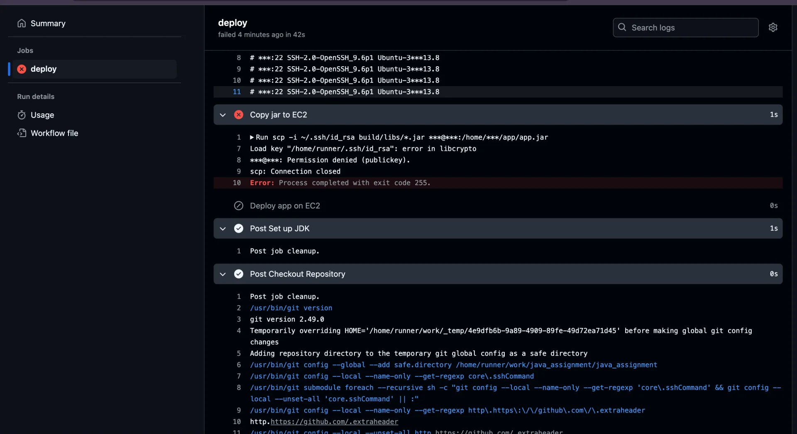
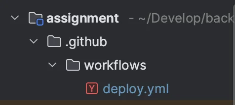

<a id="1f4eda9b0fe180b89a24c2185ce3a6bd"></a>

## Github actions

<details>
<summary>&#46;pem 키 인식오류 </summary>



<a id="1f3eda9b0fe18096b1fef0cb5f9217ee"></a>

&#46;pem 파일을 그냥 복사해서 붙여넣을 경우, GitHub Secrets에 들어가는 내용이 <strong>줄바꿈이 깨지거나 포맷이 손상되어</strong> libcrypto 오류를 유발한다&#46;

<a id="1f4eda9b0fe180699323ce66ee71a964"></a>

```yaml
cat asw_prac.pem | pbcopy
```

<a id="1f3eda9b0fe180cca390dbf9c8744d92"></a>

따라서 위의 cli를 통해 복붙을 해야한다&#46;

</details>

<details>
<summary>1&#46; <code>&#46;gihub/workflows/{&#46;&#46;&#46;}&#46;yml</code> 파일 생성&#35;</summary>



</details>

<a id="1f4eda9b0fe1809cbb1be1c6cc1ca263"></a>

### 2&#46; yaml&#46; 파일 정의

<a id="1f4eda9b0fe18072be6fc52b361b63d1"></a>

```yaml
name: Deploy to EC2

on:
  push:
    branches:
      - main

jobs:
  deploy:
    runs-on: ubuntu-latest
    environment: production

    steps:
      - name: Checkout Repository
        uses: actions/checkout@v3

      - name: Set up JDK
        uses: actions/setup-java@v3
        with:
          distribution: 'temurin'
          java-version: '17'

      - name: Run Tests with Gradle
        run: ./gradlew clean test
        env:
          JWT_SECRET_KEY: ${{ secrets.JWT_SECRET_KEY }}
          JWT_EXPIRATION: 360000

      - name: Build with Gradle
        run: ./gradlew build -x test

      - name: Setup SSH key
        run: |
          mkdir -p ~/.ssh
          echo "${{ secrets.EC2_SSH_KEY }}" > ~/.ssh/id_rsa
          chmod 600 ~/.ssh/id_rsa

      - name: Add EC2 to known_hosts
        run: ssh-keyscan -H ${{ secrets.EC2_HOST }} >> ~/.ssh/known_hosts

      - name: Ensure remote directory exists
        run: |
          ssh -i ~/.ssh/id_rsa ${{ secrets.EC2_USER }}@${{ secrets.EC2_HOST }} \
            "mkdir -p /home/ubuntu/app/build/libs"

      - name: Copy jar to EC2
        run: |
          scp -i ~/.ssh/id_rsa build/libs/*.jar \
            ${{ secrets.EC2_USER }}@${{ secrets.EC2_HOST }}:/home/ubuntu/app/build/libs/assignment.jar

      - name: Deploy app on EC2
        run: |
          ssh -i ~/.ssh/id_rsa ${{ secrets.EC2_USER }}@${{ secrets.EC2_HOST }} << 'EOF'
            APP_PATH="/home/ubuntu/app/build/libs/assignment.jar"
            LOG_PATH="/home/ubuntu/app/app.log"

            echo "[INFO] 기존 실행 중인 프로세스를 종료합니다"
            pkill -f "$APP_PATH" || echo "No matching java process."

            echo "[INFO] 애플리케이션을 실행합니다"
            nohup \
              JWT_SECRET_KEY="${JWT_SECRET_KEY}" \
              JWT_EXPIRATION=360000 \
              java -jar "$APP_PATH" > "$LOG_PATH" 2>&1 &

            echo "[INFO] 배포 완료. 로그 출력:"
            tail -n 10 "$LOG_PATH"
          EOF
        env:
          JWT_SECRET_KEY: ${{ secrets.JWT_SECRET_KEY }}
          JWT_EXPIRATION: 360000

```
