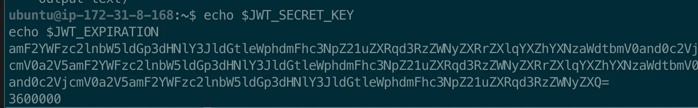

<a id="1f3eda9b0fe1807ab63ee91c7d210e45"></a>

##  EC2 환경변수 설정

---

> 📖 
> 
> - 운영 환경에서  서버 빌드 시에는 보통 테스트는 제외 (&#45;x test)
> 
> - CI/CD에서는 &#46;env, application&#45;prod&#46;yml 파일을 SSM Parameter Store 등에서 관리
> 
> - 테스트는 로컬 및 GitHub Actions에서만 실행하는 전략이 일반적이다&#46;

<a id="1f3eda9b0fe180e5b382c338ab6f9322"></a>

### EC2 내부 설정

<details>
<summary>1&#46; 환경변수 설정</summary>

<a id="1f3eda9b0fe180c6903bda31c70a3627"></a>

```bash
# 환경변수 설정
export JWT_SECRET_KEY=amF2YWFzc2lnbW5ldGp3dHNlY3JldGtleWphdmFhc3NpZ21uZXRqd3RzZWNyZXRrZXlqYXZhYXNzaWdtbmV0and0c2VjcmV0a2V5amF2YWFzc2lnbW5ldGp3dHNlY3JldGtleWphdmFhc3NpZ21uZXRqd3RzZWNyZXRrZXlqYXZhYXNzaWdtbmV0and0c2VjcmV0a2V5amF2YWFzc2lnbW5ldGp3dHNlY3JldGtleWphdmFhc3NpZ21uZXRqd3RzZWNyZXQ=
export JWT_EXPIRATION=3600000

# 확인
echo $JWT_SECRET_KEY
echo $JWT_EXPIRATION
```

- &#46;bashrc 에 명시 &#45; console 다시 실행해도 유지
    <a id="1f3eda9b0fe18061a5b4f36f01fbf4ff"></a>

    ```bash
    echo 'export JWT_SECRET_KEY=amF2YWFzc2lnbW5ldGp3dHNlY3JldGtleWphdmFhc3NpZ21uZXRqd3RzZWNyZXRrZXlqYXZhYXNzaWdtbmV0and0c2VjcmV0a2V5amF2YWFzc2lnbW5ldGp3dHNlY3JldGtleWphdmFhc3NpZ21uZXRqd3RzZWNyZXRrZXlqYXZhYXNzaWdtbmV0and0c2VjcmV0a2V5amF2YWFzc2lnbW5ldGp3dHNlY3JldGtleWphdmFhc3NpZ21uZXRqd3RzZWNyZXQ' >> ~/.bashrc
    echo 'export JWT_EXPIRATION=3600000' >> ~/.bashrc
    source ~/.bashrc
    ```

</details>

<details>
<summary>2&#46; spring boot 실행</summary>

<a id="1f3eda9b0fe18052ba0af191f6532bee"></a>

```bash
./gradlew clean build -x test

cd ~/{프로젝트 폴더}/build/libs

sudo java -jar assignment.jar

java -jar java_assignment/build/libs/assignment.jar

nohup java -jar java_assignment/build/libs/assignment.jar


sudo -E java -DJWT_SECRET_KEY=$JWT_SECRET_KEY -DJWT_EXPIRATION=$JWT_EXPIRATION -jar java_assignment/build/libs/assignment.jar

sudo nohup -E java -DJWT_SECRET_KEY=$JWT_SECRET_KEY -DJWT_EXPIRATION=$JWT_EXPIRATION -jar java_assignment/build/libs/assignment.jar
```

</details>

<a id="1f3eda9b0fe1809db44bd66ad32bd600"></a>

### AWS Systems Manager(SSM) 

> ✏️ 
> 
> <a id="1f3eda9b0fe180c5aaf7cf21a5970a3e"></a>
> 
> WS Systems Manager(SSM)의 기능 중 하나로, <strong><u>환경변수나 설정값을 안전하게 저장</u></strong><u>하고 </u><strong><u>서버 실행 시 꺼내서 사용</u></strong><strong>할 수 있는 저장소이다&#46;</strong>
> 
> - 문자열(Key&#45;Value) 형태로 저장
> 
> - <strong>SecureString</strong> 타입 사용 시 암호화 가능 (KMS 기반)
>     - 민감 정보 (JWT&#95;SECRET, DB 비밀번호 등)에 적합

<details>
<summary>환경변수 등록</summary>

- secketKey
    | <strong>항목</strong> | <strong>예시 값</strong> |
    | --- | --- |
    | <strong>Name</strong> | <code>/myapp/prod/jwt&#46;secretKey</code> |
    | <strong>Description</strong> | JWT 서명 키 |
    | <strong>Type</strong> | SecureString (암호화됨) |
    | <strong>Value</strong> | mySuperSecretKey123&#33; |

- expiration
    | <strong>항목</strong> | <strong>예시 값</strong> |
    | --- | --- |
    | <strong>Name</strong> | <code>/myapp/prod/jwt&#46;expiration</code> |
    | <strong>Description</strong> | jwt 만료시간 |
    | <strong>Type</strong> | String |
    | <strong>Value</strong> | 3600000 ( 1시간, ms ) |

<details>
<summary>SSM에 환경 변수 등록</summary>

<a id="1f3eda9b0fe18009b5dcccf4cb9eff83"></a>

```bash
# aws iam 로그인
aws configure

# secretKey 등록
aws ssm put-parameter \
  --name "/myapp/prod/jwt.secretKey" \
  --value "amF2YWFzc2lnbW5ldGp3dHNlY3JldGtleWphdmFhc3NpZ21uZXRqd3RzZWNyZXRrZXlqYXZhYXNzaWdtbmV0and0c2VjcmV0a2V5amF2YWFzc2lnbW5ldGp3dHNlY3JldGtleWphdmFhc3NpZ21uZXRqd3RzZWNyZXRrZXlqYXZhYXNzaWdtbmV0and0c2VjcmV0a2V5amF2YWFzc2lnbW5ldGp3dHNlY3JldGtleWphdmFhc3NpZ21uZXRqd3RzZWNyZXQ=" \
  --type "SecureString"

# expiration 등록
aws ssm put-parameter \
  --name "/myapp/prod/jwt.expiration" \
  --value "3600000" \
  --type "String"
```

<details>
<summary>base64 인코딩</summary>

<a id="1f3eda9b0fe18049829bf98a12b77844"></a>

‣

</details>

</details>

<details>
<summary><strong>EC2에서 파라미터 꺼내기 (환경변수로 주입)</strong></summary>

<details>
<summary>오류 &#45; <code>Command &#39;aws&#39; not found</code></summary>

- EC2에 aws 를 설치하지 않은 경우 설치가 필요하다&#46; 
    <a id="1f3eda9b0fe1802d9008cb8b0c7790e6"></a>

    ```bash
    sudo apt update
    sudo apt install -y awscli

    # 접근하기 위해 로그인 필요
    aws configure
    ```

</details>

<a id="1f3eda9b0fe180aaaf21eeaf267a5b5a"></a>

```bash
# ssm에서 환경변수 가져오기 
export JWT_SECRET_KEY=$(aws ssm get-parameter \
  --name "/myapp/prod/jwt.secretKey" \
  --with-decryption \
  --query "Parameter.Value" \
  --output text)

export JWT_EXPIRATION=$(aws ssm get-parameter \
  --name "/myapp/prod/jwt.expiration" \
  --query "Parameter.Value" \
  --output text)
  
# 확인
echo $JWT_SECRET_KEY
echo $JWT_EXPIRATION
```



</details>

<details>
<summary><strong>Spring Boot 적용</strong></summary>

1. 빌드 파일 생성 ( 테스트 제외 )
    <a id="1f3eda9b0fe180ef9ff1da359ad18ba3"></a>

    ```bash
     sudo ./gradlew build -x test
    ```

    - 테스트는 CI/CD 단계에서 실행, 운영 서버 X

1. jar 파일 실행
    <a id="1f3eda9b0fe180cb9ed2eb9393e4e498"></a>

    ```bash
    # nohup - 터미널(ssh) 종료 후에도 서버 실행
    nohup java -DJWT_SECRET_KEY=${JWT_SECRET_KEY} -DJWT_EXPIRATION=${JWT_EXPIRATION} -jar "/home/ubuntu/app/build/libs/assignment.jar" > "/home/ubuntu/app/app.log" 2>&1 &
    ```

1. 실행 확인
    <a id="1f3eda9b0fe180b1b03bcd17f0bbcf61"></a>

    ```bash
    ps aux | grep java

    # 실행 중인 Spring Boot ( jar 파일만 )
    ps -ef | grep '[a]ssignment.jar' # jar 파일명: assignment.jar
    	
    ```

1. 오류 로그 확인
    <a id="1f3eda9b0fe1806bbac2e531b192b286"></a>

    ```bash
    tail -n 100 ~/app.log

    cat  ~/app.log
    ```

- 서버 종료 
    <a id="1f3eda9b0fe1808ab19cfe7e29d31292"></a>

    ```bash
    # sudo로 실행 시, sudo 로 삭제해야 한다.
    sudo kill -9 <PID 번호>

    ```

</details>

</details>
