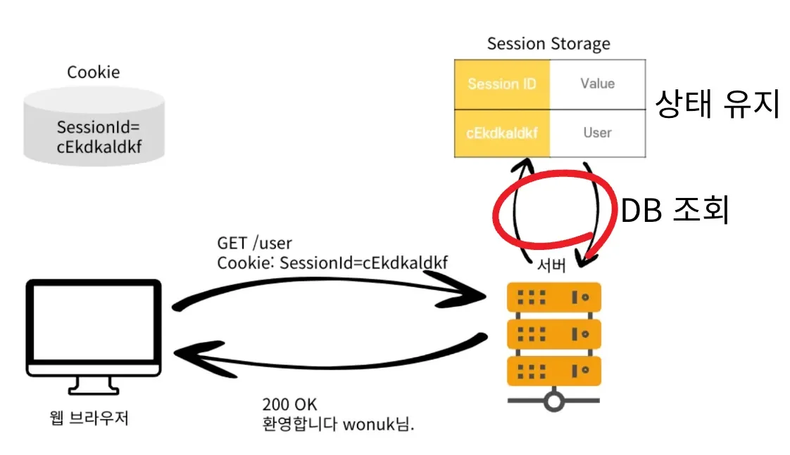
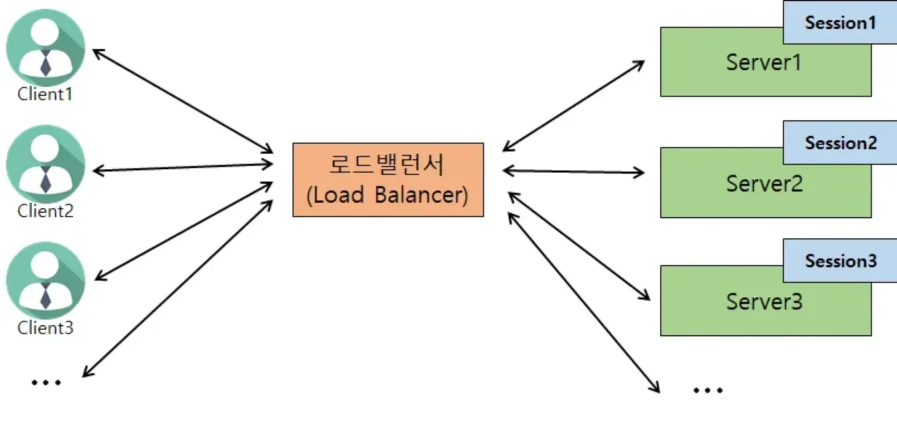

## Session TimeOut

---

> 📖 
> 
> 
> 
> Session은 <u>logout 기능을 사용</u>하여 <code>session&#46;invalidate()</code> 가 되어야 삭제되지만 대부분의 사용자들은 로그아웃을 굳이 하지않고, 브라우저를 종료한다&#46;

Session의 문제점

- HTTP는 Connectionless 특성을 가지고 있어서 서버가 브라우저 종료 여부를 판별하지 못한다&#46;

- 서버에서 Session을 언제 삭제해야 하는지 판단하기 힘들다&#46;

- JSESSIONID의 값을 탈취 당한 경우 해당 값으로 악의적인 요청을 할 수 있다&#46;

- 세션은 서버 메모리에 생성되고 자원은 한정적이기 때문에 꼭 필요한 경우만 생성해야 한다&#46;
    - ex) 로그인 유저 100만 → 서버 다운

Session의 생명주기

- 기본적으로 30분을 기준으로 세션을 삭제

- 실제 로그인 후 30분 이상의 시간동안 사용중인 사용자의 세션 또한 삭제
    - 다시 로그인 해야하는 경우가 발생

HttpSession 사용

- 세션 생성시점 아닌 서버에 최근 Session을 요청한 시간을 기준으로<u> 30분을 유지</u>한다&#46;
    - Session 정보에서 <u><code>LastAccessedTime</code></u><u> 을 기준으로 30분이 지나면 WAS가 내부적으로 세션을 삭제</u>한다&#46;

- <code>HttpSession</code>은 기본적으로 해당 방식으로 세션의 생명주기를 관리한다&#46;

## Session의 한계

---

> 📖 
> 
> 
> 
> Session은 서버의 메모리를 사용하여 <u>확장에 한계</u>가 있다&#46;

- 서버가 DB 혹은 메모리에 저장된 세션 정보를 매번 조회하여 오버헤드가 발생한다&#46;
    

- 서버가 상태를 유지해야 하므로 사용자 수가 많아질수록 부담이 커진다&#46; 

- Cookie는 웹 브라우저에만 존재하며 모바일 앱 등의 다양한 클라이언트에서 인증을 처리할 수 없다&#46; 

- Scale Out ( 수평적 확장 ) 에서 서버간 세션 공유가 어렵다&#46; 
    

    - 무상태(stateless)로 설계하며 <u>상태 정보</u>를 <u>지속성 저장소( 영속성 데이터베이스)에 저장</u>해, <u>필요할 때 조회</u>해서 사용
        > <a href="https://beautiful-college-c84.notion.site/406a58ece4814fa995ee3ad1b5437ad1">페이지</a> &#45; 무상태 웹 계층
