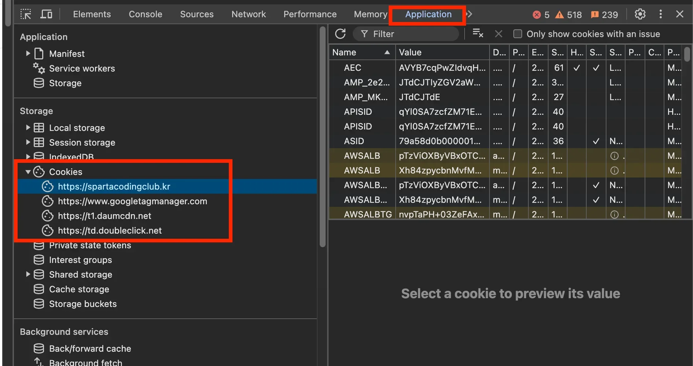
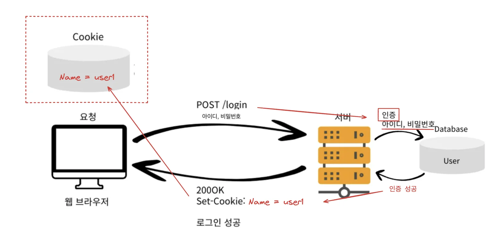
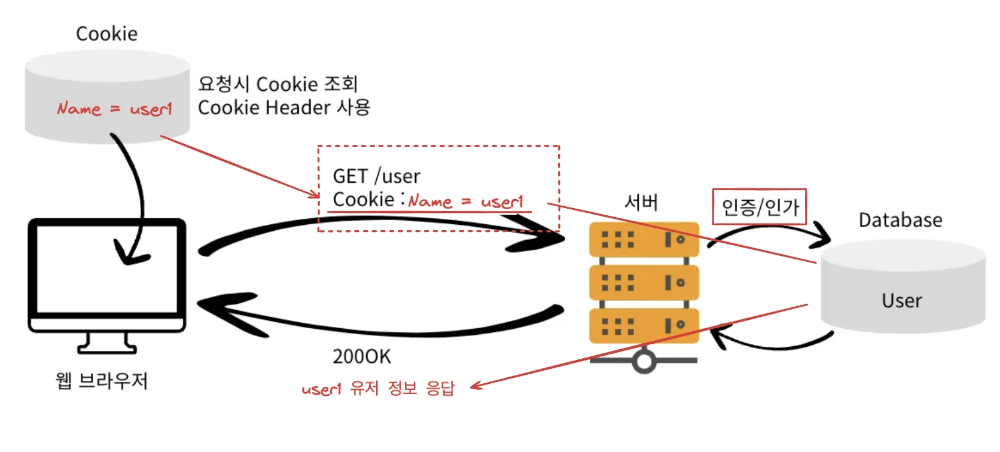

<a id="1f4eda9b0fe18180909de52bd1349912"></a>

## Cookie

---

> 📖 
> 
> <a id="1f4eda9b0fe181c09cbdf08b03e81a99"></a>
> 
> 사용자의 웹 브라이저에 저장되는 정보<br><u>사용자의 상태 </u>or <u>세션</u>을 유지하거나 <u>사용자의 경험을 개선</u>하기 위해 사용된다&#46; 

<details>
<summary>Cookie를 사용하는 이유</summary>

<a id="1f4eda9b0fe1811396dcc49b0d70f0f6"></a>

HTTP로 통신 시, <u>상태 정보를 유지하지 않</u>고 (Stateless), <u>연결을 지속하지 않</u>는다&#46; (Connectionless) 

<a id="1f4eda9b0fe18113919eda9c19af462c"></a>

따라서 <u>동일한 Client에서 요청</u>이 와도<u> 서버는 이전 요청에 대한 정보(상태 정보)를 기억하지 못</u>한다&#46;

<a id="1f4eda9b0fe181168dcffbbaff2b7ce6"></a>

그래서 로그인과 같이<u> 유저의 상태 정보</u>를 기억하고 처리해야 하는 경우, 요청 시에 <u>상태 정보를 포함</u>하여 통신한다&#46; 

<a id="1f4eda9b0fe1810bb8f2e319a73a1362"></a>

이때, 사용자의 상태 정보를 유지를 위해 쿠키를 사용할 수 있다&#46;

- 로그인 후, 사용자의 상태 정보가 쿠키에 저장하여 해당 유저가 요청  시마다 쿠키에서 유저의 상태 정보를 꺼내 요청에 담아 보낸다&#46; ( 보안에 취약함 )

- 브라우저를 완전히 종료한 뒤 다시 열어도 사용자 정보가 유지될 수 있다&#46; 
    - 영구 쿠키 ( 뒤에서 학습 )

</details>

<details>
<summary>쿠키의 주요 특징</summary>

<details>
<summary>클라이언트 측 저장소</summary>

- 사용자의 브라우저에 저장되며 클라이언트 측에서 관리함

</details>

<details>
<summary>작은 크기</summary>

- 최대 약 4KB, 간단한 텍스트 데이터만 저장 가능

</details>

<details>
<summary>짦은 수명</summary>

- 만료 날짜, 시간 설정 가능
    <details>
    <summary>세션 쿠키 ( Session Cookie )  </summary>

    - 특정 시점 이후 자동 삭제

    - 세션이 끝나면 삭제

    </details>

    <details>
    <summary>영구 쿠키  ( Persistent Cookie ) </summary>

    - 만료 기간 설정

    </details>

</details>

<details>
<summary>도메인 및 경로 제한</summary>

-  특정 도메인 및 경로에만 쿠키를 전송하도록 설정 가능
    - 쿠키는 해당 도메인 또는 특정 경로에서만 접근할 수 있음

</details>

<details>
<summary>보안 </summary>

-  Secure 속성을 설정 → HTTPS 연결에서만 전송하도록 제한

- HttpOnly 속성을 설정 →  자바스크립트에서 쿠키에 접근하지 못하도록 막을 수 있음
    - XSS(교차 사이트 스크립팅) 공격을 방지

</details>

</details>

<details>
<summary>Cookie 찾아보기</summary>

> <strong>브라우저 개발자도구(F12) → Application → Cookies</strong>



</details>

<details>
<summary>예시 &#45; 로그인</summary>

> ☝🏻 
> 
> <a id="1f4eda9b0fe1816c92d8d7bff5342dc3"></a>
> 
> Cookie는 보안에 취약함 → 세션, 토튼(JWT) 

- 1&#46; 로그인 성공 시 응답
    

    - 사용자로부터 입력받은 아이디와 비밀번호로 인증에 성공하면, 응답 메세지의 Set&#45;Cookie에 유저 상태 정보를 담아 보내며, 클라이언트에서 저장한다&#46;


- 2&#46; 로그인 이후 요청 
    

    - 유저의 상태 정보가 필요한 요청마다 쿠키를 확인하고, 상태 정보가 존재하면 요청 시 함께 보내 서버에게 유저의 상태 정보를 전달한다&#46; 
        - 요청 헤더 <code>Cookie &#58; 사용자 정보</code>
            - 네트워크 트래픽이 추가적으로 발생

            - 최소한의 정보만 사용

        - Cookie에 담겨있는 값으로 인증/인가 를 진행

</details>

<a id="1f4eda9b0fe1810fbf12c429a67c8687"></a>

## Cookie Header

---

> 📖 
> 
> <a id="1f4eda9b0fe181b4968bed2407842a95"></a>
> 
> 서버에서는 <u>HTTP 응답 헤더에 </u><u><code>Set&#45;Cookie</code></u><u> 속성을 사용</u>해 쿠키 생성 및 설정 가능하다

<details>
<summary>Cookie Header</summary>

- <code>Set&#45;Cookie</code>&#58; 서버 → 클라이언트
    - 응답 헤데에 담아 전달

- <code>Cookie</code>&#58; 클라이언트 → 서버
    - Client가 Cookie를 저장, HTTP 요청 시 요청 헤더에 담아 서버로 전달

</details>

<details>
<summary>Responce 쿠기 </summary>

<a id="1f4eda9b0fe18188b113c1300fc26388"></a>

```java
set-cookie: 
sessionId=abcd; 
expires=Sat, 11-Dec-2024 00:00:00 GMT;
path=/; 
domain=spartacodingclub.kr;
Secure
```

<details>
<summary>쿠키 구성 요소</summary>

<details>
<summary><strong>쿠키의 이름과 값</strong></summary>

- <strong>이름 ( sessionId</strong> ) <strong> &#45;</strong> 쿠키의 이름

- <strong>값 ( </strong>abcd<strong>) &#45;</strong> 쿠키에 저장된 데이터
    - ex) <strong><code>sessionId</code></strong><code>=abcd;</code>

</details>

<details>
<summary><strong>만료 시간 ( expires ) </strong></summary>

- 쿠키 만료(생존) 시간

- ex) <strong><code>expires</code></strong><code>=Sat, 11&#45;Dec&#45;2024 00&#58;00&#58;00 GMT;</code>
    - 2024년 12월 11일 이후에 만료

</details>

<details>
<summary>경로 ( path )</summary>

- 도메인 내, 유효한 경로를 지정

- ex) <code>path=/</code>
    -  도메인의 모든 경로(<code>/</code>)에서 유효함

</details>

<details>
<summary>도메인 ( domain )</summary>

- 쿠키에 유효한 도메인을 정의 
    - 정의한 도메인에서만 접근 가능

    - ex) <code>domain=spartacodingclub&#46;kr</code>
        - 해당 도메인 및 하위 도메인까지 해당 쿠키에 접근 가능하다&#46;
            - ex) <code>subdomain&#46;spartacodingclub&#46;kr</code>

</details>

<details>
<summary>보안 속성 ( Secure ) </summary>

- <code>Secure</code> &#45; <strong>HTTPS</strong> 연결을 통해서만 전송
    - HTTP 연결에서는 이 쿠키가 전송되지 않음

    - 네트워크 상에서 데이터가 암호화되지 않고 전송될 때 발생되는 보안 위험 방지

</details>

</details>

</details>

<details>
<summary>Cookie 생명주기 &#45; <code>expires</code></summary>

<details>
<summary>세션 Cookie &#45; 만료 시간( <code>expires</code> ) 지정 ❌</summary>

- 만료 시간을 설정하지 않은 쿠키로 브라우저의 완전 종료시 까지만 유지된다&#46;  ( <code>Default</code> )
    - <code>expires</code>, <code>max&#45;age</code>  생략

    - 브라우저를 완전 종료 후 다시 페이지를 방문했을 때 다시 로그인을 해야 한다&#46; 

</details>

<details>
<summary>영속 Cookie &#45; 만료 시간(<code>expires</code>, <code>max&#45;age</code>)  지정</summary>

- 만료 시간을 설정한 쿠키, 설정한 만료 시간까지 유지(생존)한다&#46;
    - ex)
        - <code>expires=Sat, 11&#45;Dec&#45;2024 00&#58;00&#58;00 GMT;</code>
            - 해당 만료일이 지나면 쿠키 삭제

        - <code>max&#45;age=3600</code> ( 초단위, 3600초  → 1시간 )
            - 0이 되거나 음수를 지정 → 쿠키 삭제

</details>

</details>

<details>
<summary>Cookie 보안 </summary>

- <code>Secure</code>
    - 해당 속성 적용 시, https인 경우에만 전송

- <code>HttpOnly</code>
    - XSS(Cross&#45;site Scripting) 공격을 방지
        - <u>악성 스크립트를 웹 페이지에 삽입</u>하여 다른 <u>사용자의 브라우저에서 실행</u>되도록 하는 공격

    - <u>자바스크립트에서 Cookie 접근을 못하도록 막</u>는다&#46;

    - HTTP 요청시 사용

- <code>SameSite</code>
    - 비교적 최신 기능이라 브라우저 지원여부를 확인해야 함

    - CSRF(Cross&#45;Site Request Forgery) 공격을 방지
        - 사용자가 의도하지 않은 상태에서 특정 요청을 서버에 전송하게 하여<br> 사용자 계정에서 원치 않는 행동을 하게 한다&#46;

    - <u>요청 도메인과 쿠키에 설정된 도메인이 같은 경</u>우만 쿠키 전송

</details>
