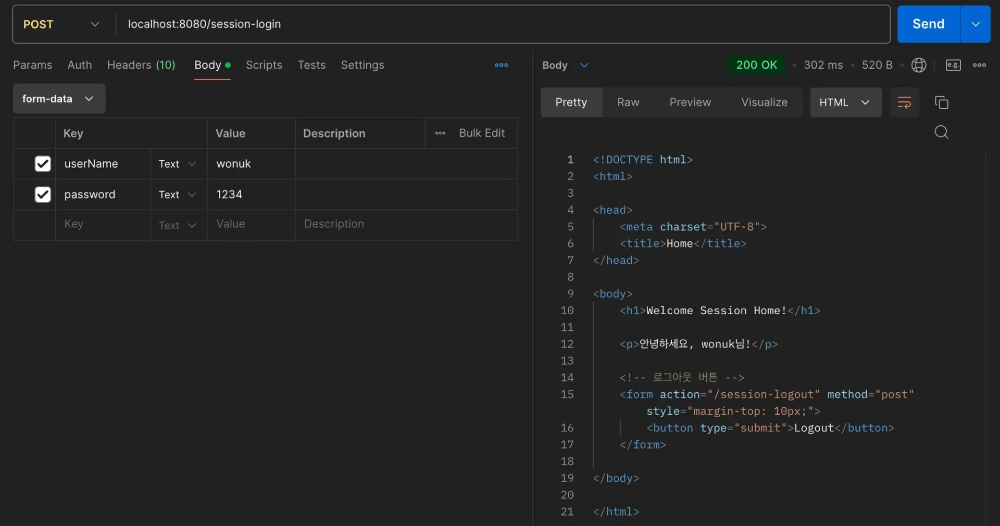
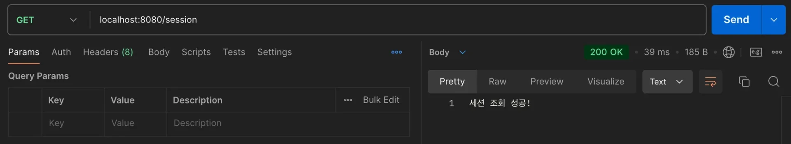
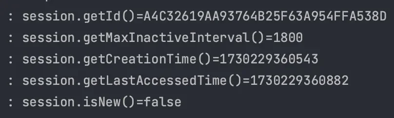

<a id="1f4eda9b0fe181199bf2d7d2a432a655"></a>

## Spring의 Session

---

> 📖 
> 
> <a id="1f4eda9b0fe1811bb37eeac50f52a80b"></a>
> 
> Spring에서는 Session을 쉽게 다루도록 <code>&#64;SessionAttribute</code>라는 어노테이션이 제공한다&#46;

<details>
<summary>&#64;SessionAttribute</summary>

> ☝🏻 
> 
> <a id="1f4eda9b0fe1816a818ddb43aee00a64"></a>
> 
> <code>request&#46;getSession(true)</code> 와는 다르게 <u>세션을 새로 생성하는 기능은 없</u>다&#46;
> 
> <a id="1f4eda9b0fe181e69c62fa982cf3f5b9"></a>
> 
> 따라서 Session이 이미 존재하는 경우( 이미 로그인 성공하여 세션이 생성된 경우 )에 사용한다&#46;  

---

<details>
<summary>&#91; 코드 &#93;</summary>

<a id="1f4eda9b0fe181adaeedfe0af3ceb8b3"></a>

```java
@Controller
@Requiredargsconstructor
public class SessionHomeController {

		private UserService userService;
	
		@GetMapping("/v2/session-home")
    public String homeV2(
            // Session 필수값 X, required = false
			            // why? 세션 값이 존재하는 경우, 즉 로그인을 한 경우와 그렇지 않은 경우로 case를 나눠 처리해야하기 떄문
            @SessionAttribute(name = Const.LOGIN_USER, required = false) UserResponseDto loginUser,
            Model model
    ) {

        // session에 loginUser가 없으면 
        if (loginUser == null) {
            return "session-login";  // Login 페이지로 이동
        }

        // Session이 정상적으로 조회되면 로그인된것으로 간주
        model.addAttribute("loginUser", loginUser);

        // home 화면으로 이동
        return "session-home";
    }
}
```

</details>

</details>

> 💡 
> 
> <a id="1f4eda9b0fe181bbbb60c6065554b144"></a>
> 
> Template Engine을 사용 시, jsessionId를 URL에 자동으로 포함한다&#46; 

<details>
<summary>URL 아닌 Cookie를 통해서만 Session을 유지하고 싶다면?  &#45; 설정 변경</summary>

- application&#46;properties
    <a id="1f4eda9b0fe181d8ba9ad0c23441de24"></a>

    ```java
    erver.servlet.session.tracking-modes=cookie
    ```

- application&#46;yml
    <a id="1f4eda9b0fe181a7bef3ec207dd22dd6"></a>

    ```java
    server: 
    	servlet: 
    		session: 
    			tracking-modes: cookie
    ```

</details>

<a id="1f4eda9b0fe1818085cfdf4b310b62f6"></a>

## Session 정보

---

> 📖 
> 
> <a id="1f4eda9b0fe181e39515dbf1709843a1"></a>
> 
> <code>HttpSession</code>은 Session을 간편하게 사용할 수 있도록 <u>다양한 기능을 지원</u>한다&#46;

<details>
<summary>HttpSession </summary>

> <code>HttpServletReuqest&#46;getSession()</code>

- <code>&#46;getId()</code> 
    - 현재 세션의 고유한 식별자(<code>jsessionId</code>) 조회

- <code>&#46;getMaxInactiveInterval()</code> 
    - 세션의 유효시간

    - second 단위 default는 30분(1800초)이다&#46;

- <code>&#46;getCreationTime()</code> 
    - 세션이 생성된 시각을 long 타입으로 반환

    - ex) Sat Dec 9 15&#58;40&#58;23 KST 2024

- <code>&#46;getLastAccessedTime()</code> 
    - 마지막으로 세션에 접근한 시간을 long 타입으로 반환

    - ex) Sat Dec 9 15&#58;40&#58;23 KST 2024

- <code>isNew()</code> 
    - 세션이 새로 생성된 것인지 여부를 boolean 값으로 반환

---

<details>
<summary>&#91; 코드 &#93;</summary>

<a id="1f4eda9b0fe181f8ac6de5139add39ab"></a>

```java
@Slf4j
@RestController
public class SessionController {

    @GetMapping("/session")
    public String session(HttpServletRequest request) {
        HttpSession session = request.getSession(false);

        if (session == null) {
            return "세션이 없습니다.";
        }

        // session 정보 조회
        log.info("session.getId()={}", session.getId());
        log.info("session.getMaxInactiveInterval()={}", session.getMaxInactiveInterval());
        log.info("session.getCreationTime()={}", session.getCreationTime());
        log.info("session.getLastAccessedTime()={}", session.getLastAccessedTime());
        log.info("session.isNew()={}", session.isNew());

        return "세션 조회 성공!";
    }
    
}

```

</details>

<details>
<summary>포스트맨 테스트</summary>

- 로그인
    

- 로그 출력
    

    

</details>

</details>
