<a id="1f4eda9b0fe18168ad59e3c1dd8ed7f8"></a>

## Session

---

> ☝🏻 
> 
> <a id="1f4eda9b0fe181a5a8a1e42e9d9f59df"></a>
> 
> Cookie를 사용한 방식은 여러가지 보안 문제가 있다&#46; 결국 이러한 보안 문제를 해결하려면 중요한 정보는 모두 서버에 저장 후, 암호화된 예측 불가능한 임의 값(토큰)으로 통신을 해야한다&#46; 

> 📖 
> 
> <a id="1f4eda9b0fe18139b6becdcb665262dd"></a>
> 
> 웹 앱에서 클라이언트와 서버 간의 상태 유지를 위해 사용되는 방법이다&#46; <br><u>서버에서 중요한 정보를 보관</u>하며 이를 대체하는 <u>암호화된 토큰을 클라이언트와 주고 받으면서 상태 정보를 유지</u>한다&#46;  ( 암호화 방식은 Token 파트에서 진행 )
> 
> - Cookie &#45; Client에서 중요 정보 보관
> 
> - Session &#45; Server 측에서 중요 정보 보관

<details>
<summary>세션 생성 순서</summary>

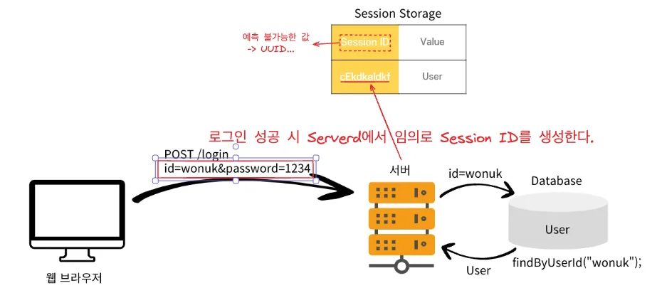

1. 로그인 폼에서 받아온 사용자의 데이터로 유저 인증에 성공 시, 서버에서 임의로 만든 Session ID를 샘성한다&#46; 
    - <code>Sesstion ID</code>는 예측 불가능해야 하기 때문에, <code>UUID</code>와 같은 값을 활용한다&#46; 

1. 생성된 Session ID와 조회한 User 인스턴스를 서버의 Session Storage에 저장한다&#46;
    - 해당 방법으로 서버에 <strong><u>유저와 관련된 중요한 정보를 저장</u></strong>함

</details>

<details>
<summary>세션 동작 순서</summary>

- 1&#46;  로그인
    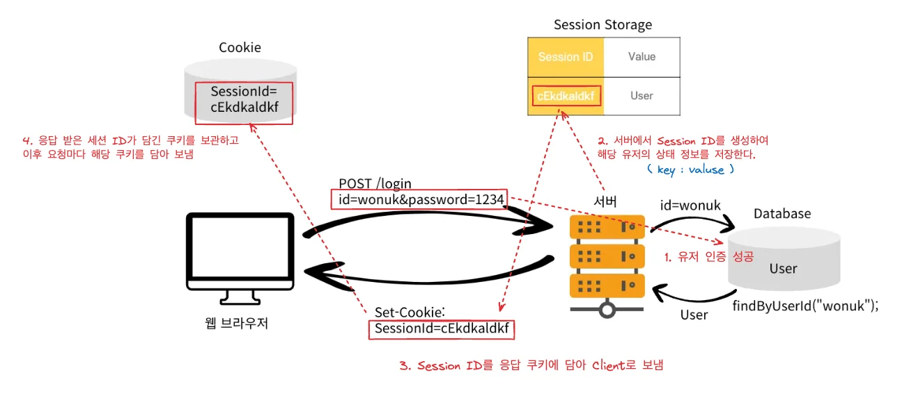

    - 상태 유지를 위해 Cookie를 사용
        - 서버에서 응답에 <code>Set&#45;Cookie&#58; SessionId=임의생성값</code>  담아 전달

        - 클라이언트는 전달 받은 <code>SessionId</code> 를 쿠키 저장소 저장함

- 2&#46; 로그인 이후 요청
    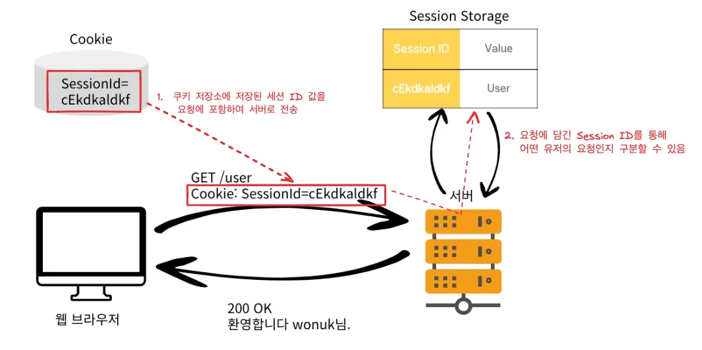

    - 클라이언트는 모든 요청에 <code>Cookie</code> 의 <code>SessionId</code>를 전달

    - 서버에서는 <code>Cookie</code>를 통해  전달된 <code>SessionId</code>로 Session 저장소를 조회

    - 로그인 시 저장하였던 Session 정보를 서버에서 사용하여 요청을 처리함

</details>

<details>
<summary>세선 특징</summary>

1. Session을 사용하여 서버에서 민감한 정보들을 저장한다&#46;
    - 예측이 불가능한 세션 ID를 사용하여 쿠키 값을 변조해도 문제가 없다&#46; 

    - 세션 ID에 중요한 정보를 넣지 않는다&#46; 

    - 시간이 지나면 세션이 만료되도록 설정

    - 해킹이 의심되는 경우 해당 세션을 제거
        - 중간에 탈취 당해서 새로 발급되어 악용에 대한 대처가 가능하지만, 미흡함
            - <code>Access Token,</code> <code>Refresh Token</code>

</details>

<a id="1f4eda9b0fe1818f90f4c371309bd6f6"></a>

## HttpSession

---

> 📖 
> 
> <a id="1f4eda9b0fe1816d9936e8869bab9a10"></a>
> 
> Servlet에서 공식적으로 지원하는 세션인 HttpSession은 구현에 필요한 다양한 기능들을 지원한다&#46; 
> 
> - <code>HttpServletRequest&#46;getSession();</code> 
>     - default&#58; <code>true</code>
> 
> - <code>HttpServletRequest&#46;getSession(false);</code>
> 
> - <code>session&#46;setAttribute(key, value);</code>

<details>
<summary>상수를 클래스로 관리하는 방법</summary>

- <u>추상 클래스</u>나, <u>인터페이스</u>에서 생성 및 초기화한다&#46;
    - <u>상수로 활용할 class</u>는 <u>인스턴스를 생성(new)하지 않</u>는다&#46;

    - <code>abstract</code> 추상클래스 혹은 <code>interface</code> 로 만들어 상수값만 사용하도록 만들어두면 된다&#46;

    <a id="1f4eda9b0fe181439cb8f1d6c6a97cbf"></a>

    ```java
    // 추상클래스 -> O
    public abstract class Const {
    	public static final String LOGIN_USER = "loginUser";
    }

    // 인터페이스 -> O
    public interface Const {
    	String LOGIN_USER = "loginUser";
    }

    // 클래스 -> X
    public class Const { // new Const();
    	public static final String LOGIN_USER = "loginUser";
    }

    // Const.LOGIN_USER; O
    // new Const(); X
    ```

</details>

<details>
<summary>서블릿을 통한 세션 관리</summary>

<a id="1f4eda9b0fe181e98be6d03b1d4aa163"></a>

```java
session.setAttribute("USER_ID", userId);
```

<a id="1f4eda9b0fe181248ff2efa04d06d6db"></a>

<code>setAttribute()</code>로 이미 생성된 세션 객체에 유저의 상태 정보를 저장한다&#46; 

<a id="1f4eda9b0fe181289e89dc715e061083"></a>

여기서 중요한 점은 <u>‘이미 생성된 세션 객체에 데이터를 저장한다’</u>는 점이다&#46; 

<a id="1f4eda9b0fe181608d00c8e46afa68b1"></a>

```java
HttpSession session = HttpServletRequest.getSession() // default: required = true;

session.setAttribute("USER_ID", userId);
```

<a id="1f4eda9b0fe18193ac0cc2e8632376fd"></a>

이미 <code>HttpServletRequest&#46;getSession()</code> 에서 세션 객체가 생성되었다&#46;

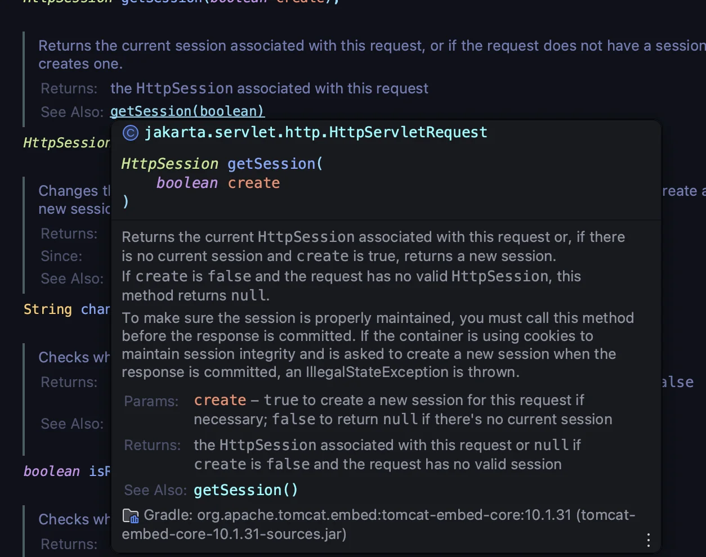

<a id="1f4eda9b0fe18158a7edffee31faebef"></a>

이렇게 동작하는 이유를  HttpServletRequest 스펙에서 찾을 수 있었다&#46;

<a id="1f4eda9b0fe1811e9368fc10f5fc68cf"></a>

서블릿을 통한 세션 관리(생성, 조회)는 <code>HttpServletRequest&#46;getSession</code>(getter)를 통해 세션 조회 후 <u>세션 객체가 없는 경우 새로 생성</u>하고, <u>있는  경우 이미 존재하는세션 객체를 조회해서 가져온</u>다&#46; 

<a id="1f4eda9b0fe1815297b3fc4034d3a030"></a>

<code>HttpServletRequest</code> 요청 처리를 위해 매 요청마다 새로 생성되는 서블릿 객체이고, 세션은 요청마다 조회하여 새로 생성 및 기존의 세션을 가져온다&#46; 

<a id="1f4eda9b0fe1818f88b2c6e4f9fbae91"></a>

즉, 매 요청마다 하나의 세션을 관리(생성, 유지) 한다&#46; 

</details>

<details>
<summary><strong>JSESSIONID</strong></summary>

> ✏️ 
> 
> <a id="1f4eda9b0fe181c992d6ce9d537b1a62"></a>
> 
> <code>JSESSIONID</code> <strong>세션 객체를 식별하기 위해 무작의로 생성되는  고유한 ID 값을 저장하는 쿠키의 key 값이다&#46; </strong>
> 
> <a id="1f4eda9b0fe18129a8b6dfccf8699dd6"></a>
> 
> 자동으로 생성되어 고정되는 값이다&#46; 

- 서블릿에서 세션 객체를 생성하고,  상태 정보를 저장하면 응답 시, 자동으로 를 key로 하고  session의 id 값을 value 가지는 쿠키를  응답에 담아 보낸다&#46; 
    - 응답 &#45;   Set&#45;Cookie&#58; <code>JSESSIONID=abc123</code>

    - 요청 &#45;  Cookie&#58; <code>JSESSIONID=abc123</code>

</details>

<details>
<summary>인증 이후 인가를 위한 세션 생성 및 <code>세션id(쿠키)</code> 전달 과정</summary>


> 인증이 완료 된 후, 인가를 위한 상태 정보를 세션으로 처리 시 동작 과정

1. <code>HttpSetvletRequest&#46;getSession()</code> 시, 세션이 생성된다&#46;
    - 이때, 생성된 세션을 구분하기 위한 session id 값이 임의로 생성되어 key 값을 처리된다&#46;

<a id="1f4eda9b0fe181d3ab43dc7659241571"></a>

2&#46; <code>HttpSetvletRequest&#46;getSession()</code>으로 생성 및 조회한 세션 객체에 <code>&#46;setAttribute()</code>를 통해 값을 담는다&#46; 

- <code>key &#58; value</code>  형태로 값이 저장된다&#46;

1. <code>JSESSIONID</code>의 key 와 value 값에 세션 id를 담는 쿠키를 포함하여 응답을 보낸다&#46;
    - ex) set&#45;cookie&#58; <code>JSESSIONID={ 세션 id }</code>

1. 이후 요청 시, 인가를 위해 쿠키에 응답 받았던 세션 id를 반환한다&#46;
    - ex) cookie&#58; <code>JSESSIONID={ 세션 id }</code>

</details>

<details>
<summary>클라이언트에 <code>세션id(쿠키)</code> 전달 후 인가(<code>세션id(쿠키)</code>)를 포함한 요청</summary>


1. 클라이언트의 쿠기 저장소에 저장된 session id 값을 이후 요청에 담아 서버로 보낸다&#46;

1. 요청으로 받은 session id 값 session storage에서 조회하여 해당하는 세션 객체가 존재하면 인가 처리를하고 그렇지 않다면 인가를 거부한다&#46;

1. 인가 처리가 되면 <code>&#64;SessionAttribute</code>, <code>HttpServletRequest&#46;getSession()&#46;getAttirubute()</code>를 통해 세션 내부의 값에 접근이 가능하다&#46;
    - 정의한 key 값을 통해 value를 반환

1. 세션에 저장된 유저 정보를 확인하여 해당하는 응답 처리를 한다&#46;

</details>

<details>
<summary>예시 </summary>

<a id="200eda9b0fe1807e9facf1457676c86b"></a>

### 코드

<details>
<summary>&#91; 코드 &#93; SessionUserController</summary>

<a id="1f4eda9b0fe181848180eda2c7eb27d7"></a>

```java
@Controller
@RequiredArgsConstructor
public class SessionUserController {

    private final UserService userService;

    @PostMapping("/session-login")
    public String login(
            @Valid @ModelAttribute LoginRequestDto dto,
            HttpServletRequest request
    ) {

        LoginResponseDto responseDto = userService.login(dto.getUserName(), dto.getPassword());
        Long userId = responseDto.getId();

        // 실패시 예외처리
        if (userId == null) {
            return "session-login";
        }

        // 로그인 성공시 로직
        // Session의 Default Value는 true이다.
        // Session이 request에 존재하면 기존의 Session을 반환하고,
        // Session이 request에 없을 경우에 새로 Session을 생성한다.
        HttpSession session = request.getSession();

        // 회원 정보 조회
        UserResponseDto loginUser = userService.findById(userId);

        // Session에 로그인 회원 정보를 저장한다.
        session.setAttribute(Const.LOGIN_USER, loginUser);

        // 로그인 성공시 리다이렉트
        return "redirect:/session-home";
    }

    @PostMapping("/session-logout")
    public String logout(HttpServletRequest request) {
        // 로그인하지 않으면 HttpSession이 null로 반환된다.
        HttpSession session = request.getSession(false);
        // 세션이 존재하면 -> 로그인이 된 경우
        if(session != null) {
            session.invalidate(); // 해당 세션(데이터)을 삭제한다.
        }

        return "redirect:/session-home";
    }
}
```

- <code>request&#46;getSession();</code>
    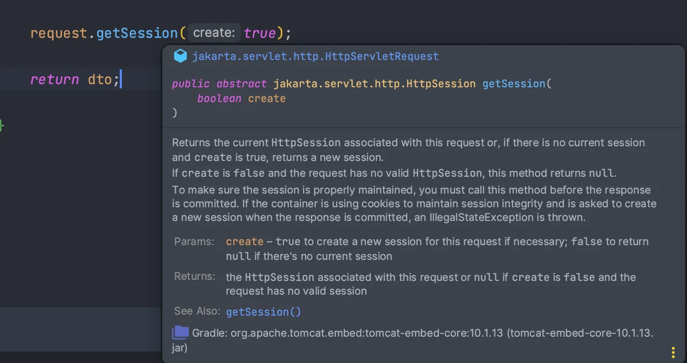

    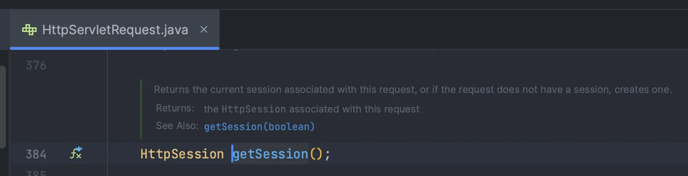

    - <code>request&#46;getSession(true);</code>
        - Default 설정

        - Request 객체 내에 Session이 존재한다면 기존 Session을 반환

        - Request 객체 내에 Session이 없으면 <strong>새로운 Session을 생성해서 반환</strong>

    - <code>request&#46;getSession(false);</code>
        - Request 객체 내에 Session이 존재한다면 기존 Session을 반환

        - Request 객체 내에 Session이 없으면 <strong>null을 반환</strong>

- <code>session&#46;setAttribute(Const&#46;LOGIN&#95;USER, responseDto);</code>
    - Session에 Data를 저장하는 방법으로 <code>request&#46;setAttribute();</code> 와 비슷하다&#46;

    - 하나의 Session에 여러개의 데이터를 메모리에 저장할 수 있다&#46;

</details>

<details>
<summary>&#91; 코드 &#93; SessionHomeController</summary>

> 🧑‍🎓 <strong>요구사항1&#46; </strong>로그인한 회원이면 <code>home</code> 페이지로 이동한다&#46;<br><strong>요구사항2&#46; </strong><code>home</code> 페이지를 보려면 로그인이 필수이다&#46;<br><strong>요구사항3&#46; </strong>로그인하지 않은 회원이면 <code>login</code> 페이지로 이동한다&#46;

<a id="1f4eda9b0fe181a0b8b2e7101b9ed087"></a>

```java
@Controller
@RequiredArgsConstructor
public class SessionHomeController {

    private final UserService userService;

    @GetMapping("/session-home")
    public String home(
            HttpServletRequest request,
            Model model
    ) {

        // default인 true로 설정되면 로그인하지 않은 사람들도 값은 비어있지만 세션이 만들어진다.
        // session을 생성할 의도가 없다.
        HttpSession session = request.getSession(false);

        // session이 없으면 로그인 페이지로 이동
        if(session == null) {
            return "session-login";
        }

        // session에 저장된 유저정보 조회
        // 반환타입이 Object여서 Type Casting이 필요하다.
        UserResponseDto loginUser = (UserResponseDto) session.getAttribute(Const.LOGIN_USER);

        // Session에 유저 정보가 없으면 login 페이지 이동
        if (loginUser == null) {
            return "session-login";
        }

        // Session이 정상적으로 조회되면 로그인된것으로 간주
        model.addAttribute("loginUser", loginUser);
        // home 화면으로 이동
        return "session-home";

    }
}
```

- Session은 Memory를 사용하기 때문에 리소스를 낭비하면 안된다&#46;

</details>

<details>
<summary>&#91; 코드 &#93; session&#45;home&#46;html</summary>

<a id="1f4eda9b0fe18113a3d7f483dece875d"></a>

```html
<!DOCTYPE html>
<html xmlns:th="http://www.thymeleaf.org">
<head>
  <meta charset="UTF-8">
  <title>Home</title>
</head>
<body>
<h1>Welcome Session Home!</h1>

<p th:text="'안녕하세요, ' + ${loginUser.name} + '님!'">Hello, User!</p>

<!-- 로그아웃 버튼 -->
<form th:action="@{/session-logout}" method="post" style="margin-top: 10px;">
  <button type="submit">Logout</button>
</form>

</body>
</html>
```

</details>

<details>
<summary>&#91; 코드 &#93; session&#45;login&#46;html</summary>

<a id="1f4eda9b0fe181d0abcccb90043a2191"></a>

```html
<!DOCTYPE html>
<html xmlns:th="http://www.thymeleaf.org">
<head>
  <meta charset="UTF-8">
  <title>Session Login</title>
</head>
<body>
<h2>Session Login</h2>
<form th:action="@{/session-login}" method="post">
  <div>
    <label for="userName">Username:</label>
    <input type="text" id="userName" name="userName" required>
  </div>
  <div>
    <label for="password">Password:</label>
    <input type="password" id="password" name="password" required>
  </div>
  <button type="submit">Login</button>
</form>

</body>
</html>
```

</details>

<details>
<summary>&#91; 테스트 &#93; 브라우저 form</summary>

- session&#45;home 페이지 접근
    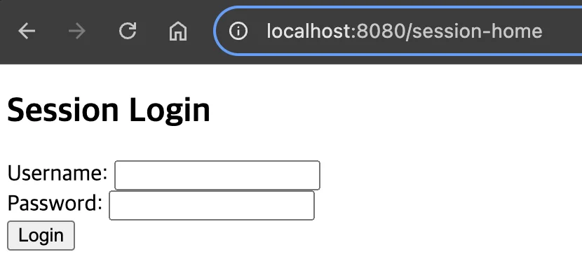

- 로그인 실패
    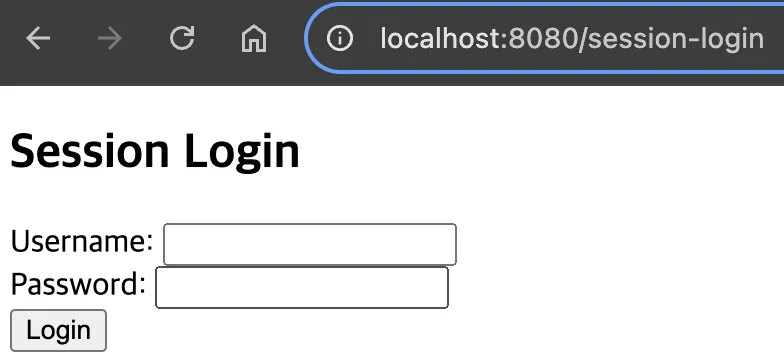

- 최초 로그인
    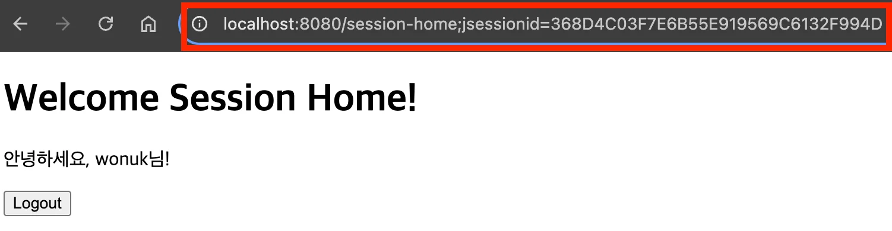

    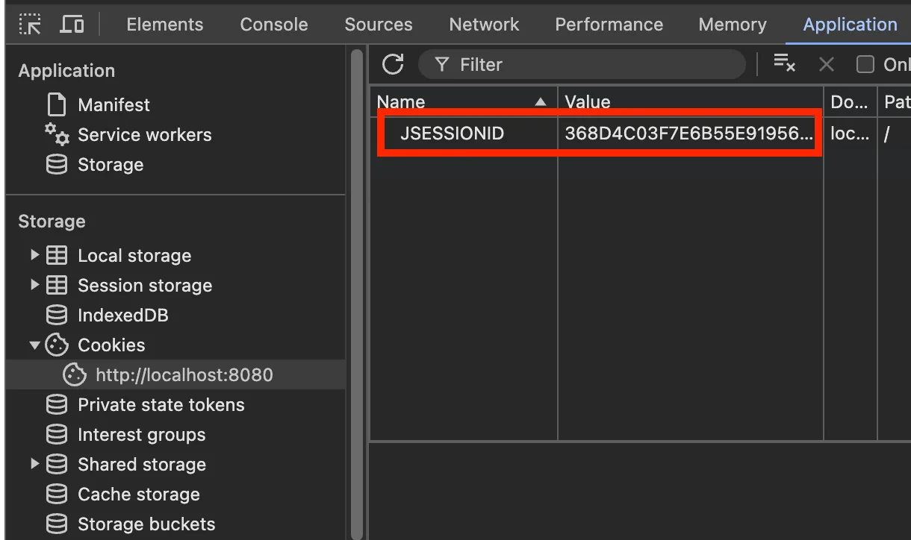

- 이후 로그인 
    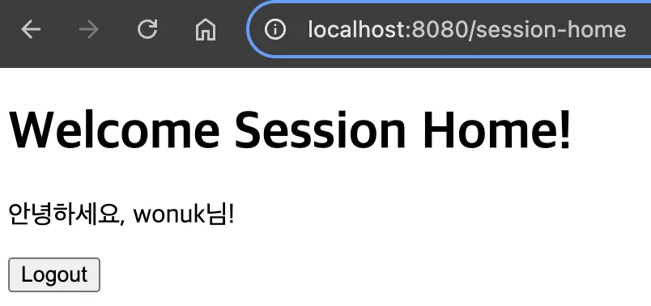

- 로그아웃
    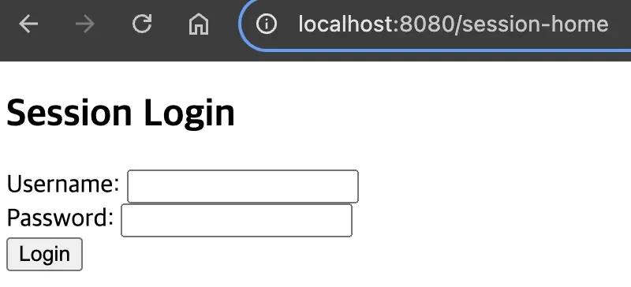

</details>

</details>
