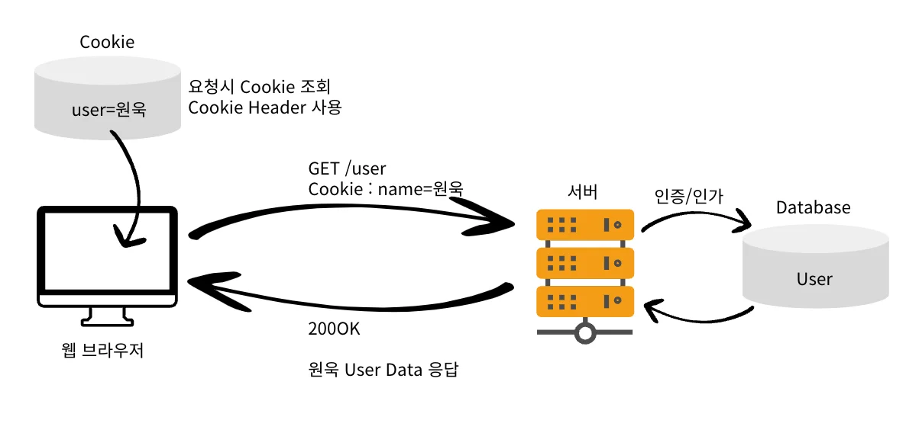
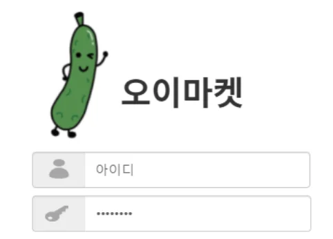
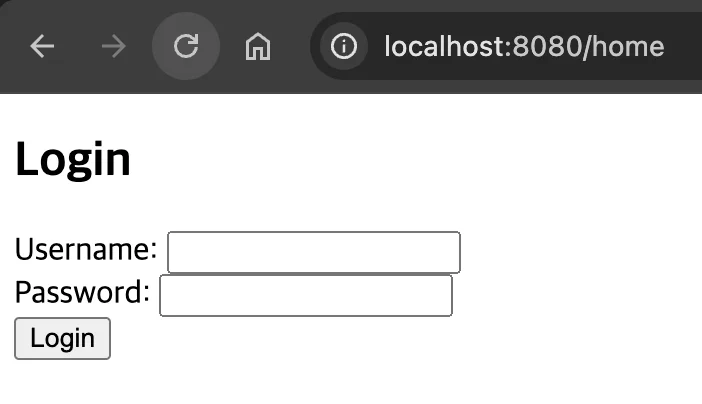
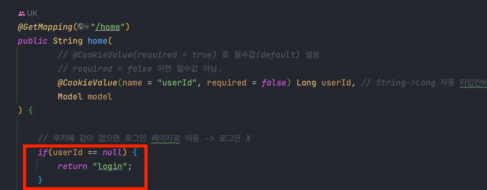
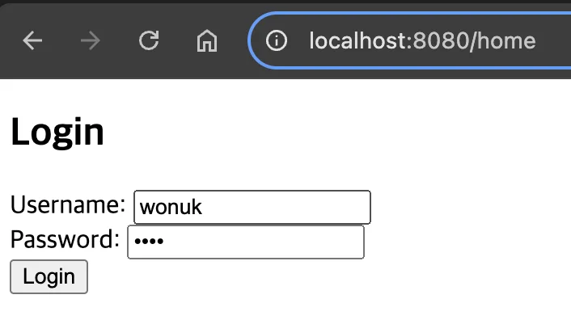
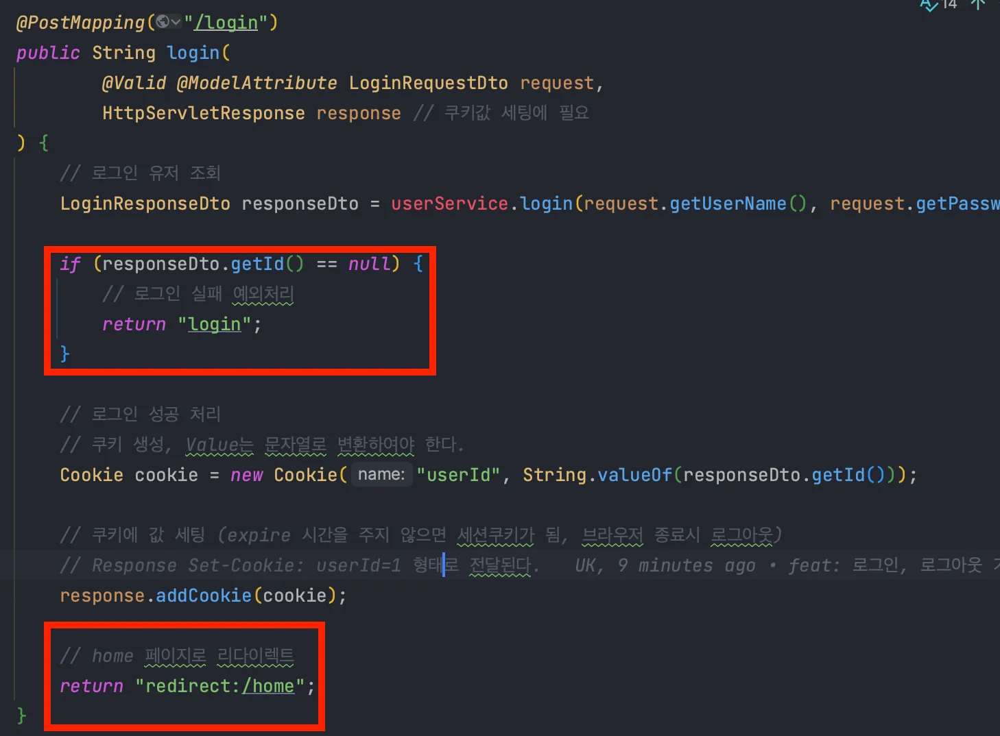
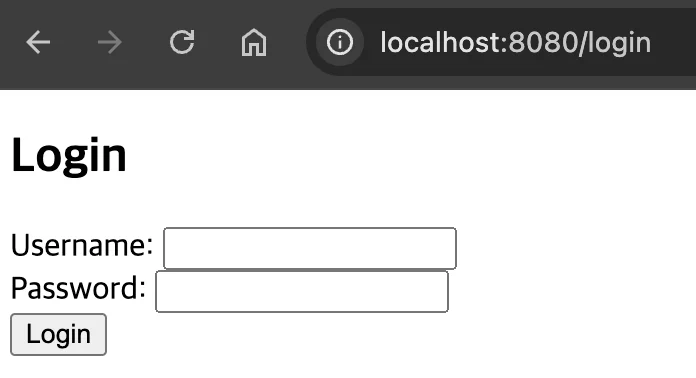
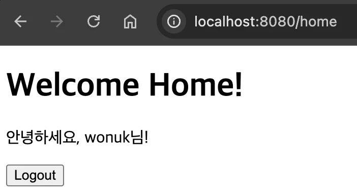
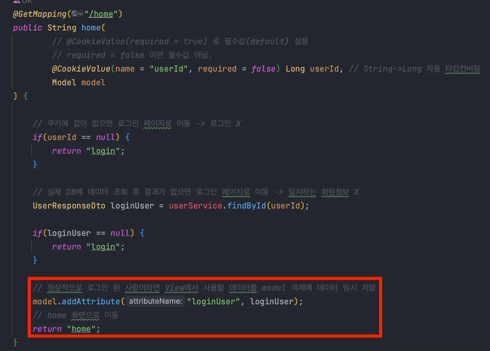
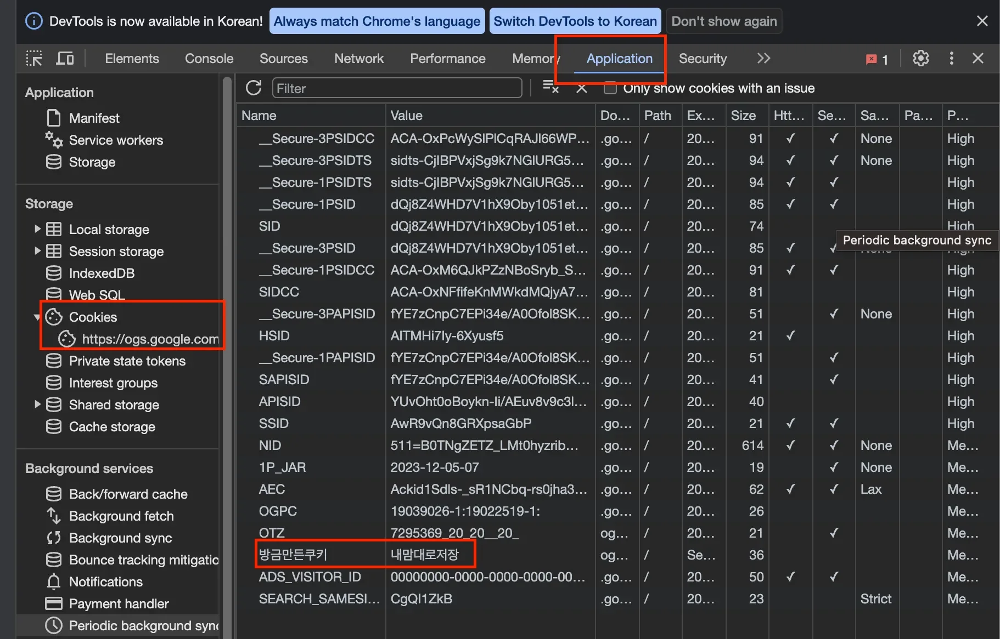

<a id="1f4eda9b0fe1817faf60d99acb8d9a5b"></a>

## Cookie로 로그인 상태 유지하기

---

> 📖 
> 
> <a id="1f4eda9b0fe18170ba65e25e2ae919fe"></a>
> 
> <code>Cookie</code>는 주로 <strong><u>사용자 세션 관리( 로그인, 장바구니, 접속시간 )</u></strong>나 <strong><u>광고 트래킹(사용자 행동)</u></strong> 등의 목적으로 사용된다&#46;  

<details>
<summary><strong>Cookie 사용방법</strong></summary>



- 한번 로그인에 성공하면 HTTP Response에 쿠키를 담아서 브라우저에 전달한다&#46;

- 브라우저는 요청마다 Cookie를 함께 전송한다&#46;

- 보안상의 문제로 <code>userId=1</code>과 같은 index 정보를 저장하여 보낸다&#46; 
    - 이 경우도, 보안 문제가 발생될 수 있다&#46; 

- 요구사항에 맞추어 <strong><u>세션 Cookie를 사용</u></strong>할지 <strong><u>영속 Cookie를 사용</u></strong>할지 결정한다&#46;

</details>

<details>
<summary>실습 </summary>

> 📄 
> 
> - <strong>요구사항1&#46; </strong>로그인한 회원이면 <code>home</code> 페이지로 이동한다&#46;
> 
> - <strong>요구사항2&#46; </strong><code>home</code> 페이지를 보려면 로그인이 필수이다&#46;
> 
> - <strong>요구사항3&#46; </strong>로그인하지 않은 회원이면 <code>login</code> 페이지로 이동한다&#46;
> 
> - <strong>요구사항4&#46; </strong>브라우저 종료 시 로그아웃 된다&#46;(Session Cookie)

<details>
<summary><strong>실습 코드</strong></summary>

> ✏️ 
> 
> <a id="338eda9b0fe180bb8ca4f769571008af"></a>
> 
> 간단한 실습이기에 화면은 <code>ViewTemplate(Thymeleaf)</code> 사용 (SSR)



<details>
<summary>User 클래스</summary>

<a id="338eda9b0fe180ae8b17d6926a192065"></a>

```java
@Getter
public class User {
    // 식별자
    private Long id;
    // 이름
    private String name;
    // 나이
    private Integer age;
    // 로그인 ID
    private String userName;
    // 비밀번호
    private String password;

    public User(Long id, String name, Integer age, String userName, String password) {
        this.id = id;
        this.name = name;
        this.age = age;
        this.userName = userName;
        this.password = password;
    }
}
```

- User 클래스 설계

</details>

<details>
<summary>로그인 요청 DTO</summary>

<a id="338eda9b0fe180c38939e805772fbd4a"></a>

```java
// 필드 전체를 매개변수로 가진 생성자가 있어야 @ModelAttribute가 동작한다.
@Getter
@AllArgsConstructor
public class LoginRequestDto {
	// 사용자가 입력한 아이디
	@NotBlank	
	private final String userName;
	// 사용자가 입력한 비밀번호
	@NotNull
	private final String password;
}
```

- 일반적으로 DTO는 클라이언트의 요청혹은 서버의 응답이기 때문에 변경되면 안된다&#46; 
    - <code>final</code>을 사용하여 불변 객체로 관리한다&#46;

    - Java17 버전에 나온 <code>record</code>를 사용할 수 있다&#46;

</details>

<details>
<summary>로그인 응답 DTO</summary>

<a id="338eda9b0fe180e1bdfdfbd40aaaa1f5"></a>

```java
@Getter
public class LoginResponseDto {
    private final Long id;
    // 이외 응답에 필요한 데이터들을 필드로 구성하면 된다.
    // 필요한 생성자
    public LoginResponseDto(Long id) {
        this.id = id;
    }
}
```

</details>

<details>
<summary>유저 조회 응답 DTO</summary>

<a id="338eda9b0fe180bfb672e3a7f8e2ff76"></a>

```java
@Getter
public class UserResponseDto {
		// 유저 식별자
    private final Long id;
    // 유저 이름
    private final String name;

    public UserResponseDto(Long id, String name) {
        this.id = id;
        this.name = name;
    }
}

```

</details>

<details>
<summary>HomeController</summary>

<a id="338eda9b0fe180f49c9dc69f31d06693"></a>

```java
@Controller
@RequiredArgsConstructor
public class HomeController {

    private final UserService userService;

    @GetMapping("/home")
    public String home(
            // @CookieValue(required = true) 로 필수값(default) 설정
            // required = false 이면 필수값 아님.
            @CookieValue(name = "userId", required = false) Long userId, // String->Long 자동 타입컨버팅
            Model model
    ) {

        // 쿠키에 값이 없으면 로그인 페이지로 이동 -> 로그인 X
        if(userId == null) {
            return "login";
        }

        // 실제 DB에 데이터 조회 후 결과가 없으면 로그인 페이지로 이동 -> 일치하는 회원정보 X
        UserResponseDto loginUser = userService.findById(userId);

        if(loginUser == null) {
            return "login";
        }

        // 정상적으로 로그인 된 사람이라면 View에서 사용할 데이터를 model 객체에 데이터 임시 저장
        model.addAttribute("loginUser", loginUser);
        // home 화면으로 이동
        return "home";
    }
}
```

- View에서는 model 객체에 담겨있는 <code>loginUser</code> 를 활용하여 변수로 사용할 수 있다&#46;

</details>

<details>
<summary>UserController</summary>

<a id="338eda9b0fe18033bb2bd0e13fee16b0"></a>

```java
@Controller
@RequiredArgsConstructor
public class UserController {

    private final UserService userService;

    @PostMapping("/login")
    public String login(
            @Valid @ModelAttribute LoginRequestDto request,
            HttpServletResponse response // 쿠키값 세팅에 필요
    ) {
        // 로그인 유저 조회
        LoginResponseDto responseDto = userService.login(request.getUserName(), request.getPassword());

        if (responseDto.getId() == null) {
            // 로그인 실패 예외처리
            return "login";
        }

        // 로그인 성공 처리
        // 쿠키 생성, Value는 문자열로 변환하여야 한다.
        Cookie cookie = new Cookie("userId", String.valueOf(responseDto.getId()));

        // 쿠키에 값 세팅 (expire 시간을 주지 않으면 세션쿠키가 됨, 브라우저 종료시 로그아웃)
        // Response Set-Cookie: userId=1 형태로 전달된다.
        response.addCookie(cookie);
        
        // home 페이지로 리다이렉트
        return "redirect:/home";
    }

    @PostMapping("/logout")
    public String logout(
            HttpServletResponse response
    ) {
        Cookie cookie = new Cookie("userId", null);
        // 0초로 쿠키를 세팅하여 사라지게 만듬
        cookie.setMaxAge(0);
        response.addCookie(cookie);

        // home 페이지로 리다이렉트
        return "redirect:/home";
    }

}
```

1. 로그인 기능
    - 로그인에 성공하면 <code>Cookie</code>를 생성하고 <code>HttpServletResponse</code> 객체에 담는다&#46;
        - <code>Cookie</code> 이름(Key)은 <code>userId</code> , 값(Value)은 회원 index 값을 담아둔다&#46;

        - <code>Set&#45;Cookie&#58; userId=1</code>

    - 만료 시간을 지정하지 않으면 세션 쿠키로 만들어진다&#46;
        - 브라우저 종료 전까지 <code>userId</code> 가 모든 요청 헤더의 <code>Cookie</code>에 담겨서 전달된다&#46; 

1. 로그아웃 기능
    - 새로운 <code>Cookie</code>를 <code>userId = null</code>로 생성한다&#46;

    - <code>setMaxAge(0)</code> 설정으로 만료시킨다&#46;

    - 응답에 만료된 쿠키를 담아 보낸다&#46;

</details>

<details>
<summary>UserService</summary>

<a id="338eda9b0fe180d2b444feb9e769c6c5"></a>

```java
@Service
@RequiredArgsConstructor
public class UserService {

    private final UserRepository userRepository;
    public LoginResponseDto login(String userName, String password) {
        // 입력받은 userName, password와 일치하는 Database 조회
        Long index = userRepository.findIdByUserNameAndPassword(userName, password);

        return new LoginResponseDto(index);
    }

    public UserResponseDto findById(Long id) {

        return userRepository.findById(id);
    }
}
```

</details>

<details>
<summary>UserRepository</summary>

<a id="338eda9b0fe1801eba2edb0012b53ee8"></a>

```java
@Repository
public class UserRepository {

    private static final User USER1 = new User(1L, "wonuk", 100, "wonuk", "1234");
    private static final User USER2 = new User(2L, "wonuk2", 200, "wonuk2", "2345");
    private static final List<User> USERS = Arrays.asList(USER1, USER2);

    public Long findIdByUserNameAndPassword(String userName, String password) {
        return USERS.stream()
                .filter(user -> user.getUserName().equals(userName) && user.getPassword().equals(password))
                .map(User::getId)
                .findFirst()
                .orElse(null);
    }

    public UserResponseDto findById(Long id) {
        return USERS.stream()
                .filter(user -> Objects.equals(user.getId(), id))
                .map(user -> new UserResponseDto(user.getId(), user.getName()))
                .findFirst()
                .orElse(null);
    }
}
```

- 실제 Database와 연동하지 않고, 상수로 미리 만든 User를 사용한다&#46;

</details>

<details>
<summary>login&#46;html</summary>

<a id="338eda9b0fe180c29957fbaa695d2f49"></a>

```java
<!DOCTYPE html>
<html xmlns:th="http://www.thymeleaf.org">
<head>
    <meta charset="UTF-8">
    <title>Login</title>
</head>
<body>
<h2>Login</h2>
<form th:action="@{/login}" method="post">
    <div>
        <label for="userName">Username:</label>
        <input type="text" id="userName" name="userName" required>
    </div>
    <div>
        <label for="password">Password:</label>
        <input type="password" id="password" name="password" required>
    </div>
    <button type="submit">Login</button>
</form>

</body>
</html>
```

</details>

<details>
<summary>home&#46;html</summary>

<a id="338eda9b0fe1808fa3eada67c733b7dc"></a>

```java
<!DOCTYPE html>
<html xmlns:th="http://www.thymeleaf.org">
<head>
    <meta charset="UTF-8">
    <title>Home</title>
</head>
<body>
<h1>Welcome Home!</h1>

<p th:text="'안녕하세요, ' + ${loginUser.name} + '님!'">Hello, User!</p>

<!-- 로그아웃 버튼 -->
<form th:action="@{/logout}" method="post" style="margin-top: 10px;">
    <button type="submit">Logout</button>
</form>

</body>
</html>
```

</details>

</details>

<details>
<summary><strong>브라우저 테스트</strong></summary>

<details>
<summary>테스트 1 &#45; 로그인한 회원이면 <code>home</code> 페이지로 이동한다&#46;</summary>





- 메인 페이지 접속 &#45; <code>http&#58;//localhost&#58;8080/home</code>

- HomeController 호출

- Cookie에 값이 없는 상태로 <code>login</code> 페이지가 반환된다&#46;

</details>

<details>
<summary>테스트 2 &#45; 로그인 </summary>





<details>
<summary>로그인 실패 &#45;  <code>login</code> 페이지로 이동한다&#46;</summary>



</details>

<details>
<summary>로그인 성공</summary>

- <code>home</code> 페이지로 리다이렉트
    

    - 리 다이렉트되어 <code>GET &#43; /home</code> 호출

- 유저 상태 데이터 쿠키에 저장
    

    - Cookie에 저장된 user 식별자 값으로 DB 조회

    - 조회된 User를 Model에 추가

    - <code>home</code> 페이지에서 Model을 참조하여 화면 출력

</details>

</details>

</details>

</details>

<a id="1f4eda9b0fe181c8bda9efd3ef5dcf7c"></a>

## Cookie 문제점

---

> 📖 
> 
> <a id="338eda9b0fe1809792dbf5273237b35c"></a>
> 
> <strong>Cookie는 보안에 취약</strong>하여 <code>userId=1</code> 형태의 방식으로 <strong><u>로그인을 구현하지 않</u></strong>는다

<details>
<summary>쿠키의 문제점</summary>

<details>
<summary>1&#46; 쿠키 값은 임의 로 변경할 수 있다&#46; </summary>

> 브라우저 개발자도구(F12) → Application → Cookies → 값 수정 가능



- 위와 같이 쿠키를 통해 간단하게 유저를 인증하는 경우 Client에서 임의로 쿠키의 값을 변경하면 서버에서는 다른 유저로 인식한다&#46; 
    - <code>userId = 임의로 수정</code>

- 실제로는 암호화된 Token 값을 사용하며 그에 대한 값들을 확인 가능하다&#46;

</details>

<details>
<summary>2&#46; 쿠키에 저장된 Data는 탈취되기 쉽다&#46; </summary>

- 쿠키는 네트워크 전송 구간에서 탈취될 확률이 매우 높다&#46;
    - HTTPS를 사용하여 전송 데이터 암호화 필수

    - 민간한 정보 저장 X → 암호화 하여 유저 상태 정보 인증

- 한번 탈취된 정보는 변경이 없다면 반영구적으로 사용 가능하다&#46;

- ex) bad case
    - <code>userId = 주민번호</code>, <code>userId = 인덱스 값</code>

</details>

</details>

<details>
<summary>보안 대처방법</summary>

- 쿠키에 <strong><u>중요한 값을 저장하지 않</u></strong>음

- 사용자 별로 일반 유저나  해커들이 <strong><u>알아볼 수 없는 값을 노출</u></strong>한다&#46;
    - 암호화된 <code>Token</code>을 쿠키 저장

    - 서버에서 암호화된 <code>Token</code>을  사용자와 매핑하여 인식

    - 암호화된 Token은 서버에서 관리

- 토큰은 해커가 <strong><u>임의의 값을 넣어도 동작하지 않</u></strong>도록 만들어야 한다&#46;
    - validation 처리 필수

    - 보안상 이슈가 발생되지 않은 적절한 암호화 알고리즘 사용 필요

    - 암호화 알고리즘&#58; <code>HMAC&#45;SHA256</code>, <code>HMAC&#45;SHA512</code>, <code>RS256</code> … 

- 해커가 토큰을 탈취해도 사용할 수 없도록 <strong><u>토큰 만료시간을 짧게 설정</u></strong>한다&#46;
    - 유저에 대한 상태 정보를 저장하는 시간이 짧아 사용자에게 지속인 로그인 요청을 하게 된다&#46; → 유저 사용성이 떨어짐
        - <code>Access Token</code>,<code> Refresh Token</code> 통해 해결

- <strong><u>탈취가 의심</u></strong>되는 경우 <strong><u>해당 토큰을 강제로 만료</u></strong>시킨다&#46;
    - 접속기기 or IP가 다른 경우 등

</details>
