<details>
<summary>AWS EC2 인스턴스 생성</summary>

> ✏️ 
> 
> - OS&#58; Ubuntu
> 
> - 인스턴스 유형&#58; t2&#46;mirco
> 
> - 인바운드 규칙&#58; ssh(22), http(80), https(443)

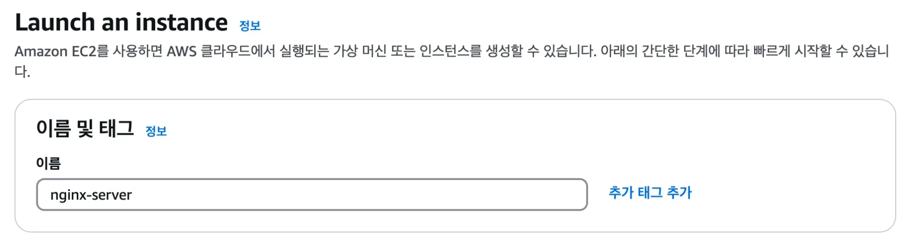

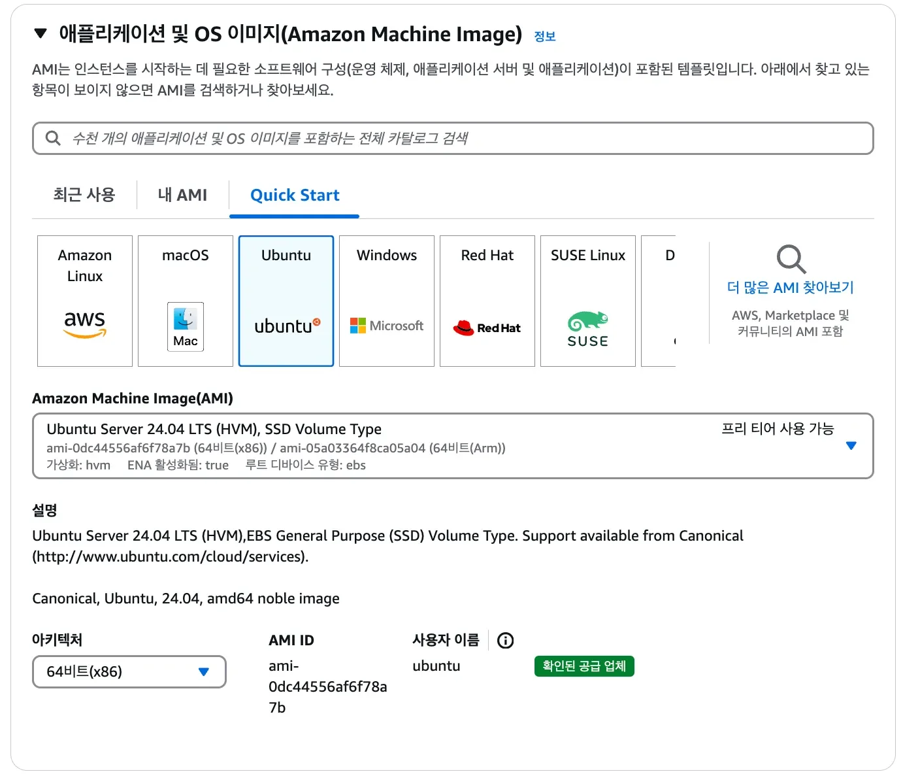

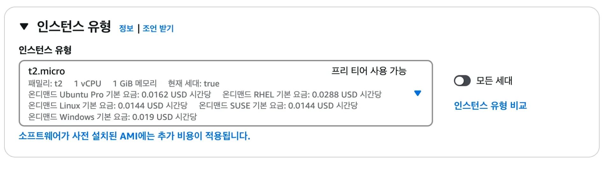


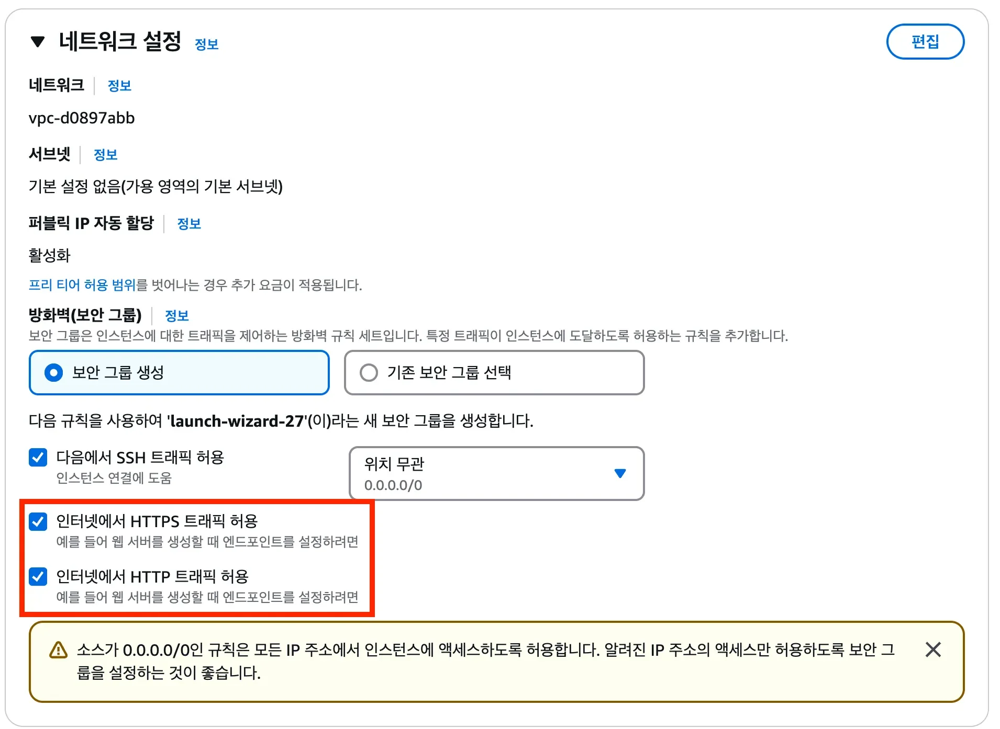

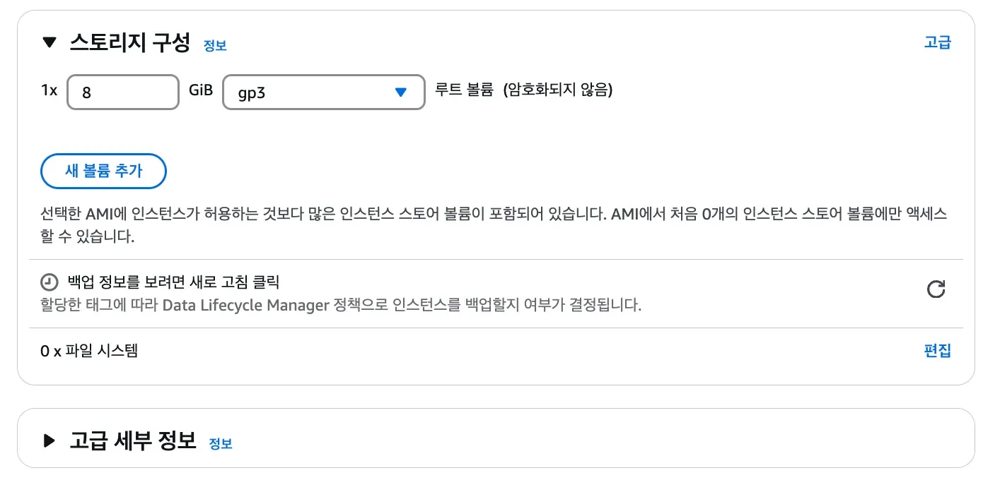

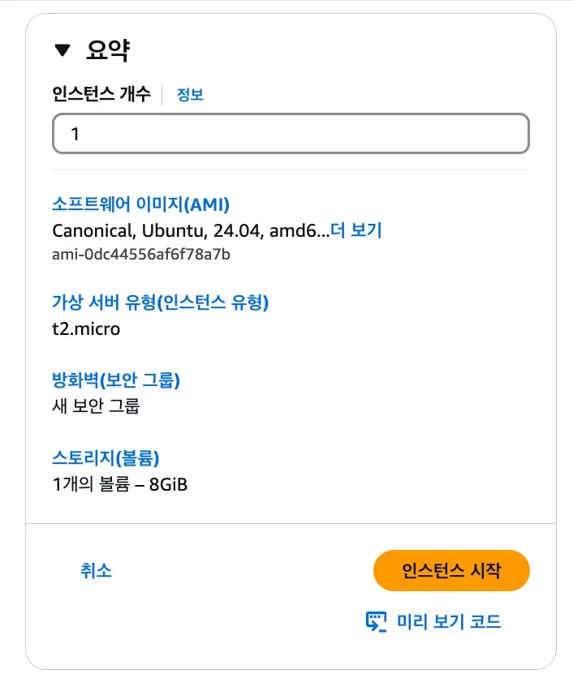

</details>

<details>
<summary>리눅스 명령어 </summary>

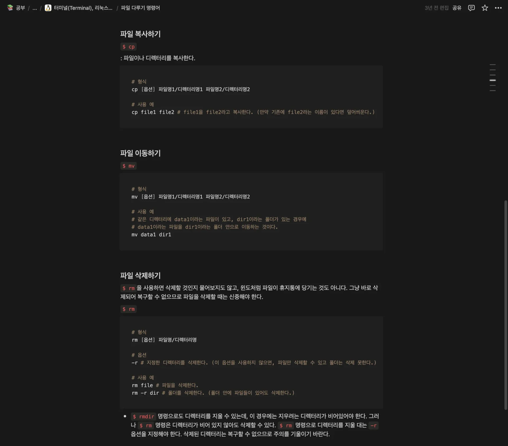

- 정리 예시 

</details>

<a id="203eda9b0fe18064bc0bdc8a973249e3"></a>

### Nginx EC2 설치 

> 🔗 
> 
> <a id="205eda9b0fe1800889feca44a6a57ba6"></a>
> 
> <a href="https://beautiful-college-c84.notion.site/16011062ff0780c1ae97c2117f97e266">페이지</a> 
> 
> <a id="205eda9b0fe180569817cdd306d3c2b5"></a>
> 
> ‣

<details>
<summary>1&#46; Ubuntu 환경 &#45; Nginx 설치</summary>

<a id="203eda9b0fe180d9950ecd5e8f192515"></a>

```yaml
# apt에서 설치 가능한 패키지 리스트(최신 패키지, 버전 등)를 최신화시킨다.
# apt는 리눅스에서 사용되는 소프트웨어 패키지를 설치 및 관리할 수 있게 도와주는 툴이다.
# npm 또는 gradle과 같은 패키지 관리 도구와 비슷하다고 생각하면 된다. 
$ sudo apt update

# nginx 설치에 필요한 라이브러리 설치
$ sudo apt install curl gnupg2 ca-certificates lsb-release ubuntu-keyring

# nginx 공식 패키지를 안전하게 설치하기 위한 보안 조치이다. 자세한 코드 의미는 몰라도 된다. 
# 다만, curl, gpg, tee, |, >, /dev/null, echo가 무슨 기능을 하는 명령어인지는 정리해두자. 
$ curl https://nginx.org/keys/nginx_signing.key | gpg --dearmor \
    | sudo tee /usr/share/keyrings/nginx-archive-keyring.gpg >/dev/null
$ gpg --dry-run --quiet --no-keyring --import --import-options import-show /usr/share/keyrings/nginx-archive-keyring.gpg
$ echo "deb [signed-by=/usr/share/keyrings/nginx-archive-keyring.gpg] \
http://nginx.org/packages/ubuntu `lsb_release -cs` nginx" \
    | sudo tee /etc/apt/sources.list.d/nginx.list

# nginx 설치
$ sudo apt update
$ sudo apt install nginx
```

</details>

<details>
<summary>2&#46; Nginx 실행</summary>

<a id="203eda9b0fe180ed899ded0d41adb134"></a>

```yaml
# nginx 상태 확인
$ sudo systemctl status nginx

# nginx 시작
$ sudo systemctl start nginx

# nginx 상태 확인
$ sudo systemctl status nginx
```

- 확인) <code>http&#58;//{EC2 IP 주소}</code>로 접속
    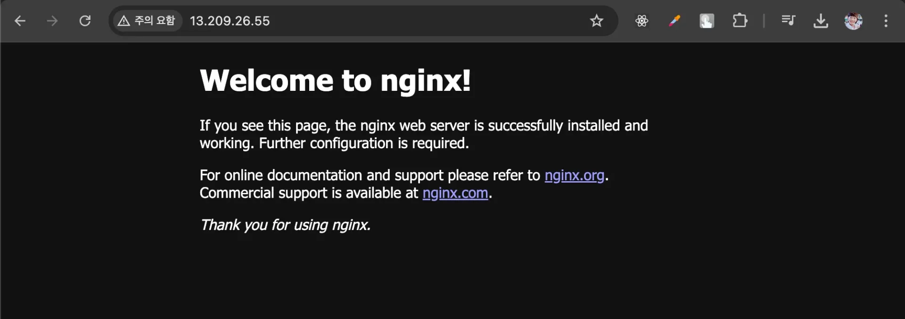

</details>

<a id="205eda9b0fe18080b718d73c7402256f"></a>

### 로그 확인

> 📖 
> 
> <a id="205eda9b0fe180b5ad50eead6e15b7ca"></a>
> 
> 로그란 <strong><u>시스템이나 애플리케이션이 수행한 작업을 시간 순서대로 기록한 데이터</u></strong>이다&#46;
> 
> <details>
> <summary>ex) 스프링</summary>
> 
> 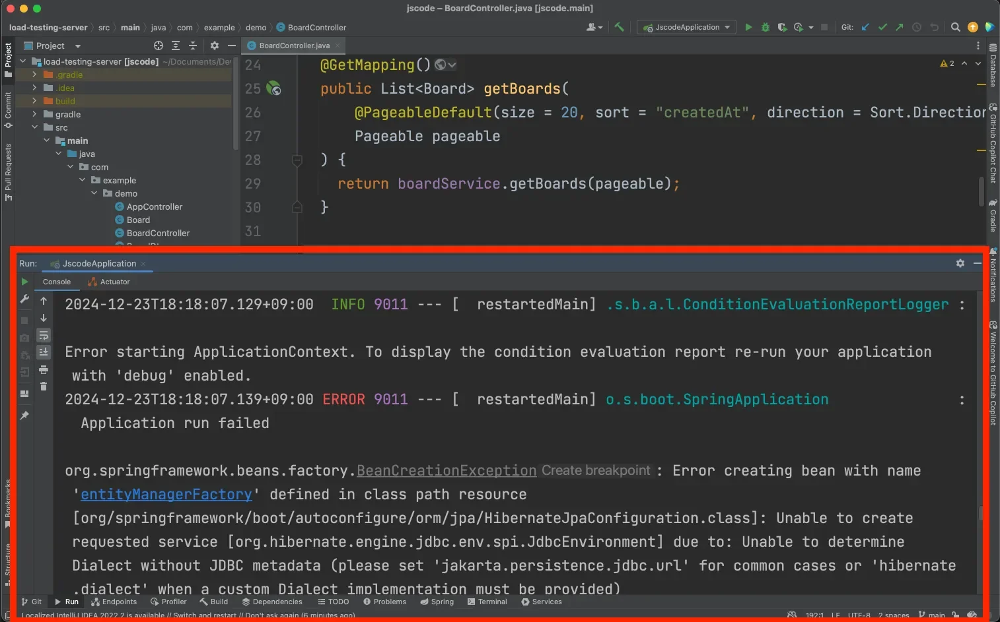
> 
> <a id="205eda9b0fe18002b59cf2906cf56ff4"></a>
> 
> 스프링에서 개발 시 콘솔창을 보면서 에러 메시지가 뜨는 지, 잘 작동하는 지 확인하면서 작업한다&#46; 
> 
> <a id="205eda9b0fe180d187fde718328e3d64"></a>
> 
> 이때, 이러한 콘솔창에 기록되는 데이터들이 로그이다&#46;
> 
> </details>
> 
> <a id="205eda9b0fe180348111f9a30f022e96"></a>
> 
> 리눅스에서  IDLE의 콘솔창 역할을 하는 것이 바로  <strong><u>로그파일</u></strong>이다&#46;
> 
> <a id="205eda9b0fe18002b9ebcc9d20ee27e9"></a>
> 
> 로그 파일을 통해 <strong>Nginx가 </strong><strong><u>잘 실행됐</u></strong><strong>는지, </strong><u>에러가 발생된건 아닌지</u><strong> </strong><strong>확인</strong><strong>할 수 있</strong>다&#46; 
> 
> <a id="205eda9b0fe18076a75cec6d38b08063"></a>
> 
> 따라서 <em><strong>어</strong></em><strong><u>떤 프로그램을 사용하든 로그를 확인 방법은 시스템을 운영하는데 있어 매우 중요</u></strong><em><strong> </strong></em>하다&#46;

<details>
<summary>Nginx 로그 확인</summary>

> ✏️ 
> 
> <a id="205eda9b0fe18004b057c66cceb23948"></a>
> 
> Nginx의 로그 파일 위치는 <code>/var/log/nginx</code>이다&#46;
> 
> <details>
> <summary>해당 경로로 이동 시, <code>access&#46;log</code>, <code>error&#46;log</code> 파일을 확인 가능하다&#46;</summary>
> 
> 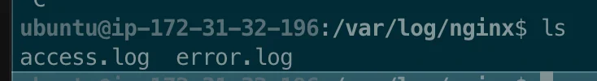
> 
> - <code>access&#46;log</code> 파일&#58; Nginx 서버로 접근한 요청에 대한 정보
> 
> - <code>error&#46;log</code> 파일&#58; 에러 메시지에 대한 내용
> 
> </details>

<a id="205eda9b0fe1806f874dcb35efd8875e"></a>

```bash
# Nginx 로그 파일이 위치한 곳으로 이동
$ cd /var/log/nginx

# 파일의 마지막 10줄을 출력
$ tail access.log
$ tail error.log

# 실시간 access.log 확인 
$ tail -f access.log # 파일의 마지막 10줄을 출력 + 실시간으로 파일에 추가되는 내용을 출력
```

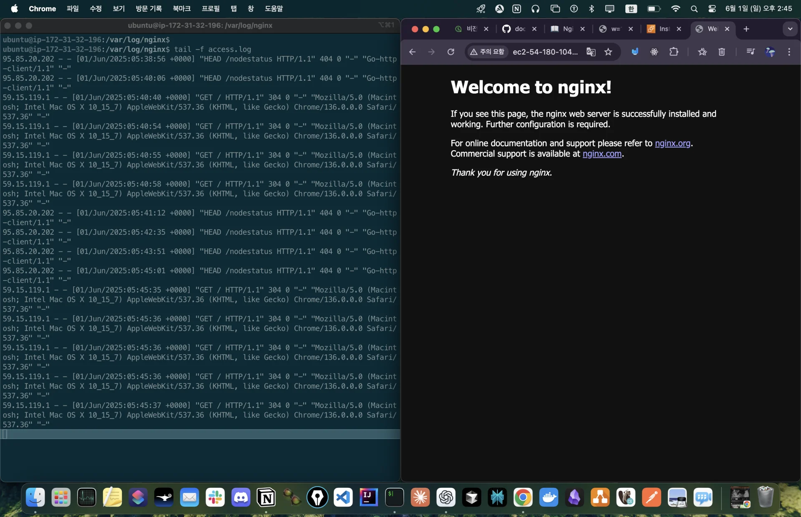

</details>
